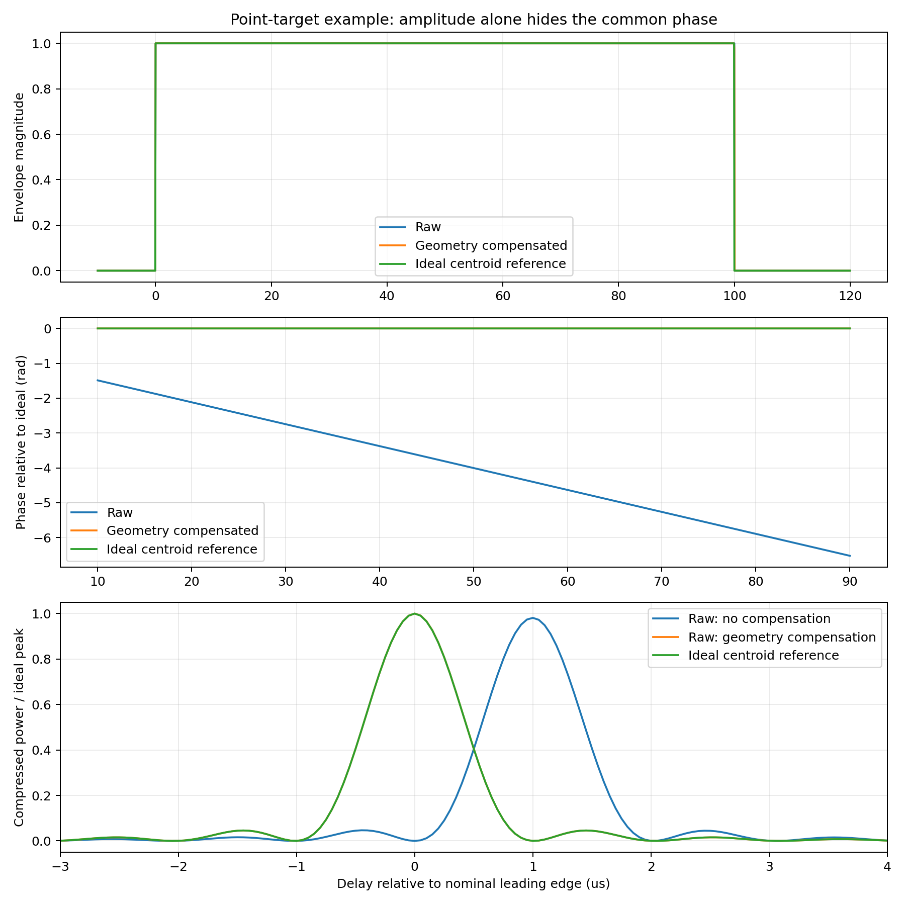
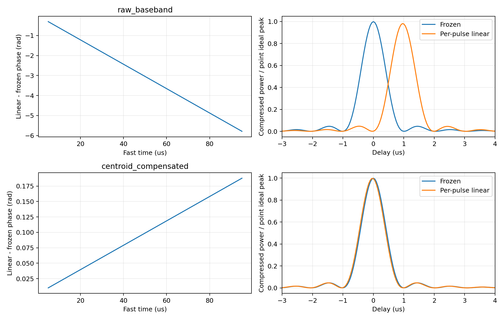
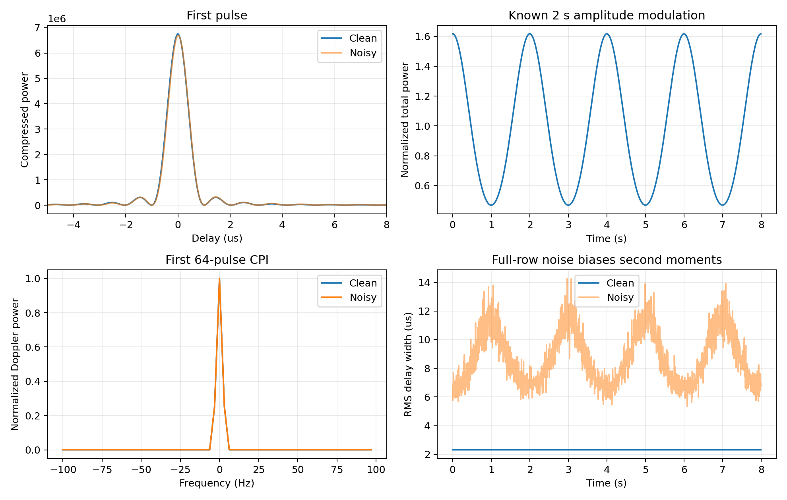

# 从一个 Chirp 回波到周期反演：4.3 逐步讲解

2026-10-10 最终更新：当前距离宽度特征为中央 90% 能量宽度，局部主峰 3 dB 宽度已删除；§9—10 的 RMS 距离公式、数值及图示保留为旧定义的教学对照，不能当作当前宽度输出。教学脚本已使用能量宽度字段，可用 `--output tmp/energy_walkthrough` 生成新结果而不覆盖旧图。生产能量宽度使用完整脉压输出；教学脚本直接对传入的脉压行计算。当前变更见 [删除峰值宽度说明](https://github.com/lewgeon/radar-asteroid-rotation-period-pipeline/blob/chirp-pulse/docs/4.3/vs_4.2/changes/NATIVE_RANGE_FEATURES.md)。

本文对应 4.3 当前代码，先解释信号、参考系、脉内运动、补偿、ADC 行坐标与特征，再连接到周期搜索。已有 [INVERSION_ALGORITHM.md](INVERSION_ALGORITHM.md) 可作为算法索引；本文重新组织其内容，并修正前沿基准、公共路径率、噪声命名和采样混叠等容易误解的地方。本文新增教学仿真，不修改生产算法，也不覆盖已有回波产物。

## 0. 符号以论文为准

本文物理量与处理数组的符号以论文项目的 [符号表](D:/Documents/graduate-thesis/misc/0_symbols.tex)、[第二章回波模型](D:/Documents/graduate-thesis/chapters/chapter2.tex) 和 [第三章信号处理](D:/Documents/graduate-thesis/chapters/chapter3.tex) 为准。上一版讲解自行选取了部分教学符号，未先对照论文，因而产生重名；本版按下表统一。代码字段名属于程序接口，保留原名，在正文给出映射。

| 含义 | 上一版讲解 | 论文一致写法 |
|---|---|---|
| 质心公共路径、路径率 | $\rho_k,v_k$ | $R_{0,m},\dot R_{0,m}$ |
| 脉宽、LFM 带宽、调频率 | $T,B,\mu$ | $T_p,B_{\mathrm{LFM}},K$ |
| 脉冲、延迟单元、频率格点、CPI 帧 | 混用 $k,n,l$ | $m,l,k,\nu$ |
| 对齐后的复距离像 | $\chi_{k,n}$ | $p[m,l]$ |
| 距离--多普勒复谱与功率 | $S_{n,l},P_{n,l}$ | $S_{\mathrm{RD}}[\nu,l,k],D_{\mathrm{RD}}[\nu,l,k]$ |
| 特征总功率 | $E$ | $Q$ |

论文中的 $\rho$ 是散射振幅密度，$\alpha,\delta$ 是自转轴赤经、赤纬，$\mu_{\mathrm{tx}},\mu_{\mathrm{rx}}$ 是方向余弦，本文不再把它们用于路径、时间伸缩或调频率。论文的 $d_m(\boldsymbol\xi^{(B)})$ 是回波在接收窗内的快时间位置，单位为秒；本文面元差分路径另记为 $\Delta R_{i,m}$，单位为米，不能把二者当作同一个量。

为解释实际 ADC 网格，本文补充 $o_m$（行起点相对质心接收事件的偏移）、$\varepsilon_m$（接收事件的亚样点余数）、$\Delta t_{\mathrm R,m}$（相对质心接收事件的时间）和 $\beta_{\mathrm{SR},m}$（散射—接收时间变化率）。这些是实现讲解的辅助记号，不是论文原有符号。论文快时间 $\tau$ 从接收窗起点计；映射到当前保存数组时，以该脉冲保存行首样点为零点，故 $\Delta t_{\mathrm R,m}=\tau+o_m$，这不意味着接收机按行重新开关。对齐后的公共差分延迟仍按论文记为 $\tau'$。下文用 $\widetilde r_m(\Delta t_{\mathrm R,m})=r_m(\Delta t_{\mathrm R,m}-o_m)$ 表示同一回波在质心相对时间坐标上的函数，以免把它与论文的 $r_m(\tau)$ 混用。辅助符号不意味着新增配置或另一个物理模型。

## 1. 先认清信号和三个时间

一个 Run 中的每个发射脉冲有已知发射前沿时刻。几何模块根据发射时刻、测站与目标的给定轨迹，解算该脉冲沿质心参考路径的散射事件和接收事件。这里“质心”指空间中的目标质心参考点，不是脉冲在时间上的中心。论文中的质心路径接收事件与这里的含义相同；代码的脉冲基准是前沿，不需要额外扣除半个脉宽。

| 符号 | 含义 | 代码来源 |
|---|---|---|
| $t_{\mathrm T,m}$ | 第 $m$ 个脉冲的发射前沿时刻 | `emit_elapsed_s[m]` |
| $t_{\mathrm S,c}^{(m)}$ | 沿名义质心路径的散射时刻 | `scatter_elapsed_s[m]` |
| $t_{\mathrm R}^{(m)}$ | 沿名义质心路径的接收前沿时刻 | `elapsed_s[m]` |
| $\Delta t_{\mathrm R,m}=t_{\mathrm R}-t_{\mathrm R}^{(m)}$ | ADC 时刻相对本脉冲参考接收事件的时间 | 由 ADC 时刻减接收事件得到 |

“名义”表示使用配置提供的目标位置与轨迹作为参考。发射时刻已知并不使真实接收事件无条件已知：还需要真实目标轨迹；实际可解算的是按给定轨迹预测的事件。在闭环仿真中，同一轨迹同时用于生成和解算，因此参考内部一致。实测中，预测事件和真实事件可以有偏差。

下文下标统一使用 $m$ 表示脉冲、$l$ 表示公共延迟单元、$k$ 表示多普勒格点、$\nu$ 表示 CPI 帧、$i$ 表示离散面元；$j=\sqrt{-1}$ 是虚数单位。I/Q 表示复信号的实部、虚部，与频率格点编号无关。

### 1.1 从 Run 开始时刻到唯一 ADC 网格

下面补齐生成端的全过程。$n$ 表示 Run，$m$ 表示该 Run 内脉冲，$q$ 表示 Run 内全局 ADC 整数索引，$a$ 表示保存行内列号；它们不是四条不同的物理时间轴。实际不同 Run 可以有不同脉冲数，保存行宽也由采集配置确定，不能把 $N\times M\times L$ 看成全部互相独立的物理样点。

设 Run 开始发射时刻为 $T_n$，脉冲重复频率为 $f_{\mathrm{PRF}}$（`waveform.prf_hz`），脉宽为 $T_p$（`waveform.pulse_width_s`），Run 调度时长为 $D_n$（`schedule.run_duration_s`）。调度器放入能完整结束的脉冲：

$$
t_{\mathrm T,n,m}=T_n+\frac{m}{f_{\mathrm{PRF}}},\qquad \frac{m}{f_{\mathrm{PRF}}}+T_p\le D_n.
$$

所以“选择 Run 发射时刻”先确定 $T_n$，随后才得到每个脉冲前沿。整个 Run 不是持续发射：每个脉冲只开启 $T_p$，最后可能留下不足一个完整脉冲的尾部空闲。

几何解算为每个脉冲求质心散射和接收事件，而不是只求一次 Run 的质心接收时刻。记目标质心轨迹为 $\boldsymbol x_c(t)$、发射站轨迹为 $\boldsymbol x_T(t)$、接收站轨迹为 $\boldsymbol x_R(t)$，名义光时关系为：

$$
c(t_{\mathrm S,c,n,m}-t_{\mathrm T,n,m})=\|\boldsymbol x_c(t_{\mathrm S,c,n,m})-\boldsymbol x_T(t_{\mathrm T,n,m})\|,
$$

$$
c(t_{\mathrm R,c,n,m}-t_{\mathrm S,c,n,m})=\|\boldsymbol x_R(t_{\mathrm R,c,n,m})-\boldsymbol x_c(t_{\mathrm S,c,n,m})\|.
$$

这两段路径之和就是参考总路径 $R_{0,n,m}=c(t_{\mathrm R,c,n,m}-t_{\mathrm T,n,m})$。这些是按配置轨迹预测的事件，实测情况下不自动等于真实事件。

采集路径窗 $D_{\mathrm{extent}}$ 对应 `target.extent_path_m`，基础时间余量是 $D_{\mathrm{extent}}/c$。但实际 ADC 开启时刻并非无条件等于“首脉冲质心接收时刻减这个时间”：规划器还考虑公共路径率造成的时间伸缩、整数采样格取整、半格补偿，以及单站收发切换约束。`observation/src/planning.py` 的 `plan_reception` 为全场取足够覆盖各脉冲的前置格数 $N_{\mathrm{pre}}$；双站连续模式下 Run 的开启时刻为：

$$
t_{\mathrm{ADC},n}^{\mathrm{on}}=\min_m t_{\mathrm R,c,n,m}-\frac{N_{\mathrm{pre}}}{f_s}.
$$

单站切换模式还要求发射结束、切换和安全余量不侵入最早有效回波；必要时前置纯噪声余量缩短。ADC 停止时刻由全部保存行的末索引决定。此处只描述数字采样窗，项目没有额外独立的模拟接收机开机窗。

ADC 时刻一旦确定，每个样点的物理时刻就是：

$$
t_{n,q}=t_{\mathrm{ADC},n}^{\mathrm{on}}+\frac{q}{f_s},\qquad q=0,\ldots,Q_n-1.
$$

前 $Q_n$ 个样点的首末时刻跨度是 $(Q_n-1)/f_s$；半开采样单元覆盖区间的右边界才是 $t_{\mathrm{ADC},n}^{\mathrm{on}}+Q_n/f_s$。每个脉冲保存行只是对同一条 Run 级时间轴取视图。其起点索引 `row_start_sample` 为 $s_{n,m}$，第 $a$ 列对应：

$$
q=s_{n,m}+a,\qquad \Delta t_{n,m,a}=t_{n,q}-t_{\mathrm R,c,n,m}.
$$

这一步解释了 `row_fast_time_offset_s` 和亚样点残差的必要性：质心接收事件通常不恰好落在 ADC 格点上，各行不能一概把同一列当作质心时刻。

### 1.2 固定 ADC 时刻之后，还需要计算什么

对一个固定 $t_{n,q}$，生成器找出可能在此贡献回波的脉冲。对每个脉冲，用 $\Delta t=t_{n,q}-t_{\mathrm R,c,n,m}$ 推出局部散射时刻及公共路径，再由旋转姿态求各面片的差分路径、朝向和幅度，最后在这个时刻直接评价延迟后的 Chirp 复函数。不是把面片只投到一个“最近接收样点”上，也不是先生成面片脉冲再做整数平移。

以面片 $i$ 在体坐标系中的质心为 $\boldsymbol b_i$、单位法线为 $\boldsymbol h_i$，旋转姿态矩阵为 $\boldsymbol U(t_S)$。发射和接收方向 $\boldsymbol u_T,\boldsymbol u_R$ 均由测站指向目标质心。当前远场一阶差分路径模型为：

$$
\Delta R_{i,n,m}(\Delta t)=(\boldsymbol u_T+\boldsymbol u_R)\cdot\boldsymbol U(t_S(\Delta t))\boldsymbol b_i.
$$

这是总路径差，不能用面片到质心的无符号欧氏距离替代。它可以为负：朝向测站的面片通常比质心更早返回。代码把三个视线向量转回体坐标系后点乘，利用正交矩阵恒等式得到相同结果。它没有逐面片、逐样点重新求完整的迟滞光时方程，局部运动近似见第 4 节。

令 $a_i$ 为面片面积、$\sigma_i$ 为模型散射系数、$A_0$ 为 `waveform.amplitude`，入射和接收方向余弦为：

$$
\mu_T=\max(0,-\boldsymbol u_T\cdot\boldsymbol U\boldsymbol h_i),\qquad \mu_R=\max(0,-\boldsymbol u_R\cdot\boldsymbol U\boldsymbol h_i),
$$

$$
\mathcal A_{i,n,m}=A_0\frac{a_i\sigma_i}{\sum_j a_j}\mu_T^{p_T}\mu_R^{p_R}.
$$

指数 $(p_T,p_R)$ 对应 `scattering_power`。正指数下背向面片权重为零；指数为零时实现将该方向权重置为 1，即关闭这一方向的衰减，而不是仍执行背面剔除。这里是项目的归一化面片幅度模型，不含完整雷达方程的绝对功率标定，也不建模面片间遮挡和多次散射。脉内姿态变化时幅度也变化，因此用户记号中的可见面片数 $I_{n,m}$ 一般还依赖 ADC 时刻；用全部面片求和并保留零权重更清楚。

面片求和得到单脉冲贡献 $\widetilde r_{n,m}(\Delta t)$，随后在唯一 ADC 样点上求所有相关脉冲之和：

$$
y_n[q]=\sum_m\widetilde r_{n,m}(t_{n,q}-t_{\mathrm R,c,n,m})+w_n[q].
$$

$w_n[q]$ 是同一物理样点的接收噪声。当前生成器对各保存行用到的全局索引先去重、求和、加噪声，再写回 `iq[n,m,a]=y_n[s_{n,m}+a]`。因此相邻保存行若共享同一个索引，就共享相同信号和噪声；有效回波重叠则使同一个样点真实包含多个脉冲贡献。这两种重叠不同，不能通过独立生成各行或强行裁剪来统一处理。

### 1.3 流水线各阶段交付什么

| 阶段 | 已知输入 → 计算 → 交付 |
| --- | --- |
| 观测解算 | Run 开始时刻、轨迹、雷达配置 → 逐脉冲事件、路径、视线、ADC 规划 → `observation_info.npz` |
| 回波仿真 | 上述规划、面片模型、自转、波形 → 唯一 ADC 样点上的面片与脉冲复贡献及噪声 → `echo.npz` 的二维保存行及物理时标 |
| 周期反演 | 保存行、行偏移、公共几何 → 公共运动补偿、匹配滤波、逐脉冲或 CPI 特征、非均匀时刻周期搜索 → 特征、搜索曲线和候选周期 |

生成器不会先假定一个周期观测值；输入真值周期用于转动面片模型，反演只从生成的复回波提取特征。保存真值供结果对照不意味着搜索必须找到它或其半周期。

## 2. 发射 Chirp 是什么

定义脉宽 $T_p$、带宽 $B_{\mathrm{LFM}}$、调频率 $K=B_{\mathrm{LFM}}/T_p$。默认 `baseband_convention=centered` 的复基带波形为：

$$
x_p(u)=\mathbf1_{0\le u<T_p}\exp\left[j\pi K(u-T_p/2)^2\right].
$$

$u$ 是从脉冲前沿开始计的波形内部时间，只是函数的哑变量；这里等价于论文 $x_p(\tau)$ 的定义，取发射幅度 $A_0=1$，并明确使用半开门控区间。其瞬时基带频率为 $K(u-T_p/2)$，从约 $-B_{\mathrm{LFM}}/2$ 扫到 $+B_{\mathrm{LFM}}/2$。脉冲内部模长为 1，频率变化藏在相位中；只看包络很容易误以为两种回波相同。

另一个支持的基带约定 `zero_to_bandwidth` 将相位中的 $u-T_p/2$ 换成 $u$。它不是补偿选项，匹配滤波模板必须与生成波形使用同一约定。

## 3. 两个回波参考系分别生成什么

GUI“质心补偿基带”对应 `echo.echo_output_reference=centroid_compensated`；“原始复基带”对应 `raw_baseband`。对应关系在 `rotation_gui/schema.py`，核心传播式在 `echo/src/echo.py` 的 `_chirp_propagation` 和 `_chirp_complex_terms`。

令 $R_{0,m}=R_{\mathrm{tx},m}+R_{\mathrm{rx},m}$ 为参考事件的双站总路径，$\dot R_{0,m}$ 为 `common_path_rate_m_s[m]`，$R_{0,m}(\Delta t_{\mathrm R,m})$ 为脉内公共路径，$\Delta R_{i,m}(\Delta t_{\mathrm R,m})$ 为面元相对质心的双站差分路径，$\mathcal A_{i,m}(\Delta t_{\mathrm R,m})$ 为离散面元散射复贡献中的幅度系数，载频为 $f_c$，光速为 $c$。这里给论文的 $R_0$ 增加脉冲编号 $m$；$\Delta R_{i,m}$ 和 $\mathcal A_{i,m}$ 是为展开代码面元求和而引入的辅助记号，后者不是论文连续表面的振幅密度 $\rho$。

### 3.1 原始复基带

先从传播推到代码公式。以下暂省略 Run 下标 $n$，采用项目的延迟传播模型和相干复基带约定。第 $m$ 个脉冲的解析射频信号可以写成 $s_m(t)=x_p(t-t_{\mathrm T,m})\exp(j2\pi f_c t)$。设某面片到达接收时刻 $t_R$ 的总路径为 $R_i(t_R)=R_{0,m}(\Delta t)+\Delta R_{i,m}(\Delta t)$。延迟后的射频贡献是 $\mathcal A_i x_p(t_R-t_{\mathrm T,m}-R_i/c)\exp[j2\pi f_c(t_R-R_i/c)]$。接收机乘 $\exp(-j2\pi f_c t_R)$ 下变频，得到：

$$
r_{i,m}^{\mathrm{raw}}(t_R)=\mathcal A_i\,x_p\left(t_R-t_{\mathrm T,m}-\frac{R_i(t_R)}{c}\right)\exp\left[-j\frac{2\pi f_cR_i(t_R)}{c}\right].
$$

因此载波相位不是额外猜出来的项，而是传播延迟与下变频相减的结果。接下来换成质心相对坐标 $t_R=t_{\mathrm R}^{(m)}+\Delta t$，使用参考事件关系 $t_{\mathrm R}^{(m)}-t_{\mathrm T,m}=R_{0,m}/c$：

$$
u_i=t_R-t_{\mathrm T,m}-\frac{R_i(t_R)}{c}=\Delta t-\frac{R_{0,m}(\Delta t)-R_{0,m}}{c}-\frac{\Delta R_{i,m}(\Delta t)}{c}.
$$

$u_i$ 就是波形内部时间：$u_i<0$ 尚未到达，$0\le u_i<T_p$ 面片贡献存在，$u_i\ge T_p$ 已越过后沿。对所有面片求复数和，才得到单个脉冲在时刻 $\Delta t_{\mathrm R,m}$ 的贡献：

$$
\widetilde r_m^{\mathrm{raw}}(\Delta t_{\mathrm R,m})=\sum_i \mathcal A_{i,m}(\Delta t_{\mathrm R,m})\,x_p\left(\Delta t_{\mathrm R,m}-\frac{R_{0,m}(\Delta t_{\mathrm R,m})-R_{0,m}}{c}-\frac{\Delta R_{i,m}(\Delta t_{\mathrm R,m})}{c}\right)\exp\left[-j\frac{2\pi f_c}{c}\left(R_{0,m}(\Delta t_{\mathrm R,m})+\Delta R_{i,m}(\Delta t_{\mathrm R,m})\right)\right].
$$

式中的波形参数决定“Chirp 此刻走到了哪一段”，复指数决定传播的载波相位。公共路径变化同时进入波形内部时间和载波相位，因此不是只在整行上乘一个常数相位。

冻结几何时 $R_{0,m}(\Delta t)=R_{0,m}$ 且差分路径不变，面片前沿由 $u_i=0$ 得到 $\Delta t=\Delta R_{i,m}/c$，这正是问题中“相对质心前沿的接收延迟”。脉内一阶运动时则为 $(1-\dot R_{0,m}/c)\Delta t=\Delta R_{i,m}(\Delta t)/c$，左右都可能依赖 $\Delta t$，不能再把一个常数延迟机械相加。生成器直接在 ADC 时刻评价 $u_i$，不必先求每个面片的前沿再采样。

### 3.2 质心补偿基带

生成器直接去掉公共传播项，构造：

$$
\widetilde r_m^{\mathrm{centroid}}(\Delta t_{\mathrm R,m})=\sum_i \mathcal A_{i,m}(\Delta t_{\mathrm R,m})\,x_p\left(\Delta t_{\mathrm R,m}-\frac{\Delta R_{i,m}(\Delta t_{\mathrm R,m})}{c}\right)\exp\left[-j\frac{2\pi f_c}{c}\Delta R_{i,m}(\Delta t_{\mathrm R,m})\right].
$$

它保留面元差分路径、差分相位和散射幅度变化。该模式是生成模型的选择，不能理解成“实测原始回波一定能无误差变成它”。两种输出仍保留上游的事件时标和 ADC 行规划。

物理上每个 Run 以唯一全局 ADC 索引计算所有相关脉冲贡献并求和，再映射为二维脉冲保存行；上面公式描述单脉冲贡献。若脉冲支持区间相交，应先叠加贡献，不能把每行当成独立接收机。本文数值例子使用不发生脉冲支持重叠的条件。

## 4. 脉内运动模型并非没有作用

GUI“脉内一阶运动”对应 `per_pulse_linear`，“冻结几何”对应 `frozen`。它们与回波参考系是两个独立选项。

### 4.1 脉内一阶运动

代码对接收局部时间采用一阶事件映射：

$$
t_{\mathrm S,c}(\Delta t_{\mathrm R,m})=t_{\mathrm S,c}^{(m)}+\beta_{\mathrm{SR},m}\Delta t_{\mathrm R,m},\qquad R_{0,m}(\Delta t_{\mathrm R,m})=R_{0,m}+\dot R_{0,m}\Delta t_{\mathrm R,m}.
$$

$\beta_{\mathrm{SR},m}$ 来自 `scatter_receive_rate`，表示散射事件时间相对接收时间的变化率。目标旋转姿态在 $t_{\mathrm S,c}(\Delta t_{\mathrm R,m})$ 上计算，进而改变面元差分路径、法线朝向及散射幅度；旋转矩阵不是简单把角度做一次泰勒展开。测站视线等使用当前脉冲给定的方向，代码并没有在每个 ADC 样点重新解完整三事件几何。

### 4.2 冻结几何

代码令 $t_{\mathrm S,c}(\Delta t_{\mathrm R,m})=t_{\mathrm S,c}^{(m)}$、$R_{0,m}(\Delta t_{\mathrm R,m})=R_{0,m}$，把一个脉冲内部的姿态和公共路径冻结。下一脉冲仍使用下一脉冲自己的几何与姿态，因此“冻结”不表示整个观测过程中目标不转。

在 `raw_baseband` 中，两模型会改变公共路径的脉内相位与波形伸缩，也改变面元运动；在 `centroid_compensated` 中，公共路径项已被省去，但面元姿态和差分相位仍随时间变化，故两模型仍可能不同。若目标无旋转或脉宽极短，差异可能很小，这取决于参数，不能据此说选项没作用。

mesh 生成入口还对 `frozen` 做遗漏相位、距离迁移和姿态变化的误差预算检查，超过门限可能报错。当前公共路径误差预算没有按输出参考系豁免，因此质心补偿参考也可能被这个保守门限拒绝。教学脚本调用传播函数展示差异，不等同于该参数组合通过完整 mesh 入口的 frozen 门限。

## 5. 反演端三个补偿选项怎样判断

配置字段是 `inversion.motion_compensation`。`auto` 检查回波产物元数据，不检查波形是否“看起来”已补偿：

```python
already_compensated = (
    metadata['echo_output_reference'] == 'centroid_compensated'
    or bool(metadata.get('centroid_common_terms_removed', False))
)
```

| 选择 | 已声明补偿 | 未声明补偿的 `raw_baseband` |
|---|---|---|
| `auto` | 跳过补偿 | 使用质心几何补偿 |
| `none` | 跳过补偿 | 仍跳过补偿，公共项保留 |
| `centroid_geometry` | 跳过，防止重复补偿 | 使用质心几何补偿 |

`centroid_common_terms_removed=true` 是生成端的声明，不是信号分析结论。若元数据写错，自动策略会信错；不应靠它判断实测数据实际上是否已被正确补偿。

### 5.1 补偿是怎样做的

一阶公共路径下，原始波形内部时间为 $(1-\dot R_{0,m}/c)\Delta t_{\mathrm R,m}-\Delta R_{i,m}(\Delta t_{\mathrm R,m})/c$。为使公共伸缩消失，输出坐标 $\Delta t_{\mathrm R,m}^{\mathrm{out}}$ 到输入行查询：

$$
\Delta t_{\mathrm R,m}^{\mathrm{src}}=\frac{\Delta t_{\mathrm R,m}^{\mathrm{out}}}{1-\dot R_{0,m}/c}.
$$

代码用实部、虚部分别线性插值取得原始样值，再乘正相位：

$$
\widetilde r_m^{\mathrm{corr}}(\Delta t_{\mathrm R,m}^{\mathrm{out}})=\widetilde r_m^{\mathrm{raw}}(\Delta t_{\mathrm R,m}^{\mathrm{src}})\exp\left[+j\frac{2\pi f_c}{c}\left(R_{0,m}+\dot R_{0,m}\Delta t_{\mathrm R,m}^{\mathrm{src}}\right)\right].
$$

这使公共相位抵消，并修正公共时间尺度。运动面元的 $\Delta R_{i,m}$ 和 $\mathcal A_{i,m}$ 会在查询时刻求值，仍可能与生成端直接构造的质心补偿参考有细小差别；有限行窗、离散插值和边界截断也会造成差异。这里不声称两种方式逐样点严格等价。

### 5.2 是不是用星历补偿

反演函数不重新查询星历；它读取 `echo.npz` 中的 `tx_range_m`、`rx_range_m`、`common_path_rate_m_s`。这些可以来自静态轨迹、线性轨迹或星历解算。因此“质心几何补偿”比“星历补偿”准确。在当前仿真闭环中，生成和反演共享名义几何，相当于理想公共几何补偿；面元模型和数值处理误差不会因此自动消失。

实测可按预测几何补偿，但效果取决于残差。若实际公共路径与补偿路径之差为 $e(t)$，补偿后残余载波相位为：

$$
\phi_e(t)=-\frac{2\pi}{\lambda}e(t),\qquad \lambda=c/f_c.
$$

常数 $e$ 只带来恒定相位，对功率无影响，但实际路径误差仍可能造成取窗或延迟定位错误；线性 $e$ 留下频率偏移 $-\dot e/\lambda$；非线性误差导致时变频率或展宽。绝对位置相差多少米本身不足以判断是否可用，还要看是否取到完整回波，以及窗内路径率和高阶误差。公共频偏还可能影响匹配滤波，不能说只有加速度误差或频率折返才有影响。

### 5.3 匹配滤波之后，CPI 可用与不可用怎样分流

两条路线都先处理公共运动，再沿快时间匹配滤波。脉冲压缩是接收行与发射 Chirp 模板的复相关，用于把长波形转换成距离响应；它不是慢时间 FFT。每行仍保留复幅度和相位，CPI 路线需要这些相位来形成多普勒谱。

设请求 CPI 时长为 $T_{\mathrm{CPI}}$，步长为 $H_{\mathrm{CPI}}$，代码按 $P=\max(2,\lceil T_{\mathrm{CPI}}f_{\mathrm{PRF}}\rceil)$、$J=\max(1,\lceil H_{\mathrm{CPI}}f_{\mathrm{PRF}}\rceil)$ 转为脉冲数；未指定步长时使用请求时长的四分之一。是否可用取决于同一个 Run、同一个相干组、没有无效脉冲打断的连续块是否至少有 $P$ 个脉冲。不会跨 Run 缺口补脉冲，也不会只比较整个观测的总时长。代码用脉冲数定义 CPI，$P$ 个前沿时刻的跨度仍是 $(P-1)/f_{\mathrm{PRF}}$。

| 条件 | 执行路线 | 周期搜索实际输入 |
| --- | --- | --- |
| 至少一个连续相干块达到 $P$ 个有效脉冲 | 沿共同延迟轴对齐，逐 CPI 加窗、慢时间 FFT、功率归约 | 每 CPI 五项：总能量、多普勒质心、多普勒 RMS 带宽、距离质心、90% 能量宽度 |
| 所有块均不足 $P$ 个有效脉冲 | 发出警告，按脉冲分块匹配滤波，在各自完整相关轴上归约，不做慢时间 FFT | 每脉冲三项：总能量、距离质心、90% 能量宽度 |

CPI 可用时，只使用能完整形成窗口的块与窗口；过短的块和不够组成下一窗口的尾部不会偷偷加入 CPI 特征。无 CPI 时则保留逐脉冲时刻，仍按有效性和权重进入搜索。两条路线的观测定义和数量不同，不能把它们的精度差异直接解释成 FFT 算错，也不能默认 CPI 一定提高周期精度。

以 `seperate_observation_2` 的当前生成配置为例：PRF 为100 Hz，每 Run 有200个脉冲，CPI 请求1 s，即 $P=100$；默认步长0.25 s，即 $J=25$。窗口起点为第0、25、50、75、100个脉冲，故每 Run 的特征点数为 $1+\lfloor(200-100)/25\rfloor=5$，100个 Run 共500点。每个点归约100个脉冲，5个窗口有重叠，联合覆盖该 Run 的200个脉冲；不是只取5个脉冲，也不是为了绘图删去195个点。逐脉冲图则每 Run 有200点。CPI 总能量还包含 Hann 加权和未归一化 FFT 的尺度，不能与单脉冲功率和直接比较数值大小。

默认四分之一步长是当前工程设定，表示75%窗口重叠；项目尚未提供误差、信息独立性与计算成本的实验把它证明为最优，也没有“雷达 CPI 必须用1/4”的规则。其作用是更密地跟踪局部谱，重叠的输出彼此相关，不是增加独立信息。相同100脉冲窗口，步长100、50、25分别产生2、3、5窗／Run；每窗频率分辨率仍由100个脉冲的孔径决定，不因步长缩短而提高。重叠可加密特征时间轴和减轻单窗位置效应，代价是计算和相关性；本项目不做逆 STFT 重建，不能借逆变换的重叠可重构条件当作周期估计最优性的证明。默认值暂不修改，比较方案见[图像与诊断规划](https://github.com/lewgeon/radar-asteroid-rotation-period-pipeline/blob/chirp-pulse/docs/4.3/vs_4.2/plans/GUI_RESULT_VIEW_PLAN.md)。

设共同延迟格点 $l$ 上的压缩复值为 $p[m,l]$，第 $\nu$ 个 CPI 从脉冲 $b_\nu$ 开始，Hann 窗为 $w[a]$。对每个延迟列沿 $P$ 个脉冲做离散傅里叶变换：

$$
S_{\mathrm{RD}}[\nu,l,k]=\sum_{a=0}^{P-1}w[a]p[b_\nu+a,l]\exp\left(-j\frac{2\pi ka}{P}\right),\qquad D_{\mathrm{RD}}=|S_{\mathrm{RD}}|^2.
$$

图中频率轴经过 `fftshift`，使用该 CPI 实际时间间隔的中位数 $\Delta t_\nu$ 得到 `fftfreq(P, d=Δtν)`。若局部接收时刻间隔不均匀超过容差，先在这个 CPI 内线性重采样，禁止对跨 Run 空缺进行插值。距离—多普勒图的横轴是 Hz，纵轴是质心相对延迟，它展示的是目标各距离位置的相位变化频率，不是 5400 秒附近的周期候选峰。

距离—多普勒功率先沿距离或频率归约，得到多普勒边缘和距离边缘，再求质心、带宽等特征。90% 能量宽度使用完整相关支撑的能量轴，不能从为显示裁剪的诊断图重新计算它。CPI 的时间坐标是窗内脉冲时刻均值，重叠 CPI 的有效信息权重会按名义重叠次数分配。

最后的“周期峰”属于另一步：对特征随观测时刻的变化做非均匀时刻周期搜索，横轴是候选周期（s），纵轴是模型分数。它不是再对距离—多普勒图跨 Run 做 FFT。当前共识规则优先数支持该周期簇的不同特征个数，再比较离散程度，未按候选强度区别投票。2026-10-13核对现存500点产物确认：约5400 s的总能量、距离质心、能量宽度主峰分数为0.533、0.866、0.599；约5739 s的簇因加入分数仅0.064的多普勒质心候选，得到4票而压过前者3票。这是已确认的选择规则缺陷，不是主峰没有出现。本阶段保留旧规则及历史结果，不能把共识输出称为已验证的正确周期；必须先修复相干处理污染，再验证质量感知的候选选择，不以已知真值硬指定主峰。

### 5.4 GUI 中查看哪一个结果

顶部“查看特征”优先打开 `inversion/period_observables.npz` 中上次反演实际使用的全部特征。CPI 路线显示五条、逐脉冲路线显示三条；读取的是小型一维特征文件，不重新加载二维 IQ，也不重新运行 FFT。标题注明处理路线、观测数和时标；新产物保存反演参数及回波文件信息，当前参数或回波改变时明确显示“上次快照”。历史产物没有这些信息时会注明，不能据此证明参数匹配。

主窗口“诊断图表”打开带说明的结果面板，提供“逐脉冲特征”“距离—多普勒诊断”“周期搜索曲线”，不重复提供主窗口“查看特征”的同一入口。逐脉冲检查始终使用当前补偿和时间轴设置，仅适用二维 Chirp；第一次需要计算，以后复用图，绘图使用散点避免跨 Run 连线。改变 CPI 或搜索范围不会重算这份逐脉冲图，改变公共运动补偿、时标或回波文件信息会使其缓存失效。缓存只核对路径、大小和修改时间，不读取整个文件计算 SHA256。

新版 CLI 保存 `processing_preview.npz` 和交互式 `processing.html`。CPI 分支展示诊断距离—时间图及至多三帧真实距离—多普勒功率，可在下拉菜单切换首、中、末诊断帧；各帧使用自己的多普勒频率轴。距离列和时间帧已抽样用于展示，周期搜索仍用全部科学特征。无 CPI 分支明确显示“没有慢时间 FFT”，只提供逐脉冲距离像诊断。历史运行若未保存这些中间量，不能从特征反推出复谱，因此菜单说明需要新版重新反演；查看已有特征和周期图不触发重算。

距离诊断的概览横轴现用诊断帧序号，悬停显示物理时刻；它不表示连续接收，避免热图把几万秒的未观测空档填成信号。纵轴使用 ns，默认聚焦所显示距离边缘功率中央99%的范围，可切换全部延迟范围；该聚焦只改变坐标，不裁剪用于搜索的特征。黑色表示低于显示动态范围，不等于零，也不表示该处被删除。当前旧诊断距离间隔约80 ns，而原 ADC 间隔5 ns，不能拿抽样图检验完整脉压分辨率；重画旧 NPZ 不能恢复已舍弃的距离列。

“沿距离脉压、沿慢时间 FFT”确实是距离—多普勒 ISAR 的基本结构，但不保证一个短 CPI 已有可辨形状。当前模型最大体半径70 m，周期10800 s，载频1 GHz，波长约0.300 m；单站最有利投影下旋转多普勒幅度上界约 $2(2\pi/10800)70/0.300=0.272$ Hz。1 s CPI 的频率格间隔约1 Hz，即目标旋转频带窄于一格；最有利横向分辨率尺度约 $\lambda/(2\omega T_{\mathrm{CPI}})=258$ m，大于模型尺度，不能期待清楚的形状。实际投影可能更差，Hann 窗还会展宽。原理参见 [ISAR 横向尺度论文](https://ietresearch.onlinelibrary.wiley.com/doi/10.1049/sil2.12034)和 [多普勒分辨率说明](https://www.mathworks.com/help/radar/ug/measurement-accuracy-bias-and-resolution.html)。

旧线性共同轴重建已复现数值污染：同参数静止点目标、固定行偏移的Hann RMS宽度0.577 Hz，换成真实首100脉冲的亚样点偏移变为1.460 Hz，即使输入没有多普勒。当前共同距离轴改用Fourier小数移位，该控制宽度降至0.580 Hz；剩余窗展宽和近奈奎斯特残差仍需区别。受控配置、误差边界及命令见[信号形成配对实验](https://github.com/lewgeon/radar-asteroid-rotation-period-pipeline/blob/chirp-pulse/docs/4.3/vs_4.2/experiments/reports/2026-10-09_SIGNAL_FORMATION_AND_INTEGRATION_COST.md#cpi-coherence-20261014)，不能以“目标转得慢”解释全部高频尾部。

`periodogram.html` 展示所有特征的周期搜索曲线，新产物标出前五个候选及最终共识选择；鼠标可读周期和分数，缩放可查看相邻峰。最终选择未必落在每个特征的最高峰上。诊断图、特征图和周期图显示的是三个不同处理层次，不能混称为“频谱”。

### 5.5 距离诊断上下图究竟画了什么

当前统一卡片默认全场回波对照；频谱选择一个Run内CPI，读取科学预处理中保存的完整距离列诊断，标题给出范围与时标。其上图仍是CPI距离能量，下图是同一个CPI谱；不跨Run。下面128帧／三帧表描述2026-10-13保留的旧反演抽样产物，不是当前单CPI查看的采样数量。逐脉冲矩阵从「脉冲压缩」单独查看，不能将CPI距离边缘称为逐脉冲脉压。

需要纠正前期解释：CPI可用时，上图不是单纯“只做距离脉压”，而是每个CPI的距离—多普勒功率沿频率求和。当前代码的 `range_time_power=dynamic.power.sum(axis=2)` 对每个距离格 $l$ 得到：

$$
M[\nu,l]=\sum_k D_{\mathrm{RD}}[\nu,l,k]=P\sum_{a=0}^{P-1}|w[a]p[b_\nu+a,l]|^2.
$$

右边是未归一化 FFT 的 Parseval 等式；若该 CPI 做过局部重采样，$p$ 在这里指实际送入 FFT 的均匀时刻样值。因此上图也可以不显式 FFT 而用窗加权距离能量得到，但它是一个 CPI 的归约，不能说它展示了每个原始脉冲。下图保留选定 $\nu$ 的二维 $D_{\mathrm{RD}}[\nu,l,k]$，两图取的是同一层功率数据的不同切片／归约。

沿频率求和是消去多普勒维度，回答“这个CPI的回波能量分布在哪些距离位置”，不能再回答“各位置的频率是多少”。如果仅需要这一距离边缘，不必先做FFT；已经有RD谱时直接求边缘也不增加科学信息。代码对完整相关能量轴已使用Parseval避免第二次大FFT，绘图则从现存诊断谱取边缘，不能把这两条不同距离支撑的输出混为同一个量。

“在FFT前沿慢时间求和”需要先明确求和对象。固定一个距离格，记送入FFT的加窗复样值为 $x[a]=w[a]p[a]$，脉冲数为 $P$：

$$
\left|\sum_a x[a]\right|^2=|S[0]|^2,\qquad \sum_k|S[k]|^2=P\sum_a|x[a]|^2.
$$

左边是复数相干求和再取功率，只相当于零频率格，包含相位交叉项；未知／未补偿的多普勒相位可以使各脉冲相消。这里 $S[0]$ 是未执行 `fftshift` 的DFT编号；显示图中的零Hz格移到了中间。右边则与FFT前功率的非相干求和只差当前未归一化DFT的因子P，保留所有频率的总能量，不能把它误称为复信号直接求和。求和前后必须保持窗函数、输入样值、距离支撑及FFT归一化相同。

用不加窗的两脉冲 $x=[1,-1]$ 举例：复数和为0，功率和为2，DFT为 $[0,2]$，谱功率和为4。目标能量没有消失，只是零多普勒相干积累没有对准它。若已知频率并先补偿其脉冲间相位，可以对该频率做相干积累；这仍不同于把全部频率功率都加起来。直接求模长之和 $\sum_a|x[a]|$ 又是幅度统计，既不是上述功率和，也不是相干积累。

| 图 | 横轴 | 纵轴 | 一个颜色值表示什么 |
| --- | --- | --- | --- |
| 当前“原始回波” | 快时间：质心相对延迟，ns | 按Run排列的慢时间脉冲顺序 | 默认全场代表行，Run边界灰线；真实时刻在悬停中，不给观测空档填色 |
| 当前“脉冲压缩” | 快时间：质心相对延迟，ns | 按Run排列的慢时间脉冲顺序 | 上图二维脉压，下图全选定脉冲平均功率，两者横轴同步；计算未用显示缩减值 |
| CPI距离概览旧HTML | 抽样CPI中心散射或接收时刻，s；`k`表示千秒 | 公共质心相对延迟，s | $M[\nu,l]$的相对功率dB；旧热图对大时间空档填色有误 |
| CPI距离概览当前绘图 | 保存的诊断帧序号0—127，悬停给物理时刻 | 公共质心相对延迟，ns | 同一个 $M[\nu,l]$，只是显示坐标改变；不是一个完整Run的脉压矩阵 |
| 选定CPI的距离—多普勒图 | 该CPI的多普勒频率，Hz | 同一公共质心相对延迟，ns | 选定CPI的 $D_{\mathrm{RD}}[\nu,l,k]$，按本帧最大功率归一化的dB |

旧原始回波图的脉冲在竖向；当前原始与脉压图按用户要求恢复快时间横向、慢时间纵向，数组仍是[pulse, fast_time]。下图横轴经过傅里叶变换，已经是Hz而不是脉冲时刻。只有给出有效旋转速度及几何后，才能把这个多普勒轴标定成横向位置，不能直接将Hz称作方位距离。跨Run的上图横轴是整场观测的时刻或诊断编号，也不是一个ISAR相干孔径内的连续方位时间。

2026-10-13读取现存产物：科学特征共有500个CPI，概览在全场均匀选128个诊断CPI，覆盖全部100个Run，每Run保留1或2帧。不是只选两个Run，也不是完整显示后一个Run。旧图80k到133k的跳跃实际为80484.526990 s到133410.591171 s，是内部Run 49与50之间的缺测空档，跨度约14.7小时；两段图中各自还有许多Run。均匀抽样是旧诊断预算的工程选择，并无“必须选首尾两个Run”的科学规则。

下图只保存并可选三帧：从128个诊断帧中取首、中、末；它们对应的真实来源如下。每个已保存CPI包含其完整100脉冲处理结果，但展示只保留抽样距离列，不能反推出一个完整Run的全部结果。

| 选项中心时刻 `t`（s） | 内部run_id／人类序号 | 全场脉冲半开范围 | 对应Run内CPI |
| --- | --- | --- | --- |
| 47091.291468 | 0／第1个 | `[0,100)` | 第1窗 |
| 80484.526990 | 49／第50个 | `[9850,9950)` | 第3窗 |
| 166804.076582 | 99／第100个 | `[19900,20000)` | 第5窗 |

`t`是该CPI内处理时间轴的100个脉冲时刻均值，当前时标为散射时刻，相对 `reference_time_utc` 的秒数；它不是UTC文本、CPI时长或发射Run起点。`[b,e)`包括b、不包括e。默认下图是第1个Run的第1窗，不会将第1、50、100个Run拼在一起做FFT；选项切换是切换已有独立CPI。当前FFT窗口构造同时受Run、相干组和有效连续块边界限制。

### 5.6 横向分辨率及两秒Run的限制

这里讨论单站、远场、小转角、有效角速度在孔径内近似恒定、公共平动已补偿的距离—多普勒成像。令波长 $\lambda=c/f_c$，$f_c$ 对应 `echo.radar.carrier_frequency_hz`；令 $\omega_{\mathrm{eff}}$ 为成像平面有效转动率，只有在最有利固定视线投影下才能用 $2\pi/P_{\mathrm{rot}}$ 替代，$P_{\mathrm{rot}}$ 对应仿真 `echo.target.rotation_period_s`。实际视线变化、轴投影和双站几何需要另外建模，不能不加说明将仿真自转真值当作实测标定值。

取横向坐标 $y$ 正方向使旋转多普勒为正，则局部关系、频率格间隔与横向分辨率尺度为：

$$
f_D\simeq\frac{2\omega_{\mathrm{eff}}}{\lambda}y,\qquad \Delta f_D\simeq\frac{1}{T_{\mathrm{ap}}},\qquad \Delta y\simeq\frac{\lambda}{2\omega_{\mathrm{eff}}T_{\mathrm{ap}}}=\frac{\lambda}{2\Delta\theta_{\mathrm{eff}}}.
$$

$T_{\mathrm{ap}}$ 为有效相干孔径，$\Delta\theta_{\mathrm{eff}}$ 为其中的有效转角。上式给常规孔径尺度，窗函数会改变主瓣宽度与分辨标准，零填充只加密谱采样不扩大孔径。离散FFT使用 $P\Delta t$ 定义格间隔；$P$个脉冲前沿首末时间跨度是 $(P-1)\Delta t$，两者不可混称。该横向尺度依据见[ISAR横向标定论文](https://ietresearch.onlinelibrary.wiley.com/doi/10.1049/sil2.12034)，原文明确有效转动率近似恒定的前提。

当前 $f_c=1$ GHz、$P_{\mathrm{rot}}=10800$ s，故 $\lambda=0.299792458$ m、$\omega=0.0005817764$ rad/s。按最有利固定视线模型，以下只是理想尺度估算，不是现有程序在这些孔径上的验收。

| 相干孔径 $T_{\mathrm{ap}}$ | 频率格尺度 | 理想横向尺度 $\Delta y$ |
| --- | ---: | ---: |
| 1 s | 1 Hz | 257.65 m |
| 2 s | 0.5 Hz | 128.83 m |
| 约12.88 s | 约0.0776 Hz | 20 m |
| 约25.77 s | 约0.0388 Hz | 10 m |
| 约51.53 s | 约0.0194 Hz | 5 m |

现有每Run200脉冲，PRF100 Hz，最多形成名义2 s／200脉冲的CPI；前沿时间跨度1.99 s。请求更长CPI不会创造数据，所有块都不足时当前程序会改走逐脉冲路线，也不会跨不同Run补齐。2 s的理想横向尺度已接近模型最大直径140 m，Hann加窗和不利投影只会降低可辨程度，不能期待清晰形状。它说明当前观测计划和常规短孔径RD处理不能分辨模型内部的横向细节，不说明1 GHz雷达原理上永远不能成像，也不说明距离信息没有用；是否满足某个检测或粗分类任务仍需另定验收标准。

若要10 m左右的理想横向尺度，首先需要约26 s的连续相干孔径。必须重新设计Run并重生成数据，检查单站收发切换、跨Run冲突、目标运动迁移、公共相位残差、相干保持和资源预算；不能直接把原两秒回波的CPI框改为26 s。实际可延长到多少目前未验收，没有可靠的通用上限。增加PRF但保持两秒孔径主要扩大无模糊频率／样点数，不会凭空将0.5 Hz格尺度变成0.04 Hz；提高载频可改变尺度，但属于系统参数与仿真模型的另一组改动。

单站距离分辨率尺度为 $\Delta r\simeq c/(2B)$，当前150 MHz带宽给约1.00 m，5 ns ADC格对应约0.75 m；旧诊断80 ns展示格则约12 m，并已丢失细距离结构。黑区比例取决于图像坐标范围：完整快时间记录约52 μs，脉压后目标只占其中很短部分；完整多普勒范围约−50到50 Hz，纯自转幅度上界却约0.272 Hz。将两者全范围画出会留下大量黑区，比例本身没有“正确ISAR”的判据。应展示完整分辨率的有效支撑和可恢复全范围，而不是靠缩小坐标冒充新增分辨率。

### 5.7 如何理解已有多普勒诊断证据

诊断文档中的HTML锚点仅为章节跳转标记，没有计算含义，不参与仿真或反演。显示成正文源码说明阅读器不支持／未隐藏该标记，不代表算法执行了它。数值探针的逻辑是：已知完全没有多普勒的点目标应只出现有限窗的谱形；使用相同波形和同一时间轴，仅改变ADC行起点的亚样点偏移，就出现额外展宽。这证明处理链对采样相位敏感，不证明真实旋转目标一定应在每个多普勒标量中有半周期峰，也未证明污染已经消除。

多普勒质心是功率加权频率均值，RMS是围绕该均值的二阶宽度，不是自转周期本身。对称分布的正负频率可以抵消成近似零质心；恒定形状／视线条件下有些标量没有周期调制。必须先用独立物理参考确认该目标该特征应怎样随自转变化，再判断“测量偏差”和“可辨识性不足”。当前明显主峰没有在两项多普勒中出现或对齐，加上已复现的额外展宽，意味着尚无足够证据将它们当作可靠周期约束，用户对此的质疑成立。FFT作为雷达处理工具的有效性、CPI对本场景的帮助、这两个标量的周期可辨识性，是三个需要分别验证的问题。

## 6. 看一次真的复信号数值计算

本节采用明确设定的教学点目标，调用项目已有传播、补偿和匹配滤波函数。它不是当前椭球的复现，也不证明任意物理工况下都能达到相同补偿精度。

| 参数 | 数值 | 用途 |
|---|---|---|
| 载频 $f_c$ | 1 GHz | 载波传播相位 |
| ADC 采样率 $f_s$ | 20 MHz | 样点间隔 50 ns |
| Chirp 带宽 $B_{\mathrm{LFM}}$ | 1 MHz | 调频范围 |
| 脉宽 $T_p$ | 100 μs | 包络支持区间 |
| 调频率 $K=B_{\mathrm{LFM}}/T_p$ | $10^{10}$ Hz/s | Chirp 相位二次项 |
| 公共路径率 $\dot R_0$ | 3000 m/s | 双站总路径率，不是单站径向速度 |
| 参考总路径 $R_0$ | $c\times1\ \mathrm{s}+0.137\lambda$，约 299792458.041 m | 公共载波余数约 0.137 圈 |
| 散射—接收时间变化率 $\beta_{\mathrm{SR}}$ | 1 | 教学局部事件映射 |
| 单散射点幅度 $\mathcal A_{i,m}$ | 1 | 隔离传播效应 |
| 点目标差分路径 $\Delta R_{i,m}$ | 0 | 隔离公共运动效应 |

公共多普勒按论文记为 $f_{\mathrm{tr}}=-f_c\dot R_0/c\approx-10006.92$ Hz。原始回波与补偿参考的包络几乎相同，但原始复相位在脉内额外转动；一个脉宽内公共相位变化约 $-6.29$ rad。对上升 Chirp 使用未偏频模板匹配时，会出现距离—多普勒耦合，峰位近似偏移：

$$
\Delta\tau\approx-\frac{f_{\mathrm{tr}}}{K}=1.00069\ \mu\mathrm{s}.
$$

这对应约 300 m 双站程偏移；在单站距离口径下是约 150 m。峰位偏移不要求峰高严重下降，因此“峰仍很高”并不证明没有运动影响。



图 1：第一幅仅看包络，两种信号近乎相同；第二幅看相对理想参考的相位，公共运动可见；第三幅看脉压结果，未补偿峰向右移动，几何补偿峰回到参考位置。第三幅所有曲线共用理想脉压峰作归一化。

| 处理 | 峰值相对延迟 | 峰幅度相对理想值 |
|---|---:|---:|
| 原始回波、不补偿 | 1.00 μs | 0.99050 |
| 原始回波、几何补偿 | 0 μs | 0.99996 |
| 生成端质心补偿参考 | 0 μs | 1 |

“0 μs”是本例离散格点定位，精度受 50 ns 网格约束；不能据此声称连续峰位误差严格为零。补偿后全波形相对 L2 差约 2.19%，包含硬门控边界与插值影响，不应将峰幅度接近 1 表述成逐样点完全恢复。

再令单个散射点的差分路径为 $\Delta R(t_{\mathrm S,c})=30\cos(\pi t_{\mathrm S,c})$ m，其中时间以秒代入，旋转周期 2 s，脉冲散射参考时刻 0.5 s，其他参数相同。该点在脉内运动，使差分相位变化即使在质心补偿参考中也存在。



图 2：左列比较一阶与冻结信号的相位差；右列比较脉压功率。质心补偿参考下，一阶与冻结的复波形相对 L2 差约 11.39%；四种组合都产生不同复波形。其中两个参考系的冻结波形仅相差约 0.137 圈的恒定公共相位，包络与脉压功率相同；四格复波形不同不表示四格功率都不同。此图展示“模型选项会改变信号”，不是给真实目标的冻结误差定普适上限。

## 7. ADC 行起点为什么不能直接减一个固定时间

若每个脉冲都能单独在 $t_{\mathrm R}^{(m)}-D/c$ 启动采样，行偏移确实相同；但当前一个 Run 只有一个连续 ADC 时间轴。ADC 起点为 $t_{\mathrm{on}}$，整数样点编号 $n$ 的时刻为 $t_{\mathrm{on}}+n/f_s$。规划器先把预测接收事件映射到最近整数格点：

$$
n_{\mathrm c,m}=\operatorname{rint}\left[(t_{\mathrm R}^{(m)}-t_{\mathrm{on}})f_s\right].
$$

设 $n_{\mathrm{pre}}$ 为固定前置样点数，则行起始编号是 $n_{\mathrm c,m}-n_{\mathrm{pre}}$，第一个 ADC 样点时刻为：

$$
t_{\mathrm{ADC},m,0}=t_{\mathrm{on}}+\frac{n_{\mathrm c,m}-n_{\mathrm{pre}}}{f_s}.
$$

定义接收事件相对最近 ADC 格点的余数：

$$
\varepsilon_m=t_{\mathrm R}^{(m)}-\left(t_{\mathrm{on}}+\frac{n_{\mathrm c,m}}{f_s}\right).
$$

因此实际行偏移为：

$$
o_m=t_{\mathrm{ADC},m,0}-t_{\mathrm R}^{(m)}=-\frac{n_{\mathrm{pre}}}{f_s}-\varepsilon_m.
$$

不同脉冲的亚样点余数不同，偏移才会不同。若接收事件始终落在同一格点相位，例如静态几何下 PRT 是采样间隔的整数倍，则 $\varepsilon_m$ 可以相同，行偏移也相同。上一轮给出的两组不同坐标是解释可能性，不是宣称当前产物一定存在 1 ns 的偏移。

### 7.1 取窗长度也经过取整

采集路径窗配置为 $D=$`observation.target.extent_path_m`。规划先考虑公共运动伸缩，取前侧时长 $D/c$ 与后侧时长 $T_p+D/c$ 的保守伸缩，再计算：

$$
n_{\mathrm{pre}}=\left\lceil\tau_{\mathrm{pre}}f_s+\frac12\right\rceil,\qquad n_{\mathrm{after}}=\left\lceil\tau_{\mathrm{after}}f_s+\frac12\right\rceil.
$$

每行数组有 $n_{\mathrm{pre}}+n_{\mathrm{after}}+1$ 个样点。额外半个采样用于覆盖最近格点舍入带来的边界风险。每 Run 的 ADC 起点通常为最早接收事件减 $n_{\mathrm{pre}}/f_s$；若单站切换尚未就绪，还受接收机就绪约束，行起始编号可能被截到零。此时数组列数不变，但首样点位置和前侧余量改变，$o_m=-n_{\mathrm{pre}}/f_s-\varepsilon_m$ 的推导不再适用于被截断的行，应直接使用保存的实际行起点。不存在“每行独立再开一次 ADC”。

### 7.2 一个整数格点例子

取样点间隔 5 ns，前置物理需求 9 ns，按代码得到 $n_{\mathrm{pre}}=\lceil9/5+0.5\rceil=3$。设最早接收事件为 100 ns，ADC 起点为 85 ns。这是单独的坐标教学例子，与图 1 的 20 MHz 采样参数不同。

| $t_R$（ns） | 最近格点编号 $n_{\mathrm c,m}$ | 行起始编号 | 首样点时刻（ns） | $\varepsilon_m$（ns） | $o_m$（ns） |
|---:|---:|---:|---:|---:|---:|
| 100.0 | 3 | 0 | 85 | 0.0 | −15.0 |
| 131.2 | 9 | 6 | 115 | 1.2 | −16.2 |
| 159.1 | 15 | 12 | 145 | −0.9 | −14.1 |

表中的首样点都是同一 ADC 时间轴上的整数格点。采集路径窗相同，却没有给每个预测事件量身定做一个独立采样原点，所以 $o_m$ 不同。

## 8. 脉压之后如何对齐

匹配滤波首先输出长度与保存行相同的复距离像 $p_m(\tau)$，切除相关滞后 $N_{\mathrm{ref}}-1$ 后，峰的位置表示模板前沿在该行的位置。$N_{\mathrm{ref}}$ 是匹配模板的样点数。未对齐行的第 $n$ 列快时间为 $\tau_n=n/f_s$，对应质心差分延迟 $\Delta t_{\mathrm R,m,n}=o_m+n/f_s$。这是同一个样点的两种坐标；对齐后才用 $l$ 编号公共延迟单元。

对齐函数不找峰、不追踪面元，也不把每行最强峰强制挪到零。它取各行首延迟的中位数和相邻延迟差的中位数，构造共同轴：

$$
\tau_l'=\operatorname{median}_m(o_m)+l\Delta\tau_{\mathrm{grid}}.
$$

其中 $\Delta\tau_{\mathrm{grid}}$ 是各行相邻有效坐标间隔的中位数，规则网格下等于 $1/f_s$；它与第6节的峰位偏移 $\Delta\tau$ 不同。生产共同轴现在使用Fourier小数移位：先按原始均匀样点位置保留各值，无效格置零，增加零保护区，FFT后乘移位相位，再IFFT并取公共坐标对应段，得到 $p[m,l]$。不把内部无效格删除后再跨空洞线性插值；但零填补仍会影响频谱，不能宣称缺样被无损恢复。少于两个有效点的行保持零。底层API仍保留显式线性对照，生产指定Fourier；离边界很近或不近似带限的输入仍有重建误差。

Fourier移位校正的是复振幅及相位，不能把功率或角度直接平均。若公共轴比原行轴晚 $s$ 个样点，则离散频域乘 $e^{j2\pi\nu s}$，其中 $\nu$ 是归一化频率，重建值为原连续带限近似在晚 $s$ 个样点处的值。先补零再移位避免直接周期接续，但有限保护长度不构成任意波形的误差上界；现有带宽/采样率扫描与边界控制见第5.9节链接。

CPI 还有一层慢时间重采样：检查相邻脉冲时刻间隔是否接近中位间隔，必要时把每列复值插到均匀脉冲时刻后 FFT。默认使用散射时刻；其频率轴是相对于所选时间变量的 Hz，若严格转换到接收时间定义的多普勒，还需考虑事件时间伸缩。CPI 不跨 Run 或相干分组，不补 campaign 大间隔。

## 9. 从实际数组逐项计算特征

接下来构造已知振幅调制的点目标序列，避免把复杂椭球散射与计算定义混在一起。散射参考时间取 $t_{\mathrm S,c}^{(m)}=m/200$ s，$m=0,\ldots,1599$；额外定义教学振幅乘子 $\mathcal B_m=1+0.3\cos(2\pi t_{\mathrm S,c}^{(m)}/P_{\mathrm{obs}})$，其中 $P_{\mathrm{obs}}=2$ s；每一行等于 $\mathcal B_m$ 乘图 1 的理想质心参考波形。脉冲间隔 5 ms，远大于 100 μs 脉宽，不发生支持重叠。幅度调制是人为设定的 2 s 周期，不是由目标形状推导的自转周期。这里不使用论文的特征时间戳 $t_m$ 代替脉冲参考事件，CPI 特征另取窗中心时间。

### 9.1 一个脉冲的距离特征

匹配滤波并对齐后的复样值为 $p[m,l]$，本文补充距离像功率记号 $D_{\mathrm R}[m,l]=|p[m,l]|^2$，它尚未经过慢时间 FFT。逐脉冲总量、重心和展宽分别为：

$$
Q[m]=\sum_l D_{\mathrm R}[m,l],\qquad \bar\tau[m]=\frac{\sum_l D_{\mathrm R}[m,l]\tau_l'}{Q[m]}.
$$

$$
\sigma_\tau[m]=\sqrt{\frac{\sum_l D_{\mathrm R}[m,l](\tau_l'-\bar\tau[m])^2}{Q[m]}}.
$$

第一行振幅为 1.3，模板有 2000 个样点，零延迟峰幅度为 $1.3\times2000=2600$，峰功率为 6,760,000。附近样点功率如下，真正求矩时使用全行，而不是只用这五点：

| 相对延迟（μs） | 功率 |
|---:|---:|
| −0.10 | 6,527,868.68 |
| −0.05 | 6,697,936.09 |
| 0 | 6,760,000.00 |
| +0.05 | 6,697,936.09 |
| +0.10 | 6,527,868.68 |

全行计算得到距离重心约 0.11253 μs、RMS 延迟展宽约 2.31429 μs。点目标脉压主峰在零，不表示全行矩必为零；有限行保留的旁瓣和不对称截断会改变一阶、二阶矩。RMS 延迟展宽也不是目标尺寸，其对应双站程为 $c\sigma_\tau$，单站径向距离口径再除以 2。

### 9.2 一帧 CPI 的多普勒特征

每帧取 $N_{\mathrm{CPI}}=64$ 个脉冲，窗移 $N_{\mathrm{hop}}=16$，加周期 Hann 窗后沿脉冲编号做 FFT。$f_{\mathrm{PRF}}=200$ Hz，格点间距为 $200/64=3.125$ Hz；论文的名义积累时长 $T_{\mathrm{CPI}}=N_{\mathrm{CPI}}/f_{\mathrm{PRF}}=0.32$ s，而 64 个脉冲首末跨度为 $63/200=0.315$ s，两种时长不可混用。

帧复谱为 $S_{\mathrm{RD}}[\nu,l,k]$，功率为 $D_{\mathrm{RD}}[\nu,l,k]=|S_{\mathrm{RD}}[\nu,l,k]|^2$。沿延迟轴求和得到多普勒边缘谱 $Q_{\mathrm D}[\nu,k]=\sum_l D_{\mathrm{RD}}[\nu,l,k]$；沿频率轴求和得到距离边缘分布 $Q_{\mathrm R}[\nu,l]=\sum_k D_{\mathrm{RD}}[\nu,l,k]$。帧总量为 $Q[\nu]=\sum_{l,k}D_{\mathrm{RD}}[\nu,l,k]$。$Q_{\mathrm R}$ 沿用论文定义；$Q_{\mathrm D}$ 是本文为展开多普勒矩补充的边缘谱记号。

$$
\bar f[\nu]=\frac{\sum_k Q_{\mathrm D}[\nu,k] f_k}{Q[\nu]},\qquad \sigma_f[\nu]=\sqrt{\frac{\sum_k Q_{\mathrm D}[\nu,k](f_k-\bar f[\nu])^2}{Q[\nu]}}.
$$

$$
\bar\tau[\nu]=\frac{\sum_l Q_{\mathrm R}[\nu,l]\tau_l'}{Q[\nu]},\qquad \sigma_\tau[\nu]=\sqrt{\frac{\sum_l Q_{\mathrm R}[\nu,l](\tau_l'-\bar\tau[\nu])^2}{Q[\nu]}}.
$$

第一帧多普勒边缘谱主要格点为：

| 频率（Hz） | 多普勒边缘功率 |
|---:|---:|
| −6.25 | 1,593,730.57 |
| −3.125 | 32,504,798,291.69 |
| 0 | 128,897,740,477.21 |
| +3.125 | 32,504,798,291.69 |
| +6.25 | 1,593,730.57 |

全部格点计算后，多普勒重心约为 0 Hz，RMS 带宽约 1.80962 Hz。本例没有面元速度展宽，但 Hann 窗和幅度调制已经使谱具有有限宽度；测得带宽不是纯自转展宽。频谱无需是高斯分布就能求矩，多峰也可以求；但 RMS 宽度不是最大频率减最小频率，也不是半高全宽。`total_power` 是未标定的处理后模平方和，未归一化 FFT 会改变数值尺度，不能直接叫物理焦耳。

## 10. 给同一复信号加噪声会怎样

教学脚本对全部保存样点加入独立圆对称复高斯噪声，固定随机种子 20261009，SNR 定义为全序列所有保存样点合并平均的信号功率与噪声期望功率之比，取 0 dB。噪声方差固定，振幅调制使各行 SNR 不同；脉冲内 SNR 与包含脉冲外样点的整行 SNR 也不同。噪声在脉压前加入，之后沿相同脉压、CPI 与矩计算路径处理；没有拿噪声功率直接当复信号相加。



| 全序列统计量 | 无噪声 | 整行 0 dB 噪声 |
|---|---:|---:|
| 距离 RMS 延迟展宽中位数 | 2.31429 μs | 8.40904 μs |
| CPI 多普勒 RMS 带宽中位数 | 1.80858 Hz | 10.54330 Hz |

当前 `range_features` 与 `range_doppler_features` 把全部功率格点纳入矩，不估计噪声底、不扣除噪声、不检测有效目标谱区。远处噪声因乘坐标偏差平方而显著抬高二阶矩。高噪声下输出数字并不代表目标带宽可靠可辨。

若要估计目标自身的宽度，需要在相同处理条件下估计噪声底、检测可信目标区域、评估不确定度与低 SNR 拒绝条件；阈值会漏掉弱尾部，简单截零也有正偏差。本文只解释现状，不把这些尚未实现的步骤写成现有功能。

## 11. 与当前 600 s 椭球产物有什么关系

`runs/chirp_mesh_target_test/echo/echo.npz` 的保存产物为 500×10403，100 个 Run，每 Run 5 个脉冲，PRF 10 Hz，脉宽 50 μs，Chirp 带宽 150 MHz，ADC 200 MHz，真自转周期 600 s，参考系为 `centroid_compensated`。这组数据未加入接收噪声，`iq` 与 `clean_iq` 完全相同；其组内特征起伏不能直接命名为接收噪声。

配置 CPI 16 s 需要 160 个脉冲，每 Run 只有 5 个，实际走逐脉冲距离特征兜底，不能拿教学例子中已形成的多普勒帧当作这个产物的实际输出。该产物 ADC 间隔为 5 ns，记录的质心格点余数约在皮秒量级，本例的实际行坐标近乎一致；本文第 7 节的 1.2 ns 是舍入机制教学，不是该产物的观测事实。

## 12. 再连接到周期搜索，但先保留两个区别

教学序列幅度为 $1+0.3\cos(2\pi t/P_{\mathrm{obs}})$，其中 $t$ 取各脉冲散射参考时间，总量因此包含基频和二次谐波。为避免将人为调制角频率冒充论文的物理自转角速度 $\omega$，这里直接用 $P_{\mathrm{obs}}$ 写成：

$$
Q(t)\propto1.045+0.6\cos\left(\frac{2\pi t}{P_{\mathrm{obs}}}\right)+0.045\cos\left(\frac{4\pi t}{P_{\mathrm{obs}}}\right).
$$

脚本对该已知调制序列使用当前多谐波搜索函数，设置谐波阶数 2、一个共同分组、搜索 1–3 s，估计为约 2.00000002 s。它只是把信号定义、复样点、脉压、矩特征与搜索连接起来的数值例子，不是椭球自转的论文级验证，也不证明现有跨 Run 截距与共识策略没有缺陷。

实际 Chirp 算法逐特征拟合周期，逐组截距可能削弱短 Run 间承载的信号；形状对称性会产生半周期，近等间隔 Run 采样还会产生镜像混叠。当前椭球 Run 均值上的约 299.85 s 与 277.92 s 强候选近乎同分，不能把“有强峰”理解为“唯一自转周期已确定”。当前 Chirp FAP 未校准，`significant=false` 也不是数据没有周期的证明。详细搜索模型仍可参阅原算法文档 §5–§6，但先区分物理自转周期、特征调制周期和采样混叠。

## 13. 复现与阅读顺序

```powershell
conda activate pytorch
python scripts/explain_chirp_inversion.py
python scripts/check_doc_math.py
```

脚本 `scripts/explain_chirp_inversion.py` 默认将三个 PNG/SVG 图和 `metrics.json` 生成到 `tmp/chirp_walkthrough/`，也可用 `--output` 指定新的目录。本文的[历史教学统计](https://github.com/lewgeon/radar-asteroid-rotation-period-pipeline/blob/chirp-pulse/docs/4.3/vs_4.2/experiments/data/2026-10-09_CHIRP_WALKTHROUGH.json)与[归档配图](vs_4.2/experiments/figures/2026-10-09_CHIRP_WALKTHROUGH)保持冻结，不会随默认运行更新；当前脚本的距离宽度字段与旧RMS教学对照的区别见页首。脚本不修改生产回波或算法，参数固定、使用 CPU 即可，CUDA 并不会使这组以 NumPy/SciPy 为主的小规模处理明显获益。公式与图先读第 2–8 节，再读第 9–10 节；第 12 节仅用于连接全流程，可以暂时跳过。

源码阅读顺序：`rotation_gui/schema.py` 的选项映射 → `observation/src/planning.py` 的行网格 → `echo/src/echo.py` 的运动和传播函数 → `inversion/src/inversion.py` 的准备与补偿函数 → `inversion/src/radar_signal.py` 的匹配滤波、对齐和矩特征。

### 5.8 共享中间结果与看图边界

匹配滤波、共同距离网格、CPI窗口与FFT、特征提取形成同一个科学预处理阶段，只由周期反演执行入口计算。看图读取已完成反演的保存结果，缺少时置灰；当前参数改变后仍可查看上次结果，只有重新运行反演才使用新参数。原始回波在本地文件存在时可以查看；原生行脉压和逐脉冲三项检查由反演执行时另行分块保存，作为CPI五项的对照，统计支撑不同。检查结果不参与周期搜索；其额外生成成本发生在反演执行中，不隐藏在看图操作里。

“合并显示列”只把多个物理列映射到一个屏幕像素并取最大功率保留窄峰；不是频率求和、相干积累或新的采样过程。全场代表行用来观察Run内缓变、Run之间跳变；灰线表示Run边界而非连续相干时间。共同网格上的RD全距离列可能显示此前抽样隐藏的结构，单凭条纹不能判定算法正确或错误，仍需核对同一CPI功率与控制实验。

### 5.9 距离对齐、有限窗与低频有效宽度

行原点的ADC小数偏移沿慢时间变化时，对实部/虚部线性插值会使高带宽信号出现数值幅相调制。生产共同距离轴现在采用带零保护区的Fourier小数移位，匹配滤波原生输出不变。慢时间FFT仍不跨Run。之后默认提取的是含Hann窗展宽的谱矩；可选低频有效估计从未加窗滞后相关拟合质心和宽度，仅适用于窄低频高相干数据，质量失败窗口明确不可用，弱高频尾部仍可能超出定义。它不代表频率格间隔缩小，也不保证所有目标都能从CPI获得更准确周期。

面片相干交叉项是复振幅相加后的真实干涉，和插值产生的假多普勒不同；不能通过删掉干涉项让相干谱符合非相干几何速度矩。点目标也有距离脉压旁瓣，矩形频谱约−13.26 dB，距离加窗可抑制却会扩宽主瓣。本作业的测量、半周期偏差、两类条纹对照及CPI精度实验均见[信号形成专题](https://github.com/lewgeon/radar-asteroid-rotation-period-pipeline/blob/chirp-pulse/docs/4.3/vs_4.2/experiments/reports/2026-10-09_SIGNAL_FORMATION_AND_INTEGRATION_COST.md#cpi-coherence-20261014)。
