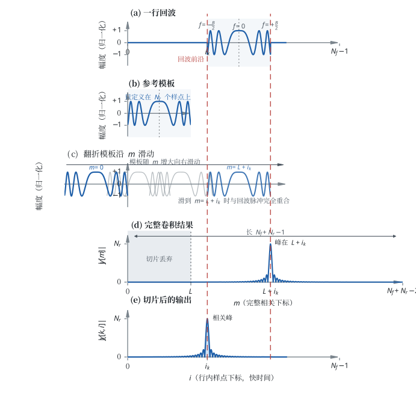

# Chirp 脉冲序列的自转周期反演算法

本文描述**当前代码**如何从 chirp 脉冲序列的回波中估计自转周期。术语沿用 [GLOSSARY.md](GLOSSARY.md)；配置字段归属见 [ARCHITECTURE_V4.md](ARCHITECTURE_V4.md)。

2026-10-11 第一批修改：逐脉冲 fallback 与 CPI 的周期搜索统一采用共同截距，保留原始特征时刻，不按 Run 聚合。逐脉冲三项特征均来自完整原生脉压输出。附录 A5 的逐组截距与旧候选为历史诊断，不是当前模型；本次证据见 [共同截距修改记录](https://github.com/lewgeon/radar-asteroid-rotation-period-pipeline/blob/chirp-pulse/docs/4.3/vs_4.2/changes/PERIOD_INVERSION_BASELINE.md)。

2026-10-10 最终更新：按用户要求删除局部主峰 3 dB 宽度。逐脉冲保留总能量、距离质心和 90% 能量宽度；有效 CPI 另提取多普勒质心与多普勒宽度。预览、周期搜索和新导出均不再包含峰值宽度。附录的旧实验周期候选保留为历史记录，其中的 `range_width` 不代表当前输出。变更见 [删除峰值宽度说明](https://github.com/lewgeon/radar-asteroid-rotation-period-pipeline/blob/chirp-pulse/docs/4.3/vs_4.2/changes/NATIVE_RANGE_FEATURES.md)。

`range_energy_width` 使用完整相关输出的中央 90% 功率分位宽度，不设置目标距离门、功率阈值或背景扣除；逐脉冲在原生完整脉压轴计算，CPI 在完整距离轴对齐及同一慢时间加窗后计算。完整输出通过时延坐标减去滤波滞后实现前沿参考，不删除左侧响应。定义、有效输入和验证见 [全窗能量宽度说明](https://github.com/lewgeon/radar-asteroid-rotation-period-pipeline/blob/chirp-pulse/docs/4.3/vs_4.2/changes/NATIVE_RANGE_FEATURES.md)。

## 0. 范围与用法

当前Chirp默认`period_selection="predictive_joint"`，独立特征搜索后在同一完整网格执行共同周期预测评分；旧`legacy_consensus`仅供对照。CPI的总功率、距离质心、90%能量宽度统一使用完整相关支撑；FFT多普勒仍保留窗展宽。融合契约见第6节，[生产专题](https://github.com/lewgeon/radar-asteroid-rotation-period-pipeline/blob/chirp-pulse/docs/4.3/vs_4.2/changes/PERIOD_INVERSION_BASELINE.md#predictive-joint-20261016)保留配对控制与边界。

- **范围**：只讲 chirp 脉冲序列（二维 `[脉冲, 快时间]` I/Q）。CW 一维路径不在本文范围内。
- **描述对象**：`inversion/scripts/estimate_period.py`、`inversion/src/inversion.py`、`inversion/src/radar_signal.py`、`inversion/src/dataset.py`。
- **用法**：正文按数据流顺序分节。当前行为和术语在对应正文维护；[附录 A](#附录-a-逐轮问答)保留历史问答及其条件，不再按每轮聊天扩写另一套当前说明。
- **边界**：本文只描述现状，不把改进建议写进正文；尚未实现的能力统一记在 §7。

### 0.1 先把主流程和新增选项分开

主流程仍是两条：CPI能由同一Run／相干连续块内的足够有效脉冲构成时，慢时间加Hann窗并做FFT，每个CPI输出总功率、距离质心、90%能量宽度、多普勒质心、多普勒宽度五个数；没有任何可用CPI时，逐脉冲输出前三个距离／功率特征。当前示例100Hz PRF、每Run200脉冲、1s CPI及0.25s滑动步长形成每Run5个CPI观测；这5个观测各含五项特征，不是总共只有5个标量。CPI不能形成时每Run则保留200个逐脉冲观测，各含三项特征。

“谱功率矩”是原有FFT后计算多普勒质心和宽度的名字：将每个频率格的功率当权重，算频率的加权平均及加权标准差。它不是另一个主流程。2026-10-14工作日志记载新增显式 `doppler_estimator` 选择，其中 `spectral_moments` 仍是默认，`narrowband_lag` 是新增的受限实验选项。2026-10-15界面将两者改称“FFT功率谱法（默认）”和“相关法（实验性）”，替代不够直观的旧称“低频有效估计”；只改变显示名，不改变JSON值、算法或当前选择。

新增相关法只替换CPI的两个多普勒数，其余三个特征、CPI数量与FFT图不变。它把同一CPI的复回波与相隔若干脉冲的自身进行比较，计算“隔一段时间后信号还多相似、相位转了多少”；这叫滞后相关。相位随间隔增长的斜率用来估计平均频率；相似程度衰减的曲率用来估计窄频分布的有效宽度。“拟合”在此指求直线或曲线的系数，不是训练神经网络；“有效性检查”是在低相似度、拟合残差过大或不满足窄频条件时拒绝这两个数。它不会因此自动切到逐脉冲路线。具体假设及拒绝条件见第4.1.5节；已有负结果不支持它在任意回波上替代谱宽。

“估计器”只表示从观测数据算出某个未知量的一套公式。已核对的Git可达历史生产反演采用NumPy／SciPy CPU计算；2026-10-15新增可选CUDA核，CPU仍为默认。不能把echo生成、面片计算使用CUDA说成周期反演原先已有GPU而后来被关闭。研究选项与会话需要分开：本日核对时，`seperate_observation_2` 会话保存1s CPI和相关法，源JSON仍为16s CPI且未显式指定估计器；未指定时采用原谱功率矩。

### 0.2 周期拟合、阶数和Run留出是什么意思

周期拟合是在候选周期T下寻找一条能解释特征随时间变化的曲线，再比较不同T。例如H=1只允许“一条正弦波加常数”；H=2还允许周期T/2的成分，曲线可以更尖、更不对称。一般形式为

$$
y(t)=a_0+\sum_{h=1}^{H}\left[a_h\cos\left(\frac{2\pi ht}{T}\right)+b_h\sin\left(\frac{2\pi ht}{T}\right)\right].
$$

这里y是某一项已提取特征，t是该观测的时刻，T是待搜索周期，a和b是从数据求出的系数；H才是这里所说的“谐波阶数”，不是CPI长度、FFT点数或滑动步长。增加H会增加曲线自由度，并不保证周期更准。例如5400s正弦波既能由T=5400s的一次项表示，也能由T=10800s的二次项表示，必须另行区分重复周期与物理转一圈的周期。

2026-10-14保存特征探针共有五项特征×三种H（1/2/4）×三份数据（全部、偶数Run、奇数Run）=45次周期搜索。每次把用于计算系数及选择周期的数据称为“训练集”，只是统计拟合用语，不涉及机器学习训练。奇偶Run分开时，100个Run分成两组各50个Run，每组250个CPI；用一组拟合，再看其曲线能否预测未参与拟合的另一组，重叠CPI不跨两组。这是删去部分观测后的敏感性检查，不是45次独立噪声实验。

本例只用距离质心、H=1时，全部500点得到5400.633728s，偶数Run的250点得到5397.800778s，奇数Run的250点得到5403.876868s。后两值是分别重新搜索得到的周期，不是同一结果的误差条。相对5400s，主周期只改变几秒，不能笼统说该通道的主周期不稳定；相对已知5400s的绝对误差则从0.63s增至2.20／3.88s，尚未验证稳定亚秒精度。“别称周期”指有限／有空档的观测可能让另一个周期同样拟合得好，也包括高阶表示的半／倍周期歧义；不能把它们当成已确认的另一种转动。其他特征／H的敏感性与此单通道结论分开报告。后续鲁棒性验收限定在调制可识别、有效观测足量的预声明范围，评价误差、误选率及可信区间，不再用退化观测反驳用户希望在有效数据下稳定求解的目标。

高阶谐波不是另一个更快自转，而是同一转动产生的非正弦特征曲线。例如 `cos(2πt/T)+0.2cos(4πt/T)` 仍以T为基本周期，第二项只改变波形。投影、照射面积、可见面片集合、遮挡、复振幅相加后取功率及分位宽度都不是对转角的线性正弦映射，因此椭球等简单形状也不能事先保证每项雷达特征都是纯正弦。H=1应保留为低复杂度基线；只有残差和未参与拟合的数据证明高阶项有效时才增加H，不能按真值误差挑H或默认越大越好。

## 1. 起点：反演拿到的二维数组

### 保存快照中的旧规则诊断与升级结果

2026-10-16升级在原保存特征上只替换融合时得到5399.847409秒；完整相关支撑修正后，实际CLI重新提取100Run／500CPI并输出5399.833177秒，保存在`runs/seperate_observation_2/inversion_upgrade_20261016/`，没有覆盖原结果。该次CPU、H1、无视线相位补偿、1秒CPI、1800—14400秒／4000格、未启用bootstrap；相对5400秒重复周期偏差−0.166823秒。不能把融合改善归因于完整支撑修复，也不能把单场景偏差当作跨场景亚秒保证。下表及旧重采样数字保留原阶段作用域。

以下历史诊断只针对保存的`runs/seperate_observation_2/inversion/period_observables.npz`：原FFT功率谱法、500个CPI、100Run、H=1、无视线相位补偿。当前椭球的目标重复周期为5400秒，完整转动周期为10800秒；这里讨论前者。五项特征不是五次独立实验，而是同一份IQ的五种概括。

| 特征 | 自身最高分候选(s) | 当前判读 |
| --- | --- | --- |
| 总能量 | 5398.349 | 与5400秒重复周期相符 |
| 90%能量宽度 | 5398.485 | 与5400秒重复周期相符 |
| 距离质心 | 5400.634 | 与5400秒重复周期相符 |
| 多普勒质心 | 5427.837 | 约偏28秒，当前不能作为准确周期约束 |
| FFT多普勒RMS带宽 | 4817.284 | 约偏583秒，当前不能作为准确周期约束 |

仅对前三项执行当时的旧共识规则，得到5398.484748秒。五项全部参加时，约5750秒附近的次级峰恰好得到五项支持；约5400秒附近虽有三个很强的主峰和多普勒质心支持，却少了RMS带宽这一票。“票数优先”因此输出5748.465058秒。这是组合规则过于信任弱通道的具体表现；上一轮只修复“同票数再比较拟合质量”，没有把票数优先改掉，不能说已修复全部错误选峰。

该阶段把三个距离特征作为主要周期证据、两项多普勒作为待查诊断；三特征比较属于旧规则对照。当前生产仍保留五项可用特征，以共同周期预测评分替代票数优先，不自动排除多普勒。它也不证明所有形状、几何和噪声下三项一定正确。将“不适合当前周期拟合”与“信号本身没有周期”分开：单正弦拟合可能把非正弦、受视线影响的重复曲线拟成偏移周期。多普勒质心的连续相干信号参照本身也出现约25—31秒H1偏差，因此仅换提取公式未必能消除它；需分离波形表示、几何和相干权重。RMS带宽另受Hann窗展宽与频谱尾部影响：受限相关法曾在相同输入得到约5398秒，但那是低频有效宽度，不能冒充任意频谱的RMS已修复。机制与控制见[信号形成专题](https://github.com/lewgeon/radar-asteroid-rotation-period-pipeline/blob/chirp-pulse/docs/4.3/vs_4.2/experiments/reports/2026-10-09_SIGNAL_FORMATION_AND_INTEGRATION_COST.md#cpi-coherence-20261014)。

“20秒控制RMSE从1.985秒降至0.0459秒”只描述人工检查：生成已知20秒的信号，改变噪声重复200次，分别检查原／新排序偏离20秒多少；RMSE是这200次误差平方平均后开方，不是小行星周期误差。“经验95%覆盖86.5%”表示200个标称95%的区间只有173个包含已知20秒，说明区间构造仍欠覆盖；不是说真实小行星结果有86.5%的正确概率。“重采样跨峰”表示将100个Run有放回重抽、重新搜索时，结果会落到相距较远的不同峰，是删换数据后的敏感性诊断，不是重复接收到100份新IQ，也不能当成各峰的真实后验概率。三特征在同参数100次重抽中都留在原结果±5%内，其2.5／50／97.5分位约为5387.665／5399.676／5411.011秒；它是有用的条件敏感性范围，但尚未计入模型偏差或校准为总95%置信区间。

### 输入字段

反演入口只读上游 `echo/echo.npz`（`dataset.load_echo`）。与周期反演相关的量：

| 符号 | 含义 | 来源 |
|---|---|---|
| $N_p$ | 脉冲总数（二维数组的行数） | `iq.shape[0]` |
| $N_f$ | 每行快时间样点数 | `iq.shape[1]`，等于 `metadata.fast_sample_count` |
| $f_s$ | 快时间采样率（接收 ADC） | `metadata.fast_sample_rate_hz` |
| $T$ | 单脉冲脉宽 | `metadata.pulse_width_s` |
| $B$ | 单脉冲带宽 | `metadata.pulse_bandwidth_hz` |
| $f_c$ | 载频 | `metadata.carrier_frequency_hz` |
| $\mathrm{PRF}$ | 脉冲重复频率 | `metadata.prf_hz` |
| $\mathrm{PRT}$ | 脉冲重复间隔，$=1/\mathrm{PRF}$ | 由上导出 |
| $c$ | 光速，$299\,792\,458\ \mathrm{m/s}$ | 代码常量 |
| $M$ | **一个 CPI 的脉冲数**（窗长），仅 §4.1 使用 | 式 (4)，由 `inversion.cpi_duration_s` 与 $\mathrm{PRF}$ 导出 |
| $H$ | CPI 滑动步长（脉冲数），仅 §4.1 使用 | 式 (4)，由 `inversion.cpi_hop_duration_s` 导出 |
| $T_{\mathrm{CPI}}$ | CPI 内**首末脉冲的时间跨度**，$=(M-1)\,\mathrm{PRT}$ | 式 (6) 之后 |

$N_p$ 是整幅二维数组的行数（本次观测的脉冲总数），与 §4.1 里**单个 CPI 的窗长 $M$** 不是一回事：$M$ 由 CPI 物理时长与 $\mathrm{PRF}$ 决定，可能远小于 $N_p$，也可能因相干分组内脉冲不足而根本取不到。其余符号在首次使用处定义。

`iq[k, :]` 是**第 $k$ 个脉冲**的复基带接收样本，一行一个脉冲；`valid[k, :]` 是同形状的布尔掩码，无效样点在反演入口被置零（`inversion.py` 中 `np.where(valid_samples, raw, 0.0)`）。

### 1.1 行内延迟轴是"相对目标质心"的

每行有一个起点字段 `row_fast_time_offset_s[k]`，其定义是

$$
\texttt{row\_fast\_time\_offset\_s}[k] = (\text{第 } k \text{ 行第 0 个 ADC 样点的绝对时刻}) - (\text{第 } k \text{ 个脉冲的质心接收时刻})
$$

`fast_time_s` 本身是行内差分坐标，$t_i = i/f_s$（$i=0,\dots,N_f-1$，起点为 0）。于是第 $k$ 行第 $i$ 个样点的延迟坐标是

$$
\tau_{k,i} = t_i + \texttt{row\_fast\_time\_offset\_s}[k] \tag{1}
$$

$\tau$ 即"相对该脉冲质心接收时刻的差分校准延迟"，$\tau c$ 是相对双站程。

**术语提醒**：这里的"行"指**脉冲保存行**（二维数组的一行）。物理上每个 Run 只有一条连续 ADC 时间轴（Run 级连续 ADC 窗），二维行是它的分段视图，同一个全局 ADC 样点可能出现在多行中。反演读取重叠元数据并给出诊断；尚未完成共享ADC重复计权和真实叠加回波分离的完整验收，见 §7。

## 2. 第一步：逐脉冲脉冲压缩（匹配滤波）

`radar_signal.matched_filter_chirp` 对**每一行独立**做匹配滤波，生产预处理先保留完整相关结果，再分别构造逐脉冲原生统计和 CPI／显示视图：

- 参考信号样点数 $N_r = \max(2,\lceil T f_s\rceil)$，样点时刻 $t_n = n/f_s$，调频率 $k = B/T$。
- `baseband_convention = "centered"`（默认，来自 `echo.waveform.baseband_convention`）时

$$
r_n = \exp\!\Big(j\pi k\,(t_n - T/2)^2\Big),\qquad n = 0,\dots,N_r-1 \tag{2}
$$

- 互相关用 `signal.fftconvolve(iq, conj(r[::-1]), mode="full")`，完整长度为 $N_f+N_r-1$。显示与多普勒计算使用其中长度为 $N_f$ 的切片，已知相关峰滞后为 $L=N_r-1$：

$$
\chi[k,i] = \text{full}[k,\ L+i],\qquad i = 0,\dots,N_f-1 \tag{3}
$$

式 (3) 是显示与多普勒计算的裁剪视图，不是逐脉冲或CPI总功率、距离质心、90%能量宽度的科学输入。逐脉冲保留 $\chi_{\mathrm{full}}[k,j]=\mathrm{full}[k,j]$，$j=0,\ldots,N_f+N_r-2$，仅修正其坐标。设 $\Delta t$ 为 `fast_time_s` 的采样间隔中位数，$t_{f,0}$ 为该数组首值，$o_k$ 为第 $k$ 行的 `row_fast_time_offset_s`，则完整原生时延为：

$$
\tau_{k,j}^{\mathrm{full}}=t_{f,0}+(j-L)\Delta t+o_k
$$

该行偏移已含分数 ADC 校正，不再重复扣除 `centroid_fractional_offset_s`；仅在缺少有效行偏移的兼容输入上使用后者的负值代替 $o_k$。完整原生轴通过减去滞后标记前沿参考，没有删除左侧响应。下图保留切片教学，用于解释索引关系，不表示逐脉冲统计仍裁剪。

**输出语义。** 把式 (3) 的切片写成互相关形式，$\chi$ 等价于

$$
\chi[k,i] = \sum_n \text{iq}[k,n]\,\overline{r_{n-i}}
$$

读法：把参考模板的第 $0$ 个样点压到行内样点 $i$ 上，看这一行与模板有多像。（$i$ 是泛指的行内下标，峰值所在的那个下标另记 $i_k$。）



**图 1**　匹配滤波的峰值为什么落在回波前沿。五幅面板**共用同一根横轴**（同一原点、同一比例尺），所以两条红色竖虚线是真正贯穿全图的同两条线：**左线＝回波前沿 $i_k$，右线＝回波后沿 $i_k+N_r-1$**。

- **(a) 回波**：整行 $N_f$ 个样点都有采样，脉冲外取值为 0，蓝线画满并盖住灰色横轴。
- **(b) 参考模板**：只定义在自己的 $N_r$ 个样点上，按真实长度画在原点右侧，左沿就在纵轴处。
- **(c) 翻折模板**：卷积前沿纵轴翻折（$n\to-n$，代码里同时取共轭），然后沿 $m$ 向右滑动。图中画出四个位置：$m=0$、$80$、$160$、$L+i_k$；**滑到 $m=L+i_k=N_r-1+i_k$ 时，它与回波脉冲的支撑区间完全重合**，此时卷积取到最大值——这就是 (d) 里那个峰。
- **(d) 完整卷积**：长 $N_f+N_r-1$，比回波长 $N_r-1$；左侧灰区是切片要丢掉的 $L=N_r-1$ 个样点。**峰值在 $m=L+i_k$，正好落在那条后沿红线上。**
- **(e) 切片后输出**：丢掉前 $L$ 个样点，输出下标 $i=m-L$，峰值左移 $L$ 后**落在前沿红线上**，长度回到 $N_f$，与 (a) 同刻度。

这就是“匹配滤波后峰值位于回波前沿”的索引关系：完整卷积峰在 $L+i_k$，将横轴减去 $L$ 个采样间隔便落在前沿参考；式 (3) 的裁剪视图也采用这一索引。逐脉冲统计通过坐标修正保留全部样值，不依赖丢弃前段来实现前沿参考。理想单位振幅模板完全重合时峰值高度等于 $N_r$。图中波形为复基带实部，标出的 $f=-B/2,\,0,\,+B/2$ 是脉冲内瞬时频率（0 频在中点）；脉宽与旁瓣间距为示意。

模板的第 $0$ 个样点就是模板自身的起点（前沿）。回波与模板同源，所以当模板起点压上回波起点 $i_k$ 时逐项同相相加：

$$
\chi[k,i_k] = \sum_{j=0}^{N_r-1} |r_j|^2 = N_r
$$

错开则退化为 LFM 自相关在滞后 $i_k-i$ 处的旁瓣。因此峰值出现在 $i=i_k$，即**回波前沿**所在的样点，而不是脉冲中心所在的样点；这与元数据 `pulse_fiducial = "leading_edge"` 同源。

**恒定偏置**：前沿比脉冲中心早 $T/2$，故按式 (1) 的轴读出

$$
\tau_{\text{峰}} = \tau_{\text{中心}} - \frac{T}{2}
$$

它对所有脉冲相同，只让 §3 的矩特征整体平移，不影响周期搜索。

## 3. 周期信息藏在哪：自转对回波的调制

目标在自转，因此随时间变化的有三类量：

1. **距离像的形状**。刚体自转使视线方向的投影形状随自转角 $\theta(t)$ 变化，各面元的双站程不同，于是距离像的重心位置与展宽随时间起伏。
2. **微多普勒**。同一时刻不同面元沿视线的速度分量不同，回波多普勒谱被展宽；展宽与重心随 $\theta(t)$ 变化。
3. **回波总强度**。目标朝向变化使有效散射截面起伏。

所以“周期”是从**上述标量随时间变化的不均匀序列**里读出的。逐脉冲三项标量统一对完整原生功率 $\Pi_{\mathrm{full}}=|\chi_{\mathrm{full}}|^2$ 统计，使用 §2 定义的逐行完整时延轴；功率记号用 $\Pi$ 以免与 §5 的候选周期 $P$ 混用：

| 特征名 | 定义 | 物理含义 |
|---|---|---|
| `total_power` | $\sum_j \Pi_{\mathrm{full}}[k,j]$ | 完整脉压功率样点和，不含采样间隔因子 |
| `range_centroid` | $\dfrac{\sum_j \Pi_{\mathrm{full}}[k,j]\,\tau_{k,j}^{\mathrm{full}}}{\sum_j \Pi_{\mathrm{full}}[k,j]}$ | 完整原生距离像重心 |
| `range_energy_width` | 完整脉压功率的 95% 分位时延减去 5% 分位时延 | 全窗中央 90% 能量宽度 |

若脉冲足够密，还可以先做 §4.1 的 CPI 处理，再多得到两个标量 `doppler_centroid` 与 `doppler_bandwidth`（定义见 §4.1.5）。

## 4. 从距离像到标量：两条路径

`_estimate_chirp_rotation` 先尝试路径 A；只有 `range_doppler_cube` 抛出**唯一那句** `"没有任何相干分组包含足够脉冲形成一个 CPI"` 时，才回退到路径 B。其它异常一律上抛，避免把配置错误伪装成数据不足。

### 4.1 路径 A：滑动 CPI 距离—多普勒

#### 4.1.1 CPI 的定义与脉冲数

**相干处理区间（Coherent Processing Interval, CPI）**：同一相干分组（`coherence_id`）内选取**相邻**脉冲形成的短时处理窗口（定义同 [GLOSSARY.md](GLOSSARY.md)）。入口把配置的物理时长换算为脉冲数：

$$
M = \max\!\Big(2,\ \big\lceil \texttt{cpi\_duration\_s}\cdot \mathrm{PRF}\big\rceil\Big),\qquad
H = \begin{cases}\max(1,\lceil \texttt{cpi\_hop\_duration\_s}\cdot\mathrm{PRF}\rceil) & \texttt{cpi\_hop\_duration\_s}\ \text{已给}\\[2pt] \max(1,\lceil 0.25\,\texttt{cpi\_duration\_s}\cdot\mathrm{PRF}\rceil) & \text{未给（默认 CPI/4）}\end{cases} \tag{4}
$$

$M$ 是一个 CPI 的脉冲数（窗长），$H$ 是滑动步长（脉冲数）。二者都只由配置与 $\mathrm{PRF}$ 决定，与快时间无关。注意 $M$ 是**单个 CPI 的窗长**，与 §1 的脉冲总数 $N_p$ 不是一回事（同一 Run 内可以滑出很多个 CPI，也可能一个都取不到）。

#### 4.1.2 不允许跨越的缝

CPI 的分组键是 `(run_id, coherence_id)` **配对**：既不能跨 Run，也不能跨相干分组。相干分组内部还要求脉冲**连续**（代码按 `np.diff(indices) != 1` 切块），静默拼接被隔断的块会重新引入被禁止的"补洞"行为。块长不足 $M$ 时整块跳过。

#### 4.1.3 慢时间采样均匀化

取定一段脉冲后，令其接收时刻为 $t_0,\dots,t_{M-1}$，中位间隔 $\mathrm{PRT} = \operatorname{median}(\Delta t)$。若实际到达时刻与标称栅格 $t_0 + m\,\mathrm{PRT}$ 的偏差超出 `rtol = 1e-3`（且 `atol = 1e-9`），就把**整行所有延迟列**线性插值到标称时刻（实部、虚部分别插值）。这只用于吸收传播引起的微小到达抖动；**campaign 的大间隔绝不重采样**。

#### 4.1.4 沿慢时间做 FFT

加 Hann 窗 $w_m$（`signal.get_window("hann", M, fftbins=True)`）后沿脉冲维做 DFT：

$$
\chi_m(\tau, f_q) = \sum_{m'=0}^{M-1} w_{m'}\,\chi_{m'}(\tau)\,e^{-j2\pi f_q m'\,\mathrm{PRT}},\qquad
f_q = \operatorname{fftshift}\Big(\operatorname{fftfreq}(M,\ \mathrm{PRT})\Big) \tag{5}
$$

多普勒**栅格间距**与无模糊范围：

$$
\Delta f_{\text{bin}} = \frac{1}{M\,\mathrm{PRT}},\qquad f \in \Big[-\frac{\mathrm{PRF}}{2},\ +\frac{\mathrm{PRF}}{2}\Big) \tag{6}
$$

式 (6) 是 DFT 的输出**栅格间距**（代码 `fftfreq(M, d=PRT)`），由 $M$ 个采样点决定；它**不是**窗的时间跨度。$M$ 个脉冲的**首末时间跨度**是

$$
T_{\mathrm{CPI}} = (M-1)\,\mathrm{PRT}
$$

因为 $M$ 个采样点之间只有 $M-1$ 个间隔，而 $M\,\mathrm{PRT}$ 是"$M$ 个采样单元"的标称时长（半开单元约定）。$M=64$、$\mathrm{PRT}=0.25\ \mathrm{s}$ 时二者分别为 $15.75\ \mathrm{s}$ 与 $16\ \mathrm{s}$，相差 $1.6\%$。式 (6a)/(6b) 只做量级判断，不区分这两者；凡涉及"窗内漂移总量"（如 $\dot f_DT_{\mathrm{CPI}}$、$2\Omega R\,T_{\mathrm{CPI}}$）都按首末跨度 $(M-1)\,\mathrm{PRT}$ 计，因为它必须与**实际存在于数据里的时长**一致。两种约定各自的适用范围、代码里并存的分工与误用后果见 [A4](#a4-每个采样点连带后随的一段间隔算一次完整采样这种理解会出什么问题)。

**栅格间距不等于分辨能力。**"分辨能力"指把同一帧内**同时存在**的两个多普勒成分分成两个峰的能力，由窗的**主瓣宽度**决定：矩形窗约 $1/T_{\mathrm{CPI}}$，本代码使用的 Hann 窗主瓣更宽（零到零 $4$ 个栅格、半高全宽约 $1.44$ 个栅格），实用上取 $\sim 2/T_{\mathrm{CPI}}$。

窗长同时还受"窗内多普勒恒定"这一前提的约束：窗内多普勒漂移 $\dot f_D\,T_{\mathrm{CPI}}$ 必须远小于分辨能力 $1/T_{\mathrm{CPI}}$，即

$$
T_{\mathrm{CPI}} \ll \frac{1}{\sqrt{\dot f_D}} \tag{6a}
$$

否则谱线被漂移抹宽，`rms_bandwidth_hz` 等特征被系统性抬高（偏置），不再是自转展宽本身。因此 `inversion.cpi_duration_s` 不是"越长越好"的单向参数，而是双向权衡；定量讨论见 [A2.1](#a21-cpi-越长多普勒分辨率越高到底指什么)。

还有一条**独立**的窗长上限：面元相对质心的差分校准延迟在窗内也在变化，造成**距离走动**。要求窗内走动 $2\Omega R\,T_{\mathrm{CPI}}$ 远小于压缩后的程分辨单元 $c/B$：

$$
T_{\mathrm{CPI}} \ll \frac{c}{2B\Omega R} \tag{6b}
$$

$\Omega = 2\pi/P$ 是自转角速率，$R$ 是目标赤道半径量级。式 (6a) 与式 (6b) 必须同时满足；推导与数量级见 A3.2。

**这两条判据是选参依据，不是代码行为**：`inversion.cpi_duration_s` 由配置直接给出，代码不做任何检查。

每个 CPI 产生一帧，帧时刻取该 CPI 内脉冲时刻的均值，并记录 `coherence_id`、起止脉冲序号。

**重叠 CPI 的计权**：相邻 CPI 共享脉冲，彼此相关。代码给每帧记一个有效样本数，把落入该窗的脉冲按"标称重叠重数"折抵：

$$
\texttt{effective\_sample\_count} = \frac{\sum_{m \in \mathrm{CPI}} \overline{\mathrm{valid}}_m}{\max\!\big(1,\lceil M/H\rceil\big)} \tag{7}
$$

其中 $\overline{\mathrm{valid}}_m$ 是第 $m$ 个脉冲的有效样点占比。这是对重叠相关性的粗略折算，不是统计意义上的最优权重。

#### 4.1.5 CPI 到五个标量

以下谱矩公式描述默认`doppler_estimator="spectral_moments"`，包含Hann窗展宽及所有频率尾部。显式可选`narrowband_lag`保留相同的总能量和距离量，但用未加窗滞后相关的相位斜率、对数幅度曲率提取低频有效质心与宽度；后者不是任意谱RMS，至少需要12脉冲、高相干及短滞后内低频窄分布。相干/拟合检查失败的窗口输出NaN，日志和摘要记录拒绝数，其多普勒特征不参与周期搜索；没有静默替换回谱矩。质量通过仍不能排除弱高频尾部，99.99%功率在0 Hz、0.01%在20 Hz就是反例。定义、公式、真实输入及带噪声作用域见[2026-10-14配对实验](https://github.com/lewgeon/radar-asteroid-rotation-period-pipeline/blob/chirp-pulse/docs/4.3/vs_4.2/experiments/reports/2026-10-09_SIGNAL_FORMATION_AND_INTEGRATION_COST.md#cpi-coherence-20261014)。

周期Hann窗中，1秒整格单频点的谱RMS约为$1/\sqrt{3}$ Hz，并非目标的真实展宽。当前无噪声作业修正距离对齐后，质心主峰约5428秒，和独立连续相干参考相近；有效宽度在已测1秒CPI/0.25秒步长下主峰约5398秒。半转重复不保证稀疏采样的H1最强拟合峰恰好等于重复周期，不能用强制对齐候选峰替代测量验证。新增方法为可选策略，默认继续使用谱矩，CPI长度与步长未据单一目标自动调整。

多普勒量使用显示距离支撑上的功率 $\Pi_D = |\chi|^2$（形状 `[帧, 延迟, 多普勒]`）；距离／总功率量使用完整相关支撑的距离边缘功率 $R_{\mathrm{full}}(\tau)$。$\bar f$ 为该帧的多普勒重心，$\tau_c$ 为距离重心，两种支撑分别归一化：

| 特征名 | 定义 |
|---|---|
| `total_power` | $\sum_\tau R_{\mathrm{full}}(\tau)$ |
| `doppler_centroid_hz` | $\bar f = \sum \Pi_D f / \sum \Pi_D$ |
| `rms_bandwidth_hz` | $\sqrt{\sum \Pi_D (f - \bar f)^2 / \sum \Pi_D}$ |
| `range_centroid_s` | $\tau_c = \sum_\tau R_{\mathrm{full}}(\tau)\tau / \sum_\tau R_{\mathrm{full}}(\tau)$ |
| `energy_range_width_90_s` | 完整距离范围内、沿多普勒积分的 CPI 功率的中央 90% 分位宽度 |

表中总功率、距离质心及90%能量宽度统一使用完整相关支撑的距离边缘功率；其功率由同一CPI脉冲选择、慢时间重采样和Hann窗经Parseval关系计算，不从裁剪后的谱恢复丢失尾部。两个多普勒量仍来自裁剪谱，不应将两类支撑混为一谈。另记录Hann窗自身RMS、Nyquist接缝功率比例及对应宽度，仅诊断，不减去窗宽、不自动删除多普勒通道。特征缓存版本为4，旧标量缓存需重算，兼容的原CPI显示谱仍可复用；作用域及配对负结果见[完整支撑修复](https://github.com/lewgeon/radar-asteroid-rotation-period-pipeline/blob/chirp-pulse/docs/4.3/vs_4.2/changes/NATIVE_RANGE_FEATURES.md#cpi-full-support-20261016)。

多普勒方向的边缘分布按**每帧自己的频率轴**计算（`frame_frequencies_hz`），因为 §4.1.3 的重采样可能让各帧的 PRT 略有差异。

### 4.2 路径 B：逐脉冲距离像兜底

CPI 无法形成时，逐脉冲提取 `total_power`、`range_centroid`、`range_energy_width` 三个特征；三者统一来自完整原生脉压相关输出及逐行真实时延轴，不消费裁剪或共同轴插值结果。此时：

- `run_id` 保留用于追溯，不作为搜索截距标签；
- 权重退化为逐脉冲有效样点占比 $\overline{\mathrm{valid}}_m$。

§4.2 的三个量都是沿快时间轴对单行的归约，可以按脉冲分块计算。「查看特征」及 CPI 无法形成时的反演入口先对整份输入确定行偏移校验与公共路径率的非有限值回退策略，再切分脉冲，因此回退行为不受块边界影响。CPI 不足时跳过共同轴对齐及重复宽度计算，全部逐脉冲观测仍进入原周期搜索。可形成 CPI 时按照原 Run／相干组／有效连续块和步长枚举窗口，逐 CPI 匹配滤波并立即归约五项特征；所有窗口使用与整批原实现一致的全局裁剪共同轴及完整支撑联合轴，不能用各 CPI 自己的中位数替代。精确全局间隔中位数按块统计浮点取值及次数，特殊轴使用临时磁盘数组进行精确选择。验收及输入范围见[距离特征专题](https://github.com/lewgeon/radar-asteroid-rotation-period-pipeline/blob/chirp-pulse/docs/4.3/vs_4.2/changes/NATIVE_RANGE_FEATURES.md#11-cpi-分支逐窗口计算与完整入口验收2026-10-13)。

两分支的 `dynamic_spectrum` 仅用于诊断展示。逐脉冲图最多保留 128 行、1024 列；CPI 图保留至多 128 帧及最多 1024 个距离列，完整 Doppler 轴保留，复数展示谱预算 128 MiB，实际列数随 CPI 脉冲数调整。`search_diagnostics.dynamic_preview` 标明采样状态、实际大小及 `diagnostic_only`；科学 `features` 和 `period_observables.npz` 始终保留全部观测。逐脉冲 `compensated_iq` 是诊断样本，CPI 分支为 `None`，不再作为完整脉压产品返回。回波加载、单个 CPI 和极端共同轴仍有内存需求，这些展示预算不是总进程峰值保证。

## 5. 周期搜索：共同截距的多谐波最小二乘周期图

路径 A/B 的每个特征各自得到一条"标量—绝对时刻"序列

$$
\{(t_k,\ y_k,\ w_k)\}_{k=1}^{N},\qquad
\begin{cases} t_k & \text{原始特征时刻（见 §5.1）}\\ y_k & \text{对应标量特征}\\ w_k & \text{权重（式 (7) 或逐脉冲占比）}\end{cases}
$$

### 5.1 特征用哪个时间轴

由 `inversion.period_time_role` 决定：

| 取值 | 用的数组 | 输出 `time_axis_role` |
|---|---|---|
| `scatter_centroid`（默认） | `echo.scatter_elapsed_s`（散射质心时刻） | `scatter_elapsed_s` |
| `receive_centroid` | `echo.elapsed_s`（接收质心时刻） | `receive_elapsed_s` |

GUI 旧别名 `receive` / `receive_elapsed_s` / `scatter_elapsed_s` 会被归一化到上表两值；`emit` 显式报错（尚未实现）。

### 5.2 模型与得分

对候选周期 $P$，令 $\omega = 2\pi/P$，$t'_k = t_k - t_1$，构造设计矩阵

$$
X(P) = \Big[\ \underbrace{\mathbf{1}}_{\text{共同截距}},
\ \cos(\omega t'),\ \sin(\omega t'),\ \dots,\ \cos(H_\omega \omega t'),\ \sin(H_\omega \omega t')\ \Big] \tag{8}
$$

其中 $H_\omega$ 是由 `inversion.harmonics` 与多谐波开关共同确定的有效阶数（默认 1，兼容规则见第5.2.1节），参数个数为 $2H_\omega+1$，与 Run 数无关。两条 Chirp 路径均不传逐组标签，不按 Run 聚合或重排特征时间。底层求解时按时间排序，保持每个观测值和权重对应关系。特征值与权重先作统一缩放以避免平方溢出或下溢；这些缩放不改变得分。加权最小二乘给出

$$
\hat\beta(P) = \arg\min_{\beta}\sum_k w_k\big(y_k - X(P)_k\beta\big)^2,\qquad
\mathrm{SSE}(P) = \sum_k w_k\big(y_k - X(P)_k\hat\beta(P)\big)^2 \tag{9}
$$

基线模型只含一个共同常数，即特征的加权均值，其残差平方和为 $\mathrm{SSE}_0$。**得分定义为共同基线残差被解释的比例**：

$$
\mathrm{score}(P) = 1 - \frac{\mathrm{SSE}(P)}{\mathrm{SSE}_0} \tag{10}
$$

本项目单 Run 发射时长受光行时约束，相对自转周期较短，主要调制在 Run 之间。自由逐组截距会丢弃这部分信息，因此 CPI 能形成也不自动启用逐组截距。共同截距要求跨 Run 标量参考和标定一致；真实未知零点偏置、增益及几何漂移需要独立校准或受约束模型，不能由本次模型保证消除。底层 `groups` 参数保留为显式研究对照，不进入生产配置。旧模型的诊断见 [A5](#a5-逐组截距在什么条件下会吸收掉周期信号)。

<a id="optional-method-contract"></a>

### 5.2.1 可选模型与配置兼容

视线相位补偿、多谐波特征拟合、周期局部细化是独立选项；关闭它们不撤销共同截距、正确散射时标或原始特征样本。开关、缺省值与八组合报告集中见[用户手册](GUI_USER_MANUAL.md#optional-period-methods)。这些选项仅适用于 Chirp，不接入 CW。

`multi_harmonic_enabled=false` 时有效谐波数固定为 1；旧配置缺少新开关时沿用 `harmonics`，并保留旧缺省 H=1。显式开启多谐波且省略阶数时取 H=2。增大阶数拟合的是特征的周期波形，不改变脉压；自由度不足时依第5.4节跳过特征，没有可搜索特征时报错。较高分数不能认证更准确周期，整数倍基周期候选仍需保留。

相位补偿只使用独立提供的极轴、回波散射时刻与收发视线，不从 `echo.target` 复制极轴，也不读取真实初始相位或形状。关闭补偿且不比较时，隐藏极轴不参与计算。相位模型与适用范围见第8节。


<a id="candidate-policy"></a>

### 5.3 频率栅格、候选策略与峰值细化

频率栅格为 $f\in\operatorname{linspace}(1/P_{\max},1/P_{\min},\texttt{period\_grid\_size})$，其中 $P_{\min}$、$P_{\max}$ 来自 `period_min_s`、`period_max_s`；它在频率上均匀，因此周期栅格在长周期端更粗。

旧 CLI 配置省略 `refine_period` 且不启用相位补偿时，保留原有内部峰选择：使用 `scipy.signal.find_peaks` 查找局部峰，无峰时取全局最大点，再保留前 5 个候选。显式设置细化开／关，或启用相位补偿时，把搜索区间端点也纳入候选；`candidate_policy` 诊断标识实际路径。GUI 保存会明确写入开关，因此边界占优的数据可能与旧 CLI 省略字段的结果不同，不能笼统承诺两条路径在所有输入上相同。

`refine_period` 缺省仍为 `true`。开启时，在候选点相邻栅格限定的周期区间内，用 `scipy.optimize.minimize_scalar(method="bounded")` 直接最小化 $\mathrm{SSE}(P)$；显式候选策略仅在残差不增加时接受细化。关闭时返回网格候选。每个候选记录 `period_s`、`score`、`source`，例如 `multi_harmonic_ls:H=1`。局部细化减少网格离散误差，不消除波形／几何模型偏差，也不认证全搜索区间的全局最优。


<a id="gpu-period-search"></a>

选择`compute_device="cuda:0"`时，Chirp周期网格使用PyTorch双精度按频率分块计算：同一批候选共同构建设计矩阵，形成加权小矩阵并求解，再直接计算残差。它保留原频率网格、共同截距、权重、谐波和视线相位。正规方程会放大病态性，因此加权设计的Gram矩阵最小／最大特征值比必须大于1e-6（对应设计矩阵条件数约小于1000）才采用GPU结果；不满足、相位自变量上界超过1e6、参数数大于64或单格超出分块工作数组预算时，逐格回到原CPU SVD参考。不会因此删除候选或降低精度。64MiB只是分块工作数组估算预算，不是CUDA库工作区或进程总显存上限；显存不足明确报错。

近乎相等的相邻网格分数在CPU重算；所有局部最大值和需要评估的边界在截取前5名之前也用CPU重算，随后局部连续细化仍使用原CPU残差函数。主搜索、八组合比较和整Run重采样均遵从当前设备选择；独立调用`multi_harmonic_lomb_scargle(...,compute_device="cuda:0")`也可显式选择。无CUDA时记录CPU回退，省略设备且不在GPU上下文时沿用CPU默认。逐特征`search_diagnostics.period_compute`记录实际设备、求解路径、分块大小、CPU保护格数和CPU峰核验数。CW原有Lomb搜索仍在CPU，本功能不改变其配置契约。验证、适用范围及目标规模速度见[GPU搜索阶段](https://github.com/lewgeon/radar-asteroid-rotation-period-pipeline/blob/chirp-pulse/docs/4.3/vs_4.2/changes/NATIVE_RANGE_FEATURES.md#gpu-period-search-20261016)。

### 5.4 自由度保护

要求有效样本数满足

$$
N \ge \max\big(5,\ 2H_\omega + 1 + 3\big) \tag{11}
$$

非有限时刻、特征或权重，以及非正权重，不进入有效样本数。样本不足、常量特征、不同有效时刻不足、基线无变化及整个搜索网格秩退化通过 `PeriodSearchUnavailable` 分开报告；仅捕获这一类预期数据限制。配置与形状错误继续抛出，不改写成“常量”。每个候选拟合检查设计矩阵秩；退化格点记为 NaN，不参与候选选择。不同有效时刻数必须大于 $2H_\omega+1$，避免重复同一组少量时刻制造饱和拟合。上述检查不等于统计独立样本数校准。

部分特征跳过时，原因写入日志及 `search_diagnostics.features`；全部失败时报“没有可估计周期的特征”，并列出每项原因。`best_summary.json` 和 `period_observables.npz` 的元数据记录 `processing_path`、共同基线、未聚合、输入脉冲数、特征观测数、权重来源与逐项有效／排除点数；`summary.json` 的每项结果记录对应搜索诊断。

### 5.5 半/倍周期别称

每个候选额外追加 $P/2$ 与 $2P$（若落在 $[P_{\min}, P_{\max}]$ 内），得分原样复制，`source` 后缀 `:half` / `:double`。它们只用于报告，不参与 §6 的投票。

### 5.6 显著性（chirp 路径目前不校准）

CW 单谐波路径会用白噪声零假设算假警报概率（FAP）：单频点 $p = e^{-P_{\text{peak}}N/2}$，独立频点数 $M_{\text{ind}} \approx \operatorname{round}\big((f_{\max}-f_{\min})\,T_{\text{span}}\big)$，$\mathrm{FAP} = 1-(1-p)^{M_{\text{ind}}}$，阈值 5%。

**chirp 路径尚未校准显著性**，返回 `FAP = NaN`，JSON 中为 null，校准标签为 `unavailable_multi_harmonic_regression`。CLI 导出 `significance_status=not_evaluated`，摘要显示“未评估”；旧 `significant=False` 保留用于兼容，不代表已评估且不显著。式 (10) 是加权多参数回归改善量，不能套用单谐波白噪声 FAP；相关结构及整个搜索流程的统计校准留待后续。

<a id="period-uncertainty"></a>

### 5.7 周期误差上界、局部标准差与覆盖率

本节说明可推导的条件与当前缺口，不表示生产程序已计算可靠周期区间。假警报概率回答“无周期信号时是否可能出现这么高的峰”，不回答周期离真值有多远；同一个候选峰内的拟合误差、跨候选选错的概率和系统偏差必须分别处理。[Astropy说明](https://docs.astropy.org/en/stable/timeseries/lombscargle.html)明确假警报概率不能作为周期是否正确的概率。

**本项目已经推导出的，是误差怎样传到周期，以及在声明误差预算下怎样求周期范围；尚未推导出的，是当前真实物理模型的全部误差预算。** 这两件事不同：知道“体重秤读数误差如何传到计算结果”，不等于已经测定这台秤的零点偏差。现有局部σ估计回答：选对某个特征的周期峰、所拟合曲线足够正确时，测量扰动大致使该周期抖多少。它没有自动回答：波形模型偏了多少、是否选错峰、五特征组合又引入了多少变化。

距离质心的5400.633728±11.891692秒，是该单通道的条件性±3σ。当时旧规则的最终五特征共识却是5748.465058秒，并不是距离质心估计器；把前者的半宽搬到后者中心，相当于给另一台仪器贴同一张误差标签。要给最终结果误差范围，应先明确使用三项还是五项特征，固定搜索和组合规则，处理不能可靠约束周期的通道；再让同一份误差实现同时作用于各通道、按实际相关性重跑全流程，并另外传播几何／时标／波形等系统项。若仍有多个可行周期，应报告多个范围；若只报告一个±3σ，还需要证据表明错误峰概率可忽略且该估计误差近似正态。不能靠把五个单通道区间求交来补上共同偏差。

常规科研误差条不必先证明每一种物理误差都有严格绝对界。现在就可报告模型明确的形式／条件统计误差，再以重复观测、独立校准和合理替代模型给出采用误差及敏感性；未覆盖项明说即可。第5.8节的严格概率集合是更强、也更保守的独立研究路线，并非正常报告误差的唯一门槛。水星论文采用的正是重复测量与模型比较支撑的误差分析：711页表1由连续测量确定时差和转速不确定度；712页结合两种极化拟合扩大最终采用误差，最终35.8±2角秒对应天平动振幅的1σ，不是从任意未知自转周期全域搜索直接获得3σ。其88日受迫周期由轨道规定，估计目标和本项目不同。原文与可迁移步骤见[水星论文核对](research/RADAR_PERIOD_ESTIMATION.md#mercury-2007-transfer-20261016)。

**先从只拟合周期的情况推导。** 设第i项特征观测为y_i，真实周期为T₀，模型在该时刻的预测为m_i(T)；其他波形参数在这个教学推导中暂视为已知。令ε_i为零均值随机测量误差，b_i为模型遗漏的系统差异，例如视线变化引起但模型没有描述的波形变化。即使没有随机噪声，b_i也可能非零：

$$
y_i=m_i(T_0)+b_i+\epsilon_i.
$$

周期只改变很小时，令δT=T̂−T₀，g_i=∂m_i/∂T在T₀处的值，表示“周期改变1秒，模型第i项改变多少”。局部展开m_i(T̂)≈m_i(T₀)+g_iδT，代入最小二乘残差平方和Q，求导为零得到：

$$
Q(\delta T)\approx\sum_i(b_i+\epsilon_i-g_i\delta T)^2,\qquad \frac{\partial Q}{\partial\delta T}=0
\quad\Longrightarrow\quad
\delta T\approx\frac{\sum_i g_i b_i}{\sum_i g_i^2}+\frac{\sum_i g_i\epsilon_i}{\sum_i g_i^2}.
$$

右边第一项是系统偏差传到周期上的量，第二项是随机误差传到周期上的量。若ε_i彼此独立、方差同为σ_y²，则后一项的方差按“独立项的方差相加”直接得到：

$$
\sigma_T^2\approx\frac{\sum_i g_i^2\sigma_y^2}{(\sum_i g_i^2)^2}=\frac{\sigma_y^2}{\sum_i g_i^2},\qquad
\operatorname{bias}(\widehat T)\approx\frac{\sum_i g_i b_i}{\sum_i g_i^2}.
$$

这说明σ不是从真值相减算出来的，而是把观测误差通过模型灵敏度传播过去；模型对周期越不敏感，或周期变化越容易被其他未知参数模仿，误差越大。很多相邻CPI共享脉冲时不能套用上述“独立”假设。实际还要同时拟合幅度、相位和截距，不能把它们当已知，于是使用下面的联合参数Jacobian；生产程序再按Run聚类估计残差相关性。

令已提取特征组成向量y，在模型正确的局部区域写作y=m(θ)+ε，θ包含周期T与必须同时拟合的幅度、相位、常数及几何参数；ε的均值为0、协方差为C。这里C是特征误差的协方差，不是特征数或脉冲数。记模型对各参数的导数组成矩阵J，其元素Jᵢⱼ=∂mᵢ/∂θⱼ。在C已知、局部固定且可逆、J满列秩、候选峰已正确识别、局部线性近似成立时，广义最小二乘可近似给出

$$
\operatorname{Cov}(\widehat{\boldsymbol\theta})\approx\left(J^{\mathsf T}C^{-1}J\right)^{-1},\qquad \sigma_T\approx\sqrt{\left[\left(J^{\mathsf T}C^{-1}J\right)^{-1}\right]_{TT}}.
$$

这可以从不规则观测时刻及噪声模型推导／计算，不必先知道周期真值；但它是正确模型与正确峰条件下的局部近似，不能称误差上界。Fisher信息及Cramér–Rao方差下界说明理想无偏估计有多好的一项极限，也不是“实际误差不会超过它”。非线性拟合的协方差本身依赖局部线性近似，[SciPy说明](https://docs.scipy.org/doc/scipy/reference/generated/scipy.optimize.curve_fit.html)也明确这一限制。若C随参数变化，完整Fisher信息另有协方差导数项，不能直接将上式当完整界。

其来源仍是刚才的最小二乘求导。记δθ为所有参数的局部改变量、b为遗漏模型差异向量，取加权残差平方和并令梯度为零，得到JᵀC⁻¹Jδθ≈JᵀC⁻¹(b+ε)。定义A=(JᵀC⁻¹J)⁻¹JᵀC⁻¹，就有δθ≈Ab+Aε。第一项是参数偏差，第二项的协方差是ACAᵀ=(JᵀC⁻¹J)⁻¹；取其中周期对应的对角元素便是σ_T²。由此也能看到，协方差公式不会自动把未知b消掉。它要求对所有共同拟合参数求逆，不是只对周期求一个导数就能避开幅度或几何退化。

只有周期估计误差近似正态且偏差已消除或足够小时，T̂±3σT才近似具有99.73%覆盖率；这不是所有有限样本分布的性质。[NIST说明](https://emtoolbox.nist.gov/Publications/NISTTechnicalNote1297s.pdf)给出的99.73%以正态分布为条件。若能独立证明系统偏差绝对值≤B，可在同样随机误差条件下使用半宽B+3σT；只把重复实验的标准差乘3而忽略固定偏差，会得到重复性很好但不覆盖真值的窄区间。Gaussian噪声本身无有限确定幅度界，因此不能同时声称一个不依赖概率的有限误差保证。

“σ只能包含随机项”也需要限定：仅从同一设置的重复测量得到的σ，不会自动包含不变偏差；但若有独立系统修正估计，其不确定度可以传播到合成标准不确定度。教学例：假设真值5400秒、测量含固定+20秒偏差及1秒随机标准差，则以5420秒为中心的±3秒明显不覆盖真值。若独立校准估计出20秒偏差，并有2秒校准标准不确定度，修正结果为5400秒；校准误差与测量误差独立时，合成标准不确定度为√(1²+2²)=2.236秒，三倍约6.71秒。这里的数字是教学假设，不是本项目已测偏差；近似99.73%的解释仍要求相应分布和校准成立，不能承诺每次必含真值。标准差如何构造、覆盖因子如何解释，可参阅[NIST第4—6节](https://emtoolbox.nist.gov/Publications/NISTTechnicalNote1297s.pdf)。

严格上界仍可以在明确有界的噪声／模型误差及全局可辨识条件下构造。设白化矩阵W满足WᵀW=C⁻¹，且真实参数下总扰动满足‖W[y−m(T₀,α₀)]‖≤ε；α为除周期外的模型参数。定义每个T下的最小残差r(T)=infα‖W[y−m(T,α)]‖，则所有满足r(T)≤ε的周期组成包含真值T₀的可行集合。全范围求这个集合的端点能给有条件的界；若所有相距超过Δ的候选模型与真实模型之间的最小白化距离都大于2ε，则由三角不等式可保证可行解满足|T−T₀|≤Δ，这是充分条件。关键是对域外候选取最小距离，不能用某些候选残差很大来排除其他仍可拟合的别名；存在远处同样可行的周期时，必须报告多个区间而不是强行给一个局部±3σ。

当前Chirp五特征含重叠CPI、同源通道、分位宽度和可选拒绝，误差可能相关且非高斯；现有搜索权重是有效样点数等工程权重，未认证为C⁻¹。几何／波形表示偏差、缓存前端数值误差与离散候选选择与共同周期预测评分也未纳入上式，因此不能从现有峰宽或拟合残差直接签发最终共识的3σ。当前无噪声仿真已有非零偏差，表明只重复加接收噪声并不能自动覆盖全部误差。

可行集合给出更直接的严格上界推导：如果已证明总扰动界ε、模型族包含真实过程，且选定估计T̂属于上文可行集合F，那么真实T₀也属于F，因此逐点集合包含关系立即给出

$$
|\widehat T-T_0|\leq\sup_{T\in F}|\widehat T-T|.
$$

右侧是有条件的确定上界，而非3σ。难处在于必须独立证明ε覆盖噪声和模型遗漏、正确限定其他参数范围，并在整个连续搜索域认证F；有限网格上某些残差很大不能构成域间的严格排除。当前没有这种总扰动界，也没有完成连续域及远处别名的认证，所以程序将严格上界标为“尚未建立”，不从局部σ编造数值。如果只假定真值位于搜索区间，区间总宽度确实给一个很粗的先验界，但不是算法高精度测量的证明。

**2026-10-15新增的条件性全域排除。** 研究API `inversion/src/bounded_period.py::outer_period_set`现可针对显式声明的谐波特征模型，在整个连续周期区间上构造包含可行集合的外包络。用户必须提供每个谐波系数的绝对范围，以及每个观测的总误差分量界；模型以首观测时刻为相位参考。各误差分量的绝对界相加，不擅自按独立高斯项平方和合并。浮点最小二乘只提出一个可检验向量，最终排除使用精确有理输入、Machin公式的π包围、带余项Taylor式、50位Decimal定向舍入及整周期子区间的导数界；不能证明排除时就保留。资源用尽时保留全部未决区间，不把超时当排除成功。输出可能包含多个区间，也可能整个搜索域都允许；它不是生产共识或统计3σ的新默认。

其排除证据可写得很直接。模型为y=X(T)a+e，系数满足|a_j|≤A_j，逐观测总误差满足|e_i|≤E_i。对任意检验向量v，所有允许解都必须满足下式；若能证明它在整个周期子区间内违反，就可以排除这一整段：

$$
v^{\mathsf T}y\leq\sum_j A_j\left|\left[X(T)^{\mathsf T}v\right]_j\right|+\sum_i|v_i|E_i.
$$

这是将y=Xa+e代入左侧后逐项应用三角不等式，不要求v来自精确最优解。程序包围每个vᵀX列值，再以三角函数导数界扩展到整个周期段，所以不是仅检查网格点。当所有观测允许的区间[y_i−E_i,y_i+E_i]存在共同常量，且此常量在截距范围内，取所有谐波系数为0就证明每个周期都可行；此时不能人为选一个峰后给窄界。给定任意估计值，计算它到保留包络全部端点的最大距离，可得到声明模型下的条件性上界；若真实过程不在声明范围内，该结论不适用。

另有 `bounded_features.py::range_centroid_budget`把已处理复样本处的独立L2扰动界传播到距离功率质心。设观测向量为z，真实向量与z的L2差≤η，距离坐标跨度D已知且共同，E=‖z‖²。功率改变量的L1和≤q=2√Eη+η²，真实能量≥(√E−η)²；当√E>η时，质心差不超过min[D,Dq/(√E−η)²]。允许真实能量为0则返回不可用，坐标偏差还要另加界。这里η必须已经覆盖该处理位置之前的接收、几何、处理数值及模型差异，不是把拟合残差换个名字。2026-10-16已补充离散已知点目标的输入IQ→生产脉压／CPI→特征→连续周期外包控制；变化几何、未知散射形状及实际仪器的全部误差预算仍未完成，不能据此宣称实测总误差已建立。完整实验与范围见[条件性排除实验](https://github.com/lewgeon/radar-asteroid-rotation-period-pipeline/blob/chirp-pulse/docs/4.3/vs_4.2/experiments/reports/2026-10-14_PERIOD_UNCERTAINTY_AND_FUSION.md#continuous-bounds-20261015)与[IQ传播控制](https://github.com/lewgeon/radar-asteroid-rotation-period-pipeline/blob/chirp-pulse/docs/4.3/vs_4.2/experiments/reports/2026-10-14_PERIOD_UNCERTAINTY_AND_FUSION.md#bounded-chirp-20261016)。

该IQ控制如何得到预算：令h为脉压参考波形，W为逐脉冲Hann加权，δx为输入IQ扰动。有限卷积的Young不等式给出‖W(h⋆δx)‖₂≤‖W‖₂‖h‖₁‖δx‖₂，裁剪不会增大L2范数。脚本用输入IQ和参考波形的精确二进制有理表示做直接相关，独立包住该次生产FFT卷积及加窗的数值差异，再与输入扰动传播界相加得到η。Parseval恒等式允许用精确有理时域功率计算数学FFT的质心，和实际FFT特征的差异计入另一项数值界。这里使用固定公共坐标，未假设未知运动补偿误差为零后推广到实测；坐标误差须另计，真实形状／散射误差不能由上述数值审计推导出来。

削弱视线变化偏差需要把各观测的收发视线、倾角、双站夹角等几何条件写入响应模型，或用有独立校准的几何修正；单个经度相位修正不会同时纠正波形幅度和形状变化。应先以固定几何／真实变化几何的受控配对分离偏差，再验证模型在未参与拟合的Run和几何下的预测，最后传播几何、定时、散射及修正参数的不确定度。视线是已知候选来源，但当前尚不能把全部偏差归给视线，非正弦波形、采样与选峰也需要分别验证。不能给每个Run自由截距或任意波形去吸收偏差，否则可能同时吸收周期。水星散斑论文怎样建几何模型、扩大采用误差，以及它实际采用的是1σ，见[Margot等2007年的文献核对](research/RADAR_PERIOD_ESTIMATION.md#mercury-2007-uncertainty)。

可采用理论和统计联合验收：先固定估计目标为特征重复周期或物理自转周期，再以模型导数／剖面残差给局部区间，按Run成块重采样或使用保持时序相关的残差重采样诊断当前数据的不稳定性；最后在预声明的有效几何、信噪比、观测安排及模型误差范围内做全链路注入恢复，检查区间覆盖率、偏差与全局误选率。重叠CPI不能逐点当独立样本打散；改变Run采样也会改变采样窗，bootstrap方案必须验证，不能自动称为正确。蒙特卡洛不是唯一求区间的方法，但对本项目这种复杂前端与选峰流程，是检验理论区间是否过于乐观的重要手段。此前30种子探索不足以可靠估计0.27%的尾部，不能当99.73%覆盖已经验收。

上述三层计划没有全部完成，当前状态如下。局部形式区间不是系统总误差预算，受限控制也不等同于完整变化几何仿真。

| 计划层次 | 实际已实施 | 尚未完成 |
| --- | --- | --- |
| 局部误差推导与计算 | 谐波模型导数、Run聚类协方差及条件性±3σ；独立公式和极端尺度测试 | 系统修正不确定度、模型偏差范围、最终共识的总区间 |
| 保留相关性的重采样 | 同Run所有CPI／通道共用抽样重数，每次重跑配置的全范围搜索和融合；旧投票阶段真实100Run作业曾执行100次 | Run间非交换／相关情形与共享ADC生成层的完整校准，未得到95%或99.73%覆盖保证 |
| 全链路覆盖率验证 | 200次正确波形、200次失配波形、32次解析接收IQ到五特征及共识控制 | 多形状、变化几何、星历／定时／散射及共享ADC噪声的全链路校准，未验证0.27%尾部 |

当前可选`uncertainty_method=run_bootstrap`实现两层诊断。局部层用现有加权谐波模型的周期导数及波形参数组成Jacobian，按Run累积残差得分，用CR1修正的聚类夹心协方差估计局部周期σ；它允许同Run内相关，但仍依赖足量独立Run、正确波形与正确峰，不是Cramér–Rao下界的替代上界。重采样层对Run做有放回抽样，所有通道、同Run所有CPI共用重数，以原工程权重乘抽样重数后重新执行配置的全区间搜索、谐波候选及`period_selection`指定融合。保存各次周期、不可用比例及共识的2.5／50／97.5分位数；明显跨峰或失败时不标为单峰条件95%区间。最终`final_3sigma_interval_s`始终为空，不能把各特征的局部3σ套在最终离散共识上。至少10个正权且存在有效特征的Run及至少30次抽样；预测融合重抽后若正权唯一Run少于10、导致验证模式切换，则计失败，不混入经验分位数。零权及全部特征缺失的Run不进入抽样总体；全部抽样不可用时明确给出原因且不产生区间。默认关闭，启用默认200次。接收端与波形控制结果见[实验正文](https://github.com/lewgeon/radar-asteroid-rotation-period-pipeline/blob/chirp-pulse/docs/4.3/vs_4.2/experiments/reports/2026-10-14_PERIOD_UNCERTAINTY_AND_FUSION.md#uncertainty-controls-20261015)。

具体计算中，设有效观测数为N、Run数为G，波形及周期参数总数为p=2H+2；H是谐波阶数。以q=(t−t_min)/S、S=t_max−t_min、ν=S/T归一化时间和频率，θ由截距、各谐波cos/sin系数和ν组成。特征先缩放至有限量级，残差为r_i=y_i−f_i(θ)，J_i是f_i对θ的列向量导数，w_i沿用原搜索工程权重。定义A和每Run得分s_g，再用Run间得分变化估计协方差：

$$
A=\sum_{i=1}^{N}w_iJ_iJ_i^{\mathsf T},\qquad s_g=\sum_{i\in g}w_iJ_i r_i,
$$

$$
\widehat{\operatorname{Cov}}(\theta)=\frac{G}{G-1}\frac{N-1}{N-p}\,A^{-1}\left(\sum_{g=1}^{G}s_gs_g^{\mathsf T}\right)A^{-1},\qquad \widehat{\sigma}_T=\frac{S}{\nu^2}\sqrt{\widehat{\operatorname{Cov}}(\theta)_{\nu\nu}}.
$$

第一式把同Run相关残差先求和，避免把重复／重叠观测当作独立噪声而人为缩小σ；第二式最后一步是T=S/ν的一阶误差传播。它是有限样本和局部线性化近似，不能消除波形失配产生的系统偏差，也不能覆盖远处别名峰。Jacobian缺秩、病态或数值不可识别时返回“不可用”，不为此中止已成功的反演。

设备由`compute_device=cpu|cuda:0`显式选择，默认CPU。CUDA仅替换匹配滤波、Fourier距离对齐和慢时间FFT的数值核，有界张量批次，不修改科学定义；特征归约、搜索与误差重采样仍在CPU，显存限制不是整个进程峰值保证。CPI不可用的逐脉冲分支也使用所选匹配滤波核；CW不提供此选项。实际设备和回退原因写入搜索诊断，CPU／GPU科学产物分开认证。浮点差异在近乎恒定通道、并列峰或分位边界可能放大，不能把当前作业微小周期差推广为通用误差上界。

<a id="gaussian-confidence-cover"></a>

### 5.8 已知噪声与有界系统项下的全域概率误差范围

“周期集合”就是暂时不能排除的周期范围，可以是一段，也可以是几段。教学例：若数据同时允许[5390,5410]秒和[5700,5800]秒，必须把两段都报告；这不表示目标同时按两个周期转，而是当前数据和误差预算还分不清。“至少99.73%覆盖”表示：在声明的噪声／系统误差模型下反复采集数据、每份都重新求集合，至少99.73%的集合应包含固定真实周期；不是说已知这一次集合中每个周期都有99.73%的可能性，也不是说当前作业已被认证。当前缺少可靠的逐观测噪声尺度和总模型偏差界，因此新增API实现了条件计算方法，尚未给这份真实作业算出这样的保证集合。

研究API`inversion/src/gaussian_period.py::gaussian_outer_period_set`把显式校准预算接入连续周期外包核。它不读取周期真值，不从拟合残差推测噪声，也不进入GUI默认计算。设N为实际参与约束的特征观测数，εᵢ为第i项零均值高斯误差，其外部已知标准差为σᵢ，Bᵢ为该项模型、系统和数值误差绝对界之和；所有量均在同一特征单位下。周期域和谐波系数允许域必须事前确定并包含真实过程，α为整个分析的失败概率预算。观测可任意相关，只要求所声明的边际高斯模型正确。

取整数k满足以下不等式。第一步来自标准正态矩母函数和Markov不等式，第二步为并集界，不使用观测独立性：

$$
2N\exp(-k^2/2)\leq\alpha,\qquad E_i=B_i+k\sigma_i,\qquad
\Pr\left(\forall i:\ |b_i+\epsilon_i|\leq E_i\right)\geq1-\alpha.
$$

程序用浮点对数提出k，再以精确有理数正项Taylor和Sₘ认证exp(k²/2)≥Sₘ≥2N/α；乘积kσᵢ也向上舍入，因此不依赖普通浮点正态分位的误差假设。α默认0.0027，表示至少99.73%的模型内覆盖目标；每个观测的预算通常大于3σᵢ，不能把所有观测各自3σ当成同时99.73%。σᵢ=0时随机预算为0，乘积溢出时明确拒绝。可提供多个确定误差分量，按绝对界相加，不按高斯独立项平方和处理。

把Eᵢ交给现有全域外包算法，得到包含全部相容周期的集合Cα。只要声明的模型／系数／周期域和系统界包含真值，上述同时事件发生时真实周期一定在Cα中；故Pr(T₀∈Cα)≥1−α，无需先选对共识峰。对任意给定点估计T̂，整个外包集合到T̂的最远距离给出同概率水平的误差半宽：

$$
R_\alpha=\sup_{T\in C_\alpha}|T-\widehat T|,\qquad
\Pr\left(|T_0-\widehat T|\leq R_\alpha\right)\geq1-\alpha.
$$

这里的概率结论针对完整程序输出，约定空集合为拒绝／失败事件，不产生半宽0；资源耗尽仍保留全部未决区间。多分支集合可能使Rα很大，这是真实信息限制或排除算法保守性，不能只拿最近一支缩窄误差。α应覆盖全部参与通道；分别运行多通道再取交集时须预分配各通道失败预算。`calibration_provenance`要求说明来源，但非空字符串不构成校准证据；输出的`physical_model_error_validated`和`coverage_calibrated`仍为False，`confidence_lower_bound`只在声明前提成立时有效。

当前小行星的非线性质心和宽度特征尚未建立已知高斯边际及总系统界，因此不能直接把它们的局部残差σ填入此接口。此功能完成的是可计算、无需局部选峰正态近似的条件性置信集合，不是实测总误差认证。推导来源、联合协方差椭球的替代路线及适用限制见[研究正文](research/SIGNAL_PROCESSING_LIMITS.md#selection-and-probabilistic-sets-20261016)；控制结果见[概率外包实验](https://github.com/lewgeon/radar-asteroid-rotation-period-pipeline/blob/chirp-pulse/docs/4.3/vs_4.2/experiments/reports/2026-10-14_PERIOD_UNCERTAINTY_AND_FUSION.md#gaussian-cover-20261016)。

## 6. 共同周期融合与旧规则对照

### 6.1 默认整Run留出预测融合

`period_selection="predictive_joint"`调用`joint_period.py::select_predictive_period`，策略标识为`median_whole_run_predictive_skill_v1`。每个单特征仍独立搜索并保存结果；最终周期不再把各特征的少量候选聚类计票，而是在原完整频率网格对应的每个周期上共同评价所有保留通道。每个通道有自己的共同截距和谐波系数，同一候选周期与显式相位补偿用于所有通道；H由配置固定，默认H1。

有效Run至少10个时，按Run时间顺序轮流分配到五折，同Run的全部CPI保持在同一折。每折用其他Run拟合，预测留出Run；每通道评分为1减去累计留出加权残差平方和与训练均值基线的留出加权残差平方和之比，最终取通道评分中位数。使用完整网格、端点和局部峰，开启细化时在相邻网格范围细化各局部峰。留出折参与周期选择，因此这不是最终独立测试分数，也不是概率或已校准似然。新共同评分实际在CPU执行；CUDA仍可用于独立特征网格，不能把其加速外推到整个新融合。

常量、纯线性趋势、样本不足、缺少可用独立搜索或五折不可估计的通道记录排除原因；搜索前固定通道集合，不能在不利周期临时删通道。仅在有效样点掩码完全相同且归一化差异不超过`1e-10`时去除仿射副本；不同缺样与一般相关通道不因此独立。通道中位数能抑制少数失配，不能处理污染通道占多数的共同偏差：180组配对控制中，三目标／两污染的90组无超过5%的误选，反向两目标／三污染90组全部跟随污染多数。此边界不能省略。

有效Run少于10个时返回`shared_fit_fallback`，使用共同拟合对共同均值的改善，不称为留出验证。分数非正、搜索边界、覆盖不足两个周期、网格过粗或相距超过5%的远峰同分均有诊断；数值同分不等于已经解决别名。融合输出不定义跨通道周期离散度；`support`为共同周期上正评分的通道数，不代表独立证据数量。

CLI输出`period_selection.json`及`period_selection.html`，记录所选规则、验证模式、候选与各通道评分、排除与去重原因、边界及远峰诊断；GUI只读打开保存的报告。整Run重采样复用当前融合规则，不能把旧投票的重采样区间挪作新规则的区间。实现及控制见[共同周期专题](https://github.com/lewgeon/radar-asteroid-rotation-period-pipeline/blob/chirp-pulse/docs/4.3/vs_4.2/changes/PERIOD_INVERSION_BASELINE.md#predictive-joint-20261016)。

### 6.2 旧候选投票对照

`period_consensus.py::_cross_feature_consensus`由CLI和整Run重采样共同调用，在`period_selection="legacy_consensus"`时决定最终`best_period_s`；输出中的`consensus_policy=feature_support_then_mean_fit_score_v2`标识旧规则：

1. 每个特征取前 5 个候选，**丢弃** `source` 以 `:half` / `:double` 结尾的项（避免同一个物理峰重复计票）。
2. 按周期升序贪心聚类，容差 `relative_tolerance = 0.05`（相对簇中心 5%），并入最近的兼容簇，簇中心取成员周期中位数。
3. 每个簇内**每个特征只保留排名最高的一条**，得到逐特征去重的证据集合。
4. 簇排序键为`(-支撑特征数, -证据平均拟合分数, 相对离散度, 簇中心周期)`；取第一名。Chirp分数为相对共同截距基线的加权残差改善比例。同票数时先比较拟合质量，避免仅因边界峰离散度为零就压过高分主峰；单特征的最高分候选不会被一个孤立低分边界取代。
5. 共识周期 = 证据周期中位数；`consensus_relative_spread` = 各证据相对簇中心偏差的中位数。
6. `consensus_fap = max(各贡献特征 FAP)`（保守取最差）；`significant = 支撑特征数 ≥ 2 且 其中显著特征数 ≥ 2`。

chirp 特征的 FAP 全为 `None`，所以 `consensus_fap = None`、`significant = False`。

上述去重只按特征名称进行；同一IQ的多个特征不因此成为统计独立证据。平均拟合分数只是同票数排序依据，不是概率或已校准的联合似然；更多低分通道仍可能胜过较少高分通道，特征相关性、采样别名及H阶失配仍需校准。真正分数相等时仍按离散度及短周期确定性破平票，不宣称解决不可辨识性。旧结果不自动重算，历史误差评估对应旧规则；新结果与证据见[共识修复阶段](https://github.com/lewgeon/radar-asteroid-rotation-period-pipeline/blob/chirp-pulse/docs/4.3/vs_4.2/changes/PERIOD_INVERSION_BASELINE.md#consensus-quality-20261016)。

## 7. 当前实现的能力边界（已核对）

| 项 | 现状 |
|---|---|
| CPI 路径可达性 | 需要至少 $M=\max(2,\lceil\texttt{cpi\_duration\_s}\cdot\mathrm{PRF}\rceil)$ 个连续且有效的同 Run、同相干组脉冲；不足时报告实际所需／可用点数并用逐脉冲特征 |
| 共同基线 | 逐脉冲与 CPI 均只拟合一个共同截距，保留跨 Run 调制；不能消除未知逐 Run 标定偏置或增益 |
| chirp 显著性 | 无校准 FAP；`significance_status=not_evaluated`，兼容 `significant=False`（§5.6） |
| 重叠保存行 | 反演读取`row_start_sample`及重叠元数据并报告共享样点诊断；尚未实现按唯一全局ADC样点的统计计权及真实叠加脉冲分离，同源样点进入多行／CPI仍会相关 |
| 跨相干组相位 | 有意不拼接（不同 `coherence_id` 之间无确定相位关系），因此搜索只用幅度型标量 |
| 时间轴 | `emit` 未实现（§5.1） |
| 权重来源 | 来自有效样点数（式 (7) 或逐脉冲占比），不是观测噪声。`period_observables.npz` 里用相邻差分 MAD 估了 `uncertainty`，但没有消费者 |
| 谐波阶数 | `harmonics` 默认 1；式 (10) 的得分不随参数个数增加而惩罚 |
| 质心补偿精度 | 反演不做诊断。`raw_baseband` 输入的补偿完全依赖上游 `tx_range_m` / `rx_range_m` / `common_path_rate_m_s`；`centroid_compensated` 输入完全信任回波生成阶段。时变误差会以公共假多普勒的形式进入所有列（见 A2.2） |


<a id="rotation-phase"></a>

## 8. 视线相位补偿与初始自转相位

当前关注的问题是“能否通过视线相位补偿减小周期反演误差”。对此，本项目已有直接实验结果：简单经度相位补偿将原观测的半周期偏差从约 4.493 秒降到约 1.597 秒，计算补偿项和拟合特征时都没有使用真实初始自转相位。它使用了已知自转轴和观测视线方向。

约 15.48 微秒的结果属于另一项完整物理模板对照，使用了已知形状、自转轴、散射参数和初始相位。它不能作为“简单视线相位补偿必须知道初始相位”或“单靠视线相位补偿已达到微秒精度”的证据。此前将两项结果连在一起解释，容易造成这两个误解；本说明明确区分它们。

### 补偿是否只适用于椭球

不是。视线经度变化改变目标相对于观察方向的转动相位，这个几何关系并不要求目标是椭球。椭球对称性只影响应使用完整自转周期还是半周期描述重复信号，以及补偿项相应的倍数；一般形状的预测波形可能需要更多谐波或其他表达形式。

设 $T$ 为完整自转周期，$t_0$ 为首个散射时刻，$\lambda(t)$ 为已知自转轴坐标系中的视线经度，以完整自转角度表示的相对相位可写为：

$$
\psi_1(t;T)=\frac{2\pi(t-t_0)}{T}-\left[\lambda(t)-\lambda(t_0)\right].
$$

在单一视线的方位变化可用绕自转轴的角度描述时，这个相对角度关系与形状无关。若椭球特征每转半圈重复一次，令 $P=T/2$，则采用两倍相对角度描述该重复信号：

$$
\psi_2(t;P)=2\psi_1(t;2P)=\frac{2\pi(t-t_0)}{P}-2\left[\lambda(t)-\lambda(t_0)\right].
$$

因此不能在改为一般形状后，仍不加区分地把“半周期加两倍经度”作为完整自转周期模型。可以用完整周期的相对相位及其谐波表达波形；常数相位仍可由自由正弦、余弦系数吸收，不必预先知道初始朝向。

本项目当前实验用收发视线和定义一个有效经度。在双站观测中，如果两条视线的纬度、相对夹角或各自方位关系同时变化，单个有效经度并不能完全表示这些变化。即使在单站，视线纬度变化也会改变所见波形，而不仅是平移相位。一般形状可能使这些波形变化更明显。因此“经度补偿的几何思想可以用于一般形状”与“当前单个经度补偿一定能降低任意形状的估计误差”是不同结论；后者尚未通过本项目的一般形状实验验证。

目前被实际验证的作用域仍是这一组椭球观测。换用一般形状后应调整周期及波形表达，再做补偿前后的同数据对照，而不是因为形状不再是椭球就取消相位补偿。

<a id="phase-geometry-contract"></a>

### 相位几何的输入条件与失败状态

实现中的 $\lambda(t)$ 是收发单位视线之和在给定自转轴赤道面投影的连续经度。`phase_period_convention=half_rotation` 采用上述两倍经度项，`full_rotation` 采用一倍；约定由用户明确选择，不按目标形状自动判定。自由正弦和余弦系数吸收常数相位，因此经度常数基准不影响模型空间，也无需真实初始自转相位。

补偿只允许 `period_time_role=scatter_centroid`。逐脉冲特征在对应散射时刻取经度，CPI 特征在其中心时刻线性插值经度；后者是几何相位近似，不是逐脉冲相干重建。经度先按散射时刻排序并解缠，假定相邻几何样本足以判定连续方向，不能恢复长空档内未采样的超过半圈绕转。

有效视线接近自转极点、收发视线相反、所需数据缺失，或特征时刻超出几何范围时，程序报错，不外推或静默关闭补偿。单个有效经度不描述全部纬度、双站夹角和散射波形变化；极轴不准确也可能引入偏差，不能将该功能称为任意形状和观测几何下的精度保证。


### 为什么完整物理模板对照会出现已知初相位

反演周期并不要求事先知道目标的初始自转相位。未知初相位通常应当作为待拟合参数，与周期一起估计，或者在每个候选周期下先优化相位。上一轮成功的实验直接使用已知初相位，只是为了减少求解自由度、检验同模型下能够恢复到什么精度；这不是实际观测必须满足的条件。

此前的实验报告已经记录已知相位先验及联合拟合失败，但没有把“为什么模型需要这个参数”与“为什么实验把它固定”分开解释。本文补充这个原因，不改写已经冻结的实验记录。

### 初始相位是什么

周期决定目标后续转动的快慢；初始自转相位决定某个基准时刻目标长轴朝向哪里。两颗周期相同的椭球，如果开始时的长轴朝向不同，同一时刻的回波也可能不同。这里说的是目标的自转姿态，不是雷达载波的初相位。

以本项目椭球的半周期 $P$ 为待估量，完整自转周期为 $2P$。设 $t$ 为相对观测 `start_utc` 的散射时刻，$\alpha$ 为该时间基准下的初始自转角，则自转角可以写成：

$$
\theta(t)=\alpha+\frac{\pi t}{P}.
$$

公式中的 $\alpha$ 用弧度表示，对应配置中的 `target.initial_phase_deg` 经角度单位转换后的值。它定义在 `start_utc`，不等于首个实际散射样本处的角度；当前作业的首个散射时刻约为 47090.796 秒，二者尤其不能混淆。

### 原来的周期算法为什么不需要预先知道它

原来的单谐波拟合不是把波形相位固定为零，而是在每个候选周期下求解自由系数。令 $y(t)$ 为观测特征，$c$ 为共同截距，$a,b$ 为自由系数，模型为：

$$
y(t)=c+a\cos\left(\frac{2\pi t}{P}\right)+b\sin\left(\frac{2\pi t}{P}\right).
$$

这个模型等价于振幅与相位都可变的正弦波：

$$
y(t)=c+A\cos\left(\frac{2\pi t}{P}+\beta\right),\qquad a=A\cos\beta,\quad b=-A\sin\beta.
$$

$A$ 是特征波动振幅，$\beta$ 是特征波形的常数相位，包含初始朝向等因素。算法求解 $a,b$ 时，已经允许波形在周期内平移，不需要用户提供真实的 $\beta$ 或目标的 $\alpha$。特征波形相位也不应直接等同于物理自转角；要把它转换成目标朝向，还需要形状、坐标基底及观测几何的关系。

简单视线相位修正也保留了这些自由系数。设 $t_0$ 为首个散射时刻，$\lambda(t)$ 为已知自转轴坐标系中的视线经度，修正模型是：

$$
\psi(t;P)=\frac{2\pi(t-t_0)}{P}-2\left[\lambda(t)-\lambda(t_0)\right],\qquad y(t)=c+a\cos\psi(t;P)+b\sin\psi(t;P).
$$

未知的常数相位仍由 $a,b$ 吸收；几何修正项由视线方向和已知自转轴计算，不需要知道初始自转相位。本次该模型在原观测上得到约 1.597 秒偏差，这个剩余误差不能解释为“因为没有输入初始相位”。相位之外的波形及几何效应还需要进一步建模。

### 完整物理模板为什么多出一个相位参数

完整模板不再使用任意正弦波表示特征，而是给定椭球、姿态、收发方向和波形，计算实际预测回波并提取特征。候选周期只确定转速，不能确定每次观测时椭球朝向。因此模板写成 $F_i(P,\alpha)$：除了候选半周期 $P$，还需要指定或拟合初相位 $\alpha$，才能预测第 $i$ 次观测的特征。

前一轮模板只允许一个共同尺度和一个共同截距，即 $y_i\approx c+gF_i(P,\alpha)$。$g$ 调整特征波动的尺度，$c$ 调整基线；它们不能普遍把一个朝向错误的复杂物理波形变成朝向正确的波形。对完整模板而言，未知初相位需要单独处理。已知几何随时间变化时，也不能通过简单移动观测时间来代替改变目标初相位，因为收发方向和采样事件必须仍对应原来的物理时刻。

需要处理一个参数，不代表必须事先知道它。实际可用的求解形式是对每个候选周期消去未知初相位。令 $\mathcal T$ 为拟合样本集合，$y_i$ 为原始特征，$s_y$ 为其标准差，$\mathcal A$ 为模型允许搜索的初相位范围，可定义：

$$
L(P)=\min_{\alpha\in\mathcal A,\,c,\,g}\sum_{i\in\mathcal T}\left[\frac{y_i-c-gF_i(P,\alpha)}{s_y}\right]^2.
$$

然后搜索使 $L(P)$ 最小的周期。这里的初相位由数据拟合，不是从仿真真值读取。联合求解 $P,\alpha$ 也是一种方法，但需要检验相位范围、初始化、数值梯度和搜索可靠性。

### 上一轮为什么把它设为已知

那是一项受限对照：使用生成配置给定的初相位 0°，只搜索周期，检查原数据在同一已知物理模型下是否仍存在不可突破的秒级误差。该对照得到约 15.48 微秒的参考误差，说明在这些已知条件下数据和数值链路可以恢复更精确的半周期。

同时进行的未知初相位实验，仅在 ±2° 的近零先验范围内使用三个局部起点，并限制优化器评估次数。三个起点都未收敛，按训练残差选择的返回周期约为 5401.747 秒，没有优于简单经度修正。它没有完成可靠的未知初相位搜索，也不能证明未知初相位在原理上阻止高精度周期反演。

这两项实验还改变了训练样本数、周期范围和求解器，不能将结果差异完全归因于“初相位是否已知”。正确结论是：已知相位的同模型对照证明了数值恢复能力；初相位未知时能否达到相近精度，仍需通过可靠的相位搜索和周期细化验证。

后续应优先检验每个候选周期下的相位扫描／优化，再联合细化，而不是要求实际观测提供目标真实初相位。也可将相位定义改到观测中间时刻附近，以减小参数之间的相关性；这只是等价重参数化的候选改进，本项目尚未用新的实际回波实验验证其求解收益。

原实验的完整数值、先验和复现命令见 `docs/4.3/vs_4.2/experiments/README.md#reports`。本文补充的是原因和方法边界，没有新增精度实验或修改生产算法。

## 附录 A 逐轮问答

> 本附录保留历史问答与实验。A5 的“逐组截距”、候选表和经验阈值描述旧模型；2026-10-11 的当前策略以正文 §5 为准，不使用旧聚合方案或自动阈值。

### A1. CPI 是什么？为什么要沿慢时间做 FFT？各行按什么标准对齐？

#### A1.1 CPI 是什么

**CPI（Coherent Processing Interval，相干处理区间）**是一段**连续脉冲**。在这段时间里，我们把目标的运动近似成一个恒定多普勒，于是把这段脉冲当作"一次慢时间采样"，整体做一次 DFT，得到一帧多普勒谱。

三个关键词：

- **连续**：这段脉冲之间不能有跨越。代码用 `(run_id, coherence_id)` 配对作为不可跨越的缝（§4.1.2）。
- **相干**：只有同一 `coherence_id` 内的脉冲之间，相位关系才是确定的。不同相干组之间没有可用的相位关系（README 明确"不同 `coherence_id` 之间不进行相位拼接"）。跨组做 FFT，相位项没有意义。
- **滑动**：CPI 不是只取一次，而是以步长 $H$ 一段段滑过去，得到"距离—多普勒随时间"的立方体。这就是沿慢时间维的短时傅里叶（STFT）思想。

配置字段与式 (4)：`cpi_duration_s` 决定窗长 $M$，`cpi_hop_duration_s` 决定步长 $H$（缺省为 CPI/4）。

CPI 时长的本质是**时频权衡**：$T_{\mathrm{CPI}}$ 越长，频域分辨能力越好（式 (6) 后的说明），但目标在窗内自身的多普勒变化会抹宽谱线，且式 (6a) 给出窗长上限；越短则时间分辨能力高、频率分辨能力差、每帧估计噪声大。两种"分辨率"的区分与定量边界见 [A2.1](#a21-cpi-越长多普勒分辨率越高到底指什么)。

#### A1.2 为什么沿慢时间做 FFT

**慢时间**指脉冲序号（或脉冲时刻）这一维，与行内的**快时间**（一个脉冲内部的 ADC 样点）相对。

固定一个延迟 bin（即固定 $\tau$），把 $M$ 个脉冲在该 bin 上的复数值排成一列。这列数值随时间变化的根源是：**这个 bin 里的散射体在沿视线方向运动**。若该散射体的双站程 $\rho(t) = r_{tx}(t)+r_{rx}(t)$ 以速率 $\dot\rho$ 变化，其相位为

$$
\phi(t) = 2\pi f_c\,\frac{\rho(t)}{c}\ \Longrightarrow\ f_D = \frac{1}{2\pi}\dot\phi = \frac{f_c\,\dot\rho}{c} = \frac{\dot\rho}{\lambda} \tag{A1}
$$

$\lambda = c/f_c$ 为波长。单站（本项目的 `monostatic_switching`）时 $r_{tx}=r_{rx}=r$，$\rho = 2r$，于是 $f_D = 2\dot r/\lambda$，即教科书的径向多普勒式。

对慢时间做 DFT 的效果：把"相位随脉冲序号线性增长"的成分按增长率归类累加——增长率匹配的散射体在某个多普勒 bin 上同相叠加，不匹配的互相抵消。所以 FFT 之后的多普勒 bin 含义是"以该径向速度运动的散射体的总功率"。

由此得到的物理量是**多普勒谱**：

- 自转刚体上各面元视线速度不同 → 谱被展宽（微多普勒带宽）；
- 展宽与质心都随自转角变化 → 成为可用来找周期的观测量（§4.1.5 的 `doppler_centroid_hz`、`rms_bandwidth_hz`）。

**为什么值得多做这一步**：距离像只给出"程"的分布，慢时间 FFT 给出"程变化率"的分布。对自转目标，后者对投影形状与自转轴方向更敏感，是与距离像特征相互独立的信息——这正是 §6 能拿它投票的原因。

**为什么不能对整段观测做一次 FFT**：一是 Run 之间存在 campaign 大间隔，慢时间采样根本不均匀；二是目标自转使多普勒本身在变化（非平稳），长 FFT 会把不同时刻的多普勒混在一起。所以必须短窗滑动。

#### A1.3 各行按什么标准对齐

对齐分两层，**物理依据不同，不能混为一谈**。

**第一层：行内延迟轴的原点对齐（跨行同一性）**

判据：把每一行的延迟原点搬到**该脉冲自己的质心接收时刻**。这正是式 (1) 的含义——`row_fast_time_offset_s[k]` 的定义就是"该行第 0 个 ADC 样点的绝对时刻 − 该脉冲质心接收时刻"。所以

$$
\tau_{k,i} = t_i + \texttt{row\_fast\_time\_offset\_s}[k]
$$

是"相对质心"的差分校准延迟。各行原点的差异来自 ADC 整数取整与半采样补偿：即使两个脉冲的质心程相同，它们的保存行起点落在不同的 ADC 整数格点上。

随后 `align_profiles_to_common_delay` 建立**共同延迟轴**：

- 起点 $= \operatorname{median}_k(\tau_{k,0})$，步长 $= \operatorname{median}(\Delta\tau)$（对全部行、全部相邻列取中位数）；
- 共同轴 $\tau^{(c)}_j = \tau^{(c)}_0 + j\,\Delta\tau$；
- 生产CPI入口每行采用带零保护区的Fourier小数移位到 $\tau^{(c)}$ 上，保留复相位；均匀采样及相同采样间隔是输入前提。底层函数API仍默认`linear`供显式对照，生产调用指定`method="fourier"`。

目的：让二维数组的第 $j$ 列在所有行里表示**同一个相对延迟**。没有这一步，各行的第 0 列对应不同的物理延迟，慢时间 FFT 会把"延迟随脉冲序号漂移"当成一个多普勒成分。

**第二层：慢时间的采样均匀性对齐（CPI 内部）**

判据：同一个 CPI 内，脉冲的接收时刻应等间隔。做法见 §4.1.3——以中位间隔 $\mathrm{PRT}$ 为准，偏差超过 `rtol = 1e-3` 时把整行插值到 $t_0 + m\,\mathrm{PRT}$。

这一层**只处理由传播引起的微小到达抖动**。campaign 的大间隔绝不重采样，因为它属于跨相干组/跨 Run，本来就不允许进入同一个 CPI。

**对齐去掉什么、保留什么**

- 去掉的是**公共项**：目标质心的双站程（以及 `raw_baseband` 输入下由 `_compensate_raw_centroid_iq` 额外去掉的公共载波相位）。这是非自转的、所有面元共享的项。
- 保留的是**差分项**：各面元相对质心的差分校准延迟，以及它在时间上的变化。这不是误差，**正是我们要测的多普勒来源**。

所以对齐不是"为了好看"，它是慢时间 FFT 的**成立条件**：

1. 只有把公共质心程去掉，同一个延迟 bin 才对应同一段相对程、同一批散射体；
2. 只有慢时间采样近似均匀、且相位在同一相干组内确定，式 (5) 的频率轴 $f_q$ 才等于真实多普勒。

两者任一不成立，FFT 的输出就不能解释为多普勒谱。反过来说：**因为对齐有这两条明确的物理判据，慢时间 FFT 才有意义。** 这也解释了 §4.1.2 与 §4.1.3 的两条硬约束为什么存在——宁可跳过脉冲、也绝不用插值去补齐 campaign 间隔，因为那样 FFT 出来的峰是造出来的。

### A2. CPI 长度与多普勒分辨率的关系；"同一列"的物理含义；质心不准的后果

#### A2.1 "CPI 越长多普勒分辨率越高"到底指什么

前置说明：A1.1 的原话不完整，本节补上边界条件，并据此修正了 §4.1.4 与 A1.1 的措辞。

**这里的"分辨率"是频域分辨能力**：把**同一帧内同时存在**的两个多普勒成分分成两个峰的能力。它由窗长决定，量级 $\sim 1/T_{\mathrm{CPI}}$（Hann 窗主瓣更宽，见 §4.1.4）。原因是 DFT 会把一个纯音抹成一条主瓣，窗越长主瓣越窄，两条靠得很近的谱线才能分开。

提问里描述的"CPI 越短，相邻 CPI 之间的多普勒差值越小"是**另一件事**：帧与帧之间能否精细地跟上多普勒随时间的变化，即**时间分辨能力**，短窗更好。两者是同一个测不准关系的两端：

| | 长 CPI | 短 CPI |
|---|---|---|
| 频域分辨能力（同时存在的两个多普勒能否分开） | 好（$\propto 1/T_{\mathrm{CPI}}$） | 差 |
| 时间分辨能力（多普勒随时间变化能否跟上） | 差 | 好 |

所以"越长/越短分辨率越高"这类说法必须指明是哪一种分辨率。

**提问的推论里还少一步**：差值变小不等于能分辨出这个差值。每帧的多普勒估计本身有误差，在每样点 SNR 固定时 $\sigma_f \propto M^{-3/2}$（$M$ 为一个 CPI 的脉冲数）。窗越短 $\sigma_f$ 越大；当相邻帧的真实差值掉到 $\sigma_f$ 以下就分辨不出来。所以"越短分辨率越高"在短窗端会被估计噪声反过来限制。

**真正的边界条件是式 (6a)**：$\dot f_D\,T_{\mathrm{CPI}} \ll 1/T_{\mathrm{CPI}}$，即 $T_{\mathrm{CPI}} \ll 1/\sqrt{\dot f_D}$。

数量级估计。三个输入取自 `runs/chirp_mesh_target_test/echo/echo.npz`（2026-09-24）及其观测配置：

| 量 | 取值 | 来源 |
|---|---|---|
| $R$ | $150\ \mathrm{m}$ | `target.extent_path_m = 300 m` 是双程路径余量，取一半作赤道半径量级 |
| $P$ | $7200\ \mathrm{s}$ | 元数据 `truth_period_s` |
| $\lambda$ | $0.2998\ \mathrm{m}$ | $c/f_c$，元数据 `carrier_frequency_hz = 1 GHz` |

赤道面元的视线速度分量最大 $\Omega R$（自转角速率 $\Omega = 2\pi/P$），单站多普勒 $f_D = 2\dot r/\lambda$，故

$$
f_{D,\max} = \frac{2\Omega R}{\lambda} = \frac{4\pi R}{P\lambda} \approx 0.87\ \mathrm{Hz},\qquad
\dot f_D \sim \frac{2\pi f_{D,\max}}{P} \approx 7.6\times 10^{-4}\ \mathrm{Hz/s}
\ \Longrightarrow\ T_{\mathrm{CPI}} \lesssim \frac{1}{\sqrt{\dot f_D}} \approx 36\ \mathrm{s}
$$

现有夹具的 `cpi_duration_s = 16 s` 落在允许区间内。这是数量级论证（忽略了几何投影因子与目标形状），用途是说明该配置项应按目标自转速率估，而不是照抄默认值。

另外要区分：**周期本身的精度**主要由总观测跨度与特征信噪比决定，不是 CPI 长度；CPI 长度决定的是每个特征值本身的质量。

#### A2.2 同一列的"相同之处"与慢时间 FFT 的关系

提问的理解是正确的，而且它就是全部理由：对齐（A1.3 第一层）之后，第 $j$ 列在**所有行**里对应同一个相对质心时延 $\tau_j$。但"时延相同"只是表象，它带来三个后果，FFT 才有意义：

1. 同一列装的是**同一批散射体**——相对质心程差落在该 bin 内的那些面元；
2. 把它们按行排成一列，就是"**同一批散射体的复振幅随时间的序列**"。有了这条时间序列，才有"对时间做 FFT"可言；
3. 这批面元在运动，于是复振幅的**相位**随脉冲序号演化，演化率就是各自的多普勒。式 (5) 的 DFT 恰好是按演化率把它们归类累加。

一个容易混淆的地方：在这条序列里，**变的是相位**（一个 CPI 内可以转十几圈，A3.3），而面元在距离像上的位置变化慢得多，但**并不为零**——面元确实会在分辨单元之间迁移。所以"这一列装着同一批面元"只在 $T_{\mathrm{CPI}}$ 满足式 (6b) 时才近似成立；违反式 (6b) 时，同一列的内容会在窗内换人。

这一点不影响 §4.1.5 的五个标量，因为它们是**整个立方体的边缘矩**、不是单列的量（代码里对另一根轴求和），见 A3.3。直观上：该列所有面元速度相同 → FFT 出一根尖线；自转目标各面元速度不同 → 出一段展宽的谱，`rms_bandwidth_hz` 就来自这段展宽。

**为什么必须先去掉公共质心项**：不去掉，同一列的复相位里就带着一个巨大的公共相位斜坡。数量级：$f_c = 1\ \mathrm{GHz}$（$\lambda = 0.2998\ \mathrm{m}$）下，质心路径率哪怕只有 $1\ \mathrm{m/s}$，折合 $f_D = 2\dot r/\lambda \approx 6.7\ \mathrm{Hz}$，比 A2.1 估出的自发转多普勒 $f_{D,\max}\approx0.87\ \mathrm{Hz}$ 还大近一个量级。公共项不去掉，自转的差分信号会被完全淹没。这也正是 A1.3 "去掉公共项、保留差分项"的实际含义。

#### A2.3 质心不准会造成什么后果

分三类误差，后果完全不同。

1. **常数误差**（例如星历距离整体偏移）：公共相位常数，所有脉冲相同 → 对慢时间 FFT 无影响（常数相位不产生多普勒）。它只让回波在行内的落点整体平移；只要没超出由 `target.extent_path_m` 决定的行宽就不会丢失。
2. **随时间变化的误差**（要害）：任何时变的质心程误差都会给**每一列加上同一个假多普勒**：
   - 在 CPI 内近似线性 → 公共多普勒平移；若整个观测共享同一常量偏移，式 (8) 的共同截距可吸收它。逐 Run 各不相同的偏移需要独立校准。
   - **变化率本身随时间变**（错误的星历速度、错误的时标）→ 就是一个随时间变化的多普勒，会被式 (10) 当作周期调制搜出来，**直接污染周期结果**。这是最危险的一类。
   - 快变或抖动 → 把多普勒谱抹宽，系统性抬高 `rms_bandwidth_hz`（偏置而非随机误差）。

   数量级：假多普勒 $0.1\ \mathrm{Hz}$ 就与 A2.1 估出的自转展宽同量级，对应质心路径率误差 $\dot{\Delta\rho} = f_D\lambda/2 \approx 0.015\ \mathrm{m/s}$——**厘米/秒量级**。
3. **时延轴原点误差**（`row_fast_time_offset_s` 不准）：破坏 A1.3 第一层的对齐判据本身，同一个 bin 在不同行对应不同的相对延迟，距离像特征出现逐脉冲偏移；若该偏移与自转相位相关，就会被搜成一个假周期。

**代码里唯一的检验**：`inversion/tests/test_chirp_contracts.py` 对补偿结果的要求是积分多普勒谱的峰落在 $\pm 0.1\ \mathrm{Hz}$ 内（`test_routing_scatter_clock_and_raw_motion_compensation` 与 `test_centroid_compensated_input_is_not_compensated_twice`）。这个阈值与上面估的 $0.1\ \mathrm{Hz}$ 同量级。反演运行时不做这个检验，见 §7 表最后一行。

#### A2.4 "质心"本身是建模选择

项目的质心是几何/散射质心的双站程 `tx_range_m + rx_range_m`。对不规则且自转的目标，散射重心本身可能随自转相位漂移。被算作"公共项"而补偿掉的那部分如果实际含自转信息，这部分信息就被一起减掉了，且不可恢复。这正是 §5.1 提供 `scatter_centroid` / `receive_centroid` 两个时间角色的意义：它们代表对"什么算公共项"的不同选择。

### A3. CPI 的选取规则；$\dot f_D T_{\mathrm{CPI}}$ 的来历；面元身份在窗内是否保持不变

#### A3.1 CPI 是怎么被选出来的

规则（`radar_signal.range_doppler_cube`），五步：

1. 由配置算出窗长 $M$ 与步长 $H$（式 (4)）。例：`cpi_duration_s = 16 s`、`prf_hz = 4 Hz` → $M = 64$；`cpi_hop_duration_s` 未给 → $H = \lceil 0.25\times16\times4\rceil = 16$。
2. 把全部脉冲按 `(run_id, coherence_id)` **配对**分桶（两者都相同才算同一桶）。
3. 桶内按脉冲序号要求连续，遇到缺口就切成子块；每块长度 $L$ 与 $M$ 比较。
4. $L < M$ 的块**整块丢弃**；$L \ge M$ 的块从 `local_start = 0, H, 2H, …` 滑窗，条件是 `local_start ≤ L − M`，帧数 $= \lfloor (L-M)/H\rfloor + 1$。**不做"不足 $M$ 个脉冲的收尾窗"。**
5. 每个窗就是一次 CPI，产生一帧：沿脉冲维加 Hann 窗后 FFT，帧时刻取该 CPI 内脉冲时刻的均值。

**用当前仓库产物验证第 4 步的后果**：`runs/chirp_mesh_target_test/echo/echo.npz`（2026-09-24）有 40 个脉冲、`coherence_id = [0,0,1,1,2,2,…]`、`prf_hz = 4`，故每个 (Run, 相干组) 块只有 **2** 个脉冲 $\ll M = 64$ → 全部丢弃 → `range_doppler_cube` 抛"没有任何相干分组包含足够脉冲形成一个 CPI" → 反演走 §4.2 兜底路径。这是 §7 第一行的来源。

**一个能形成 CPI 的例子**：若某相干组内有 $L = 100$ 个连续脉冲，仍取 $M = 64$、$H = 16$，则帧起始脉冲为 $0, 16, 32$（$48 > 100-64$），共 3 帧，分别覆盖脉冲 $0\text{–}63$、$16\text{–}79$、$32\text{–}95$。

#### A3.2 $\dot f_D T_{\mathrm{CPI}}$ 与 $2\Omega R\,T_{\mathrm{CPI}}$ 的来历

**多普勒漂移项（式 6a）。** 设某面元在 CPI 中心 $t_c$ 的多普勒为 $f_D(t_c)$、变化率 $\dot f_D$ 在窗内近似恒定。慢时间上收到的是

$$
s(t) = A\exp\!\Big(j2\pi\!\int_0^t f_D(u)\,du\Big) \approx A\exp\!\Big(j2\pi\big[f_D(t_c)\,t + \tfrac12\dot f_D t^2\big]\Big)
$$

即**慢时间上的一个线性调频信号**，调频率为 $\dot f_D$。它在窗内扫过的频率总宽度是

$$
\Delta f_{\text{smear}} \approx |\dot f_D|\,T_{\mathrm{CPI}}
$$

DFT 会把这段 chirp 的能量铺在这段范围上。要求它远小于一个分辨单元 $1/T_{\mathrm{CPI}}$，就得到式 (6a)。

等价的标准做法：窗边缘 $t=\pm T/2$ 处的二次相位为 $\phi_2 = 2\pi\cdot\frac12\dot f_D(T/2)^2 = \frac{\pi}{4}\dot f_DT^2$；取常用门限 $\phi_2\le\pi/2$ 得 $T_{\mathrm{CPI}}\le\sqrt{2/\dot f_D}$，与式 (6a) 的 $\sqrt{1/\dot f_D}$ 只差 $\sqrt2$。所以式 (6a) 的常数是 $O(1)$ 量级，"$\ll$"是刻意的。

**距离走动项（式 6b）。** 面元相对质心的双站程变化率最大为 $2\Omega R$（$\Omega = 2\pi/P$ 为自转角速率），故窗内走动

$$
\Delta\rho_{\text{mig}} \approx 2\Omega R\,T_{\mathrm{CPI}}
$$

压缩后的程分辨单元是 $c/B$（延迟分辨 $1/B$ 乘 $c$）。要求 $\Delta\rho_{\text{mig}} \ll c/B$，即得式 (6b)。

**两条上限谁更紧。** 取 `runs/chirp_mesh_target_test/echo/echo.npz` 的参数（$f_c = 1\ \mathrm{GHz}$ → $\lambda = 0.2998\ \mathrm{m}$，$B = 150\ \mathrm{MHz}$，$\mathrm{PRF} = 4\ \mathrm{Hz}$，$P = 7200\ \mathrm{s}$）与 $T_{\mathrm{CPI}} = 16\ \mathrm{s}$：

| 量 | $R = 150\ \mathrm{m}$ | $R = 69\ \mathrm{m}$ |
|---|---|---|
| 式 (6a) 上限 $1/\sqrt{\dot f_D}$ | $36.2\ \mathrm{s}$ | $53.3\ \mathrm{s}$ |
| 式 (6b) 上限 $c/(2B\Omega R)$ | $7.6\ \mathrm{s}$ | $16.5\ \mathrm{s}$ |
| 窗内走动 $2\Omega R T_{\mathrm{CPI}}$ | $4.2\ \mathrm{m} = 2.1$ 单元 | $1.9\ \mathrm{m} = 1.0$ 单元 |

（$R$ 只能取量级：`target.extent_path_m = 300 m` 是双程路径余量，除 2 得赤道半径上界 150 m；echo summary 的 `max_actual_bistatic_path_offset_m = 138.8 m` 折半给约 69 m 作下界。$c/B = 2.0\ \mathrm{m}$。）

**结论：距离走动是更紧的那条约束**，现有夹具的 16 s 正好落在它的量级上。注意式 (6b) 的上限与 $B$ 成反比，所以这条结论只对高带宽配置成立（换成 1 kHz 带宽的配置，走动项可忽略）。两条判据都是**选参依据**；代码只读 `inversion.cpi_duration_s`，不做检查。

#### A3.3 "同一列装着同一批面元"这句话要修正

提问指出的问题是对的：A2.2 原来的说法太强。真实图景是**两个时间尺度**同时存在：

- **相位**在窗内变化极快：$f_{D,\max}\approx0.87\ \mathrm{Hz}\times16\ \mathrm{s}\approx14$ 个 $2\pi$。慢时间上"相位在转圈"是主导效应。
- **距离像上的位置**变化慢得多，但**不是零**：窗内走动约 $1\text{–}2$ 个分辨单元（A3.2）。所以同一延迟单元里的面元集合在窗内确实会换人。

**"这一列"的意义在哪里。** 关键在于五个标量**不是从单列算出来的**，而是整个立方体（形状 `[帧, 延迟, 多普勒]`）的边缘矩：

| 特征 | 代码里的表达式 | 被求和掉的轴 |
|---|---|---|
| `total_power` | `power.sum(axis=(1,2))` | 两个轴 |
| `doppler_centroid_hz`、`rms_bandwidth_hz` | `doppler_marginal = power.sum(axis=1)` | 距离轴 |
| `range_centroid_s` | `range_marginal = power.sum(axis=2)` | 多普勒轴 |

由此：

1. **不丢能量**。面元迁移到哪个延迟单元，它的能量仍然计入多普勒边缘分布（因为对距离轴求和了）。所以"换人"不会让某个面元凭空消失。
2. **但走动会给多普勒谱加一层门控加宽**。面元在一个分辨单元里只停留约 $T_{\mathrm{CPI}}/K$（$K$ 为窗内跨过的单元数），时间上门控 → 频域卷积一个宽度约 $K/T_{\mathrm{CPI}}$ 的核。
3. **距离特征对走动不敏感**，因为距离像本征宽度远大于走动：本征宽度约 `extent_path_m/(c/B)` $=150$ 个分辨单元，走动只有 $1\text{–}2$ 个（约 1%）。

同一参数集下的量级对比：

| 机制 | 宽度（Hz） | 折成分辨单元 $1/T_{\mathrm{CPI}} = 0.0625\ \mathrm{Hz}$ |
|---|---|---|
| 窗内多普勒漂移 $\dot f_DT_{\mathrm{CPI}}$ | $0.0122$ | $0.20$ |
| 走动门控加宽 $\sim K/T_{\mathrm{CPI}}$ | $0.131$ | $2.1$ |
| 自发转多普勒总展宽 $2f_{D,\max}$ | $1.75$ | $28$ |

所以：走动加宽比多普勒漂移加宽大一个数量级（式 (6b) 是更主要的**处理加宽**来源），但两者相对自发转展宽都还小——走动约占展宽主轴宽度的 7%，按 RMS 平方相加更小。结论是 $16\ \mathrm{s}$ 并非灾难性取值，只是已进入"必须知道它存在"的区间。

**尺度分离**（回答"观测跨度跨越周期，怎么还能有一列装同一批面元"）：处理是分两级的。

- **总观测跨度**（几小时、跨若干自转周期）是**特征序列的长度**，也是周期搜索的定义域；
- **CPI**（十几秒）只是**每个特征值的计算窗口**。

两者差 2~3 个数量级。面元身份在 CPI 内近似保持（在式 (6a)/(6b) 允许的尺度内），在整段观测上当然完全不保持——这不影响结论，因为跨 CPI 只比较标量，不做任何相位拼接（§4.1.2）。

**回答"这样一列信号有什么意义"**：单看一列，它确实没有一个恒定的面元集合，因此不宜当作"某个面元的时间序列"来解释。有意义的单位是**一帧**——五个标量是整帧立方体的边缘矩；周期搜索要求的是"特征值随自转相位可复现"，**不要求面元身份在窗内不变**。DFT 在这里承担的是**特征提取器**的角色，不是严格的物理谱反演。

**能力边界**：因此当前流程不能当作 ISAR 成像或严格的按面元反演来使用；它每一帧只保留五个边缘矩。

### A4. "每个采样点连带后随的一段间隔算一次完整采样"这种理解会出什么问题

#### A4.1 两种约定回答的是两个不同的问题

设采样间隔 $\Delta = 1/f_s$（或慢时间的 $\mathrm{PRT}$），共 $M$ 个采样点。

| 约定 | 表达式 | 回答的问题 |
|---|---|---|
| **跨度约定**（首末采样时刻之间） | $L_{\text{span}} = (M-1)\Delta$ | 第一个和最后一个采样**时刻**相隔多久 |
| **采样单元约定**（每点带一个后随单元，半开） | $L_{\text{cell}} = M\Delta$ | 把 $M$ 个点各自延拓成一个单元后，这些单元的**并集**覆盖多长 |

两者都不是错的，**错只发生在把其中一个当成另一个用**。提问里的"两棵树之间距离"类比正好对应这两个量：$L_{\text{span}}$ 是"两棵树之间的距离"，$L_{\text{cell}}$ 是"每棵树连带它到下一棵树的地"。后一种记账必须把最后一棵树之后那块地也画进去，而那块地其实属于"下一棵树"（这一次观测里不存在的那个）。

#### A4.2 本项目里两种约定**并存**，而且按问题性质分工（代码依据）

这不是理论讨论——`observation/src/planning.py` 里两条判断用的就是两种不同约定：

| 判断 | 代码 | 用的约定 |
|---|---|---|
| 保存窗/ADC 整数索引是否重叠 | `starts[1:] < starts[:-1] + fast_count`（第 342 行） | **单元约定 + 半开区间**：一行占用 `[start, start + fast_count)` 个格 |
| 相邻脉冲的物理回波是否重叠 | `receive[1:] - before[1:] < receive[:-1] + after[:-1]`（第 339 行） | **物理时刻**：真实到达时刻区间比较 |

ADC 窗本身就是单元约定（第 321–327 行，注释明确写了理由）：

```python
# 半开窗 [0, q_off) 必须覆盖每一行的每一格：末格全局索引 = max(starts) + fast_count - 1，
# 因此 q_off 直接由行网格给出，而不是由最晚回波尾沿这一物理时刻向上取整。
q_off = int(np.max(starts)) + fast_count
rx_off = rx_on + q_off / fs_hz
```

于是 `adc_window_duration_s = rx_off - rx_on = q_off/f_s`——**格数 × 格宽**，即 $L_{\text{cell}}$，而不是 $(M-1)\Delta$。也就是说：**提问里那种理解方式在本项目里是被采用的**，并且是有注释的自觉选择。

配套的还有 `adc_row_sample_counts` 的栅格补偿：两侧各用 `ceil(duration*fs + 0.5)`，行样点数 $= n_{\text{pre}} + n_{\text{after}} + 1$，注释说明"每条边最多比 `ceil(duration*fs)` 多一列"，目的是让**最外侧的采样单元**盖住物理需求。这正是 §7 里 `window_overlap` 那种"行宽比物理支撑多 1~2 列"的来源。

#### A4.3 会出问题的四类场合

1. **重复计数**（必须半开）。若把"点 + 后随单元"写成闭区间 `[0, q_off]`，$M$ 个点会声称覆盖 $M+1$ 个边界，相邻行共享的端点被算两次。代码用 `[0, q_off)` 正是为了避免它。这类"多算一格"在本项目有真实下游后果：§7 指出反演不读 `window_overlap`，重复样点会被当成独立观测参与矩统计。
2. **累积量乘速率**（要用"有数据的时长"）。$\dot f_DT$、$2\Omega R\,T$ 这类"窗内漂移总量"必须与真实存在于数据里的时间相乘。取 $M\Delta$ 而不是 $(M-1)\Delta$ 会系统性高估 $M/(M-1)$ 倍：$M=64$ 时 $1.6\%$、$M=8$ 时 $14.3\%$、$M=4$ 时 $33\%$。所以 §4.1.4 规定这类量按 $(M-1)\mathrm{PRT}$ 计。
3. **因果与边界判断**（不能用单元数外推）。判断"某回波是否落在窗内""下一个脉冲能否放进 Run"时，取 $M\Delta$ 会把窗右端外推一个 $\Delta$，可能把窗外的事件算进来。本项目这些判断全用时刻比较（如"最后一个脉冲必须完整结束"）。
4. **频域栅格与自由度**（这里单元约定反而正确）。$M$ 个样本提供 $M$ 个自由度，DFT 隐含把记录按 $M\Delta$ 周期延拓，因此栅格间距就是 $1/(M\Delta)$（式 6）。这不是"观测到了 $M\Delta$ 长的信号"，而是"$M$ 个样本按 $M\Delta$ 周期延拓后的离散谱栅格"。

#### A4.4 "窗有多长"其实有三个数，都不是同一个量

以 $M = 64$、$\mathrm{PRT} = 0.25\ \mathrm{s}$ 为例：

| 量 | 表达式 | 数值 | 用途 |
|---|---|---|---|
| 单元并集长度 | $M\,\mathrm{PRT}$ | $16.00\ \mathrm{s}$ | ADC 格归属、DFT 周期延拓 / 栅格间距 |
| 首末采样时刻跨度 | $(M-1)\,\mathrm{PRT}$ | $15.75\ \mathrm{s}$ | 物理时长、漂移总量 |
| Hann 窗的**等效噪声时长** | $M\,\mathrm{PRT}/1.5$ | $10.67\ \mathrm{s}$ | 噪声/分辨能力口径 |

第三行来自实测：`signal.get_window("hann", M, fftbins=True)`（周期 Hann）的等效噪声带宽恒为 $1.5$ 个栅格，且第一点权重为 $0$、最后一点权重为 $\pi^2/M^2$（$M=64$ 时 $2.4\times10^{-3}$，$M=8$ 时 $0.146$）。所以"端点权重为零"只对第一点成立；$M$ 小的时候末点权重并不小。

结论：讨论**分辨能力**时只到 $O(1)$ 精度，用哪个约定都不改变结论；只有做**定量门限**（例如规定 $\dot f_DT^2$ 必须小于某个数）时才必须固定约定并写清用的是哪一个。

#### A4.5 与本项目其它约定条目的对应

- `AGENTS.md` 里"$N$ 个样点的首末时刻跨度是 $(N-1)/f_s$，不能写成 $N/f_s$"说的是**跨度约定**，适用于解释物理时长；它不否定单元约定在**格点归属与频域栅格**里的正当性。
- 两种约定造成的差异在 $M$ 大时可以忽略（$1.6\%$），在 $M$ 小时是实质性的（$M=4$ 时 $33\%$）。本项目的慢时间 CPI 通常 $M\gg1$，但**距离像快时间行**的 $n_{\text{pre}}$、$n_{\text{after}}$ 只有几格到几十格，那里必须按单元约定逐格记账。

### A5. 逐组截距在什么条件下会吸收掉周期信号

本节固定描述 2026-09-29 的历史模型。当时的旧式 (8) 含 $G$ 个组指示截距列，参数数为 $G+2H_\omega$；它与当前正文式 (8) 的共同截距模型不同。本节实验、旧候选和经验判据不作为当前生产默认策略。

#### A5.0 本节回答的问题与结论摘要

**问题**：`configs/paras_for_70m_600s.json`（真周期 600 s）的实际反演输出为 208.63 s，相对误差 65%。这是数据问题还是算法问题？

**结论**：数据没有问题，回波的周期调制清晰存在；问题在于 当时旧式 (8) 的**逐组截距**在本观测的采样条件下会把周期调制本身一起吸收。判定量不是 Run 的**间隔**，而是**去掉 Run 内均值之后剩下的信号变化与逐脉冲噪声之比**：Run 内信号变化约为 $A\,(S_{\mathrm{tx}}/P)$（$A$ 为 Run 之间的信号幅度、$P$ 为候选周期），它必须与噪声 $\sigma$ 可比，周期才可能被检出。本观测 $A=2208.53$、$\sigma=1177.43$、$S_{\mathrm{tx}}=0.4\ \mathrm{s}$，代入数据里的周期 $300\ \mathrm{s}$ 得 $0.0025$，远低于检出所需；同一批数据上改用不含逐组截距的模型（或先按 Run 聚合）后，真周期立即出现在候选首位。

**依据的数据**：`runs/chirp_mesh_target_test/`（2026-09-28 由 GUI 生成），500 个脉冲、100 个 Run、$\mathrm{PRF}=10\ \mathrm{Hz}$、真值 600 s。全部数值可由 A5.8 列出的脚本复现。

**阅读提醒**：A5 首次成文时用了一组**无噪声**合成实验来定阈值，那组实验不能用；其中一个快速投影实现的标度也有误。两次错误的定位与更正见 A5.4。本节保留更正后的结论，不保留错误数据。

#### A5.1 本次观测的采样参数

沿用 §1 的符号，新增：$n_p$ 为每 Run 脉冲数，$S_{\mathrm{tx}}$ 为一次 Run 的发射段跨度（首末脉冲之间的时间），$G$ 为 Run 数，$P_0$ 为真自转周期。

| 量 | 符号 | 数值 |
|---|---|---|
| 脉冲总数 | $N_p$ | 500 |
| Run 数 | $G$ | 100 |
| 每 Run 脉冲数 | $n_p$ | 5 |
| 脉冲重复频率 | $\mathrm{PRF}$ | $10\ \mathrm{Hz}$（$\mathrm{PRT}=0.1\ \mathrm{s}$）|
| Run 内脉冲间隔 | $\mathrm{PRT}$ | $0.100000\ \mathrm{s}$ |
| Run 发射段跨度 | $S_{\mathrm{tx}}$ | $0.400000\ \mathrm{s}$ |
| ADC 窗长 | — | $0.400052015\ \mathrm{s}$ |
| Run 起点间隔 | $\Delta$ | $144.233333\ \mathrm{s}$（标准差 $3.9\times10^{-7}$）|
| 观测总跨度 | — | $14279.500\ \mathrm{s}=23.7992$ 圈 |
| 真自转周期 | $P_0$ | $600\ \mathrm{s}$ |

由此得到本节的核心判定量：

$$
\frac{S_{\mathrm{tx}}}{P_0} = \frac{0.400000}{600} = 6.67\times10^{-4} = 0.0667\%,\qquad
\frac{S_{\mathrm{tx}}}{P_0}\times360^\circ = 0.2400^\circ \tag{A5.1}
$$

即一次 Run 内目标只转过 $0.24^\circ$。

单位相位步进（相邻 Run 之间目标转过的角度）：

$$
\frac{\Delta}{P_0} = \frac{144.233333}{600} = 0.240389\ \text{圈} = 86.5400^\circ \tag{A5.2}
$$

#### A5.2 数据里确实有 300 s 的周期性调制

三轴椭球绕固定轴匀速自转，姿态旋转 $180^\circ$ 后投影相同，因此回波包络以**半周期**为周期，$P_0$ 的基频被对称性抵消。把 500 个逐脉冲观测量按 Run 取算术平均（每个 Run 得 1 个数，共 100 个数），对这 100 个数直接做单频正弦拟合，得到"该周期能解释的起伏比例"：

| 观测量 | $299.669\ \mathrm{s}$ | $300.000\ \mathrm{s}$ | $208.027\ \mathrm{s}$ | $411.504\ \mathrm{s}$ | $600.000\ \mathrm{s}$ |
|---|---|---|---|---|---|
| `total_power` | 0.8379 | 0.8384 | 0.0006 | 0.0083 | 0.0008 |
| 压缩峰值 | 0.5398 | 0.5360 | 0.0011 | 0.0379 | 0.0001 |

$600\ \mathrm{s}$ 处几乎为零，$299.7\ \mathrm{s}$（即 $P_0/2$）处接近 1：**周期调制存在于 Run 级序列，且是半周期形式。**

#### A5.3 分箱取平均本身不损失信号；损失发生在"每箱一个自由参数"

旧式 (8) 的基线截距单独拟合时在数学上等价于"每组取平均"：对总功率观测量，最小二乘解与组内平均的最大差为 $3.6\times10^{-12}$。但两者身份不同——前者是**模型里 $G$ 个自由未知数**，后者是**从数据算出的观测量**。区分二者需要一组对照。

**先确认分箱没有把信号平均掉。** 若 Run 之间没有真实信号、Run 内只有独立噪声，则 Run 均值的标准差应是 Run 内标准差的 $1/\sqrt{n_p}$ 倍（$n_p=5$ 时即 $1/\sqrt5=0.447$）。实测：

| 量 | 数值 |
|---|---|
| 500 个逐脉冲观测量标准差 | $2502.79$ |
| 按 Run 取平均后（100 个值）标准差 $A$ | $2208.53$ |
| Run 内部残差标准差 $\sigma$ | $1177.43$ |
| $A$ ÷ $\sigma$ | $1.876$ |
| 若纯噪声时的期望 $A/\sigma$ | $1/\sqrt5 = 0.447$ |

实测 $1.876$ 远高于纯噪声预期的 $0.447$，说明**起伏主要落在 Run 之间**——这正是承载周期调制的那一部分。另一对比值是 500 点标准差除以 Run 均值标准差，$2502.79/2208.53=1.133$。若起伏全在 Run 内部、Run 均值只是噪声的平均，这个比值应接近 $\sqrt{n_p}=\sqrt5=2.236$，而不是上表的 $1/\sqrt5$；$1.133$ 更接近 $1$，说明取平均没有把主要起伏压掉。

Run 均值序列重建 500 个点与原序列的相关系数为 $0.882428$，解释原方差的 $77.9\%$；剩下的 $22.1\%$ 是 Run 内残差，其大小 $\sigma=1177.43$ 相对 $A=2208.53$ 不可忽略，构成周期搜索的噪声底。

**组内残差不是包络本身的系统性调制。** 五个残差位与 Run 均值的相关系数分别为 $-0.123$、$+0.047$、$+0.087$、$+0.023$、$-0.006$，都接近 0。

**再做判决性对照。** 同一份数据、同一批逐脉冲观测量、同一条 $200$–$2000\ \mathrm{s}$ 网格（$\texttt{period\_grid\_size}=9001$），只切换模型是否含逐组截距：

| 编号 | 处理方式 | 观测点数 | 自由参数 | 得分最大值及位置 | $299.669\ \mathrm{s}$ 处得分 |
|---|---|---|---|---|---|
| (1) | 500 个点 + 100 条自由截距（当时 §4.2 兜底路径）| 500 | 102 | $0.03882$ @ $409.20\ \mathrm{s}$ | $0.00397$ |
| (2) | 100 个分箱平均值 + 1 条正弦 | 100 | 3 | $0.83959$ @ $299.80\ \mathrm{s}$ | $0.83635$ |
| (3) | 500 个点 + 1 条正弦（无逐组截距）| 500 | 3 | $0.65388$ @ $299.80\ \mathrm{s}$ | $0.65137$ |

第 (2) 行就是"先按 Run 聚合、再搜索"：只加 2 个参数，输出 $299.80\ \mathrm{s}$，与 $P_0/2=300\ \mathrm{s}$ 相差 $0.067\%$。第 (1) 行即当前实现，真周期处得分仅为最大值的 $10.2\%$。

**结论：分箱取平均不是病因，"给每个箱子配一个自由参数"才是。**

#### A5.4 判定量：Run 内的信号变化与噪声之比（含两次更正）

**两个轴都要看：Run 内跨度决定信号能否存活，Run 间隔决定能否把它采出来。** 先说被否定的猜测：Run 起点间隔 $144.233\ \mathrm{s}$ 与半周期 $300\ \mathrm{s}$ 存在近共振关系（$3$ 步 $=259.62^\circ$、$5$ 步 $=432.70^\circ$，见式 A5.2），容易猜到是"间隔取值特殊"导致失败。**该猜测在因果上不成立**——决定成败的第一位因素仍是 Run 内跨度；但间隔也确实有影响，不是在两个轴之间二选一。

联合扫描（$\sigma=0.5$、每 Run 5 个脉冲、观测总跨度固定 $14400\ \mathrm{s}$、6 次实现；表中为峰值落在 $300\ \mathrm{s}$ 的 $\pm5\%$ 内的次数与峰位中位数）：

| Run 内跨度 | 间隔 $300\ \mathrm{s}$ | 间隔 $144.2\ \mathrm{s}$ | 间隔 $75\ \mathrm{s}$ | 间隔 $37.5\ \mathrm{s}$ | 间隔 $18.8\ \mathrm{s}$ |
|---|---|---|---|---|---|
| $0.4\ \mathrm{s}$ | 0/6 | 0/6 | 0/6 | 0/6 | 0/6 |
| $10.0\ \mathrm{s}$ | 0/6 | 1/6 | 0/6 | 0/6 | 0/6 |
| $30.0\ \mathrm{s}$ | 0/6 | 0/6 | 3/6 | 4/6 | 4/6 |
| $60.0\ \mathrm{s}$ | 2/6 | 2/6 | **6/6** | **6/6** | 3/6 |

两个自变量各自的换算：

| Run 间隔 | 每半周期采样点数 |
|---|---|
| $300.0\ \mathrm{s}$ | 0.50 |
| $144.2\ \mathrm{s}$ | 1.04 |
| $75.0\ \mathrm{s}$ | 2.00 |
| $37.5\ \mathrm{s}$ | 4.00 |
| $18.8\ \mathrm{s}$ | 8.00 |

| Run 内跨度 | 占周期比例 |
|---|---|
| $0.4\ \mathrm{s}$ | $0.13\%$ |
| $10.0\ \mathrm{s}$ | $3.33\%$ |
| $30.0\ \mathrm{s}$ | $10.00\%$ |
| $60.0\ \mathrm{s}$ | $20.00\%$ |

读法：

- **$0.4\ \mathrm{s}$ 行在任何间隔下都是 0/6**，$10\ \mathrm{s}$ 行最好也只有 1/6（间隔 $144.2\ \mathrm{s}$）：Run 内跨度不足时，加密间隔救不回来。这正是本次观测所处的情形。
- 跨度足够（$30$、$60\ \mathrm{s}$）之后间隔才开始起作用：$60\ \mathrm{s}$ 行在 $75$ 与 $37.5\ \mathrm{s}$ 处 $6/6$，间隔过疏（$\le144\ \mathrm{s}$，不足 2 点/半周期）或过密（$18.8\ \mathrm{s}$，$8$ 点/半周期时峰跑到 $600\ \mathrm{s}$）都会变差。
- 因此**近共振不是起因，但"间隔是否给出足够采样点"是一个真实存在的次要条件**。

**更正一：无噪声实验不能用来判定可辨识性。** A5 首次成文时用合成信号 $\cos(2\pi t/300)$ 做了一组无噪声实验，并据"真周期处得分"定出"Run 内相位跨度需占周期 3%–10% 以上"的门槛。该实验不能用，但**原因不是"模型饱和"**：$500$ 个观测点对 $102$ 个参数还有 $398$ 个残差自由度，并不饱和；也不是数值病态——用正规方程（式 A5.4）与 QR 分解两条独立路线算同一条得分曲线，最大差只有 $4.5\times10^{-14}$，真周期在两种算法下都得 $1.00000000$。

无噪声数据说明不了失效边界，读法有两条：

1. **检测在这种数据上不会失败**，所以量不出失效边界。实测逐组截距模型下，真周期在 $0.4$ 至 $90\ \mathrm{s}$ 的所有跨度上都是得分最高的周期：

| Run 内跨度 | 真周期处得分 | 非真周期最大值 | 比值 | 真周期是否第一 |
|---|---|---|---|---|
| $0.4\ \mathrm{s}$ | $1.000000$ | $0.995519$ | $1.0045$ | 是 |
| $10.0\ \mathrm{s}$ | $1.000000$ | $0.992979$ | $1.0071$ | 是 |
| $60.0\ \mathrm{s}$ | $1.000000$ | $0.979467$ | $1.0210$ | 是 |

2. **表中 $0.45\%$ 是相邻栅格，不是远处周期也拟合得很好。** 上表的网格是 $150$–$1200\ \mathrm{s}$、共 $2101$ 点，步长 $(1200-150)/2100=0.5\ \mathrm{s}$。“非真周期最大值”是删掉恰好落在 $300\ \mathrm{s}$ 的那一格之后的最大值，也就是 $299.5\ \mathrm{s}$ 或 $300.5\ \mathrm{s}$。$1-0.995519=0.00448$，即约 $0.45\%$，只说明峰顶比半个步长还宽。同一节 Gram 表里，$200\ \mathrm{s}$ 与 $500\ \mathrm{s}$ 的得分约为 $10^{-4}$，离真周期很远的候选并没有接近 $1$。单一常数模型的 $0.994181$ 同样是这条网格上的相邻格。

无噪声时真周期在每个跨度上都是第一名，因此这组实验量不出“从哪一跨度开始失败”。加噪声之后，逐组截距模型失败，是因为 Run 内部剩下的信号远低于噪声（A5.5 的 $\Delta_{\mathrm{in}}/\sigma=0.0025$），不是因为峰顶那 $0.45\%$ 被抹平。**失效边界只能由带噪声实验给出。**

> **过程记录**：本节曾一度写成"逐组截距模型在无噪声下真周期不是峰"，那是一个中间脚本的索引错误造成的（该脚本在非真周期处的取值为 $6.4\times10^{-6}$，与正规方程、QR、显式最小二乘、以及逐点手算四种算法都矛盾，已删除）。本节历史三张表由 `tmp/_q70_noiseless_trusted.py` 生成，两种算法逐点互校。

**更正二：投影标度曾经算错。** 首次成文用的快速实现把两个基方向的投影**直接相加**：

```python
proj = einsum("n,njk->jk", v_tilde, h)
score_raw = einsum("jk,jk->k", proj, proj) / sse0     # 错：忽略 Gram 矩阵
```

$h$ 的两列是**去掉组均值之后**的 $\cos$/$\sin$。当 Run 内相位跨度很小时，每个 Run 内的信号近似线性，这两列在组内空间中**几乎共线**，因此真实的 SSE 下降量必须解 $2\times2$ Gram 系统：

$$
\Delta\mathrm{SSE} = \mathbf p^{\mathsf T}\,\mathrm{Gram}^{-1}\,\mathbf p,\qquad
\mathbf p = \tilde v^{\mathsf T} h,\qquad
\mathrm{Gram} = h^{\mathsf T}h \tag{A5.4}
$$

$\tilde v$ 为去掉逐组均值后的观测量序列。用 $|p|^2$ 代替 $\mathbf p^{\mathsf T}\mathrm{Gram}^{-1}\mathbf p$ 会系统性**低估**判别量，正是上一版表中"真周期处得分 0.00145、最大值 0.00170"的来源。三种标度对比（$S_{\mathrm{tx}}=0.4\ \mathrm{s}$、无噪声）：

| 候选周期 | $\lvert p\rvert^2/\mathrm{SSE}_0$（错）| Gram 形式 | 显式最小二乘 | 错 ÷ 对 |
|---|---|---|---|---|
| $200\ \mathrm{s}$ | $0.0000002103$ | $0.0000668854$ | $0.0000668854$ | $0.0031$ |
| $300\ \mathrm{s}$ | $0.0014489960$ | $1.0000000000$ | $1.0000000000$ | $0.0014$ |
| $500\ \mathrm{s}$ | $0.0000000399$ | $0.0000793184$ | $0.0000793184$ | $0.0005$ |

Gram 形式与显式最小二乘逐位一致（差 $\le 6.4\times10^{-16}$），错误标度把判别量压低约 $10^3$ 倍。另用 QR 分解对 $[G,\cos,\sin]$ 直接算残差范数作为第三条独立路线，在整条 $150$–$1200\ \mathrm{s}$ 网格上与正规方程的最大差为 $4.5\times10^{-14}$。

**更正后的判定量。** 逐组截距是"每个 Run 用一条水平线拟合它自己的 $n_p$ 个观测量"。它能吸收掉多少周期信号，取决于 Run 内那点信号弯曲是否**可被噪声分辨**。

设 Run 之间的信号幅度为 $A$（可用 Run 均值的标准差估计）、逐脉冲噪声为 $\sigma$、一次 Run 的发射段跨度为 $S_{\mathrm{tx}}$。候选周期为 $P$ 时，Run 内信号变化约为

$$
\Delta_{\mathrm{in}}(P) \approx A\,\frac{S_{\mathrm{tx}}}{P} \tag{A5.5}
$$

判定量为它与噪声之比：

$$
\frac{\Delta_{\mathrm{in}}(P)}{\sigma} \approx \frac{A}{\sigma}\cdot\frac{S_{\mathrm{tx}}}{P} \tag{A5.6}
$$

式 (A5.6) 随 $P$ 变化。既要用它判断某个具体周期能否被检出，也要用它估计整个搜索区间：区间里**最长**的候选周期 $P_{\max}$ 给出的 $\Delta_{\mathrm{in}}$ 最小、最容易被截距吸收，所以判断"该不该启用逐组截距"时应代入 $P_{\max}$。

**带噪声的恢复实验**（100 个 Run、每 Run 5 个脉冲、Run 间隔 $144.2333\ \mathrm{s}$、真周期 300 s，8 次实现，判据是周期图峰值是否落在 300 s 的 $\pm5\%$ 内；表中判定量按 $P=300\ \mathrm{s}$ 计）：
| Run 发射段 | Run 内相位 | $A/\sigma$ | $\Delta_{\mathrm{in}}/\sigma$ | 峰值命中率 |
|---|---|---|---|---|
| $0.4\ \mathrm{s}$ | $0.5^\circ$ | 1.39 | $0.0019$ | 2/8 |
| $0.4\ \mathrm{s}$ | $0.5^\circ$ | $0.70$ | $0.0009$ | 0/8 |
| $5\ \mathrm{s}$ | $6.0^\circ$ | 1.39 | $0.0232$ | 0/8 |
| $20\ \mathrm{s}$ | $24.0^\circ$ | 1.39 | $0.0925$ | 3/8 |
| $60\ \mathrm{s}$ | $72.0^\circ$ | 1.33 | $0.2655$ | 8/8 |
| $120\ \mathrm{s}$ | $144.0^\circ$ | 0.55 | $0.2200$ | 8/8 |

$\Delta_{\mathrm{in}}/\sigma$ 在 $0.1$ 以下不可靠、$0.25$ 以上稳定——**这是本组参数下的经验分界，不是普适常数**；它随噪声、采样点数与候选周期数变化。

#### A5.5 本次观测落在什么位置

把式 (A5.6) 用到本观测：

| 量 | 符号 | 数值 | 来源 |
|---|---|---|---|
| Run 之间的信号幅度 | $A$ | $2208.53$ | Run 级 `total_power` 均值的标准差 |
| 逐脉冲噪声 | $\sigma$ | $1177.43$ | 方差分解，见下 |
| Run 发射段跨度 | $S_{\mathrm{tx}}$ | $0.4\ \mathrm{s}$ | 表 A5.1 |
| 数据里的周期 | $P$ | $300\ \mathrm{s}$ | 半周期（椭球 $180^\circ$ 对称）|

$\sigma$ 的估计：逐脉冲 `total_power` 标准差 $2502.79$，按 Run 取平均后 $2208.53$。若噪声在 Run 内独立，取平均应把噪声压低 $\sqrt{n_p}$ 倍，于是方差分解给出

$$
\sigma \approx \sqrt{2502.79^2 - 2208.53^2} = 1177.43 \tag{A5.7}
$$

该值与 A5.3 表中"Run 内部残差标准差"是同一个量（那儿按残差直接算得 $1177.43$，此处由方差分解得到，两者恒等）。代入式 (A5.6)：

$$
\frac{\Delta_{\mathrm{in}}(300\ \mathrm{s})}{\sigma} \approx \frac{2208.53}{1177.43}\times\frac{0.4}{300} = 0.0025 \tag{A5.8}
$$

比恢复实验里"不可靠"的 $0.1$ 还低一个半数量级。这解释了实测现象：

- 含逐组截距时，真周期处得分 $0.00397$，真信号只解释了残差的 $0.4\%$；
- $300\ \mathrm{s}$ 附近**不出现**在 `total_power` 与 `range_centroid` 的前 5 个候选里（前 5 分别为 $[409.257, 222.733, 464.283, 209.230, 219.765]$ 与 $[208.027, 470.332, 234.170, 375.536, 248.229]$）；
- 去掉逐组截距后，同一份数据的前 5 候选变为 $[299.847, 277.918, 288.649, 288.199, 395.167]$（`total_power`，真周期排第 1）与 $[277.756, 300.036, 288.262, 288.734, 270.620]$（`range_centroid`，真周期排第 2）。

**机制**：$S_{\mathrm{tx}}\ll P_0$ 时 Run 内目标几乎不转动，该 Run 的 $n_p$ 个观测量近似相等，$G$ 条截距可以穿过任意周期的包络，无论 Run 间隔取何值、采样多密。截距吸收掉信号后，式 (10) 的得分退化为噪声水平的随机曲线，其最大值位置由噪声决定（本次观测落在 $409.20\ \mathrm{s}$）。

**历史边界判据**：旧研究以式 (A5.6) 讨论组内信号能否从残差中辨认；本组实验的 $0.1$／$0.25$ 是特定带噪声条件的结果，不是通用门槛。CPI 能形成不保证逐组截距安全。2026-10-11 起本项目两条 Chirp 搜索路径均采用共同截距，不使用该判据自动切换。

对 $\Delta_{\mathrm{in}}/\sigma$ 远低于检出量级的观测，必须改用不含逐组截距的模型，或先按 Run 聚合再做周期搜索。

#### A5.6 与单站发射约束的关系

单站（`monostatic_switching`）时一次 Run 的发射段上限由双程光时延决定（符号沿用 [OBSERVATION_TIME_SELECTION.md](OBSERVATION_TIME_SELECTION.md)，$T_{\mathrm{switch}}$ 为收发切换时间、$T_{\mathrm{safety}}$ 为安全余量、$D_{\mathrm{extent}}$ 为采集路径窗）：

$$
S_{\mathrm{tx}} < \frac{2R}{c} - \frac{D_{\mathrm{extent}}}{c} - T_{\mathrm{switch}} - T_{\mathrm{safety}} \tag{A5.3}
$$

$R$ 为目标距离；$T_{\mathrm{switch}}$ 与 $T_{\mathrm{safety}}$ 对应 `radar_system.switch_time_s` 与 `radar_system.safety_margin_s`，本次观测均为 $0.2\ \mathrm{s}$；$D_{\mathrm{extent}}$ 对应 `target.extent_path_m`，本次观测为 $300\ \mathrm{m}$。由此得到 $S_{\mathrm{tx}}$ 的物理上限，以及它对不同自转周期的相位占比：

| 目标距离 | $S_{\mathrm{tx}}$ 上限 | $P_0=1\ \mathrm{h}$ | $P_0=6\ \mathrm{h}$ | $P_0=12\ \mathrm{h}$ |
|---|---|---|---|---|
| 0.01 AU | $9.6\ \mathrm{s}$ | $0.27\%$ | $0.044\%$ | $0.022\%$ |
| 0.12 AU（本次观测）| $119.6\ \mathrm{s}$ | $3.3\%$ | $0.55\%$ | $0.28\%$ |
| 1 AU | $997.6\ \mathrm{s}$ | $27.7\%$ | $4.6\%$ | $2.3\%$ |
| 2 AU | $1995.6\ \mathrm{s}$ | $55.4\%$ | $9.2\%$ | $4.6\%$ |

**不能由这张表推出"远距离单站只能走聚合路径"。** 本次观测的 $S_{\mathrm{tx}}$ 上限是 $119.6\ \mathrm{s}$，而配置只用了 $0.5\ \mathrm{s}$，用掉 $0.4\%$。对 $P_0=600\ \mathrm{s}$，把 $S_{\mathrm{tx}}$ 取到约 $100\ \mathrm{s}$ 就已让 Run 内跨度达到周期的 $16.7\%$，远大于 $0.5\ \mathrm{s}$ 时的 $0.067\%$——是否够用要按式 (A5.6) 结合 $A/\sigma$ 判断，不是一律不能。只有小时量级的自转周期才难以在单站一次发射内转过足够角度（$P_0=6\ \mathrm{h}$ 时上限仅 $0.55\%$）。

双站没有收发切换这条限制，$S_{\mathrm{tx}}$ 可以更长，$T_{\mathrm{switch}}$ 项也不适用。

**结论**：本次观测走聚合路径，是因为 Run 发射段只有 $0.4\ \mathrm{s}$（调度时长 $0.5\ \mathrm{s}$）。代入数据里的 $300\ \mathrm{s}$ 调制，$\Delta_{\mathrm{in}}/\sigma = 0.0025$；代入真自转周期 $600\ \mathrm{s}$，同一比值约为 $0.00125$。这是配置选择造成的，不是"远距离单站"的必然。长度更长的 Run 是可选方案，代价是同一调度窗口内 Run 数减少。

#### A5.7 共识层为何选中了 208.63 s

在当时含逐组截距的模型下复现 §6 的聚类，得到的簇与支撑特征数为：

| 支撑特征数 | 相对离散度 | 簇中心 | 贡献特征 |
|---|---|---|---|
| **2** | $0.002883$ | $\mathbf{208.628\ \mathrm{s}}$ | `range_centroid`（$208.027$）、`total_power`（$209.230$）|
| 2 | $0.006472$ | $467.307\ \mathrm{s}$ | `total_power`、`range_centroid` |
| 2 | $0.006968$ | $221.192\ \mathrm{s}$ | `range_width`、`total_power` |
| 2 | $0.013049$ | $414.668\ \mathrm{s}$ | `total_power`、`range_width` |
| 1 | $0$ | $234.170$、$248.229$、$277.168$、$300.728$、$375.536$、$1468.752\ \mathrm{s}$ | 单个特征 |

胜出簇由**两个**特征支撑，不是三个；`range_width` 的近邻是 $219.650\ \mathrm{s}$，未落进 $208.628\ \mathrm{s}$ 的 $5\%$ 容差。注意 `range_width` 的候选里确实存在 $300.728\ \mathrm{s}$，但它支撑数为 1，进不了排序首位。

**这一层不是病根，改排序也救不回来**：真周期在含截距模型下连前 5 名都进不去（A5.5），共识层根本没有可投票的正确候选。把候选强度纳入排序只能减少"噪声峰凑票"，不能恢复被截距吸收掉的峰。

#### A5.8 复现命令

```powershell
python tmp\_q70_appendix_numbers.py   # A5.1、A5.2、A5.3 的主要数值
python tmp\_q70_appendix_extra.py     # A5.2 的单频解释比例、A5.4 的相位步进
python tmp\_q70_within_run.py         # A5.3 的组内散度分解与相关性检验
python tmp\_q70_verify_critique.py    # A5.4 标度错误证据（|p|^2 vs Gram vs 显式）
python tmp\_q70_noiseless_trusted.py  # A5.4 更正一：无噪声对照，正规方程与 QR 互校
python tmp\_q70_decisive.py           # A5.4 两算法在整条网格上的一致性
python tmp\_q70_noisy_recovery.py     # A5.4 的带噪声恢复实验（判定量与命中率）
python tmp\_q70_span_gap_sweep.py     # A5.4 的 Run 内跨度 × Run 间隔联合扫描
python tmp\_q70_gap_effect.py         # A5.4 固定跨度、只改间隔的对照
python tmp\_q70_verify_claims.py      # A5.5、A5.7 的候选表与聚类复现
python tmp\_q70_binning_test.py       # A5.3 的判决性对照
python tmp\_q70_scheme.py             # A5.6 的发射段上限与 CPI 所需驻留
```

其中 `tmp/_q70_resonance_test.py` 与 `tmp/_q70_verify_critique2b.py` 结论均已作废（前者定的阈值无效，后者有索引错误），保留仅供追溯，不要再用它们的输出。

### A6. 跨相干组的相位关系；"质心接收时刻"的来源与星历误差

#### A6.1 相干组之间的相位关系是数据契约，不是数据缺失

**（1）`coherence_id` 在代码里的位置**

- 它是**每个 Run 的配置字段** `schedule.runs[].coherence_id`，缺省值为该 Run 在 `runs` 数组中的序号（`observation/src/planning.py:135`，`int(run.get("coherence_id", run_index))`）。
- 自动选取 Run 时（`observation/src/campaign_planning.py:365`）每个 Run 自成一个相干组：`"coherence_id": index`。
- 它沿脉冲轴透传进 `echo.npz` 的 `coherence_id` 数组（`echo/src/echo.py:786`）。除 summary 里数个数外，**回波生成器不使用它**。
- 反演把它用作 CPI 的不可跨越边界（§4.1.2）。

所以"跨组不能拼相位"不是代码在随机化相位，而是一条**声明**：哪些脉冲之间我们允许假定存在共同的相位参考。

**（2）"你不知道各行信号的相位吗"：仿真里知道，契约里不允许假定**

这一条是本节的关键。当前回波生成器对整段 campaign 的每一个脉冲、每一个面元都算出确定的复相位：

$$
y_n = \sum_i A_{i,n}\,x_{\mathrm{bb}}(t_{\mathrm T,i,n})\exp\!\big(-j2\pi f_c\,\tau_{i,n}\big),
\qquad \tau_{i,n} = \frac{R_{i,n}}{c}
$$

（`echo/src/echo.py`。）所以 `iq` 里当然有相位，而且是精确值——它是生成器自己算出来的。

但反演的输入契约不把"绝对相位"当作有意义的量，理由是这个量的量级。以 $f_c = 1\ \mathrm{GHz}$（$\lambda = 0.3\ \mathrm{m}$）、双站程 $\rho = R_{\mathrm{tx}}+R_{\mathrm{rx}}\sim10^{11}\ \mathrm{m}$ 计：

$$
\frac{\rho}{\lambda} = \frac{f_c\,\rho}{c} \sim 10^{11}\ \text{圈}
$$

相位只是这个圈数的模 1 余数，于是任何路径误差都直接换算成相位误差：

$$
\Delta\phi = 2\pi\,\frac{\Delta\rho}{\lambda}
$$

$\Delta\rho = 0.15\ \mathrm{m}$ 就是 $\pi$。而跨相干组的两次观测之间的"公共相位差"，还额外包含收发链路相位参考、时标基准这些反演端拿不到的量。因此跨组的相位差在真实测量里是**不可知量**，相干组正是"声明这几段共享同一个相位参考"的容器。

**（3）代码里的表现**

- CPI 只在同一 `(run_id, coherence_id)` 内形成（§4.1.2）；
- 周期搜索只用**幅度型标量**：§3 五个特征的定义里没有相位；
- 不拼接跨组复相位；当前共同截距保留组间标量变化，真实组间标定差异需独立处理，不能与相干性要求混为一谈；
- `inversion.cross_run_phase_coherent` 已被 `pipeline.py` 显式拒绝，理由是**该字段从未实现**（`pipeline.py:698-699`）。

一句话：不是"没有相位数据"，而是"算法被设计成不需要它"——这样它才不会依赖仿真特权，接到实测数据（初相任意、时标有偏差）时才不会立刻失效。

#### A6.2 "第 $k$ 个脉冲的质心接收时刻"是怎么来的

它就是**三事件光行时解**在接收端的那个时刻，由已知的发射时刻前向求解得到（`observation/src/light_time.py::propagate_from_transmit_epochs`）。

1. **发射时刻已知**。`schedule` 给出每个 Run 的发射起点与时长，脉冲以 PRT 等间隔排列（`planning.py:129-130`）：

$$
t_{E,k} = t_{\text{run start}} + \frac{k}{\mathrm{PRF}},\qquad
k = 0,\dots,\Big\lfloor (\texttt{tx\_duration\_s}-T)\,\mathrm{PRF}\Big\rfloor
$$

2. **发射 → 散射**。解 $t_{S,k}$，使 $t_{E,k}$ 出发的光刚好到达目标（名义质心）在 $t_{S,k}$ 的位置：

$$
t_{S,k} = t_{E,k} + \frac{\big\|\mathbf x_{\text{target}}(t_{S,k}) - \mathbf x_{\text{tx}}(t_{E,k})\big\|}{c}
$$

3. **散射 → 接收**：

$$
t_{R,k} = t_{S,k} + \frac{\big\|\mathbf x_{\text{rx}}(t_{R,k}) - \mathbf x_{\text{target}}(t_{S,k})\big\|}{c}
$$

4. $t_{R,k}$ 就是"第 $k$ 个脉冲的质心接收时刻"。chirp 观测里它写成 `observation_info.npz` 的 `elapsed_s`（元数据 `time_axis_role = pulse_centroid_receive`）。

用论文（`D:\Documents\graduate-thesis`）的符号更清楚：质心路径上的三个事件是 $t_{\mathrm T,c}$（质心路径发射事件）、$t_{\mathrm S,c}$（质心路径散射事件）、$t_{\mathrm R,c}$（质心路径接收事件；以接收采样为自变量时 $t_{\mathrm R,c}=t_{\mathrm R}$）。三者一一对应，任取其一为自变量，其余两个被唯一确定。本仓库字段名与它们一一对应：

| 论文符号 | 本仓库字段 |
|---|---|
| $t_{\mathrm T,c}$ | `emit_elapsed_s` |
| $t_{\mathrm S,c}$ | `scatter_elapsed_s` |
| $t_{\mathrm R,c}$ | `elapsed_s` |

所以"质心接收时刻"就是 $t_{\mathrm R,c}$，即上面第 3 步解出的 $t_{R,k}$。

5. `plan_reception` 用它对齐 ADC 整数栅格（`planning.py:314-331`）：

$$
\texttt{centroid\_index}[k] = \operatorname{rint}\big((t_{R,k}-\texttt{rx\_on})\,f_s\big)
$$

$$
\texttt{row\_start\_sample}[k] = \texttt{centroid\_index}[k] - n_{\mathrm{pre}}
$$

$$
\texttt{row\_fast\_time\_offset\_s}[k]
= \Big(\texttt{rx\_on} + \frac{\texttt{row\_start\_sample}[k]}{f_s}\Big) - t_{R,k}
$$

于是

$$
t_i + \texttt{row\_fast\_time\_offset\_s}[k]
= (\text{第 } i \text{ 个 ADC 样点的绝对时刻}) - t_{R,k}
$$

即式 (1) 的 $\tau_{k,i}$：**每一行都以"该行自己那个脉冲的 $t_{R,k}$"为原点**。

顺带一个量：`centroid_fractional_offset_s[k] = t_{R,k} - \big(\texttt{rx\_on} + \texttt{centroid\_index}[k]/f_s\big)`，是质心接收时刻在 ADC 栅格上的**亚样点余数**（可正可负）。当前产物用 `row_fast_time_offset_s`，它已经包含这个余数；旧产物才需要由后者重建（`radar_signal.centroid_delay_axes` 的注释专门说明这是为了避免双重施加）。

#### A6.3 "你怎么知道质心在哪"：不知道，是约定；而且反演只消费相对量

**（1）它不是测量值，是配置值。** 上面的 $\mathbf x_{\text{target}}(t)$ 完全来自配置：`static` 用 `position_m`，`linear` 用初速，Horizons 用查询星历。代码里没有任何观测量去修正它。所以 $t_{R,k}$ 是**名义质心参考**，不是真实质心。

论文第 2.3.1 节把这层建模顺序写得很直白：先把目标理想化为"不具尺寸、全部散射功率由质心一点发出"的等效点目标，该等效点目标对应的路径就是质心路径；**它不是对真实目标的替代，而是分离几何运动与形状效应所用的公共参考路径**。本仓库的 $t_{R,k}$ 与 `tx_range_m` / `rx_range_m` 就是这个等效点目标的量。

**（2）项目把这份不确定度折进了一个容差字段。** `target.extent_path_m`（GUI 标签「采集路径窗」）的定义（[GLOSSARY.md](GLOSSARY.md) 原文）是："相对质心参考回波，两侧各允许的最大额外双程路径。**未知尺度、星历误差和余量都写在这一个数里**，时延为该长度除以光速。" 它决定每行向质心两侧各延伸 $D_{\mathrm{extent}}/c$（`planning.py:250-251, 260`）。也就是说：不假装知道真实质心，而是保证真实回波落在这个窗内、不被裁掉。

**（3）关键在于反演消费的是"相对质心"的量。** 回波模型本身就是差分形式（`echo/src/echo.py` 的远场一阶展开）：

$$
R_{i,n} \approx \underbrace{R_{\mathrm{tx},n}+R_{\mathrm{rx},n}}_{\text{公共质心程}}
+ \underbrace{\big(\mathbf u_{\mathrm{tx},n}+\mathbf u_{\mathrm{rx},n}\big)\cdot\mathbf x_i^{(I)}(t_{\mathrm S,n})}_{\text{面元相对质心的差分程}}
$$

公共项由 `tx_range_m + rx_range_m` 给出，差分项由 `relative_path = look_projection @ centroid.T` 给出。相位的公共部分 $2\pi f_c(R_{\mathrm{tx}}+R_{\mathrm{rx}})/c$ 是所有面元共享的，差分部分才是距离像形状与多普勒的来源。

于是：**质心位置的绝对误差只进公共项**；而反演用的距离像特征（重心、展宽、功率）与多普勒特征，都建立在**相对质心的差分延迟**（式 (1) 的 $\tau$）上，它只依赖目标自身的形体与姿态。这就是"星历不准不会立刻毁掉这个反演"的原因——误差落在反演不读的那一项上。

**（4）星历误差真正咬人的地方取决于输出参考系。** 三类后果见 A2.3，这里只补两者与本节的关系：

- `centroid_compensated`（当前夹具使用）：生成器按同一个名义质心把公共项整体去掉（`metadata.centroid_common_terms_removed = true`）。若名义与真实质心相差 $\Delta\rho(t)$，这一项**去不掉**，会作为残差留在数据里，并按 A2.3 第 2 类污染周期结果。所以这个模式的定位正是 README 所说"**先验证自转周期算法**"：在一个星历误差为零的仿真闭环里验证算法本身。
- `raw_baseband`：保留公共传播时延与载波多普勒，定位是"部署前的真实性验证"。反演会调用 `_compensate_raw_centroid_iq` 按**同样的名义几何**做补偿（含 $1-\dot\rho/c$ 的时标重采样与公共载波相位的模 1 余数），其精度完全取决于名义几何与真实几何的一致程度。

两者共同的前提是"生成端与反演端使用同一份名义几何"。这是**仿真闭环的内部一致性**，不等于"我们知道了真实质心"；当前代码里没有用观测量去约束 $\rho(t)$ 的机制，§7 表最后一行（质心补偿精度）记的就是这条边界。

### A7. 载波相位与 $\rho/\lambda$；为什么跨 run 的相位差不可知

> A6.1 的结论正确，但把"绝对相位不可用"压缩成了一句话。本节给出完整推导，并回答四个具体疑问。

#### A7.1 相位就是载波相位，$\rho/\lambda$ 是"圈数"

本项目 `iq` 是复基带，其相位就是载波相位相对参考的余数。载波相位与时延的关系是

$$
\varphi = -2\pi f_c\,\tau = -2\pi\frac{\rho}{\lambda},
\qquad \tau=\frac{\rho}{c},\quad \lambda=\frac{c}{f_c}
$$

$\rho$ 是双站程（单站时 $\rho=2r$）。所以 $\rho/\lambda$ 的物理含义是：**双程路径相当于多少个载波波长**，也就是相位转过的圈数（以 $2\pi$ 为一圈）。

量级（$f_c=1\ \mathrm{GHz}$，$\lambda=0.2998\ \mathrm{m}$，目标在 $0.1\ \mathrm{au}$）：

$$
\rho \approx 3\times10^{10}\ \mathrm{m}
\quad\Longrightarrow\quad
\frac{\rho}{\lambda}\approx10^{11}\ \text{圈}
$$

我们测到的只是这个圈数的**小数部分**（$0\sim1$ 圈）；整数部分必须靠独立的粗距离知识去定。

#### A7.2 "路径误差变成相位误差"的意思

把 $\varphi=-2\pi\rho/\lambda$ 微分：

$$
\Delta\varphi = -2\pi\frac{\Delta\rho}{\lambda}
$$

于是 $\Delta\rho=\lambda/4$ 对应 $90^\circ$，$\Delta\rho=\lambda/2$ 对应 $180^\circ$。取 $\lambda=0.2998\ \mathrm{m}$：**$\Delta\rho\approx0.15\ \mathrm{m}$ 就是 $180^\circ$**（双站程误差还要乘 2）。

而星历给出的目标位置误差通常在 $10^1\sim10^4\ \mathrm{m}$，比 $0.15\ \mathrm{m}$ 大 2~5 个数量级。所以这句话的含义是：**相位对路径的敏感度是"每半个波长翻一次"，而我们对路径的知识精度远达不到波长量级**。相位只能当作"对路径变化的精密测量"，不能当作"可以算出来的数"。

#### A7.3 可用的与不可用的：相位斜率 vs 跨 run 相位差

- **同一个 CPI 内**：慢时间 FFT 测的是相位随脉冲序号的**斜率**（多普勒频率），不是两段相位绝对值之差。斜率没有圈数歧义——DFT 只要看到相位在 $M$ 个脉冲上均匀推进就给出推进速率；唯一的模糊是 $\pm\mathrm{PRF}/2$ 的多普勒模糊（由采样定理决定，与 $\lambda$ 无关）。（"斜率"指 DFT 所敏感的相位推进率，**输出仍是多普勒谱**而不是一个标量频率；两者的关系与完整推导见 A8.1。）
- **跨 run 比较**：要把 run 1 的相位与 run 2 的相位接起来，必须先知道两段之间双程程变化了多少个**整圈**。该变化量的量级是

$$
\Delta\rho \approx \dot\rho\,\Delta t,\qquad
\dot\rho\sim10^3\sim10^4\ \mathrm{m/s},\quad \Delta t\sim10^2\sim10^3\ \mathrm{s}
\quad\Longrightarrow\quad
\frac{\Delta\rho}{\lambda}\sim10^5\sim10^7\ \text{圈}
$$

要把这个整数定对，需要把 $\Delta\rho$ 算到优于 $\lambda/2\approx0.15\ \mathrm{m}$。反例：**速度误差只有 $1\ \mathrm{mm/s}$，间隔 $1000\ \mathrm{s}$ 也累积 $1\ \mathrm{m}\approx3.3\lambda$ 的程误差**，相位差就错上千度。星历达不到这个精度。

一句话：**相位是增量测量器，不是绝对测量器**。短间隔内的增量可用；长间隔上的累计整数圈把我们挡在外面。

#### A7.4 关于 run 与 CPI 的事实确认

- 一次观测（campaign）由多个 **run** 组成；run 的定义见 [GLOSSARY.md](GLOSSARY.md)："一次完整的硬件运行周期；单站收发切换体制下包含发射段、切换段和接收段"。提问中的理解正确。
- **CPI 一定落在一个 run 内**，而且比"不超过接收机开启时间"更强：`range_doppler_cube` 以 `(run_id, coherence_id)` **配对**作为不可跨越的缝（`keys = np.column_stack((runs, groups))`），跨 run 无条件被切断，与 `coherence_id` 如何配置无关。
- 每个 run 的接收区间是 Run 级连续 ADC 窗；CPI 取的是该窗内的一段连续脉冲。

#### A7.5 为什么跨 run 不行：两层互不相同的原因

**第一层（几何，见 A7.3）**：即使假设本振完全连续、时标完全准确、发射初相设为 0，跨 run 的相位差仍等于 $-2\pi\Delta\rho/\lambda$，而 $\Delta\rho$ 的整数圈不可知。所以"发射机初相是 0"并不能让相位变得可推导——它只是把参考点钉住，不消除累计圈数的不确定性。

**第二层（硬件与数据契约）**："跨 run 的相位参考是否连续"这件事，当前数据格式不携带。`coherence_id` 就是让配置方**声明**"哪些 run 共享一个相位参考"的字段；缺省时每个 run 各自成组（`campaign_planning.py:365`）。真实系统中这取决于收发本振在各 run 之间是否保持相位连续、以及系统是否记录；代码不去猜。

**本项目的特殊情形**：`centroid_compensated` 输出里公共相位已在生成端去掉（`centroid_common_terms_removed = true`），反演看到的是"相对名义质心"的差分相位，其跨 run 可比性又依赖名义质心（星历）精度；`raw_baseband` 保留公共相位，但反演要用**同一份名义几何**补偿，同样卡在星历精度上。两种情形都回到 A7.3。

结论：`coherence_id` 不是"数据里没有相位"的标记，而是"**我们只允许在声明了共同相位参考的范围内使用相位**"的边界。

### A8. 慢时间 FFT 的输出是"多普勒谱"；实测数据下的分段与对齐

#### A8.1 "相位斜率"与 ISAR 的多普勒谱是同一件事的两种说法

A7.3 里"测的是相位随脉冲序号的斜率"只是在解释 **DFT 为什么能把不同面元分开**，不是说输出是一个标量频率。输出确实是**多普勒谱**。

设某个面元在一个 CPI 内始终落在同一个延迟 bin 内，其脉压后复贡献的相位随脉冲序号 $m$ 推进：

$$
s_m = A\exp\!\big(j(2\pi f_D\,m\,\mathrm{PRT}+\varphi_0)\big)
$$

慢时间 DFT（含 Hann 窗 $w_m$）为

$$
S(f_q)=\sum_{m=0}^{M-1} w_m\,s_m\exp\!\big(-j2\pi f_q\,m\,\mathrm{PRT}\big),
\qquad
f_q=\operatorname{fftshift}\big(\operatorname{fftfreq}(M,\mathrm{PRT})\big)
$$

当 $f_q=f_D$ 时各项同相相加，$|S|$ 取最大。所以：

- 该面元的相位**每脉冲推进** $2\pi f_D\,\mathrm{PRT}$（这就是"斜率"）；
- DFT 按这个推进率把它的能量**分拣到对应的 bin**；
- 不同面元 $f_D$ 不同，于是落到不同 bin——这就是"把表面不同多普勒的点解析到不同多普勒网格上"。

两种说法是同一件事：一个回答"为什么能分开"（各面元的相位推进率不同），一个回答"分到了哪里"（bin 位置）。

**代码对应**：`radar_signal.range_doppler_cube` 就是距离—多普勒（RD / ISAR）一帧：

```python
spectrum = np.fft.fftshift(np.fft.fft(cpi * taper[:, None], axis=0), axes=0).T
```

`cpi` 的形状是 `[M 个脉冲, 距离列]`，沿 `axis=0`（脉冲 / 方位维）做 FFT，再转置为 `[延迟, 多普勒]`。输出立方体 `[帧, 延迟, 多普勒]` 是**分布**；反演随后从分布取 5 个标量（§4.1.5），其中 `rms_bandwidth_hz` 就是这段多普勒展宽的 RMS。

**两点补充**：

1. "斜率没有圈数歧义"要表达的是：DFT 只对**窗内**的推进率敏感，同一段相位序列加上任意常数圈数，$|S(f_q)|$ 不变。这正是"CPI 内可用、跨 CPI 不可用"（A7.3）的技术根源。
2. 真实相位并非严格线性：自转使面元速度在窗内变化（二次项），距离也会迁移。因此一个面元的能量会展宽到相邻几个 bin，而不是一根尖线——这是微多普勒展宽的来源之一，也是 §4.1.4 里 $T_{\mathrm{CPI}}$ 不能取得太长的原因（式 (6a)/(6b)）。

#### A8.2 实测数据下怎么分段、怎么对齐：两处星历精度要求相差 6~9 个数量级

在仿真闭环里，生成端与反演端用的是同一份名义几何。但"名义几何"在**取窗**与**相位**两件事上的精度要求完全不同，必须分开谈。

**（1）分段：当前实现就是按名义质心时刻定位行起点的**

一维信号是 Run 级连续 ADC 窗。当前实现取行起点的规则是（`planning.py:314-320`）：

$$
\texttt{centroid\_index}[k]=\operatorname{rint}\big((t_{R,k}-\texttt{rx\_on})\,f_s\big),
\qquad
\texttt{row\_start\_sample}[k]=\operatorname{rint}\big((t_{R,k}-\texttt{rx\_on})\,f_s\big)-n_{\mathrm{pre}}
$$

也就是"把最接近名义质心接收时刻的那个 ADC 整数格点当作质心格点，再往前退 $n_{\mathrm{pre}}$ 格"。行覆盖范围由 $D_{\mathrm{extent}}$ 与脉宽决定：

$$
\Big[\ t_{R,k}-\frac{D_{\mathrm{extent}}}{c},\
t_{R,k}+T+\frac{D_{\mathrm{extent}}}{c}\ \Big]
$$

**所以分段与行内延迟轴的原点用的是同一个名义量 $t_{R,k}$**，第 (2) 步与这一步本来就是同一个动作的两面。

对 $t_{R,k}$ 的精度要求不是"知道真实质心在哪"，而是"真实回波落在窗内"：

$$
2\Delta r<D_{\mathrm{extent}}
$$

以当前夹具 $D_{\mathrm{extent}}=300\ \mathrm{m}$ 计，可容纳约 $150\ \mathrm{m}$ 的位置误差；不确定度更大时按 2 倍位置不确定度设置 `target.extent_path_m`。GLOSSARY 对该字段的说明正是这个用途："未知尺度、星历误差和余量都写在这一个数里。"

> **对 A8.2 初稿的更正**：初稿把分段写成"用粗距离开一个足够宽的窗"，并引入了一个并不存在于代码中的 $\tau_{\text{coarse}}$ 符号。当前实现没有独立的粗时延字段，它直接使用三事件解算给出的 $t_{R,k}$。此处按代码更正。

**（2）行内延迟轴的原点对齐**

- 行起点、行内延迟轴的原点都由同一个名义量 $t_{R,k}$ 导出：前者决定**取哪些样点**，后者决定**第 $i$ 列代表什么延迟**。
- 把式 (1) 展开，可以得到各行延迟轴的具体形式：

$$
\tau_{k,i}=\frac{i-n_{\mathrm{pre}}}{f_s}-\varepsilon_k,
\qquad
\varepsilon_k=t_{R,k}-\Big(\texttt{rx\_on}+\frac{\texttt{centroid\_index}[k]}{f_s}\Big)
$$

即**各行的延迟轴本来就相同，只差一个不超过半采样的残差 $\varepsilon_k$**（它就是 `centroid_fractional_offset_s`）。所以"切分完就直接对齐了"在**行内延迟轴**这个意义上是成立的。
- `align_profiles_to_common_delay` 的作用是校正这 ≤ 半采样的残差：取共同轴（起点取各行首值中位数、步长取相邻列差中位数）后，生产使用带零保护区的Fourier小数移位。CPI内把到达时刻重采样到标称PRT栅格仍是A1.3的第二层，不要把两种对齐混淆。
- 原点选错（$t_{R,k}$ 有误差）会使距离坐标发生共模平移，并可能影响后续特征。整场共同的常量偏移可由式 (8) 的共同截距吸收；逐 Run 不同或时变偏移仍需校准，不能保证不污染周期。

这里对齐到的是同一条预测参考轨迹所定义的延迟原点，并不要求从每条回波识别真实质量质心。实际观测先用星历和仪器定时把回波放进采样窗，再按已记录的绝对ADC时刻与参考到达时刻建立延迟轴；必要时用距离像相关估计残余整体平移，并把相应误差单独传播。能量质心或最强点通常不是质量质心，不能逐行把能量质心强制归零，否则本项目用于测周期的距离质心变化也会被消掉。固定共同偏移可由共同截距吸收，随时间变化的偏移则可能模仿周期，必须独立约束。采样级对齐条件也不等于载波相位已足够相干；CPI内运动补偿另有更严格的残差要求，见本节下一部分。

**（3）误差量级分层**

| 用途 | 需要的精度 | 星历能否满足 |
|---|---|---|
| 分段取窗 | $\Delta r<D_{\mathrm{extent}}/2$（米~千米） | 能 |
| 行内延迟轴原点（共模） | 无硬要求，只需逐脉冲规则一致 | 能 |
| 每脉冲绝对时刻（周期搜索横轴） | $\Delta t\ll P$ | 能 |
| CPI 内相位（多普勒） | 只需窗内推进率 | 能 |
| 跨 CPI 相位 | $\Delta\rho<\lambda/2$（厘米） | **不能**（A7.3） |
| `raw_baseband` 公共载波相位补偿 | $\Delta\rho<\lambda/2$（厘米） | **不能** |

绝对时刻一项可以量化：时间戳误差约 $\Delta\rho/c$。星历差 $100\ \mathrm{km}$ → $0.33\ \mathrm{ms}$；观测时长与周期都是 $10^3\sim10^4\ \mathrm{s}$ 量级，相对影响 $\sim10^{-7}$，可忽略。

**（4）结论与当前实现的边界**

- 实测中**可以对齐**，前提是三条：取窗位置误差小于窗宽的一半；每行第 0 个 ADC 样点的绝对时刻被记录；各行用**同一条**规则确定延迟原点。
- 反演**不需要**知道真实质心位置，它需要的是"每行都取到完整回波"和"每个脉冲的绝对时刻"。
- **真正需要星历达到厘米级的只有公共载波相位那一项**（`raw_baseband` 的补偿）。这一项靠星历本来就做不到，这也正是当前夹具采用 `centroid_compensated` 的原因：它在生成端直接把该项去掉，属于"先验证算法"的仿真闭环定位。
- 边界：当前实现走的路线是"信任上游给出的 `tx_range_m` / `rx_range_m` / `elapsed_s` / `scatter_elapsed_s`"（§7 表最后一行），代码里**没有**从数据自身估计粗距离的机制。把反演用于实测数据时，这一环需要另外的距离信息来源——这属于当前实现之外的语义，不是对现有行为的描述。

