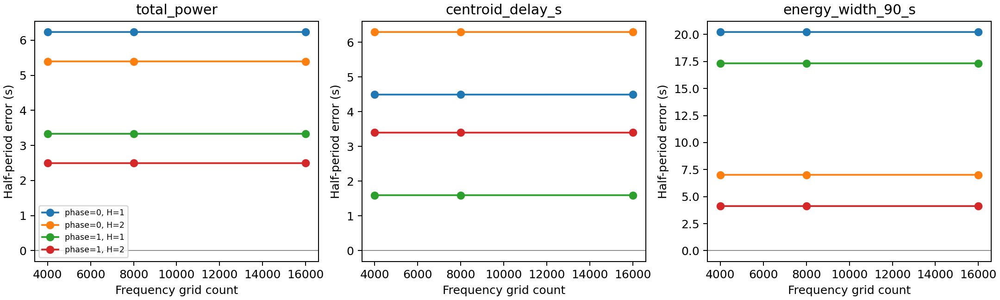

# 雷达周期估计：算法路线与原始文献

整理日期：2026-10-12。同一主题在本文件内统一阅读；以下各部分保留原研究日期、输入条件及实际阅读范围，不把历史实验或文献建议当作已交付生产行为。

## 阅读入口

- **直接编码请读[独立接手说明](https://github.com/lewgeon/radar-asteroid-rotation-period-pipeline/blob/chirp-pulse/docs/4.4/vs_4.3/plans/EV5_PRECISION_IMPLEMENTATION_HANDOFF.md)**：已汇总本轮A/B所需模型、数值规则、代码入口和验收值，不需要通读本文。以下保留推导、文献与历史阶段，按需查证。
- [2026-10-20 现有数据上的可执行解法：多谐波预测融合与有限球面响应](#ev5-precision-models-20261020)；配套[修改方案](https://github.com/lewgeon/radar-asteroid-rotation-period-pipeline/blob/chirp-pulse/docs/4.3/vs_4.2/plans/PERIOD_INVERSION_IMPROVEMENT_PLAN.md#precision-implementation-20261020)和[实际实验](https://github.com/lewgeon/radar-asteroid-rotation-period-pipeline/blob/chirp-pulse/docs/4.3/vs_4.2/experiments/reports/2026-10-16_RECEIVER_SNR_AND_EV5.md#ev5-precision-20261020)
- [2026-10-20 前阶段数学推导：可辨识性、功率噪声与评分校正](#period-math-20261020)；其中固定功率、M1/M2与迹校正保留为备选研究，不是本次实现的前置条件
- [算法迁移与项目适用边界](#radar-overview)
- [两篇指定原文的模型、误差指标与阅读范围](#reference-papers)
- [扩展原始文献及实际阅读范围](#literature-sources)
- [水星散斑追踪的观测量与误差来源](#mercury-2007-uncertainty)

<a id="radar-overview"></a>

## 算法迁移与项目适用边界

研究日期：2026-10-11。本文综合同次会话的当前算法实验与公开原始文献，回答两个问题：已有开关究竟改善了什么，以及下一步怎样在不输入形状真值的条件下提高半周期准确度。本文不更改生产默认算法，不声称已经复现文献算法或达到其性能。当前实验结果另存为冻结证据；原文阅读范围和访问限制见文末两份研究笔记。

后续检索已扩展至半参数统计、工业测量、核信息论、非均匀动力模态分解及计算机视觉。调整后的跨领域研究优先级与原文依据见 [跨领域周期精度研究](CROSS_DOMAIN_PERIOD_ESTIMATION.md#statistical-strategy)，不再以雷达文献或既有三个特征作为候选方法的边界。

### 一、先区分准确度、重复性和数值分辨率

本项目暂时关注椭球的半周期，参考值为 5400 s。准确度是估计值相对参考值的误差；噪声重复试验的标准差衡量重复性；拟合得到的置信区间是特定模型及噪声假设下的不确定度。三个量不同。一个错误的波形模型可以给出稳定但偏离真值的周期；增加样本可能缩小区间而不消除偏差。搜索网格间距、瀑布图时间步长和 Doppler 分辨率也都不是周期误差。

当前输入是无噪声的 2000 个单脉冲 Run，跨约 9.37 h，覆盖约 6.25 个半周期。视线补偿实验显式提供极轴 RA=105°、Dec=−66°，没有把目标形状或初始自转相位作为反演输入。这是“未知形状、已知极轴”的条件评估，不能当作“形状与极轴均未知”的验证。当前对三种特征分别搜索；“算法组合比较”开关仅同时生成比较结果，本身不产生新估计器。

此次完成 168 条搜索记录：72 条无噪声网格/开关/特征组合、72 条配对原始 IQ 加噪组合及 24 条极轴扰动结果。下表固定开启局部细化、网格 4000，数字为估计半周期减 5400 s；三种特征分别估计，未按真值择优输出。

| 特征 | 基础 H=1 | 视线补偿 H=1 | 视线补偿 H=2 |
| --- | --- | --- | --- |
| 总功率 | +6.236 s | +3.333 s | +2.495 s |
| 距离质心 | +4.493 s | +1.597 s | +3.398 s |
| 90% 能量宽度 | +20.226 s | +17.330 s | +4.123 s |

视线补偿在这三种特征上均减少约 2.9 s 的偏差，质心绝对误差约减少 64%；多谐波对宽度帮助很大，对质心却变差，所以不能作为普遍提高精度的选项。组合比较开关本身不改善估计，只使上述差异可见。

网格增加到 8000/16000 时，已细化的质心 H=1 补偿结果为 +1.596744/+1.596704 s，三档最大差约 0.000063 s。相反，未细化结果为 +0.506424/+0.928401/+2.025886 s；4000 网格偶然更接近真值，不能解释为更准确的算法。细化的收益是减少数值网格依赖，不是消除观测模型偏差。

在 20 dB ADC 窗平均信噪比、三个配对噪声种子的探索试验中，质心 H=1 的未补偿 RMSE 为 4.335 s，补偿后为 1.461 s；补偿后的平均偏差 +1.427 s、样本标准差 0.381 s。这里三次重复不足以确定可靠置信区间；噪声下平均误差偶然更小也不是噪声有益的证据。极轴坐标单独偏差 ±5° 时，质心补偿误差范围约 +1.480 至 +1.725 s，属于当前很小视线变化的条件结果，不代表一般极轴误差容限。

完整八组合、多特征噪声与极轴敏感性表、作用域和重建命令见 [本轮冻结精度评估](https://github.com/lewgeon/radar-asteroid-rotation-period-pipeline/blob/chirp-pulse/docs/4.3/vs_4.2/experiments/reports/2026-10-11_PERIOD_METHOD_RESEARCH.md#optional-options)。这项实验仍不足以证明任何真实观测系统的绝对误差上限，也没有验证文献候选算法能稳定达到亚秒。



图中各线表示一组补偿/谐波配置；三个面板分别为总功率、距离质心和能量宽度。细化后增加网格几乎不改变结果，而不同特征和模型仍存在明显不同的周期偏差。

本轮 25 项相关测试通过；全新上下文的对抗性审查独立核对了 168 条记录、全部结果表与源码哈希，未发现剩余交付阻断项。Markdown 公式检查当前版本零违规。此验收限定于本轮研究与实验，不替代其他形状、未知极轴或真实系统验证。

### 二、文献中没有可直接搬来的通用精度冠军

检索覆盖用户指定的两篇文章、雷达散斑与空间目标转动测量、近期小行星雷达形状/自转研究，以及可迁移的非均匀周期统计方法。使用出版方正文、作者全文与机构存档；部分论文只取得摘要或网页抽取正文，已在笔记中注明。因此下面是有证据边界的研究路线比较，不能视为穷尽所有论文的系统综述，也不能确认“全球最高精度”这一排名。

| 路线及代表原文 | 实际估计量与证据 | 对本项目的判断 |
| --- | --- | --- |
| [CW 微多普勒，2025](https://arxiv.org/html/2510.25004) | 连续谱图中的旋转签名；作者称秒级，但正文没有逐目标误差条 | 可迁移图样重复思路；其连续 CW 数据和秒/分钟转动不同于 singleton Chirp，无法直接比较准确度 |
| [APT 相位跟踪 ISAR，2026](https://doi.org/10.3390/rs18142311) | 孤立散射点相位曲率估计二维成像模型的等效角速度；仿真 0.2% 转速误差，暗室 0.31%/0.37% 尺度误差 | 本身使用 LFM，波形相容；需要相干多脉冲、稳定散射点和几何模型，不是当前半周期准确度的证据 |
| [金星雷达散斑跟踪，2021](https://arxiv.org/html/2103.01504) | 多站相关延迟与几何估计转速、极轴；单次转速平均相对不确定度约 5 ppm，长期平均周期与自然变化另行处理 | 精度很高但观测量不同，需要多站及适当散斑尺度；不可直接用于当前单一数据流 |
| [小行星散斑跟踪，2010](https://echo.jpl.nasa.gov/asteroids/2008EV5/busch.etal.2010.radarspeckle.pdf) | EV5 实测约束逆行极轴，自转率使用光学结果 | 有助后续极轴研究，不能称为独立无先验周期精度验证 |
| [2000 RS11 雷达/光学联合反演，2026](https://arxiv.org/abs/2603.16703) | 跨多日数据联合推断形状及自转；摘要报告 4.445±0.001 h，± 的统计定义尚未全文核验 | 不必输入真实形状，但要联合拟合未知形状；不是完全无形状建模的方法 |
| [GLS，2009](https://arxiv.org/abs/0901.2573)、[多波段周期图，2015](https://arxiv.org/abs/1502.01344)、[周期 GP，2022](https://arxiv.org/abs/2111.12596) | 非均匀时刻的周期拟合、共同频率或条件后验，原文并非本项目雷达性能验证 | 可迁移统计结构，需重新在 Chirp 距离像上验证，不承诺原论文的光学收益 |

对于几小时转动，仅有“周期是几小时”的条件不能给出几秒的物理误差下限。随机噪声、观测基线、结构调制幅度、几何和模型错配共同决定误差。当前无噪声秒级残差更符合受几何变化及简化特征模型影响的系统偏差；其大小不是信息论极限的测量结果。反过来，已知完整形状模板的微秒控制实验也不能证明未知形状数据具有同样可辨识信息。

### 三、从文献提炼的首选算法：利用距离像，而不只利用三个摘要量

现有算法把每个距离像压缩为功率、质心或宽度，丢弃了大量内部结构。首选研究路线是对运动补偿后的脉压距离强度像进行共同周期估计，并与原来的单特征方法保持独立。这里改善的是“随自转变化的观测特征模型”，不会改变发射 Chirp，也不会在接收端假定系统发射其他波形。

#### 3.1 多通道共同频率

多波段周期图提供共同频率、不同通道响应及正则化的统计思想。[原始论文](https://arxiv.org/abs/1502.01344)。下式是面向本项目的迁移设计，不是原文已经验证的雷达算法。令 $t_i$ 为第 $i$ 个特征的物理散射时刻，$z_{ik}$ 为其第 $k$ 个距离单元或低维距离像成分的强度，$P$ 为待估半周期，$c_k,a_{kh},b_{kh}$ 为从数据拟合的系数，$H$ 为谐波阶数，$\delta_i$ 为可选几何相位补偿。

$$
\psi_i(P)=\frac{2\pi(t_i-t_0)}{P}+\delta_i,
\qquad
\widehat z_{ik}=c_k+\sum_{h=1}^{H}\left[a_{kh}\cos(h\psi_i)+b_{kh}\sin(h\psi_i)\right].
$$

共同搜索一个 $P$，各通道分别拟合幅度和相位。用估计噪声协方差计权，或先做可复核的低维降噪；不得将相关的相邻距离 bin 当作完全独立样本。初始自转相位被自由系数吸收，无需事先知道。选择阶数、通道与正则化时用按完整 Run/周期划分的留出验证，不能按与真值最近的结果挑选。多个特征简单平均可能把偏差平均进去，共频也不能自动消除几何系统误差。

#### 3.2 相位折叠距离像重复性：PDM、相关与周期样条

[Stellingwerf 的 PDM](https://articles.adsabs.harvard.edu/pdf/1978ApJ...224..953S) 以相位箱内方差判断周期，不要求正弦波；[2026 雷达网络研究](https://doi.org/10.1049/rsn2.70140) 也讨论在观测跨越自转周期时用距离像自相关。针对非均匀 Run，应直接用真实时刻折叠并比较图样，不把缺测时段填成连续相干 IQ。分箱会产生量化与起点敏感性，不能因拟合模型更灵活就许诺更高精度。

更适合做精细研究的迁移版本是周期样条或低维距离像模板。由数据学习一个周期函数 $g_k$，联合优化周期，并用曲率正则化控制复杂度。令 $\sigma_{ik}$ 为观测误差尺度、$\mu$ 为正则化强度，定义：

$$
\mathcal L(P,g)=\sum_{i,k}\frac{\left[z_{ik}-g_k\!\left(\psi_i(P)\right)\right]^2}{\sigma_{ik}^2}+\mu\sum_k\int_0^{2\pi}\left[g_k''(\psi)\right]^2\,d\psi.
$$

这是研究设计，不是新增生产功能或已经得到的精度结果。模型的形态从回波学习，不输入网格形状真值；相位零点只是模板坐标约定。需要完整周期的训练/留出分离，扫描样条自由度及正则化，并检查噪声重采样下的偏差、失败率和网格稳定性。完全对称椭球仍以 5400 s 半周期作为评价目标，本轮无需解决全周期歧义。

#### 3.3 再处理几何引起的波形变化

视线经度补偿仅对周期坐标作平移，不能保证距离像在不同观测方向下完全相同。后续可将模板扩展为 $g_k(\psi,\eta)$，其中 $\eta$ 表示相对极轴的视角或双站角，限制其变化平滑程度，再与仅相位补偿做逐项 A/B。极轴未知时可联合搜索候选极轴，但必须检查周期—极轴—模板之间的退化，报告不可辨识区间。尤其不能添加自由线性“相位漂移”并称之为误差补丁：线性漂移与周期变化等价，会把真正的周期信息吸收掉。

周期 GP 可作为候选周期后验和模板平滑程度的复核工具。[原文](https://arxiv.org/abs/2111.12596)。仅靠准周期核也不能识别几何变化的物理原因；先验敏感性、相关噪声及多峰解必须显式评估。阶段目标应是减少未知形状条件下的模型偏差，而不是单纯把优化容差调得更小。

### 四、两篇用户参考论文如何迁移

#### 4.1 CW 瀑布图路线

可借鉴的步骤是去除平动 Doppler 漂移、保留随时间变化的谱/强度结构、估计图样重复周期，再利用多接收方向约束几何。Chirp 路线应先脉压或正确解调，再对相干多脉冲慢时间序列形成距离—Doppler 图。原始 Chirp 快时间频谱不能直接当 CW 旋转瀑布图。[原文](https://arxiv.org/html/2510.25004)。当前 singleton 数据优先使用非相干距离像重复；如果以后增加 Run 内相干脉冲，才比较谱宽、谱形及距离—Doppler 结构的周期信息。

论文的 0.2 Hz 谱分辨率与 5 s 时间采样不是其周期准确度。它主要报告近似周期，不能据此判定其比当前约 1.6 s 的理想仿真更好或更差。还需独立参考周期、噪声重复实验、观察基线及几何条件一致的比较。

#### 4.2 APT 与等效转速路线

该论文用 LoG 提取可分离散射点，利用自适应 EKF 跟踪幅相历史，再用相位曲率与距离位置的关系估计成像等效转速，完成横向尺度定标与自聚焦。它使用 LFM，用户对“不需要更换发射波形”的判断正确；主要条件是相干数据和模型成立。[原文 DOI](https://doi.org/10.3390/rs18142311)。

用户将其理解为“垂直视线分量”抓住了常见 ISAR 定标的一层几何关系，但不能无条件等同于真实角速度矢量的正交投影。任意三维散射点、倾斜转轴、双站及变化视线下，相位二阶导数还含轴向坐标与几何变化项；二维转台回归的估计量必须先证明与真实 spin 的映射。网页公式还存在平方项不一致，实施前应取得 PDF 再核验。独立推导见 [两篇原文核验笔记](#reference-papers)。

若在适用几何下确实分别获得真实角速度大小 $|\boldsymbol\omega|=2\pi/P_{\mathrm{spin}}$ 和垂直视线分量 $\omega_\perp$，则夹角 $\theta$ 满足下式。这是几何关系，不是现有算法已实现的极轴测量：

$$
|\sin\theta|=\frac{\omega_\perp}{|\boldsymbol\omega|}.
$$

单一方向只约束极轴落在锥面上，还存在符号/方向歧义；需要足够不同的视线或额外信息才能进一步定位极轴。因此可以保留该后续研究方向，但不能先由成像等效转速直接宣称同时测得真实周期及极轴。

### 五、下一阶段的可执行路线及门槛

| 顺序 | 新的独立研究选项 | 验收目标 |
| --- | --- | --- |
| 1 | 多通道共频：先三个特征，再低维完整距离像 | 未补偿/已补偿两条基础线同会话 A/B；报告偏差、噪声 RMSE，避免按真值选通道 |
| 2 | PDM 与周期样条距离像模板 | 含非正弦但严格周期的独立夹具、网格/平滑扫描和完整周期留出；证明收益超出增加参数造成的拟合改善 |
| 3 | 有限自由度的几何条件模板与极轴敏感性 | 固定极轴与未知极轴分别验证；视线变化和散射变化独立扰动，防止漂移吸收周期 |
| 4 | 多脉冲相干数据上的微多普勒/APT | 先验证当前策略允许的 CPI 内能否测到旋转曲率，再比较周期误差；不得拼接相位重置的 Run |
| 5 | 多站散斑与极轴联合测量 | 属于新增观测能力研究，需要同步接收和多基线，不作为当前代码补丁 |

前三项可以作为独立可选研究分支，延续基础功能加开关的设计，不需输入形状真值。改进能否稳定达到亚秒必须通过实验回答，目前尚不能保证。若延长观察基线，应同时处理周期计数与几何变化；增加同一姿态附近的脉冲能改善局部 Doppler，却不能替代多个小时的姿态覆盖。

### 阅读与证据入口

- [本轮可选算法精度评估](https://github.com/lewgeon/radar-asteroid-rotation-period-pipeline/blob/chirp-pulse/docs/4.3/vs_4.2/experiments/reports/2026-10-11_PERIOD_METHOD_RESEARCH.md#optional-options)：当前实际结果、加噪及极轴敏感性，不是文献性能复现。
- [用户指定两篇论文的原文核验与独立推导](#reference-papers)：参数、实际误差指标、访问限制和二维/三维区别。
- [更广的原始文献与算法迁移笔记](#literature-sources)：PDM、GLS、共同频率、GP、散斑、近期雷达研究及书目信息。
- [实验协议](https://github.com/lewgeon/radar-asteroid-rotation-period-pipeline/blob/chirp-pulse/docs/4.3/vs_4.2/experiments/README.md)：先定评价范围，再运行实验。

<a id="reference-papers"></a>

## 两篇指定原文的模型、误差指标与阅读范围

检索日期：2026-10-11。本笔记只做文献研究，不修改算法或开展实验。项目条件采用本次研究给定的冻结数据事实：2000 个 singleton Runs、全场约 9.37 h、单 Run 远短于几小时自转周期，跨 Run 载波相干尚不能成立；这些条件不是下列论文的实验条件。

### 书目、阅读范围与证据等级

| 文献 | 已核验书目信息 | 实际阅读范围 |
| --- | --- | --- |
| Micro-Doppler signatures and object characterisation of space debris with radio telescopes | Guifré Molera Calvés、Shinji Horiuchi、Edwin Peters、Ed Kruzins、Nick Stacy，2025；arXiv:2510.25004；会议版本 DOI 10.52202/083079-0085，847–859 页；会议目录题名采用 Characterization 拼写 | [作者 arXiv 全文](https://arxiv.org/html/2510.25004v1) 的方法、计算、结果、层析与结论；[会议出版目录](https://www.proceedings.com/083079-0085.html) 核验 DOI |
| Joint Cross-Range Scaling and Phase Autofocus for ISAR Imaging Based on Adaptive Phase Tracking with Application to Asteroid Imaging | Zilin Wang、Wanni Chen、Enhua Zhang、Mingxuan Song、Xuyuan Lin、Kaizhi Wang，Remote Sensing 2026, 18(14), 2311，2026-07-10；DOI 10.3390/rs18142311 | [出版社页面](https://www.mdpi.com/2072-4292/18/14/2311) 的检索返回正文及 [MDPI 提供的 Publisher Full-text](https://www.researchgate.net/publication/408726679_Joint_Cross-Range_Scaling_and_Phase_Autofocus_for_ISAR_Imaging_Based_on_Adaptive_Phase_Tracking_with_Application_to_Asteroid_Imaging) 中信号模型、APT 状态模型、误差分析和表 2、5、8、10、11；出版社直接打开/PDF下载失败，未完成 PDF 公式图像检查 |

第二篇的 ResearchGate 页面明确标记全文由 MDPI 提供，读取的是论文正文而不是研究者评论。网页公式转换仍可能损坏上下标，因此下文指出一致性问题，不能将这些网页式子未经核对当作可执行规格。

### 原文实际支持什么

微多普勒论文采用 7.15 GHz CW、多接收站；处理链为粗谱与三阶 Doppler 拟合、相位去漂移、窄带相干谱、周期图样判读、180° 投影分段与滤波反投影。§3.1 给最终 0.2 Hz、5 s；§4.2/4.3/4.6 给约 230/700/220 s。摘要称秒级精度，但未给逐目标周期误差条；已知尺寸参与验证。其式(1)将带宽与尺寸、几何和周期耦合，不能独立由带宽解周期或 pole。[原文](https://arxiv.org/html/2510.25004v1)

APT 论文处理链为 LFM 脉压、平动补偿、距离迁移校正、RD/LoG 孤立散射点提取、幅相联合 EKF、二次相位拟合、调频率—距离回归、定标及二次相位补偿。表 2/5：9.6 GHz、200 MHz、PRT 1 ms、CPI 4 s、仿真 $\omega_e=0.005$ rad/s、脉压 SNR −5 dB，APT 转速误差 0.2%；表 10/11：9 GHz、2 GHz、1.6 s、转台 3.07°/s，UAV/模型尺度误差 0.31%/0.37%。这些不是实测小行星周期误差；表 8 的 CPI 20 s 转速误差为 2.97%。[出版社](https://www.mdpi.com/2072-4292/18/14/2311)、[出版社全文镜像](https://www.researchgate.net/publication/408726679_Joint_Cross-Range_Scaling_and_Phase_Autofocus_for_ISAR_Imaging_Based_on_Adaptive_Phase_Tracking_with_Application_to_Asteroid_Imaging)

### 从模型独立推导可识别量

以下是本笔记的推导，不是论文额外验证结果。设 $\lambda$ 为波长、$t$ 为相干慢时间、$x_i,y_i$ 为散射点相对转动中心的二维坐标，其中 $y_i$ 沿视线；$\omega_e$ 是二维等效转台角速度。若距离历程确实满足二维刚性转台近似，则有：

$$
r_i(t)=y_i+x_i\omega_e t-\frac{1}{2}y_i\omega_e^2t^2+O(t^3).
$$

取单站载波相位 $\phi_i=-4\pi r_i/\lambda$，其频率与调频率为：

$$
f_i(t)=\frac{1}{2\pi}\dot\phi_i(t)=-\frac{2x_i\omega_e}{\lambda}+\frac{2y_i\omega_e^2}{\lambda}t,
\qquad \gamma_i=\dot f_i=\frac{2\omega_e^2}{\lambda}y_i.
$$

因此拟合 $\gamma_i=a+K y_i$，可得 $|\omega_e|=\sqrt{\lambda|K|/2}$；允许截距 $a$ 可吸收公共平动加速度和距离原点偏置产生的公共项。必须有可分离散射点、足够距离分布、相位历史和可测二次项；只有一个距离位置时无法可靠区分公共加速度与转动曲率。未知形状不要求把仿真形状真值喂给这个回归，但散射点稳定性与上述运动模型依然是先验。

APT 网页式(11)的文字定义显示 $K_\gamma=2\omega_e/\lambda$，而式(6)含 $\omega_e^2$、式(32)取平方根；由上述微分与量纲可知比例系数应含平方。该处至少存在网页/原文一致性问题；式(18)显示的时间矩阵也应核对各列 $T_s^2,T_s,1$ 的量纲，不能直接从抽取文本复制实现。[公式位置的原文](https://www.mdpi.com/2072-4292/18/14/2311)

二维转台结果不能无条件推广到三维 spin。设 $\mathbf n$ 为目标到雷达的单位方向，$\boldsymbol\omega$ 为惯性角速度、$\mathbf r$ 为散射点相对转动中心的位置。忽略视线变化时，一般刚体满足：

$$
\dot\ell=\mathbf n\cdot(\boldsymbol\omega\times\mathbf r),
\qquad
\ddot\ell=(\mathbf n\cdot\boldsymbol\omega)(\boldsymbol\omega\cdot\mathbf r)-|\boldsymbol\omega|^2(\mathbf n\cdot\mathbf r).
$$

第一式的瞬时 Doppler 对平行视线的角速度分量不敏感；常见横向定标使用垂直视线的等效角速度。但第二式还包含未直接观测的轴向坐标，故任意倾斜轴与三维形状下，“曲率—测量距离”并非自动具有二维转台斜率。只有模型成立且几何投影已处理，才能把 APT 估计量解释为该模型的 $\omega_e$；不能一律用 $2\pi/\omega_e$ 报真实自转周期。

双站应从总路径重新建模。令 $\mathbf u_T,\mathbf u_R$ 为发射站/接收站指向目标的单位向量，$\mathbf q=\mathbf u_T+\mathbf u_R$；在局部远场、基站几何冻结时，相对路径为 $L_i-L_0\simeq\mathbf q\cdot\mathbf r_i$，相位为 $-2\pi L_i/\lambda$。双站角 $\beta$ 满足 $|\mathbf q|=2\cos(\beta/2)$，等效方向为 $\mathbf n_b=\mathbf q/|\mathbf q|$。若几何随时间变化，还必须保留 $\dot{\mathbf q}\cdot\mathbf r_i$ 等项；有效观测转动包含视角演化与真实 spin 的相对运动，不能只替换一个常数系数。

$$
f_{D,i}=-\frac{1}{\lambda}\frac{d}{dt}\left(\mathbf q\cdot\mathbf r_i\right)
=-\frac{1}{\lambda}\left[\dot{\mathbf q}\cdot\mathbf r_i+\mathbf q\cdot(\boldsymbol\omega\times\mathbf r_i)\right].
$$

若基站方向近共线，多接收站未必提供足够不同的投影；视线接近 spin 轴时转动 Doppler趋近零；散射场存在半转或更高旋转对称性时观测周期可能为 $P/2$ 或 $P/m$。周期重复可不依赖精确尺寸，但需要足够重复循环、稳定可见特征和对谐波别名的排除。单一短 CPI 的定标标量既不能唯一确定三维 pole，也不能排除轴向不可辨识；多几何联合拟合必须实际给出可辨识性与置信区间。

### 迁移到当前 Chirp 与短 Run 的要求

CW 微多普勒直接在载波窄带序列上形成相干频谱；Chirp 原始快时间频谱主要包含发射调频，须先脉压或正确解调，在物理散射/距离单元的慢时间上构造转动特征，并处理距离—Doppler 耦合、运动伸缩、距离迁移及非均匀采样。APT 本身就是 LFM 模型，主要迁移难点是其相干慢时间、二维运动模型与双站几何，而非把 CW FFT 参数照搬。

冻结 singleton Run 不提供 Run 内多脉冲慢时间 CPI。一个 Chirp 的快时间采样不能直接当作论文的脉冲慢时间；单脉冲内仍可能含 Doppler 信息，但其可观测量与距离/调频耦合需另建模型，不能宣称已具备 ISAR RD 图或 APT 输入。9.37 h 时间跨度有助于寻找非相干重复图样，却不等于 9.37 h 相干积分。若每个 Run 存在独立未知载波相位，跨 Run 相位差既可由转动也可由相位重置解释；必须证明相位参考或将这些相位作为 nuisance 参数处理。

可迁移的研究方向是比较经脉压、校准与几何修正后的非相干距离强度轮廓/散射特征重复，或将多几何物理路径模型与未知散射场联合拟合；前者要警惕半周期别名，后者要检查形状与 spin 的参数补偿。两篇文献都不能作为当前数据“必然达到秒级”或“最高精度”的证据，尤其不能把二维定标误差、频率分辨率或近似周期当作真实周期精度。

<a id="literature-sources"></a>

## 扩展原始文献及实际阅读范围

研究日期：2026-10-11。范围：公开原始论文、出版方正文、作者机构存档及 NASA/JPL 原文；重点覆盖 2020—2026 年相关进展，并保留可靠经典算法。本文不宣称某一方法是唯一精度冠军，也不把空间碎片、金星、光学和小行星雷达的不同误差指标横向混排。没有运行实验或修改生产代码。

### 1. 项目适用边界与结论

本次迁移判断以主任务提供的冻结条件为前提：2000 个 singleton Run，跨约 9.37 h，每 Run 短于光行时且远短于小时量级自转周期，Run 间载波相干性未保证，没有实际可用的形状或 pole 真值。这里没有独立复核这些配置数值。对这样的数据，优先研究逐 Run 压缩距离像的强度结构、多特征共同频率及折叠重复性；不能把独立 Run 的复 IQ 直接拼接成连续相干 CPI，也不能仅凭信号带宽反推出无歧义自转周期。

“不需要预先已知形状”包含两种不同情况：直接估计重复周期而不拟合形状，以及把未知形状与自转一起反演。后一种仍然需要形状模型和散射模型，只是形状不是输入真值。前者通常先得到视几何条件下的表观重复周期，若要高精度恒星自转周期，还需要观察方向和 pole 的联合处理。NASA/JPL 介绍明确将充分方位覆盖、延迟—多普勒影像和三维形状/自转反演联系起来。[NASA/JPL 雷达研究介绍](https://echo.jpl.nasa.gov/introduction.html)

### 2. Speckle tracking：高精度但需要多站

Busch 等，《Determining asteroid spin states using radar speckles》，Icarus 209, 535–541 (2010)，DOI：10.1016/j.icarus.2010.05.002。Arecibo 发射、VLBA 接收，2008 年 12 月观测 2008 EV5，通过不同接收站回波的互相关时间延迟判定逆行旋转。作者机构记录注明 EV5 自转率由光学观测确定；这篇实测不能表述成完全没有周期先验的高精度周期独立测量。它证明的是未知形状下的 speckle 运动与 pole 约束能力，并强调多基线的重要性。[NASA/JPL 全文](https://echo.jpl.nasa.gov/asteroids/2008EV5/busch.etal.2010.radarspeckle.pdf)、[Caltech 作者存档](https://authors.library.caltech.edu/records/28hg5-rcs64)

Margot 等，《Spin state and moment of inertia of Venus》，Nature Astronomy 5, 676–683 (2021)，DOI：10.1038/s41550-021-01339-7。Goldstone 70 m 发射 8560 MHz、约 200–400 kW 的单色信号，Goldstone 与 GBT 接收；2006—2020 共 21 次有效测量，单次自转测量的平均相对不确定度 5 ppm，pole 总体精度 2.7 arcsec。平均恒星日 243.0226 ± 0.0013 地球日是 bootstrap 得到的 1σ 不确定度，真实自转变化至少 ±0.0047 日（1σ）；不是与已知真值比较的绝对误差，也不是同一固定周期的任意精度积累。[原文及补充材料](https://arxiv.org/html/2103.01504)、[出版记录](https://www.nature.com/articles/s41550-021-01339-7)

操作路线是双站同步记录功率起伏，扫描相关峰出现的时刻及站间延迟，用已知站坐标、传播几何和自转矢量模型联合拟合，再通过不同基线或不同几何的观测解除退化。该路线不依赖完整形状先验，却需要多个物理接收站、同步时间、足够 SNR 和合适 speckle 尺度；现有单站仿真数据不能通过换软件补齐这些观测量。上述金星精度仅说明这种观测机制的潜力，不是本项目精度预测。

### 3. 相干微多普勒与距离像重复性的近期证据

《Experimental Comparison of Radon Domain Approaches for Resident Space Object’s Parameter Estimation》，Sensors 21(4), 1298 (2021)，DOI：10.3390/s21041298。原文对比基于 spectrogram、autofocus 和 inverse Radon transform 的转速/尺寸估计，通过候选转速下的重建集中度或峰值选解；含仿真与真实空间目标数据，使用 NRMSE 衡量重复噪声实现下的误差。这是完整时频结构和散射分布共同提供转速信息的原始依据，但不是小行星 singleton Run 的直接验证。[公开全文](https://pmc.ncbi.nlm.nih.gov/articles/PMC7918837/)

《Long baseline bistatic radar imaging of tumbling space objects for enhancing space domain awareness》，IET Radar, Sonar & Navigation 18(4), 598–619 (2024)，DOI：10.1049/rsn2.12511，2023-12-19 在线发表。作者机构记录说明真实在轨翻滚火箭体实验及 Doppler superpulse 处理；本文仅核验了机构摘要与书目，没有把“high-fidelity”换算为未经核验的具体小行星周期误差。[作者机构记录](https://research.birmingham.ac.uk/en/publications/long-baseline-bistatic-radar-imaging-of-tumbling-space-objects-fo/)

Molera Calvés 等，《Micro-Doppler signatures and object characterisation of space debris with radio telescopes》，arXiv:2510.25004，2025-10-28 预印本。SHARP 采用 DSN Canberra C 波段 CW 与分布式射电望远镜，2021—2025 观测 20 个空间目标；正文示例包括约 230 s、700 s 和 220 s 旋转，部分扫描 10 min。摘要称秒级周期精度，但正文缺少逐对象完整置信区间和独立真值误差表，因此本文不把该措辞当成保证的绝对准确度。CW 连续时频数据和长期跟踪条件与当前 Chirp singleton 数据不同。[作者预印本全文](https://arxiv.org/html/2510.25004)

《Characterisation and Classification of Resident Space Objects Using Radar Networks》，IET Radar, Sonar & Navigation (2026)，DOI：10.1049/rsn2.70140，2026-04-01 首次发表。正文明确说对快旋转目标，当观察持续时间长于旋转周期，可以用 range-profile autocorrelation 估计转率；主体是 42 类空间目标、多站 ISAR/点云仿真分类，其分类准确率不能用作周期准确率。其引用的直接转率/IRT 方法是 Ghio 与 Martorella (2019)，DOI：10.1049/iet-rsn.2018.5337，原始作者机构存档可检索；本次未取得后者完整正文，故不复述未经核实的性能值。[2026 出版全文](https://ietresearch.onlinelibrary.wiley.com/doi/10.1049/rsn2.70140)、[2019 作者记录](https://arpi.unipi.it/handle/11568/1015076)

Wang 等，《Joint Cross-Range Scaling and Phase Autofocus for ISAR Imaging Based on Adaptive Phase Tracking with Application to Asteroid Imaging》，Remote Sensing 18(14), 2311 (2026)，DOI：10.3390/rs18142311，2026-07-10 发表。出版方被检索到的正文讨论距离相关相位曲率、散射点 phase tracking 与有效角速度估计，可作为无需完整形状先验的前沿线索；本笔记撰写时直接打开正文受到 429 限制，只核验了检索正文，未据此报告确定精度。本轮另一路研究随后取得 MDPI 提供的全文镜像并核验误差表，具体数值与阅读范围统一以 [两篇原文核验笔记](#reference-papers) 为准，仍未视觉核验 PDF。网页式 (8) 包含有效角速度平方，式 (11) 的比例系数却显示一次幂，存在需要核对原 PDF 的公式一致性问题。进入实现前必须确认相位模型、量纲、连续 CPI、平动补偿及有效角速度到恒星自转矢量的映射。[出版方原始页面](https://www.mdpi.com/2072-4292/18/14/2311)

### 4. 可直接作为未知形状强度分析基础的经典算法

GLS：Zechmeister 与 Kürster，《The generalised Lomb-Scargle periodogram》，A&A 496, 577–584 (2009)，DOI：10.1051/0004-6361:200811296。它在真实不均匀时间戳上拟合带偏置、带权的正弦；适合快速候选频率搜索，不能用单正弦自动消除非正弦形体、双峰或半周期。做法是先为每 Run 提取强度特征及不确定度，在频率网格上求加权残差，保留多个峰，再以多谐波模型细化。[作者预印本](https://arxiv.org/abs/0901.2573)、[出版方 PDF](https://www.aanda.org/articles/aa/pdf/2009/11/aa11296-08.pdf)

PDM：Stellingwerf，《Period determination using phase dispersion minimization》，ApJ 224, 953–960 (1978)，DOI：10.1086/156444。按候选周期折叠时间，再比较相位箱内方差与总方差，适合非正弦周期形状。对本项目的迁移是让每个距离像特征分别折叠，再将经过误差尺度规范化的相位内残差组合；必须扫描分箱数、相位箱起点与最小箱内样本数，不把分箱伪峰当作周期。该多特征组合是本文迁移建议，并非原文已验证的小行星雷达实现。[原始全文扫描件](https://articles.adsabs.harvard.edu/pdf/1978ApJ...224..953S)

多通道共频：VanderPlas 与 Ivezić，《Periodograms for Multiband Astronomical Time Series》，ApJ 812, 18 (2015)，DOI：10.1088/0004-637X/812/1/18。原文用截断 Fourier 序列、共享基础周期及 Tikhonov 正则化联合不同光学波段。雷达可迁移的是“共频率、各通道系数可不同”这层思想；距离 bin 之间可能反相或波形不同，不能强制所有 bin 同幅同相。应比较独立通道 Fourier、共享基础模型、低维距离像特征三种配置，并按距离 bin 噪声协方差计权。[作者全文](https://faculty.washington.edu/ivezic/Publications/multibandLS.pdf)、[原始预印本](https://arxiv.org/abs/1502.01344)

周期 GP：Lindberg 等，《Characterizing Sparse Asteroid Light Curves with Gaussian Processes》，AJ 163, 29 (2022)，DOI：10.3847/1538-3881/ac3079，预印本 2021 年。该模型不要求完整形状输入，用周期及缓变协方差处理稀疏光学时间序列和后验多峰。原文假设经修正的长期趋势、严格周期过程及近似 Gaussian 误差，不包含翻滚；1388 Aphrodite 示例的 11.94597 h、68% 可信区间 11.94475–11.94700 h 是条件后验区间，不能当作雷达误差。雷达强度噪声不一定 Gaussian，2000 样本的密集 GP 也有成本，因此宜在候选区间或低维特征上辅助复核。[作者全文](https://arxiv.org/pdf/2111.12596)、[作者配套软件](https://github.com/dirac-institute/asterogap/tree/v0.1)

### 5. 与全形状联合反演的精度差别

2026 年《The shape and spin state of (275677) 2000 RS11 from ground-based radar and optical observations》报告 2014 年 3 月跨 5 天的 Arecibo 2380 MHz 与 Goldstone 8560 MHz 观测，结合光学与形状/自转建模，周期 4.445 ± 0.001 h、pole 亦有不确定度。本文核验的是作者摘要，尚未确认其 ± 的具体统计定义，故不称为 1σ。这类结果说明现代高精度工作常利用多日几何和联合物理模型；其绝对误差不能从论文报告末位小数直接推断。[2026 作者预印本](https://arxiv.org/abs/2603.16703)

2026 年 1998 SH2 雷达论文仍展示带宽估计的局限：7 Hz 带宽和约 380 m 直径只给出约 5.4 h 的周期上界，并依赖直径正确、目标没有明显拉长的前提。单次带宽与尺寸、pole 投影耦合，因此“雷达能测转速”不能推导出“不需几何约束就能精确测恒星周期”。[Nature Astronomy 原始方法段](https://doi.org/10.1038/S41550-026-02913-7)

### 6. 项目迁移排序与必要的追加观测

| 优先级 | 路线 | 可以先做的研究 | 要补齐的条件 |
|---|---|---|---|
| 1 | 多特征带权多谐波共频 | 全局频率网格、局部细化、各距离像/特征系数独立，比较不同谐波阶数 | Run 时间戳、平动对齐、强度标定、各特征噪声及协方差；几何变化评估 |
| 2 | 距离像重复相关 + PDM | 相位折叠后图像/特征相似度；明确检查 P/2、P、2P 及采样混叠 | 多个完整周期、足够 SNR；跨周期形态一致性和可见几何变化 |
| 3 | 周期/准周期 GP | 对候选周期的多峰后验及趋势敏感性复核 | 合适强度噪声似然、先验敏感性扫描；不以先验补出不存在的信息 |
| 4 | 微多普勒、phase curvature、IRT | 先验证观察量和角速度可辨识，再讨论周期转换 | 增加相干多脉冲 CPI，稳定散射特征，补偿平动；pole/视线几何约束 |
| 5 | Speckle tracking | 多站观测设计与相关延迟仿真 | 新增同步接收站、多基线、合适 speckle 尺度及功率起伏数据 |

这里的排序是基于冻结条件的工程迁移判断，不是文献性能排名。共同频率能利用多个结构的重复信息，却不能创造独立信息：相邻距离 bin 有相关噪声，同一个全局 ADC 样点的保存行副本不能重复计权。幅度归一化也可能去掉真实旋转调制，宜保留原始功率与形态归一化两条路线并比较。

高精度阶段应优先延长跨周期基线而非仅加密一次短窗口；增加 Run 内脉冲有助于相干 Doppler，但同一姿态的脉冲数不能替代小时尺度姿态覆盖。多夜/多几何观测还需处理整周计数与几何漂移。任何精度报告都应分别给出真值误差（仅仿真或独立参考可用时）、噪声重复试验 RMSE、条件后验区间、混叠/半周期解比例及模型系统误差；细网格稳定不等于物理精度，单一噪声扰动也不等于可信覆盖率。

本次公开检索未取得能够直接证明“当前单站 singleton Chirp 数据 + 循环相关”优于所有多谐波/PDM 方法的原始小行星实测依据。循环统计和周期相关可保留为研究分支，但要区分有限窗口的重复相似度与平稳循环过程假设，不能沿用空间碎片连续观测的性能数值。2021 算法对比与 2025 TESS Fourier 原文由主任务另行核验，本文不重复代替其全文阅读。

<a id="mercury-2007-uncertainty"></a>

## 水星散斑追踪的观测量与误差来源：Margot 等（2007）

核对日期：2026-10-15。本节实际读取用户提供的《Large Longitude Libration of Mercury Reveals a Molten Core》PDF，并检索出版方与作者网站。书目信息为 J. L. Margot、S. J. Peale、R. F. Jurgens、M. A. Slade、I. V. Holin，Science 316, 710–714（2007），[DOI：10.1126/science.1140514](https://doi.org/10.1126/science.1140514)。可公开核对的同篇一手全文为[作者存档 PDF](https://mel.ess.ucla.edu/jlm/publications/Margot07.science316.mercury.pdf)，另有[作者图解页](https://seti.ucla.edu/jlm/research/Mercury/moltencore.html)。本地文件共6页：第1—5页对应期刊710—714页，第6页为出版信息与链接页，没有夹入其他论文正文。

### 1. 先纠正误差等级：本文主要报告的是1σ

本文712页明确把采用的惯量比误差称为1σ，对应受迫经度天平动角振幅35.8 ± 2角秒；倾角2.11 ± 0.1角分的采用误差也明确为1σ。图2显示的是极轴方向的68%、95%、99%二维联合置信区域，没有称为3σ。全文及末页没有检出3σ误差声明。因此，不能把±2角秒说成本文给出的3σ，不能把图2最外轮廓等同于一维3σ，也不能声称这些范围100%包含真值。若另行把作者采用的1σ数值乘3，只能标为额外作出的“三倍采用标准差”换算；只有额外满足正态误差和有效校准等条件时，一维对称±3σ才对应约99.73%的覆盖率，本文没有给出针对全部未知系统误差的这种覆盖保证。[依据：本文712页正文及图2；作者PDF同上。]

### 2. 两个直接观测量，并非周期曲线的FFT峰

Goldstone通常发射8560 MHz单色连续波，Goldstone和Green Bank分别接收散斑扫过测站时的复基带电压时间序列；另有Arecibo配置，不能把所有记录都称为同一双站配置。散斑来自粗糙表面各散射波的干涉，随着目标自转扫过地球。本文对两站复电压作复互相关并取幅度（714页注29），从中读出两个量：每天最大相关出现的绝对时刻，以及同一散斑图样从一站到另一站的传播时差。前者主要约束自转轴方向，后者在几何已知时约束瞬时角速度；多次不同视线几何的观测共同确定极轴。[依据：710—711页Method、Observations，712页图1，714页注27、29。]

图1A给出相关强度随绝对时刻变化的曲线，图1B给出特定时刻的互相关随站间时差变化的曲线，两者均用高斯曲线定位峰中心。图1采用1 s积分，A和B的序列采样率分别为200 Hz、5000 Hz。正文给出的代表定位精度约为0.5 s和0.1 ms，对应初始曲线宽度约5 s和2.5 ms；这些是定位问题的尺度，不能把5 s或2.5 ms直接当作估计误差。表1的w是前一条高斯曲线的标准差宽度，也不是极轴拟合的标准差。[依据：711页、表1及712页图1。]

第一阶几何关系把基线长度、目标距离、角速度、视线倾角与最大相关时差联系起来（711页式3），用于理解方法。正式计算并非只代入这条近似式：极轴用相关最大时刻作最小二乘拟合，计算包含DE414星历、地球定向和极移、光行时及广义相对论时延；逐历元角速度则调整到两组发射机—目标—接收机路径在目标固连坐标中满足相同经度的相干条件，含光线路径、运动参考系的Lorentz变换与旋转矩阵。[依据：711页Results及712页。]

### 3. 从观测误差到参数误差：原文能确认的层次

| 层次 | 原文实际做法与数字 | 不能据此补写的细节 |
| --- | --- | --- |
| 电压噪声及散斑统计 | 711页给出代表SNR：200 Hz带宽内SC约3、OC约20；高SNR允许峰中心定位精度小于峰宽 | 没有逐项给出热噪声、散斑自噪声、量化噪声各自贡献，也没有提供完整噪声协方差 |
| 逐次时差及角速度误差 | 表1的相对不确定度s由连续多次测量经验确定；图1B说明使用连续的高斯峰中心测量。最早4组采用0.2 ms残余定时不确定度，对应表中约1.6×10⁻⁵量级的相对误差 | 没有明确交代连续测量误差用样本标准差还是均值标准误、有效独立样本数、时间相关修正，以及0.2 ms残余定时项的完整校准程序；不能把它们全叫纯热噪声 |
| 极轴与倾角 | 相关最大时刻的最小二乘得到极轴，图2为正式拟合的二维联合区域；作者采用的倾角1σ误差大于拟合的形式误差，用来防范未检出的系统影响 | 没有给出完整极轴协方差矩阵、形式误差到采用误差的倍率或系统误差逐项预算；图2形式区域不等于扩大后的采用误差 |
| 88日受迫天平动与模型差异 | 712页将瞬时角速度拟合至力矩方程的数值解；单参数只调振幅，三参数再调初始天平动角和角速度，允许约12年长周期成分 | 不能把88日当成对未知频率无先验搜索所得周期：它来自轨道受迫，曲线相位由近日点时刻确定；不足一整长周期的数据也不能确认12年成分 |
| 内部结构推断 | 713页误差传播与Monte Carlo把天平动振幅和重力系数C22的不确定度传到Cm/C；图4采用10⁵次正态抽样及内部模型两端C/MR²=0.325和0.380 | 这不是用Monte Carlo从原始电压重新产生天平动振幅误差；没有交代全部相关抽样结构、随机种子或完整实现 |

这里“形式误差”指在指定模型和观测误差假设下由拟合得到的统计误差，“采用误差”指作者最终用于结论的误差范围。原文没有披露足以逐位复现全部误差条的算法与原始序列，不能凭“最小二乘”三个字就断言用了特定Jacobian协方差公式、bootstrap或残差重标定。[依据：表1、712页Results、713页及图4。]

### 4. 为什么最终振幅误差大于某一次拟合的形式误差

令q=(B−A)/Cm，A、B、Cm分别表示赤道两个主惯量和参与天平动的地幔加地壳极惯量。712页给出如下结果，数值统一以10⁻⁴为单位；这些是同一观测分析中的不同极化或模型，不能当成多次独立重复实验。

| 拟合 | q及原文给出的误差 | 约化χ² |
| --- | --- | --- |
| 单参数、OC | 2.01 ± 0.09 | 2.3 |
| 单参数、SC | 2.08 ± 0.07 | 1.3 |
| 单参数、OC与SC合并 | 2.04 ± 0.06 | 1.8 |
| 三参数、OC与SC合并 | 2.03 ± 0.04 | 0.9 |
| 最终采用 | 2.03 ± 0.12，明确为1σ | 不是另一组拟合的χ² |

作者说明，最终±0.12覆盖OC单独和SC单独模型各自的1σ范围，并将它换算为35.8 ± 2角秒的受迫振幅。这一扩大体现极化和模型差异的考虑，不是将合并三参数拟合的±0.04直接当作最终精度。原文没有给出构造±0.12的详细数值规则，也没有说明用χ²乘某个因子得到它；不能自行把±0.12解释为±0.04的3σ。作者还检查在2.11 ± 0.1角分范围内改变满足Cassini条件的极轴，振幅解保持一致，这属于几何敏感性检查，不是所有模型误差都已消失的证明。[依据：712页Results。]

对液核结论，主要限制转而来自Mariner 10重力系数C22。714页注38说明当年重力团队为包括系统影响把现实误差扩大到形式误差约10倍；这是被引用的重力参数误差处理，不能移植成雷达时差或天平动误差的统一倍率。图4的Monte Carlo得到Cm/C<1的置信水平：不用Cassini额外约束时90%，加入后95%。714页指出Cm/C误差当时由C22主导，不能把“液核证据95%”改写成“自转率3σ准确”或“振幅保证无误”。[依据：713页图4、714页正文及注38。]

### 5. 补充材料与复现限制

本地PDF和可读作者全文均未附独立Supporting Online Material清单；本次检索没有获得可确认属于该文的官方补充材料。Science正文入口访问返回403，尝试的补充文件入口不可访问；这只说明此次未取得材料，不能证明补充材料从未存在。作者图解页提供论文和观测几何说明，但没有提供新的误差算法或可运行代码。后来的水星或金星论文即使采用更完整的误差流程，也不能反向归因给这篇2007年论文。因此，误差协方差具体构造、所有连续测量的样本量、峰拟合权重、各时差误差之间的相关性、残余系统项校准、图2轮廓阈值的数值算法及完整Monte Carlo实现均在当前已读材料之外。[一手入口：上述DOI、作者PDF及作者图解页。]

### 6. 对当前项目能迁移什么

当前项目把Chirp回波转为各CPI的功率、距离质心、距离能量宽度及多普勒统计等特征，再搜索共同周期；水星论文则先凭双站散斑传播测瞬时角速度，再用已有轨道受迫模型拟合微小速度变化。两者的“相关”也不同：当前可选CPI滞后相关是同一数据流跨脉冲比较，不能等同于双站散斑互相关。该文的约10⁻⁵单次相对转速不确定度不能直接作为本项目周期误差指标或可达到的精度承诺。当前行为见[反演算法](../INVERSION_ALGORITHM.md)，论文依据见711—712页。

可迁移的是分层做误差分析：先确定直接测得的量及其重复测量误差，再传播到周期参数；用不同特征、极化或模型比较检查偏差，把形式误差与保守采用误差分开报告；把定时、几何、运动补偿和模型偏差与随机噪声分开；只有在明确生成层与误差模型后才用Monte Carlo传播。对本项目，重叠CPI和共享ADC样点会产生相关性，不能只增加特征点数就按独立样本缩小误差。以上是从论文提炼的研究建议，没有在本次文献核对中实现或验证，也不构成通用的3σ覆盖保证。

<a id="mercury-2007-transfer-20261016"></a>

### 7. 2026-10-16补充解读：论文能报误差，本项目具体还要补什么

本次重新读取了[同篇作者存档全文](https://seti.ucla.edu/jlm/publications/Margot07.science316.mercury.pdf)的710—714页，重点核对711页表1、712页拟合与采用误差、713页图3—4。该地址的PDF为5页，与上一阶段读取的6页文件的期刊正文页码一致；本次没有取得新的补充材料。以下保留前述历史数值，只补充解释及本项目研究建议。

水星论文的误差来源可以用“先量重复测量会抖多少，再检查换一种合理分析会移动多少”来理解。表1先用连续测量经验估计时差及转速不确定度；712页再比较两种极化和两类动力学拟合，并采用比合并三参数形式误差更宽的误差；713页最后把已经给定的振幅与重力系数误差传播到内部结构判断。它没有仅凭某条最优曲线附近很尖，就宣布所有未知误差都很小。这里的最终采用误差仍有模型与误差分布的前提，论文没有提供严格确定上界或本项目所需的全周期搜索覆盖率证明。[依据：作者全文711页表1、712页Results、713页图3—4。]

这与本项目的关键差别是：论文已由轨道知道受迫变化的周期和相位，主要测其振幅；本项目还要从允许的周期范围里选出正确候选。局部3σ只回答“若这一候选和模型成立，随机扰动会使结果在附近移动多少”，不能单独回答“是否另有一个相距很远、也解释得通的周期”，也不会自动包括多个特征共同受到的模型偏差。把若干局部误差条求交，可能只留下共同偏离真值的窄区间。这是对两类估计任务的比较推论，不能归因成水星论文已经证明本项目的局部区间失效。

可迁移到本项目的具体研究步骤如下；这些步骤尚不是生产实现或已完成验收。

1. 在唯一全局ADC时间轴上生成随机噪声，经现有映射和完整处理链得到各特征与各候选周期；重复试验保留所有特征的联合结果，使共享样点、重叠CPI及跨特征相关性自然进入误差估计。真实观测则需另外估计可验证的噪声与定时误差，不能把仿真噪声当作仪器校准。
2. 分开改变极轴、几何、定时和允许的波形模型，记录周期中心的移动；对同一数据的多种拟合保留其依赖关系。仿真真值用于检验偏差及漏覆盖，不能用于挑选最终采用哪种特征或模型。模型之间相近只能提供一致性证据，共有的遗漏项仍需独立控制。
3. 在预先声明的完整周期范围内保留全部可接受分支；若要用局部3σ构造最终共识，须先验证局部近似、偏差处理和跨特征联合计权，再对“搜索、选分支、组合、输出”整条规则检验覆盖率。其他分支不能可靠排除时，最终集合应保留多个区间。
4. 同时报告条件随机误差、模型／系统项处理范围、全域候选集合及未校准项。只有其假设和覆盖检验支持相应概率时，才把集合称为99.73%置信集合；不能因采用误差比形式误差宽，便给它附上未经检验的99.73%标签。

因此，借鉴该论文并不需要等待掌握全部真值才能报告任何误差；可以先报告作用域明确的条件随机误差，随后扩大并校准结论。需要补足的是“这个误差回答哪个问题”的证据链，而非把目前的局部标准差机械乘3或照搬水星的扩大倍率。最终共识的数学对象与适用前提见[反演算法的周期不确定度说明](../INVERSION_ALGORITHM.md#period-uncertainty)。

<a id="predictive-features-20261016"></a>

## 2026-10-16：半周期特征的物理条件与共同周期预测

本阶段重新核对当前物理链路、椭球网格和一手文献，为周期反演升级提供依据。下面明确区分代码事实、解析控制和待验研究建议；未在本阶段重新生成完整雷达作业，未安装或引入新的学习模型，也不把历史实验数值记作本次重新运行。实际生产选项与验收结果仍以[反演算法](../INVERSION_ALGORITHM.md)和[周期实验专题](https://github.com/lewgeon/radar-asteroid-rotation-period-pipeline/blob/chirp-pulse/docs/4.3/vs_4.2/experiments/README.md#reports)为准。

### 1. 先核对五个环节，避免把二维保存行误认为独立物理采样

| 环节 | 已核对的实现及含义 | 周期分析需保持的边界 |
| --- | --- | --- |
| 观测计划 | [planning.py](../../../observation/src/planning.py)按质心接收事件构造每Run的ADC整数网格，保存`row_start_sample`、行相对时刻、有效掩码及两类重叠标记。 | `signal_echo_overlap`表示物理回波支持区间相交；`window_overlap`表示保存行共享ADC索引，二者不能互换。 |
| 全局ADC计算 | [echo.py的`_chirp_framework`](../../../echo/src/echo.py)先求`q_values = unique(global_q)`，在对应物理时刻累加相关脉冲贡献。 | 当前已实现全局物理样点叠加，不能将“改为统一ADC轴”当作尚未实施的修复。 |
| 二维行映射 | 同一生成器将Run信号映射回各行；带噪声时，同一全局样点也使用同一噪声实现。 | 二维出现多次的值仍是一份观测。物理回波重叠不能靠截行消除，噪声重复注入也不能按行独立执行。 |
| 文件保存 | [echo/src/dataset.py的`save_echo`](../../../echo/src/dataset.py)保存二维IQ、散射时刻、收发方向、整数映射及重叠标记。 | 保存格式是带物理映射的视图，不是相互独立的脉冲数据保证。 |
| 反演读取 | [inversion/src/dataset.py的`load_echo`](../../../inversion/src/dataset.py)读回这些字段；[CPI处理](../../../inversion/src/radar_signal.py)按Run和相干组分段。 | 不跨组FFT只是必要条件，不能代替共享样点协方差、真正脉冲混叠和特征模型的检查。 |

时间参考也必须匹配观测量：[Spin](../../../echo/src/motion.py)在散射时刻计算姿态，[反演预处理](../../../inversion/src/inversion.py)支持以`scatter_elapsed_s`建立特征时间轴。Run之间的空白时间不能补成相干观测；首末脉冲时刻跨度为$(N-1)\Delta t$，而DFT格间隔中的$N\Delta t$表示采样单元约定的名义孔径，不能混称为相同的时刻跨度。

### 2. 椭球的半周对称成立，但整场回波未必严格隔半周期重复

本次使用Conda的`pytorch`环境读取[ellipsoid.obj](../../../echo/models/ellipsoid.obj)，核对到642个顶点、1280个面元，三个方向全尺寸为140、100、80 m。将各面元质心变换为$(x,y,z)\mapsto(-x,-y,z)$并作一一最近邻匹配，质心、法线和面积的最大差均为0。[网格加载器](../../../echo/src/mesh.py)默认散射系数为1；关闭`scattering_spot`时，这个离散网格与散射场具有绕形体z轴的π对称。[Spin](../../../echo/src/motion.py)先绕形体z轴转动，再把该轴映射到配置的天球极轴，不能把极轴赤经、赤纬误解为相对椭球主轴的倾斜自转。

因此，固定收发方向、相同散射状态及等价采样处理下，半周期重复有明确模型依据。实际观测的收发方向、方面角和距离采样相位会变化，使同一转动相位下的回波形态也变化；某个特征的最佳正弦拟合周期偏离5400 s，不足以单独证明该特征提取错误。已有[视线相位补偿](../../../inversion/src/period_enhancements.py)根据用户提供的极轴修正有效视线经度，属于近似方位修正，不能消除方面角或一般双站散射形态变化。JPL的[Eros雷达形状研究](https://echo.jpl.nasa.gov/asteroids/433_Eros/eros.html)在形状与散射模型部分讨论了视角下轴长和散射参数的相关性；本项目应据此保留几何与散射模型限制，而非把所有残差归入接收噪声。

另一个独立限制是连续表面积分的收敛。[前向生成器](../../../echo/src/echo.py)仍在面元质心评价相干贡献，没有面元内相位积分；[既有共面细分实验](https://github.com/lewgeon/radar-asteroid-rotation-period-pipeline/blob/chirp-pulse/docs/4.3/vs_4.2/experiments/reports/2026-10-09_SIGNAL_FORMATION_AND_INTEGRATION_COST.md)已记录保持分片平面表面不变时功率及距离特征明显改变。该证据不能把更密网格直接立为真值，也不说明固定几何下半周期对称失效；它说明从当前离散散射模型外推到连续光滑椭球仍缺少收敛验证。此前阶段暂缓这项优化，不等于已证明其误差很小。

### 3. 多普勒带宽必须区分目标谱与CPI窗响应

令$N$为CPI脉冲数、$\Delta t$为相邻散射时刻间隔，$\Delta f=1/(N\Delta t)$为未补零DFT格间隔。对无噪声常复数序列，周期Hann窗在$N\ge4$时只在零频及左右一格产生非零DFT系数，幅度比为$2:1:1$。因此，即使目标的真实多普勒宽度为0，直接计算这些谱功率的RMS仍得到：

$$
\sigma_{f,\mathrm{Hann}}^2=\frac{(\Delta f)^2+(-\Delta f)^2}{4+1+1}=\frac{(\Delta f)^2}{3},\qquad \sigma_{f,\mathrm{Hann}}=\frac{1}{\sqrt{3}N\Delta t}.
$$

这是本阶段使用的解析控制，只适用于上述输入和窗，并非任意目标谱都可直接减去的通用校正公式。名义1 s孔径的窗响应RMS约为0.577 Hz。[SciPy频谱分析的“Sampled Sine Signal”节](https://docs.scipy.org/doc/scipy/tutorial/signal.html#spectral-analysis)给出DFT、补零和窗归一化：补零细化频谱采样，窗抑制旁瓣同时扩展主瓣。由此不能把更密频率轴当作增加物理观测孔径。

作为独立的物理数量级，令$D=140$ m为当前椭球最大直径，$P=10800$ s为生成配置`echo.target.rotation_period_s`，$f_c=10^9$ Hz为`echo.radar.carrier_frequency_hz`，$\lambda=c/f_c$为波长。忽略几何投影衰减、采用单站赤道方向的最大边缘到边缘旋转展宽近似，得到：

$$
B_{\mathrm{limb,max}}\approx\frac{4\pi D}{\lambda P}\approx0.543\ \mathrm{Hz}.
$$

这里的0.543 Hz是最大边缘到边缘带宽的数量级，**不是RMS带宽**，也不是每个观测时刻都能达到的实测值；方面角和散射权重会进一步改变观测谱。将它与0.577 Hz并列仅说明短CPI处理响应不能忽略，不能直接相减，也不能据此推导周期误差上界。已有`narrowband_lag`通过局部相关相位斜率和幅度曲率估计低频有效量，其窄谱、相干度及拟合残差条件必须保留；通过质量门限并不证明任意形状谱的无偏RMS已恢复。

[Molera Calvés等的原文](https://arxiv.org/html/2510.25004v1)§3.1实际使用CW去漂移后的相干窄带数据，报告0.2 Hz频率分辨率与5 s时间采样；§4.6讨论180°重复图样。可迁移的是补偿、保留谱结构和分析重复图样，不能把该条件下的结果直接套到单脉冲Run，也不能把Chirp原始快时间频谱视为旋转多普勒谱。

### 4. 五个摘要量与距离像可以并行比较，不能靠增加通道数制造证据

保留五个现有摘要量有利于解释结果，但应先检验其测量条件及跨Run预测能力，再决定其对共同周期目标的贡献。同一IQ提取的能量、宽度和质心具有相关性；多通道方向一致可以支持候选，却不能机械按五份独立观测累积置信度。[VanderPlas与Ivezić的多波段周期图](https://arxiv.org/html/1502.01344)§IV.1、§IV.3和§V分别给出含噪声协方差的矩阵形式、正则化和共同频率多通道模型。迁移到雷达时可共享周期，让各特征具有自己的偏置与谐波响应；论文没有提供本项目跨特征协方差，也没有保证增加谐波或通道后必然更准确。

| 候选表示 | 可以补充的信息 | 必须控制的限制 |
| --- | --- | --- |
| 完整距离功率轮廓 | 保留五个摘要量丢弃的多峰形态、相对位置及形状变化。 | 使用完整原生脉压功率，分箱需守恒；不要依真值选择距离门或只保留使结果有利的波峰。既有研究已比较距离像，不能将其描述为本次首创或已获通用精度改善。 |
| 归一化距离功率轮廓 | 降低共同增益对形状重复性的影响。 | 归一化同时丢弃总能量信息；弱信号除法会放大噪声，应与未归一化表示成对比较。 |
| 距离轮廓PCA分量 | 将高维轮廓压缩成少量可拟合通道，减少重复维度。 | PCA最大化方差而非周期性，首分量可能主要反映几何漂移；只在训练Run拟合均值、尺度与基底，避免留出泄漏，不能把每个分量当独立证据。 |
| 距离RMS宽度 | 提供连续功率二阶矩，补充90%分位宽度的阶梯变化。 | 对远端弱旁瓣、噪声底和距离门敏感；不能因为曲线更平滑就宣布物理上更正确。应扫描噪声、支撑范围及多峰形态。 |

距离RMS的定义应明确在实际使用的时延轴上。令$w_{ij}$为第$i$个特征时刻、第$j$个距离单元的非负功率，$\tau_{ij}$为对应时延，$W_i=\sum_j w_{ij}>0$；先计算功率质心$\bar\tau_i$，再计算标准差形式的宽度：

$$
\bar\tau_i=\frac{\sum_j w_{ij}\tau_{ij}}{W_i},\qquad \sigma_{\tau,i}=\sqrt{\frac{\sum_j w_{ij}(\tau_{ij}-\bar\tau_i)^2}{W_i}}.
$$

该量单位为秒，不应直接称为物体直径。转换到单站单程距离标准差时才使用$c/2$；一般双站情形的$c\tau$对应总路径差，需要另行说明几何映射。RMS、90%能量宽度和几何边缘到边缘宽度是三个不同量，不能混用其数值或误差结论。

建议采用整Run留出比较周期预测与通道稳定性，同时保留完整搜索区间的别名和谐波候选。新增表示、通道质量阈值、谐波阶数及融合规则均应在不读取周期真值的条件下确定，再以独立控制和配对仿真评价。当前文献支持这些比较方向，不支持“某一种特征周期性一定更强”或“所有数据都能稳定达到亚秒”的保证；学习模型并非开展本轮升级的前提。

<a id="ev5-physical-inputs-20261016"></a>

## 2026-10-16 EV5形状与物理输入核对

[Busch等，2011](https://echo.jpl.nasa.gov/asteroids/2008EV5/busch.etal.2011.2008ev5.pdf)第655页表2给出体积等效直径400±50m、周期3.725±0.001h、赤道极轴赤经7h／赤纬−66°、极轴不确定度约10°。第652页第2.3节说明最终周期仍来自光变；弱调制使形状／反照率微调与周期难以分离，不能把论文形状重建直接当成当前五标量反演能达到同样精度的证明。用户给定105°赤经即7h，本轮采用其名义值作为仿真固定参数，真实不确定度不注入接收噪声实验。

本次通过[JPL SBDB API](https://ssd-api.jpl.nasa.gov/sbdb.api?sstr=341843&phys-par=1)取得目标341843、SPK20341843、轨道解171及相同物理参数；API将直径标为Equivalent diameter，将光变周期描述为synodic。本项目以恒定给定周期驱动惯性自转，属于名义参数仿真，不把历史会合周期及其误差当成2039年惯性周期的外部认证。轨道位置由项目Horizons向量接口重新查询，不直接用网页四舍五入轨道根数积分。原始响应在 `tmp/ev5_research_20261016/sbdb.json`。

以2026-10-16为起点、2040-01-01为止、地球距离不超过0.2AU查询[JPL近地接近API](https://ssd-api.jpl.nasa.gov/cad.api?des=341843&date-min=2026-10-16&date-max=2040-01-01&dist-max=0.2&body=Earth)，返回2039-12-28 16:27UTC、约0.04863667AU的一次接近；这给出后续候选日期依据，不等于测站可见性或硬件可探测性证明。另以Horizons和项目测站模型核对2039-12-26至30日、仰角至少20°的100Run排程。远期UTC／IERS地球定向参数存在预测退化警告，仍保留原日志；不据此声称高精度实测几何或绝对雷达链路预算已完成。

用户OBJ含2000顶点／3996面，最大笛卡尔尺寸70m，体积等效直径约61.92738m。70m控制保持该尺度，仅减去均匀密度体积质心；400m控制另按400／61.92738缩放，使等效直径400m、最大尺寸约452.14250m。原文件未改，SHA256与平移／缩放记录在生成器provenance中。保留原+Z为自转轴是明确假设，不从接收真值反推网格轴或初相位；现有回波器也没有完整射线遮挡及多次散射，因而本实验不能代替真实EV5雷达数据的物理校准。

本轮还直接读取当前 `echo/models/ellipsoid.obj`，其三轴全尺寸为140×100×80m、体积等效直径约103.55111m，而非最大径70m。故按照用户70m网格替换的阶段比较包含尺度变化；不会把这种差异全归因于形状，也不为了强行构造等径对照而擅自重新缩放用户70m模型。既有IQ基准与其冻结结果保持不变。

<a id="ev5-bias-model-20261018"></a>

## 2026-10-18：EV5残余偏差、物理下限与模型路线

本节为文献核对及本项目推导；实际缓存复算见[EV5诊断](https://github.com/lewgeon/radar-asteroid-rotation-period-pipeline/blob/chirp-pulse/docs/4.3/vs_4.2/experiments/reports/2026-10-16_RECEIVER_SNR_AND_EV5.md#ev5-bias-diagnosis-20261018)。当前400m固定场景的无噪误差约0.10126%，不足以证明物理下限；现有资料也不能保证换一个算法便能对未知形状普遍达到亚0.1%。需要分开回答“全域有没有别名”“所用目标函数最优点是否偏离真值”“同一分支的随机方差多大”。

### 有噪偏移与无噪偏差不是同一项

对固定物理场景令$P_0$为真周期，$S$为接收IQ SNR，$\widehat P_0$为当前算法的无噪输出，$\widehat P(S)$为有噪输出，定义$b_0=\widehat P_0-P_0$、$b_n(S)=\operatorname{E}[\widehat P(S)]-\widehat P_0$，以及零均值随机项$\epsilon(S)=\widehat P(S)-\operatorname{E}[\widehat P(S)]$。于是有精确分解：

$$
\widehat P(S)-P_0=b_0+b_n(S)+\epsilon(S),\qquad \operatorname{E}[\epsilon(S)]=0.
$$

这只是误差记账，不证明三个量的物理来源。若噪声趋零时估计映射连续、赢家严格唯一且门限不在切换点，输出趋向无噪结果；因此提高SNR不能消除$b_0$。跳峰区必须直接研究完整输出分布，不能强行用单峰高斯描述。当前10—30dB的均值移动与特征变形已有证据，但尚未覆盖更高SNR的实际运行。

一个独立反证说明为何仅说“噪声偶然抵消固定误差”不够：若$\widehat P-P_0=b+Z$、$b=13.578975$秒、$Z$关于0对称，0.1%阈值$B=13.41$秒，则成功要求$-B-b\le Z\le B-b<0$，其总体概率不超过1/2。这种模型不符合10—27dB每档至少95/100成功的典型行为；有限样本次数不是逻辑不可能，但与观测到的均值随SNR系统移动一起，要求显式考虑$b_n(S)$或其他分布变化。

距离质心的一个候选机制来自噪声功率混合。令$L$为固定线性前端，输入$s+\sigma n$中$n$零均值、单位协方差，则每个输出单元$k$满足$\operatorname{E}|L(s+\sigma n)_k|^2=|(Ls)_k|^2+\sigma^2(LL^*)_{kk}$。对第$i$个CPI，令$S_i,N_i$为干净与期望噪声总功率，$c_{s,i},c_{n,i}$为各自功率质心，则“期望功率图的质心”为：

$$
c_i^{\mathrm{mean\ power}}=\frac{S_i c_{s,i}+N_i c_{n,i}}{S_i+N_i}.
$$

这是期望矩之比，不是随机质心比值的精确期望。若$N_i/S_i$与$c_{n,i}$都恒定，只产生统一仿射变化，不能据此解释归一化周期搜索的峰位改变；本次检测到的非仿射变化才支持进一步调查噪声底、CPI信号强度及非线性比值。此模型也说明只去噪声偏移可能消除中等SNR的有利抵消，使结果回到仍有偏差的无噪值，不能作为完整修复。

### 无噪目标函数为何可能不在物理真值处最优

以下是局部加权最小二乘的诊断推导，不把当前五分数中位数当作似然。令干净观测$y_0=m(P_0,\eta_0)+r$，其中$m$为拟合模型、$\eta$为形状／模板／几何等干扰参数、$r$为确定模型差异，$C$为已声明的正定观测噪声协方差，$d_P=\partial m/\partial P$、$J_\eta=\partial m/\partial\eta$。在干扰方向满秩、偏移小且局部解稳定时，线性化正规方程给出：

$$
M_\eta=I-J_\eta(J_\eta^T C^{-1}J_\eta)^{-1}J_\eta^T C^{-1},\qquad \Delta P\simeq\frac{d_P^TC^{-1}M_\eta r}{d_P^TC^{-1}M_\eta d_P}.
$$

模型残差在周期变化方向的投影可把周期拉偏；若$C=\sigma^2C_0$仅作整体缩放，噪声尺度在该比值中消去。减小噪声不能自动移除这种偏差，严重别名则超出本局部推导适用范围。统计学中的相关概念是模型失配的“伪真参数”：模型内最优点与物理真值可不同，其附近的协方差界不包含两者偏移。[Fortunati等](https://arxiv.org/pdf/1709.08210)§3.1—3.4、式(1)/(5)/(9)区分伪真参数、失配界及真值MSE；§4的大样本一致性不能直接改写为本项目固定样本、高SNR定理。

正确高斯模型、参数无关已知协方差、正则且局部可辨识等条件下，有效Fisher信息为$I_{\mathrm{eff}}=d_P^TC^{-1}M_\eta d_P$，无偏估计的局部方差下界为$I_{\mathrm{eff}}^{-1}$。当$C=\sigma^2C_0$且周期信息非零，该下界随噪声缩小而下降，不自带0.1%常数；下界趋零本身仍不证明任何具体算法可达，也不能排除远处别名。证明本项目真实精度限制需纳入未知极轴、形状、散射、定时与系统误差，并做全域可辨识分析。不能通过固定本来未知的真值来得到乐观下界，再称它为无先验能力。

同样不能把约$1/T_{\mathrm{obs}}$的谱峰宽度、DFT格宽或距离分辨率直接换算为周期准确度硬下限。[VanderPlas](https://arxiv.org/html/1703.09824v1)§VII.4.1式(52)区分峰宽和条件局部频率精度；§VI.3说明高阶Fourier还会引入子谐波候选。该文提供区分概念的依据，没有EV5专属0.1%界。

### 推荐路线的含义与先验

首选在已有A05/A06上增加A14的低自由度几何响应，学习未知周期波形并共享周期；不把“更多谐波”单独当解决方案。以$z_{ik}$为时刻$i$的通道$k$观测，$g_i$为已知观测几何，$B_q(g_i)$为有限几何基函数，$\psi_i(P)$为沿用LOS约定的相位，可研究：

$$
z_{ik}=c_k(g_i)+\sum_{h=1}^{H}\sum_{q=0}^{Q}B_q(g_i)\left[a_{khq}\cos(h\psi_i(P))+b_{khq}\sin(h\psi_i(P))\right]+\varepsilon_{ik}.
$$

这是本项目待验证设计，不是文献给出的雷达精度保证。须限制$H,Q$和$c_k$复杂度，避免几何变量随时间单调变化时吸收周期漂移；不能加任意Run相位或自由线性相位漂移。完整距离像比五个摘要量保留更多形态，但正则化、协方差与留出验证必须同时跟上。[VanderPlas与Ivezić](https://arxiv.org/html/1502.01344v1)§V—V.2、式(20)—(23)支持共同频率与正则化的建模框架，不能据此假定相关雷达通道等价于独立光学波段。

更长期的替代路线是联合形状—自旋—散射物理反演，直接拟合带系统响应的距离—Doppler观测，并联合周期、极轴、初相位与受约束形状。[ADAM原文](https://echo.jpl.nasa.gov/asteroids/viikinkoski.etal.2015.adam.aa25259-14.pdf)§1（A8第2页）和§4.2（第6—7页）给出联合建模、多初值及雷达投影依据，但不证明本项目有限CPI和姿态足以唯一恢复全部参数。固定真实EV5网格的模板匹配只能作为更强先验的诊断对照；同生成器／同网格闭环仍需防止共同数值误差被抵消。

本次核对上述四份作者原文对应章节；未复现ADAM，未取得其独立补充材料。Fortunati PDF读取了文本而未完成公式截图核对，本节局部公式为独立推导。[Vuong原始记录](https://authors.library.caltech.edu/records/7j7ke-zja80)可读摘要但PDF访问失败，未据摘要补写定理。具体实验次序、留出与验收指标统一留在[改进计划](https://github.com/lewgeon/radar-asteroid-rotation-period-pipeline/blob/chirp-pulse/docs/4.3/vs_4.2/plans/PERIOD_INVERSION_IMPROVEMENT_PLAN.md#ev5-next-20261018)。

<a id="period-math-20261020"></a>

## 2026-10-20：周期反演的数学模型与可实施修正

后续状态：本节保存第一次数学推导及其条件。当天进一步用现有EV5数据检验了更小的改动，见[现有数据解法](#ev5-precision-models-20261020)。下面的“首选模型”“转M2”和实施次序只代表本阶段建议，已被后续实际比较修正；不能继续把形状反演或噪声迹校正当作提高当前周期精度的必经步骤。

本节接续10月18日诊断，按用户要求先完成数学建模，再交由后续实现者编写生产代码。这里给出命题、反例、条件化算法及其验收契约，没有声称已经把EV5误差降到0.1%以下。特别修正上一阶段的一项建议：独立的“几何基函数×正弦／余弦”系数可能吸收真实频率，低阶或正则化本身不能保证可辨识。本节作为后续实现的数学依据；旧阶段的实验数值、来源和负结果不变。

### 1. 明确估计对象与不能绕过的限制

设物体按固定极轴匀速转动，惯性自转周期为$P_{\mathrm{spin}}$，频率$f=1/P_{\mathrm{spin}}$，角速度$\omega=2\pi f$。固定几何下某观测量的最小重复周期记为$P_{\mathrm{obs}}$；给定模型和评分的最优参数记为$P_{\mathrm{fit}}$。形状或观测映射存在$d$重绕轴对称时，可以有$P_{\mathrm{obs}}=P_{\mathrm{spin}}/d$；变化几何下观测未必有严格的时间重复周期。输出必须明确这三个概念，不能依据已知仿真真值事后乘2。

**有限采样不能识别完全自由的周期波形。** 给定有限时刻和任意候选$P$，若相位$\phi_i=2\pi t_i/P\pmod{2\pi}$互异，令

$$
L_j(\phi)=\prod_{\ell\ne j}\frac{1-\cos(\phi-\phi_\ell)}{1-\cos(\phi_j-\phi_\ell)},\qquad F_P(\phi)=\sum_j y_j L_j(\phi).
$$

有$L_j(\phi_i)=\delta_{ij}$，所以光滑周期函数$F_P$精确通过全部观测。非负功率还可用$\sum_jy_jL_j^2$得到非负插值。多个通道各自构造函数也不能消除退化。因此必须事前限制波形带宽、几何响应、物理形状类或误差范围；“任意未知光滑波形”不是足够的先验。这个反例针对自由模板族，不证明每个插值函数都能由合法小行星网格实现，更不证明实际EV5原始IQ必然不可辨。

固定几何下，$\mathcal S_H(P)$表示含$1,\cos(2\pi ht/P),\sin(2\pi ht/P)$、$1\le h\le H$的列空间，则$\mathcal S_H(P)\subseteq\mathcal S_{kH}(kP)$。同阶$H$不一定全空间嵌套，但纯基频可以成为长周期的高次谐波。仅含谐波集合$\mathcal H$的响应，其最小重复周期为$P/\gcd(\mathcal H)$；非零集合应跨全部通道取并集。未检测到奇次谐波不证明其严格为零。[VanderPlas §VI.3](https://arxiv.org/html/1703.09824v1)支持增加谐波引入子谐波候选这一限制，不提供完整自转的自动判据。

### 2. 从物理姿态导出相位与几何变量

设已知单位极轴为$a$，$B=[e_1,e_2,a]$是固定右手正交基，$R_z$为绕第三轴旋转。姿态为$R(t)=B R_z(2\pi f(t-t_\star)+\phi_0)$；$t$使用散射时标，对应现有`scatter_elapsed_s`，不使用Run序号代替物理时间。收发方向$\ell_T,\ell_R$沿用数据中的站点指向目标约定，避免与照明入射方向混淆。

在$(B^T(\ell_T+\ell_R))_{1:2}$非零时，定义其经度$\lambda(t)$，并令$q_j(t)=R_z[-\lambda(t)]B^T\ell_j(t)$，$j=T,R$。则

$$
R(t)^T\ell_j(t)=R_z[-\psi(t)]q_j(t),\qquad \psi(t)=2\pi f(t-t_\star)+\phi_0-\lambda(t).
$$

这给出完整的“共同转动相位＋剩余双站几何”分解。$g(t)$至少保留$q_T,q_R$，必要时再包含已知距离、采样相位和仪器状态；仅一个方面角或双站夹角通常不足以描述所有几何自由度。只校正$\lambda$而假定$q_T,q_R$不变，就是当前LOS近似的限制。经度在极点／近反向收发方向处失定义时，应拒绝此坐标图或切换已验证的物理姿态模型，不能由经度失定义直接断言所有原始数据没有周期信息。

新模型统一以完整旋转相位定义候选；若已声明物理$d$重对称，使用$d\psi$而不是只把$P$除以$d$后保持LOS乘数不变。有时变$\lambda$时，长周期$kP$的第$kh$谐波与原周期第$h$谐波相差$-(k-1)h\lambda(t)$，固定系数下不再必然等价。任意几何相关复系数仍可吸收这一差异，故不能依靠LOS自动消除全部倍周期歧义。

### 3. 证明自由几何响应能吸收频率

考虑$\mu_i=\operatorname{Re}\{C(g_i)e^{\mathrm i[\omega t_i-\lambda_i]}\}$。若沿观测轨迹可写$t_i=\tau(g_i)$，而$C$不受限制，那么改变$\omega$为$\omega'$、同时取$C'(g)=C(g)e^{-\mathrm i(\omega'-\omega)\tau(g)}$，所有预测完全不变。单调几何轨迹与自由每Run相位都容易出现这种退化。

低阶也不能免疫。令$\phi_i=\omega t_i-\lambda_i$，模型为$\mu_i=a\cos\phi_i+b\sin\phi_i+\alpha t_i\cos\phi_i+\beta t_i\sin\phi_i$。在$\alpha=\beta=0$处：

$$
\frac{\partial\mu}{\partial\omega}=t(-a\sin\phi+b\cos\phi)=b\frac{\partial\mu}{\partial\alpha}-a\frac{\partial\mu}{\partial\beta}.
$$

频率导数完全落入干扰参数切空间，一阶有效信息为零；几何基仅近似线性时间时则近退化。该结论不意味着有限阶模型在所有频差下严格等价，但足以否定该点常规Fisher精度声明。把几何列人为投影到频率导数的正交补，是额外的“几何误差没有相位投影”假设，不能称为不损失物理信息的修复。正则化可以选解，不能制造数据原本没有的频率信息。

### 4. 用固定功率统计替代比值作为主拟合观测

将每个Run的唯一有效ADC样点组成$x=s+n\in\mathbb C^N$，噪声为proper复高斯$n\sim\mathcal{CN}(0,C)$，即$\operatorname E[nn^*]=C$、$\operatorname E[nn^T]=0$；白噪时$C=\sigma_n^2I$，实虚部各方差$\sigma_n^2/2$。重复保存行通过映射进入处理算子，不生成第二份物理噪声。固定的脉压、距离对齐、掩码与必要的线性重采样合成$L$；它只能依赖已知元数据，不能随观测值、试探周期或选峰改变。

第$a$项固定距离bin／CPI能量写成$u_a=x^*Q_ax$，其中$Q_a=L^*D_aL$为Hermitian矩阵，$D_a$包含已声明的bin积分及窗口权重。功率bin对应$Q_a\succeq0$；固定一阶矩允许有符号权重。只需实现算子乘积，不要求显式存储巨型$Q_a$。从复高斯四阶矩得到：

$$
\operatorname E[u_a]=s^*Q_as+\operatorname{tr}(Q_aC),\qquad K_{ab}=\operatorname{Cov}(u_a,u_b)=\operatorname{tr}(Q_aCQ_bC)+2\operatorname{Re}(s^*Q_aCQ_bs).
$$

这里没有实高斯公式的额外因子2。不同bin、重叠CPI及共享ADC的相关性自动进入$Q_a,C$；噪声独立的不同Run之间才可分块。[Ramírez-Espinosa等 §II.B、式(4)—(11)](https://arxiv.org/abs/1805.09181)给出非中心复高斯Hermitian二次型分布／矩母函数；本节联合协方差由四阶矩展开独立推导。

若噪声均值功率$b_a=\operatorname{tr}(Q_aC)$已知，定义$y_a=u_a-b_a$，则$\operatorname E[y_a]=m_{0,a}=s^*Q_as$，精确且不要求高SNR。$y_a$可以为负，不能再截零、按信号强弱删bin或除以估计总功率，否则这个性质会丢失。保留完整相关支撑，预先固定bin及尾部；总能量是bin和时不能再把它当独立附加证据重复加权。距离质心、宽度仍可用于解释和候选交叉检查，但不作为首版主目标的必需输入。

噪声底独立估计不等于精确已知。若用$\widehat b$，必须同时记录其偏差、方差及与$u$的相关性；空背景需先证明没有目标泄漏。若$C$未知又无有效标定，返回“噪声校准不足”，不能借仿真`clean_iq`在实际反演中偷用真值。

### 5. 质心为何产生SNR相关均值偏移

令随机一阶矩与总功率分别为$N=\mu_N+\delta_N$、$D=\mu_D+\delta_D$。在分母远离零、相对扰动小且余项受控的条件下，局部二阶展开为：

$$
\operatorname E\!\left[\frac ND\right]\simeq\frac{\mu_N}{\mu_D}+\frac{\mu_N\operatorname{Var}(D)}{\mu_D^3}-\frac{\operatorname{Cov}(N,D)}{\mu_D^2}.
$$

所以“期望功率的质心”也不等于“随机质心的期望”。原始噪声功率混合改变$\mu_N,\mu_D$，比值非线性又产生二阶项；不同CPI强度不同，形变不是统一平移缩放。扣除噪声底后若分母可跨零，该比值的无条件矩甚至可能不存在，不能把上述局部展开当全SNR无偏修正。拟合未归一化$y$可从观测层消除这一类非线性均值漂移，但不自动消除模型失配或选峰偏差。

### 6. 协方差未闭合与剖面评分的第二种噪声偏移

不能仅凭功率均值求出精确$K$。例如两个复输出的噪声$C=\left[\begin{smallmatrix}1&\rho\\\rho&1\end{smallmatrix}\right]$，信号$s=(1,1)$与$s=(1,-1)$具有相同逐bin功率和相同功率均值；两者功率交叉协方差却为$\rho^2+2\rho$与$\rho^2-2\rho$。$\rho=0.5$时分别为1.25与−0.75。因此，功率模板加高斯似然并不自动构成闭合生成模型。

首版可采用固定正定工作权$W=S^TS$，在整个周期搜索内冻结；它用于数值尺度与近似计权，不冒充$K^{-1}$。对固定参数$\theta$，有$\operatorname E\|S(y-m_\theta)\|^2=\|S(m_0-m_\theta)\|^2+\operatorname{tr}(WK)$。但**最小化与取期望不能交换**：线性模板$SX_\theta\beta$的OLS投影为$\Pi_\theta$时，拟合后的残差满足

$$
\operatorname E[q_{\mathrm{prof}}(\theta)]=\|(I-\Pi_\theta)Sm_0\|^2+\operatorname{tr}[(I-\Pi_\theta)SKS^T].
$$

相关、异方差噪声可使第二项随候选变化，即使$y$已经无偏，候选仍可能因“更能拟合噪声”而获益。真正白化且秩恒定可保证该迹为常数，这是充分条件；固定近似权一般没有这个保证，不能据此宣称整条SNR曲线消失。若采用参数相关高斯协方差，似然必须包含$\log\det K_\theta$及其导数，且先证明高斯近似和协方差模型适用；低SNR功率统计不自动服从高斯。

### 7. 已知ADC噪声下的无偏剖面风险校正

这是一项可直接实现并独立验收的数学改进，目的为去掉上节候选相关的期望噪声项，而不是宣称最终周期无偏。首先构造：

$$
\widehat K_{ab}=x^*(Q_aCQ_b+Q_bCQ_a)x-\operatorname{tr}(Q_aCQ_bC),\qquad \operatorname E[\widehat K_{ab}]=K_{ab}.
$$

证明只用$\operatorname E[x^*Ax]=s^*As+\operatorname{tr}(AC)$；两个迹项减去一个后恰好留下$K$。$\widehat K$不一定半正定，所以**只用于下面的线性迹校正，不能直接当白化协方差**；截特征值为正会破坏此处的精确无偏关系。

令$\theta$包含候选频率与受约束几何参数，$\beta$为线性模板系数。对固定的$S,\lambda,R$，求$\min_{\beta\in\mathbb R^d}\|Sy-SX_\theta\beta\|^2+\lambda^2\|R\beta\|^2$。当增广矩阵满列秩时，其平滑矩阵为$H_\theta=SX_\theta(X_\theta^TWX_\theta+\lambda^2R^TR)^{-1}X_\theta^TS^T$。此处线性系数没有硬约束；不能仅因一次拟合恰好未触界，就忽略其他噪声实现可能触界对期望的影响。定义

$$
B_\theta=S^T(I-H_\theta)S,\qquad q_{\mathrm{corr}}(\theta)=y^TB_\theta y-\operatorname{tr}(B_\theta\widehat K).
$$

则对于每一个事前固定的$\theta$：

$$
\operatorname E[q_{\mathrm{corr}}(\theta)]=m_0^TB_\theta m_0.
$$

右边恰为同一模型、工作权与惩罚作用于干净功率均值后的剖面目标。即便$\widehat K$与$y$来自同一数据，该等式仍成立，因为$B_\theta$固定而取期望线性；不需要错误地假设二者独立。跨SNR固定$S,\lambda,R,Q_a$及模型族时，期望评分曲面的形状不再含已知接收噪声项。该证明不要求从功率模板恢复信号复相位。

边界必须保留：$\operatorname E[\arg\min q]\ne\arg\min\operatorname E[q]$；单次随机评分会起伏，低SNR仍可跳峰，有限样本周期仍可能有偏。未知噪声标定、数据驱动bin／权重、内层活跃约束、每个候选重新选择正则化、模型失配及正则化自身偏差均不由本公式解决。校正分数可以为负，不能截零或开平方装成最小二乘残差。首轮应在已知$C$的受控实验验证，再验证下面独立噪声强度校准的扩展；不能把仿真精确$C$的结果作为实测校准完成。

**协方差形状已知、强度需要独立校准时，仍可给出显式修正。** 设$C=\nu C_1$，$C_1$固定已知，$\widehat\nu$与科学观测$x$独立，$\operatorname E\widehat\nu=\nu$、$\operatorname{Var}\widehat\nu=v$。定义$k_a=\operatorname{tr}(Q_aC_1)$、$(T_1)_{ab}=\operatorname{tr}(Q_aC_1Q_bC_1)$，$\widehat y=u-\widehat\nu k$，并将$\widehat C=\widehat\nu C_1$代入上式得到$\widehat K(\widehat C)$。直接代入仍有偏，因为$\operatorname E\widehat K(\widehat C)=K-vT_1$，且$\widehat y$的协方差比$K$多$vkk^T$。若$\operatorname E\widehat v=v$，则

$$
q_{\mathrm{cal}}(\theta)=\widehat y^TB_\theta\widehat y-\operatorname{tr}[B_\theta\widehat K(\widehat C)]-\widehat v\operatorname{tr}[B_\theta(kk^T+T_1)],\qquad \operatorname E[q_{\mathrm{cal}}(\theta)]=m_0^TB_\theta m_0.
$$

证明是将两个额外协方差项相加后扣除；$B_\theta$不能依赖这份校准数据，不要求$\widehat v$与$\widehat\nu$独立。若校准包含$M\ge1$个独立、白化到单位形状的复噪声标量$n_j\sim\mathcal{CN}(0,\nu)$，则$\widehat\nu=M^{-1}\sum_j|n_j|^2$，$v=\nu^2/M$，可取无偏$\widehat v=\widehat\nu^2/(M+1)$。$M$必须是真正独立的复模式数，不能用重复ADC行或相关滤波点数冒充。协方差形状也未知、含噪声泄漏或与信号数据不独立时不适用；这些输入需独立建模后再启用校正。对多个Run分别标定时，需按各校准尺度及其协方差推广此式，不能未经推导当作一个共同$\nu$。

大规模实现可直接计算迹而不存储完整$\widehat K$。令$T_{ab}=\operatorname{tr}(Q_aCQ_bC)$，$M_B=\sum_{ab}(B_\theta)_{ab}(Q_aCQ_b+Q_bCQ_a)$，则$\operatorname{tr}(B_\theta\widehat K)=x^*M_Bx-\operatorname{tr}(B_\theta T)$。仍需控制算子近似和迹求积误差；小矩阵显式实现作为独立参照。未经验证的随机迹估计不能无预算地进入高精度周期声明。

对有两份同一干净信号、同一设计、独立噪声的重复观测，$y_1^TB_\theta y_2$也具有相同期望，可作为独立参照；实际相邻Run不满足相同几何／均值，不能直接充作重复。若先对两份数据联合拟合系数再作交叉残差，则不再自动有上述性质。

### 8. 首选模型族与CPI观测算子

采用三级模型，明确适用假设而不无限扩大自由度。M0是固定谐波相位、有限几何基线的基准；M1允许几何改变谐波实振幅；若其固定相位假设被否定，转M2共同形状—自旋—散射模型，不静默加入任意几何相位来降低残差。M1在第$p$个脉冲、第$b$个距离bin的干净功率均值写为

$$
v_{pb}=c_b(g_p)+\sum_{h=1}^{H}A_{bh}(g_p;\gamma)[a_{bh}\cos(h\psi_p)+b_{bh}\sin(h\psi_p)],\qquad A_{bh}=1+\sum_{q=1}^{Q}\gamma_{bhq}B_q(g_p).
$$

同一谐波的正弦和余弦共享一个实倍率；在声明几何域内要求$0<A_{\min}\le A_{bh}\le A_{\max}$，参考几何$B_q(g_\star)=0$消除尺度规范。几何基线$c_b$的字典与惩罚预先固定，线性系数在本评分分支不设硬界。M0令$\gamma=0$。上述约束排除了独立正交相位调制的反例，但不保证任意采样设计可辨，也不证明实际EV5满足固定谐波相位。幅度界、$H,Q$与几何域须来自独立控制或明确先验；尚未建立这些界时只输出研究候选。

对给定$\theta=(f,\gamma)$，$c,a,b$仍是线性系数，可变量投影；$\gamma$需少量参数的有界外层求解。不能把所有$\gamma a,\gamma b$替换成独立线性系数后仍称固定相位模型。全局初相位已可由$a,b$吸收，因此固定$\phi_0=0$，不同时再拟合一个冗余自由初相位。正弦／余弦成对使用相同惩罚，使结果不依赖任意时间原点。若总能量是固定bin之和，它由同一个模型生成。

当前距离能量CPI使用$N_i\sum_{p\in i}w_{ip}^2|z_{pk}|^2$。建议保存确定归一化权$v_{ip}=w_{ip}^2/\sum_pw_{ip}^2$，将观测和模型同时除以$N_i\sum_pw_{ip}^2$，得到$\mu_{ib}=\sum_{p\in i}v_{ip}v_{pb}$。模型设计矩阵应直接对每个脉冲的谐波及几何项做相同加权求和，不能以CPI中心时刻的一个正弦代替。这保留真实窗响应与重叠关系；确定归一化不等于按随机总功率归一化。

这一逐脉冲表达直接适用于当前已验证的均匀慢时间路径。若CPI先对复IQ做非均匀慢时间插值，平方后包含脉冲间交叉项，不能再只平均单脉冲功率；须使用完整$Q_a$及对应复信号模型，或明确拒绝该扩展。短脉冲／有限前端能否被上述$\psi,g$描述，仍需将采样相位、运动与仪器变化纳入元数据或模型残差预算，不能默认已消失。

### 9. 正则变量投影与评分导数的实现公式

令$\mathcal A_\theta=[SX_\theta;\lambda R]$、$z=[Sy;0]$，$\widehat\beta=\mathcal A_\theta^+z$、$r=\mathcal A_\theta\widehat\beta-z$。使用QR／SVD求解，不在代码里显式形成正规方程的逆。在秩不变、$S,\lambda,R$固定时：

$$
\partial_jr=(I-\mathcal A_\theta\mathcal A_\theta^+)(\partial_j\mathcal A_\theta)\widehat\beta-(\mathcal A_\theta^+)^T(\partial_j\mathcal A_\theta)^Tr.
$$

第二项不能未经控制省略。由于它与$r$正交，仅检查标量原目标梯度可能仍会通过，但完整残差Jacobian和Gauss–Newton曲率一般不同；验收必须在第二项非零的例子上逐分量比较残差导数。正则完整目标是$\|r\|^2=(Sy)^T(I-H_\theta)Sy$，不是仅数据残差$\|(I-H_\theta)Sy\|^2$。[Español与Jeronimo §2—2.2](https://arxiv.org/html/2402.08568v1)给出增广变量投影及完整Jacobian，本文使用其固定正则、满秩条件，不把局部收敛结论扩成全局正确周期保证。

无偏校正评分不是残差平方和，外层应优化标量$q_{\mathrm{corr}}$，梯度为$\partial_jq_{\mathrm{corr}}=y^T(\partial_jB)y-\operatorname{tr}[(\partial_jB)\widehat K]$，不能只用上式的原残差Gauss–Newton步。校准版还须对$-\widehat v\operatorname{tr}[B(kk^T+T_1)]$求导；固定观测算子时其余校准量不随$\theta$变化。初版可用受控中心差分核对解析导数；跨秩变化点应分支处理并记录。频率全域搜索与局部细化仍需保留，几何外层局部收敛不构成候选全域最优证书。

### 10. 数据可辨识信息、偏差预算与高精度条件

设$J_\eta$为所有允许干扰参数的Jacobian，$d_f=\partial\mu/\partial f$；令$\widetilde J=SJ_\eta$、$\widetilde d=Sd_f$、$\Pi_\eta=\widetilde J\widetilde J^+$，则诊断量为

$$
d_\perp=(I-\Pi_\eta)\widetilde d,\qquad I_f^{(W)}=\|d_\perp\|^2,\qquad \rho_f=\frac{\|d_\perp\|}{\|\widetilde d\|}.
$$

若分母为零则一阶无周期信息；若$\rho_f$很小则周期与几何／模板混淆。这里只使用未加入惩罚的真实数据Jacobian；罚项带来的曲率另报。仅当噪声为高斯、协方差与所估参数无关、$W$是该真实协方差逆且满足正则条件时，$I_f^{(W)}$才可解释为有效Fisher信息；对非高斯功率工作权，它只是加权敏感度。参数相关高斯协方差另提供信息项，不能遗漏。硬约束边界需分析可行方向，不能套内点公式。

若干净均值与模型差为$r_m$，局部未正则加权拟合的一阶频率偏差为$\Delta f\simeq d_\perp^TSr_m/I_f^{(W)}$；因此$|\Delta f|\lesssim\|Sr_m\|/\sqrt{I_f^{(W)}}$，这里的近似要求小残差、稳定分支和可控高阶项。若正则系数保持不消失，其收缩偏差还需另计；不能从一个噪声重复标准差估出$\|Sr_m\|$。这把优化目标具体化为：减小残差在周期方向的投影，同时避免模型扩展让$d_\perp$塌缩。

周期误差与频率误差精确关系为$|P-P_0|/P_0=|f-f_0|/|f|$。若以真频率为中心的界为$|f-f_0|\le\delta_f<f_0$，则相对周期误差不超过$\delta_f/(f_0-\delta_f)$；保证不超过$\epsilon$需$\delta_f\le\epsilon f_0/(1+\epsilon)$。这些是误差预算关系，不是已经取得的EV5误差上界。两端相位差的近似灵敏度$|\Delta P|/P\simeq|\Delta\phi|/(2\pi T/P)$也说明相位模型偏差会累积为周期误差，但单个端点估算不能替代全数据可辨识分析。

### 11. 全域候选集合与不能用来排除分支的量

定义允许模型集合$\mathcal M(f)=\{\mu(f,\eta):\eta\in\Theta\}$，若独立建立$\|S(r_{\mathrm{model}}+r_{\mathrm{num}}+r_{\mathrm{cal}})\|\le B$并有概率至少$1-\alpha$的联合噪声事件$\|S\epsilon\|\le q_\alpha$，则

$$
\mathcal F_\alpha=\{f:\inf_{\eta\in\Theta}\|S[y-\mu(f,\eta)]\|\le B+q_\alpha\}
$$

至少包含真频率的概率为$1-\alpha$，前提是模型域包含真实参数、预算有效。证明仅为在真实参数处使用三角不等式，不依赖先选对峰或把校正评分差当$\chi^2_1$。功率噪声非高斯，$q_\alpha$须由其真实诱导分布／保守界建立；未知信号下不能只用一份拟合信号的bootstrap宣称统一覆盖。该集合定义与项目已有有界／高斯接口思想兼容，现有接口尚不能直接认证新的非线性模型。

这里的物理允许域$\Theta$与前面无约束线性消元的排名计算分开：为了建立统一误差及Lipschitz界，可以给证书使用的线性系数设有限物理范围，并独立求约束残差的下界。不能把该约束最优值代入无约束$B_\theta$公式；反过来，排名用的无约束松弛可以帮助构造下界，但不表示其拟合系数满足物理域。按数据拒绝负预测或筛选合格分支也只是后续决策，筛选后的条件评分／最终周期不继承逐固定候选的无偏结论。

候选分支间可以计算白化后、去公共基线的实际拟合信号投影距离及主夹角，作为混淆诊断；这些不是概率。模型类普遍含常数或零信号时，全类最短距离本来就是零，不能用它证明任何数据都能区分周期。应针对实际观测保留无法排除的分支，并报告几何域、最低调制及噪声条件。

连续域认证还要求数值下界。局部优化得到的是残差上界，不能用“最优残差太大”认证排除。对频率区间中心$f_c$、半宽$h$，若有合法松弛给$\ell(f_c)\le\inf_\eta\|S[y-\mu(f_c,\eta)]\|$，并在有限系数域证明$\|S[\mu(f,\eta)-\mu(f_c,\eta)]\|\le L|f-f_c|$，只有$\ell(f_c)-Lh>B+q_\alpha$才可排除整段。未决段须保留。搜索网格满足最大谐波相位步长要求只是数值分辨率控制，不是这个排除证明。

### 12. 结论边界与数学核验

本轮得到两项可实施的明确改进：固定功率二次型的噪声均值校正，以及已知ADC噪声下对候选相关噪声拟合项的无偏迹校正；同时将自由几何相位改为有附加假设的受限实幅模型，并要求数据可辨识诊断与全域歧义输出。它们分别针对非线性均值漂移、评分噪声偏移和几何—周期退化，不能相互替代。70m的全局误选和400m的无噪模型偏差仍需后续实现及独立物理控制验收。

数学核验使用SymPy恒等式、独立高斯求积和有限差分，结果归档为[2026-10-20数学检查](https://github.com/lewgeon/radar-asteroid-rotation-period-pipeline/blob/chirp-pulse/docs/4.3/vs_4.2/experiments/data/2026-10-20_EV5_MATH_CHECKS.json)。两个等功率不同相位例子的交叉协方差分别为1.25和−0.75；自由几何正交项的频率剩余导数范数比约$4.53\times10^{-16}$，同一例中受限实幅模型约0.963。三个噪声尺度下，校正评分的求积期望与干净目标最大差$2.67\times10^{-14}$，未校正目标的最优方向会变化；完整正则变量投影导数与中心差分最大差$8.20\times10^{-11}$。这些只检验公式和反例，不是EV5精度、算法泛化或运行性能实验。

独立单复模式噪声校准的补充算例中，直接代入噪声估计的期望评分偏差最大约22.4852（算例评分单位），增加$v(kk^T+T_1)$校正后最大差约$2.85\times10^{-14}$。采用每实维3节点的张量Gauss–Hermite求积，相关多项式各实维最高四次，因而它检验的是有限精度下的矩恒等式，不是随机抽样成功率。归档同时给出完整夹具参数、库版本、执行时间与脚本SHA256；核验可以按上述公式与夹具独立重建。

本阶段实际核对的一手材料沿用同一研究正文，不另建文献报告：Español与Jeronimo的作者稿§2—2.2、PDF第3—5页式(2.1)—(2.4)用于变量投影；Ramírez-Espinosa等作者稿§II.A—B、第5—7页式(3)—(11)用于二次型分布；VanderPlas §VI.3、§VII.4.1用于谐波歧义及峰宽；ADAM §1、§4.2、第6—7页用于联合物理反演；Fortunati等§3.1—3.4用于失配参数与误差界的区分。取得了PDF文本及可用HTML，但PDF截图服务不可用；没有把未取得的补充材料、Turin／Goodman／Vuong原始全文包装成已阅读。无偏迹校正、独立校准扩展和本项目几何退化反例是这里的独立推导，不归称为上述论文已经解决的雷达问题。

```powershell
conda activate pytorch
python tmp/ev5_math_design_20261020/math_checks.py
```

一次性核验脚本、文献笔记和编辑前备份在仓库`tmp/ev5_math_design_20261020/`，因推荐的E盘缓存不在可写范围；它们不是生产入口。其他AI应按[实施契约](https://github.com/lewgeon/radar-asteroid-rotation-period-pipeline/blob/chirp-pulse/docs/4.3/vs_4.2/plans/PERIOD_INVERSION_IMPROVEMENT_PLAN.md#math-implementation-20261020)将关键不变量重建为正式测试，不以临时脚本代替回归。

<a id="ev5-precision-models-20261020"></a>

## 2026-10-20后续：在现有数据上降低周期偏差的具体解法

本阶段已执行原数据计算，数值、负结果、来源和复现方式集中在[EV5实验新增阶段](https://github.com/lewgeon/radar-asteroid-rotation-period-pipeline/blob/chirp-pulse/docs/4.3/vs_4.2/experiments/reports/2026-10-16_RECEIVER_SNR_AND_EV5.md#ev5-precision-20261020)。这里解释两个可以直接实现的估计器：首先修改现有五特征的多谐波预测融合；其次在显式已知极轴时拟合有限球面响应。二者都不估计三维形状，不需要ISAR图像，不重新生成回波。方案中的阶数由规定评分选择，周期真值只用于事后评价。方法族是在已看过这两份数据的探索过程中确定，故这些结果是同场景回测，不能包装成未见目标的独立验证。

### 1. 为什么先改模型与评分，而不是先扣噪声底

无噪声400m基线已经偏离真值13.578975秒。令噪声强度趋于零，噪声均值与迹校正项也趋于零；它们无法把这个干净目标函数的最优点搬回真值。因此前阶段推导解决的是“有噪目标相对干净目标的偏移”，不能单独解决“干净目标本身有偏”。此次主改动直接改变干净目标：用多谐波描述非正弦响应，并让有预测能力的通道贡献评分，避免五通道中位数受中间名次的弱通道支配。它不读取噪声方差，也不先从一次观测中减掉随机噪声。

形状反演并不逻辑上要求先生成ISAR图像：[ADAM原文](https://echo.jpl.nasa.gov/asteroids/viikinkoski.etal.2015.adam.aa25259-14.pdf)§1讨论光变等多种输入，§4.4讨论包括CW谱在内的一维投影，同时指出一维投影单独通常不足以恢复形状，§6也说明工具箱不是现成黑箱。它既不能证明本项目数据足够重建形状，也不能替代一个经过验证的实施方案。本轮取消“M1不适用就实施M2”的依赖，不留下必须由下一位实现者补完的形状算法或空接口。

### 2. 解法A：多谐波与正预测增益平方融合

沿用原500个CPI的五个特征、散射时刻$t_i$、Run标识$g_i$及权重$w_i$。同Run权重归一化为$\widetilde w_i=w_i/\sum_{j:g_j=g_i}w_j$；本批每Run都是5个同权CPI，因此与原基线权重仅差公共比例。按Run的时间顺序编号，从0开始以编号模5分折，同Run的重叠CPI不跨折。相位为$\psi_i(f)=2\pi f(t_i-t_0)+o_i$：70m保留原来的$o_i=0$，400m保留已知极轴下的完整自转LOS补偿，不能复用半周期的乘2约定。

对每个$H\in\{1,2,4,8\}$构造设计矩阵：

$$
X_H(f)_{i,:}=[1,\cos\psi_i,\sin\psi_i,\ldots,\cos(H\psi_i),\sin(H\psi_i)].
$$

对通道$c$、留出折$k$，仅在训练折用带权QR／SVD求线性系数$\widehat\beta_c^{(-k)}(f,H)$，并计算训练数据的带权常数均值$\overline y_c^{(-k)}$。定义全部留出折累计的误差和常数基线误差：

$$
E_c(f,H)=\sum_{k=0}^{4}\sum_{i\in V_k}\widetilde w_i
[y_{ic}-X_H(f)_{i,:}\widehat\beta_c^{(-k)}(f,H)]^2,\qquad
D_c=\sum_{k=0}^{4}\sum_{i\in V_k}\widetilde w_i[y_{ic}-\overline y_c^{(-k)}]^2.
$$

$D_c$不随候选频率和阶数改变。对$D_c>0$的固定通道集合，令$s_c=1-E_c/D_c$，最终目标为：

$$
J(f,H)=\sum_c[\max(s_c(f,H),0)]^2,\qquad
(\widehat f,\widehat H)=\underset{f,\ H\in\{1,2,4,8\}}{\operatorname{argmax}}J(f,H),\qquad
\widehat P=1/\widehat f.
$$

这一定义完整决定了如何融合、如何选阶数和周期。它不要求多数通道都携带强周期信息；预测比训练常数更差的通道不贡献正证据。平方强调较强的预测增益，不能解释成逆方差权重、独立通道似然或无偏周期定理。一个强但错误的别名仍可能占优，故必须保留竞争候选与带噪失败。数学上有$J=\max_{a_c\ge0}\sum_c(2a_cs_c-a_c^2)$，最优$a_c=\max(s_c,0)$；这只是说明评分如何按预测增益分配权重，不增加物理信息。

含截距的线性拟合以及$E_c/D_c$都对每个通道的非零仿射尺度变换不变。因此原型为数值稳定做的全数据线性标准化会在比值中抵消，不等于用留出方差决定五个通道的相对权重。常数／近常数、缺样、重复通道仍需固定输入策略，不能在某个候选处临时删除不利通道。相关的五条特征不是五份独立实验。

在全部候选阶数中扫描原配置完整频率域，不能只在旧融合峰附近搜索，也不能拿原单通道前几个峰替代共同全域搜索。首版数值合同统一为原频率间隔8等分、各H细化格点评分最高的3个局部极值及两端点，并保留原格点；具体规则见修改方案。原网格及加倍网格的无噪全部极值细化作为独立对照，不混称连续全域认证。最后周期来自上述同一个$J$，不再用全数据RSS悄悄二次定频。无噪原生500CPI全峰对照结果为70m的10806.327522秒和400m的13408.502601秒，对应误差0.058588%和0.011166%。这是已经取得的同数据改善；其余统计见实验正文。

### 3. 解法B：已知极轴下的有限球面响应，不反演形状

在已知极轴$a$及正交基$B=[e_1,e_2,a]$下，把时刻$t_i$的单位收发视线合成为$v_i=(\ell_{T,i}+\ell_{R,i})/\|\ell_{T,i}+\ell_{R,i}\|$。令$z_i=(B^Tv_i)_3$，$\lambda_i=\operatorname{atan2}((B^Tv_i)_2,(B^Tv_i)_1)$，$\psi_i=2\pi f(t_i-\overline t)-\lambda_i$。这两份作业的双站夹角均小于0.000155°，以下单有效视线模型只作为该近单站条件下的有限响应近似。一般双站角需描述两条视线，不能直接外推。

对每个原特征拟合：

$$
\widehat y_{ic}=c_{0c}+\sum_{l=1}^{L}\sum_{m=0}^{l}
N_{lm}P_l^m(z_i)
\left[c^{(c)}_{lmc}\cos(m\psi_i)+\mathbf1_{m>0}c^{(s)}_{lmc}\sin(m\psi_i)\right],
\qquad N_{lm}=\sqrt{(2l+1)\frac{(l-m)!}{(l+m)!}}.
$$

其中$P_l^m$采用SciPy `lpmv`的Condon–Shortley约定，$m=0$不设置正弦列。系数描述观测量对体固视线方向的响应，没有顶点、面片或形状输出。这里的$N_{lm}$没有给$m>0$额外乘$\sqrt2$，实现必须保持一致。用$L\in\{1,2,3,4,6\}$，并惩罚$\alpha_c\sum_{l,m}l^2(l+1)^2[(c^{(c)}_{lmc})^2+\mathbf1_{m>0}(c^{(s)}_{lmc})^2]$；截距不惩罚。该惩罚是指定基底中的谱阶正则，不能直接改称标准正交球谐的各向同性积分。

将每个非截距列除以$l(l+1)$后做ridge。中心化矩阵$X_c=U\Sigma V^T$给出帽矩阵$A_\alpha=\mathbf1\mathbf1^T/n+U\operatorname{diag}(s_j^2/(s_j^2+\alpha))U^T$，用SVD计算，禁止裸逆正规方程。

此处内层数据项是单位CPI权重的残差平方和，α与这一求和约定绑定；改为均值或逐Run归一化加权后不能保持α数值不变。训练折标准差使用总体约定`ddof=0`。对同Run索引组$g$，整组留出预测残差为：

$$
e_g^{(-g)}=(I-A_{\alpha,gg})^{-1}(y_g-\widehat y_g).
$$

将该残差除以剔除$g$后训练数据的通道标准差，累计500点平方均值。每通道从固定$\alpha\in\{10^{-8},10^{-5},10^{-3},0.1,10\}$选最低损失，再对五通道损失取均值，以同一目标选择频率及$L$。这是一套用于选择的交叉验证规则；因为它同时挑参数，不能再把其损失当作独立测试误差。本批Run等长，评分不涉及不同Run长度的隐含权重选择。

有限几何模型不等于自由几何相位。此次实际把频率导数投影到全部未惩罚系数切空间，剩余范数比$\rho$在70m为0.717—0.784、400m为0.153—0.352，没有完全被几何系数吸收；不同SVD阈值核对结论一致。这是局部敏感度，不能称为全域唯一性或CRLB。原设计矩阵仍高度病态，系数之间难分离，因此保留SVD与正则化是实际方案的一部分。

该规则自动选70m的L4和400m的L6，原500CPI无噪误差为0.015756%和0.035445%。70m相对原生产新增了已知极轴先验，必须单独标注；400m没有新增极轴先验。400m上解法A的周期误差更小，说明更丰富的几何响应不必然带来更准确的周期；两方案留出与损失归一化不同，不直接比较分数大小，也不能按真值在两模型之间自动切换。

### 4. 本轮解决的范围

已经找到并实际验证了在现有信号上降低无噪周期偏差的算法，因此这批数据的0.10126%不是不可突破的数据精度下限。这个反例不等于建立任何目标的物理极限，也不证明新估计器完全无偏。两个新模型都仍有非零无噪残差和偏差，高SNR下仍可能收敛到各自的新偏差。完整功率轮廓试验在70m仍出现半周期错误，故不将其列为本轮主线；噪声迹校正保留为独立研究项，不阻塞已验证方案的实现。具体编码范围、输入限制和已得到的回归数值见[修改方案](https://github.com/lewgeon/radar-asteroid-rotation-period-pipeline/blob/chirp-pulse/docs/4.3/vs_4.2/plans/PERIOD_INVERSION_IMPROVEMENT_PLAN.md#precision-implementation-20261020)。
