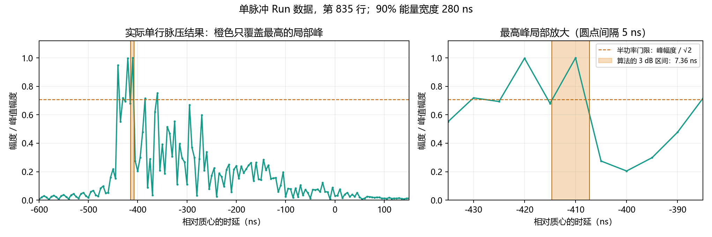

# 距离特征与绘图：最终修改及阶段证据

本记录按用户要求整合 2026-10-10 的 7 份阶段文档，集中保留定义、数值证据、验证及撤销分支。替代原 FWHM 引入、能量宽度增加、峰宽诊断、单脉冲诊断、峰宽删除、全轴绘图和原生矩特征记录。下文明确区分最终行为与历史阶段；旧产物路径曾被新仿真覆盖，同路径不代表同一输入。

## 1. 最终行为与修改范围

逐脉冲 Chirp 特征保留总功率、距离质心、中央 90% 能量宽度，统一使用完整原生匹配相关输出及逐行时延轴，不消费共同轴插值结果、不裁掉左侧相关响应。原生是既有公共运动补偿后的脉压输出，不是脉压前 ADC；没有撤销真实质心参考、散射时刻、公共路径与路径率等理想信息依赖。有效 CPI 仍走既有对齐与距离–多普勒处理，额外保留多普勒质心和 RMS 带宽；CW 不变。

总功率仍为功率样点和，不乘采样间隔。距质心时延仍为功率加权均值。`inversion/src/inversion.py::_native_pulse_range_features` 使用 `full_compressed` 和 `full_delay_axes`，供 GUI 的 `chirp_pulse_range_features` 与实际反演 CPI 不足 fallback 两入口调用。对齐后的距离像、动态谱、运动补偿和插值器没有在本次被替换。旧 HTML、图片和 NPZ 需重绘或重跑才能更新。

用户最后明确要求完整卷积／相关输出，故先前“取消插值但保持裁后范围”的中间实现被替代。最终零偏移数据也可能因恢复左侧响应而改变总功率和质心，不能把所有变化归因于插值。

## 2. 完整相关坐标与中央 90% 能量宽度

输入行长 N、Chirp 模板长 L 时，完整相关有 N+L−1 个样点。`matched_filter_chirp(full_output=True)` 返回完整输出；默认兼容模式仍返回从 L−1 开始的 N 点，供原有显示和 CPI 等消费者使用。完整输出第 k 点的时延为：

$$
\tau_{m,k}=t_{\mathrm{fast},0}+\frac{k-(L-1)}{f_s}+o_m.
$$

其中 fs 为采样率，o_m 为原有逐行偏移，已包含 ADC 分数余数；仅修正坐标，不删值，不重复施加 fractional 修正。完整输出不能恢复原始 ADC 采集范围以外没有记录的数据。

功率 P_k=|z_k|²，累计功率 C_k 与总功率 E 定义如下：

$$
C_k=\sum_{j\le k}P_j,\qquad E=C_{N-1},\qquad k_p=\min\{k:C_k\ge pE\},\qquad W_{90}=\tau_{k_{0.95}}-\tau_{k_{0.05}}.
$$

中央 90% 宽度取离散累计分位，不做端点插值，不是最短含 90% 能量区间；两端约各排除 5%，离散点不保证数学上恰好囊括 90%。不设置固定目标距离门、功率阈值、背景扣除或尾部抑制，非零长尾累计仍可改变分位，因此没有消除原始截取长度敏感性。集中于单点时宽度可为零；全零、非有限功率或空行返回 NaN。负功率、形状错误及非有限／非递增轴报 ValueError。内部按峰值缩放后累计，避免极端功率总和溢出；整体幅度缩放不改分位。

独立 golden：输入 `[1,1,1,1,0]` 与四点单位模板得到完整相关 `[1,2,3,4,3,2,1,0]`，中央宽度为 4 个采样间隔；原裁后 `[4,3,2,1,0]` 宽度为 2 个，证明恢复左侧响应是实质改变。逐脉冲字段 `energy_width_90_s`、CPI 字段 `energy_range_width_90_s`、周期键 `range_energy_width`。宽度单位为时延秒；单站径向宽度换算为 cW/2，双站不能无条件除以 2。

CPI 完整能量行对齐到覆盖所有行支持的公共轴，首末外各添一个零样点，防止半样点偏移硬切非零端点；时间选择、相干分组、Hann 窗和必要的慢时间重采样与已有 CPI 同步。用 Parseval 计算完整距离边缘功率，避免另存完整复距离–多普勒立方体：

$$
\sum_f|S_{\mathrm{full}}(\tau,f)|^2=M\sum_{m=0}^{M-1}|w_m z_m(\tau)|^2.
$$

FFT 按 NumPy 未归一化约定，M 为脉冲数。支持扩展不保证线性复插值保功率；CPI 能量宽度不是原生单脉冲量。增加能量宽度的中间阶段，总功率和质心仍裁后对齐、峰宽同时存在，完整能量分母不是旧 total_power；最终逐脉冲三者已统一完整范围。

## 3. 撤销分支：RMS → 局部 3 dB → 删除峰宽

原 RMS 是全行功率加权二阶时延离散度，远端非零尾部受距离平方加权，不等于检测带宽。用户要求先换为最强局部峰半功率宽度：选择最强峰，并列取最先峰，向左右找最近半功率交点，对跨阈值样点间功率线性插值。幅度门限为峰值的 1/√2，不是半幅度；功率阈值 1/2 对应约 −3.0103 dB。

$$
P(\tau_-)=P(\tau_+)=P_{\max}/2,\qquad W_{\mathrm{3dB}}=\tau_+-\tau_-.
$$

这只描述局部强峰，不跨低于门限的谷底连接其他峰。零或非有限功率、少于两点、任一交点缺失时返回 NaN，不把截取边界冒充交点。只要同一主峰和两交点都保留，远端弱尾变化不改此量；更强峰进入、裁掉交点、峰切换或重采样不满足此前提。合法轴允许共同／逐行、不等间隔且严格递增；形状、轴与负功率错误报 ValueError。CPI 当时先沿多普勒积分再取距离 FWHM。

历史字段 `fwhm_width_s`、`fwhm_range_width_s`、键 `range_width` 曾替换 RMS 字段，后来全部从新距离特征导出删除，不保留误导性别名。NaN 被周期搜索过滤，差分不确定度排除非有限差分。同时修复了严格恒定小数宽度被浮点标准差误判为变化而除零的边界；以 np.ptp 和非正基线误差检查处理。

历史交点 golden 为 7/6 与 19/4，并断言不同于旧 RMS；sinc 弱尾的三种原始截取长度检验局部宽度不变而 RMS 变化。高斯 P(x)=exp(−x²/2) 的真宽度 2√(2ln2)，误差扫描如下，坐标同一归一化单位，非任意回波最坏误差界：

| 步长 | 实测绝对误差 | 测试允许误差 |
| ---: | ---: | ---: |
| 0.5 | 0.0231114963 | 0.03 |
| 0.2 | 0.0009391115 | 0.005 |
| 0.1 | 0.0005162352 | 0.002 |
| 0.02 | 0.0000143977 | 0.0001 |

教学点目标 fc=1 GHz、fs=20 MHz、B=1 MHz、脉宽100 μs：无噪声 FWHM 0.884611 μs；种子20261009、脉压前整行0 dB复高斯噪声的中位数0.885031 μs。不能推出噪声必然增大宽度，已移除单向噪声展宽断言。可见范围仅讨论未实现，需要检测阈值、旁瓣及多峰关联规则；不是 FWHM 的别名，背景见[宽度研究](../../research/SIGNAL_PROCESSING_LIMITS.md#range-width-definitions)。

## 4. 历史诊断：2500 脉冲、500 Run

旧 `runs/paras_for_70m_3h/echo/echo.npz` 含2500脉冲、500 Run，散射时刻47090.796478—80826.174551 s，B=150 MHz、fs=200 MHz、质心补偿。后来文件已覆盖，当前同路径不能复现旧数值。

| 特征 | 中位数 | 5%—95%范围 | Run 内合并标准差 | Run均值固定5400 s正弦R² |
| --- | --- | --- | --- | --- |
| 原生局部3 dB宽度 | 7.557 ns | 5.351—16.213 ns | 2.468 ns | 0.0101 |
| 对齐后局部3 dB宽度 | 8.228 ns | 5.454—16.683 ns | 1.938 ns | 0.0099 |
| 完整原生90%宽度 | 215 ns | 145—265 ns | 3.232 ns | 0.6072 |
| 对齐后质心 | −303.587 ns | −365.878—−254.552 ns | 1.618 ns | 0.9118 |

R²仅比较已知5400 s正弦解释比例，不是盲搜、显著性或不存在其他周期的证明。5400 s 为真旋转10800 s一半，结论限于当时形状及散射。理想矩形频谱点响应0.885893/B约5.906 ns；离散模板自相关经旧算法为5.495 ns，不能视为任意扩展目标峰宽严格下界。实际峰宽仅约1.65个5 ns样点间隔，而90%宽度约43个间隔，支持局部峰而非全目标范围的解释。

最强峰相邻脉冲位置跳变超过10 ns的比例原生17.5%、对齐9.75%；支持峰选择不稳定，不能断言每次都是同一机制。取消插值后 FWHM 正弦R²仍仅0.0101，故其弱低阶周期不是主要由对齐插值造成。总功率R²=0.5181、Run内合并标准差1112.77，存在周期包络而非完全无周期。质心是加权平均，宽度离散端点还有5 ns量化。

临时脚本 `tmp/diagnose_peak_width.py` 每批50脉冲，使用全部偏移中位数的共同轴，对每Run均值拟合常数/cos/sin三列；Run内标准差先减各Run均值再合并总体标准差。点响应主瓣用途参见[Rommel等§5](https://ars.copernicus.org/articles/22/87/2026/)，与扩展目标宽度应区分。

## 5. 新产物：2000 个单脉冲 Run

新文件2000脉冲、2000 Run，行偏移跨度为0；旧共同轴与原生裁后功率相对L2差为0。因此其尖峰不是共同轴分数插值导致。按完整90%宽度上下四分位分组得到：

| 样本组 | 宽度中位数 | 当时裁后功率中位数 | 功率标准差 | 标准差/均值 |
| --- | --- | --- | --- | --- |
| 宽分布 | 250 ns | 5588.89 | 1342.91 | 23.33% |
| 窄分布 | 160 ns | 10872.15 | 3018.39 | 26.67% |

绝对起伏约2.25倍而相对起伏约23%至27%；分组不严格等于功率峰谷，不作孤立因果归因。相干交叉项、姿态散射是机制解释，不能全部称真实噪声。网格半轴70、50、40 m；宽度无上限裁剪或目标门，几何投影和散射权重不必形成正弦。固定5400 s直接宽度拟合R²=0.5898，宽度平方拟合后开平方R²=0.6106，只说明非正弦形状相容，不独立证明平台成因。

索引835，散射时刻61182.352243 s：完整90%宽度280 ns，历史局部FWHM 7.355999 ns，图中半功率幅度门限1/√2。谷底低于门限时局部峰宽不连接整团回波；平均幅度图与逐行取峰宽不是同一运算。复算脚本 `tmp/one_pulse_width_diagnosis.py`，每批50行，同会话对照，原统计 `tmp/one_pulse_width_diagnosis.json`。临时脚本不构成发行接口。



## 6. 绘图来源与全轴复现

`scripts/plot_range_features.py` 从实际 IQ 第835行（第836脉冲）画完整脉压幅度、累计功率，标红色质心线、橙色能量区间和总功率。历史标注质心−354.549973 ns，5%与95%端点−439.998921、−159.998921 ns；当时红线采用裁后对齐质心、橙区采用完整原生结果，最终生产定义已统一完整输出，旧图不自动更新。

原局部图按峰幅归一化，xlim约−590至−10 ns，不能据此说无拖尾。GUI第三图是全部行脉压幅度均值、不归一化、以保存行起点为横轴；与单行图外观不同不意味着新增物理平移。完整输出20403点，单行横轴−50至52.01 μs，原行10403点。当前已补偿输入中，完整输出裁回旧区间与 GUI 单行幅度最大差0；其他输出参考下 GUI 不做反演运动补偿，不能推广。新增全轴图依次为GUI定义均值、单行完整输出及对数幅度，显示下限−300 dB只避免log(0)，不改功率。

```powershell
conda activate pytorch
python scripts/plot_range_features.py --echo runs/paras_for_70m_3h/echo/echo.npz --pulse 835 --output tmp/range_features_reproduction/range_features_reproduction.png
```

同时生成局部图和 `_full.png` 全范围图，不重新仿真。2026-10-18整理时仅将上述复现输出改到临时目录，归档图片与历史数值不变。对少于两个有效样点的绘图行明确报错，避免图示静默采用不同退化规则。

## 7. 阶段验证与最终验收

FWHM引入阶段28项测试通过；能量宽度并存阶段37项通过；删除峰宽后29项通过。历史命令涉及后来删除的 `test_range_fwhm`，不能在最终版本原样重跑或把数量相加作为现行测试数。对应算法、GUI、CLI及NaN独立审查均按当时范围完成；FWHM审查未执行CLI，由实际子进程测试补充；NaN预先剔除与算法过滤得分差0。完整轴端点审查发现硬切非零边界，已补零扩展及旧实现失败的半样点回归。CLI覆盖CPI/fallback/CW并回读导出，拒绝已删除的RMS/FWHM和range_width字段；CW不输出距离宽度元数据。

最终新增 `inversion/tests/test_native_pulse_features.py`，用独立np.correlate完整输出和手算矩参照。主矩阵两种基带×相同/整数/分数偏移×逐脉冲/逐样点掩码=12格，每格断言旧对齐与完整统计不同、原生裁后与完整统计不同；含非对称复数、边界和全零行。另覆盖最短两点模板、raw-none、raw-auto非零路径率及实际fallback传入搜索的三个特征。原始基带补偿参照仅核对既有约定，不证明真实运动正确。

最初裁后中间版本测试先失败，fallback最大功率差13.2612、相对25.31%；这不是最终完整输出的收益。最终36项回归通过，独立审查未发现阻塞缺陷，旧准备函数docstring已纠正。输入无效ADC在脉压前置零，完整特征不再套输入掩码或跨洞插值；不声明缺样恢复。当前数据全有效。详细实测边界见[实测差异](../../research/SIGNAL_PROCESSING_LIMITS.md#measured-data-contract)。

```powershell
conda activate pytorch
python -m unittest inversion.tests.test_native_pulse_features inversion.tests.test_range_energy_width inversion.tests.test_chirp_contracts inversion.tests.test_signal inversion.tests.test_inversion inversion.tests.test_range_fwhm_cli inversion.tests.test_cw_echo_load
python scripts/check_doc_math.py
```

在仓库根执行；临时材料放忽略的tmp，因E盘缓存不在本次可写范围。上述回归不是真实散射模型、实测精度或任意周期恢复的证明，不声称曲线一定更平滑。

## 8. 逐脉冲特征的内存上界：按脉冲分块（2026-10-12）

本节保留接续修复之前的历史测量和原说明；其中“load_echo 校验后完全等价”“反演至少约 21.8 GiB”“整条预览内存不随脉冲数增长”及确定的第二次报错位置已在[第 9 节](#9-预览修复接续与结论更正2026-10-12)明确更正，不能继续作为当前保证。历史测量不代表本轮重跑结果。

**问题**：`configs/seperate_observation_2.json`（100 Run × 2 s、PRF 100 Hz）生成 20000 个脉冲、每脉冲 10403 个快时间样点、`pulse_width_s` = 5e-5 s、`fast_sample_rate_hz` = 200 MHz 的回波。GUI「查看特征」两次点击都失败：一次报 `(20000, 20412) complex128` 需 6.08 GiB，一次报 `(20000, 20403) float64` 需 3.04 GiB。这与绘图点数无关（三幅曲线共 3×20000 个点），两者都是逐脉冲特征的中间数组。

**内存账**：快时间步长 5 ns，模板长 `ceil(5e-5/5e-9)` = 10001 个样点，完整相关行长 10403+10001−1 = 20403。`matched_filter_chirp` 内部的 `scipy.signal.fftconvolve` 把该长度补到 `next_fast_len(20403)` = 20412 再做 FFT，于是工作区是 $20000\times20412$ 的 complex128，即 6.08 GiB；`range_features` 的 $P=|z|^2$ 是 $20000\times20403$ 的 float64，即 3.04 GiB。两次报错只差 9 列，且 (20403, 20412) 恰好是当前回波的完整相关长度与其 `next_fast_len`，说明两次点击面对同一份输入；报错先后与代码里的分配先后一致：第一次停在 FFT 工作区，第二次该工作区分配成功、下一个 float64 数组失败，可用内存的波动决定停在哪一步。同一路径还有 `full_delay_axes`（3.04 GiB）与 `aligned`（3.11 GiB）。在 2000 脉冲回波上实测该路径 tracemalloc 峰值 2.178 GiB，按脉冲数线性放大到 20000 脉冲约 21.8 GiB，超过本机 15.8 GiB 物理内存；tracemalloc 只统计 NumPy 数组，不含 FFT 内部缓冲，故 21.8 GiB 是下界。

**修改**：`inversion/src/inversion.py` 新增 `streamed_chirp_pulse_features(echo, config, pulse_chunk_size)`，沿脉冲行轴分块调用原有 `prepare_chirp_pulse_profiles` 与 `_native_pulse_range_features`，再按行拼接；`bounded_pulse_chunk_size(echo, workspace_budget_bytes)` 按 `完整相关行长 × 16 字节` 反算能放进预算的最大块。`rotation_gui/window/inversion_feature_preview.py` 的 `_pulse_features` 改用这两个函数，预算 256 MiB，本回波得到 822 脉冲/块。`prepare_chirp_pulse_profiles`、`chirp_pulse_range_features` 与反演入口 `estimate_rotation` 未改动，反演阶段仍走未分块路径。

**预算不是峰值**：这个预算只约束块内那一个全相关复数数组。同一块里还会同时存在同宽度的 float64 逐行时延轴、$|z|^2$ 功率数组与 $N$ 列的 `aligned`，实测整条预览路径的峰值是该预算的约 5.5 倍（256 MiB 预算对应约 1.4 GiB 峰值）。因此不能把常量当成"预览只吃 256 MiB"：按同样的比例，预算调到 2 GiB 时实际峰值约 11 GiB，在 16 GiB 机器上会失败。若要改成真正的峰值预算，需要把每个块内数组一起计入。

**为什么分块不改数值**：总功率是单行功率和，质心是单行功率加权时延均值，90% 能量宽度是单行累计分位，匹配滤波只沿每行的快时间轴卷积，逐行时延轴由 `fast_time_s` 加该行偏移得到。这些运算都不跨行，因此按行切分只改变峰值内存，不改变任何一行的运算顺序或结果。分块会丢弃各块自己算出的 `common_delay` 与 `aligned`（其共同轴起点取块内中位数），逐脉冲特征不消费这两个字段。

**实测（本机 15.8 GiB 物理内存）**：

| 回波 | 脉冲数 | 路径 | 块内全相关数组 | tracemalloc 峰值 | 进程峰值工作集 | 耗时 |
| --- | ---: | --- | ---: | ---: | ---: | ---: |
| `seperate_observation` | 2000 | 未分块 | 0.61 GiB | 2.178 GiB | — | 4.17 s |
| `seperate_observation` | 2000 | 分块 822 | 0.25 GiB | 1.398 GiB | — | 3.75 s |
| `seperate_observation_2` | 20000 | 分块 822 | 0.25 GiB | 1.398 GiB | 4.16 GiB（其中 3.37 GiB 为载入 `echo.npz`） | 47.7 s |

"块内全相关数组"一列只是 `matched_filter_chirp` 的 complex128 输出，不等于块内峰值；独立审查单独测过同一预算下的整条 GUI 预览路径，峰值增量为 1.41 GiB，与本表 1.398 GiB 一致，约为该列的 5.5 倍。

分块路径的 tracemalloc 峰值在 2000 与 20000 脉冲上同为 1.398 GiB，说明它由块大小决定而不随脉冲数增长。两项峰值差 0.78 GiB 来自 2000 脉冲回波未分块时同时持有的 `full_compressed`、`full_delay_axes`、`aligned`；耗时差异在单次测量中不构成性能结论。

500 脉冲回波 `runs/chirp_mesh_target_test/echo/echo.npz` 是"块大小大于脉冲数"的退化臂：822 脉冲的块一次覆盖全部 500 个脉冲，两条路径的时间（0.95 s 与 1.01 s）、tracemalloc 峰值（0.545 GiB）与进程峰值工作集（0.698 GiB）相同，特征值也逐元素相等。这既确认了小回波不退化成别的行为，也说明分块只有在回波大于一块时才开始省内存。

**等价性证据**：`inversion/tests/test_native_pulse_features.py::test_streamed_chunks_reproduce_the_full_correlation_features` 在 2 种输出参考 × 2 种偏移／掩码组合 × 块大小 {1, 3, 7, 80, 85} 上断言 `times_s`、`total_power`、`centroid_delay_s`、`energy_width_90_s`、`run_id` 与未分块路径逐元素完全相等。夹具先经过非退化处理：原夹具每行同值，且 90% 能量宽度整份只有一个取值（独立审查实测），因此除按行改幅度外，每第 3 行再加两个内侧样点，使宽度逐行不同（实测 13 个不同取值），并断言总能量不同取值多于 10、有限宽度不同取值多于 5、且存在非有限宽度。同一文件 `test_streamed_chunks_follow_row_rates_and_the_receive_clock` 在 2 种时间轴角色（`scatter_centroid` 与 `receive_centroid`）× 块大小 {1, 5, 79, 80} 上重复该断言，夹具用逐行不同的路径率、公共路径与行偏移驱动 `centroid_geometry` 补偿（第一份夹具的 2 个输出参考格在这份数据上实际是同一格，补偿分支由这里覆盖）。真实回波 `runs/seperate_observation/echo/echo.npz`（2000 脉冲）上，2 种时间轴角色 × 2 种运动补偿设置下两条路径的四个字段与 `run_id` 最大绝对差为 0，`total_power` 有 2000 个互不相同取值、有限宽度有 38 个取值。

断言灵敏度用变异检查确认（`tmp/mutation_check_chunking.py`，一次性脚本）：把 `_PULSE_ROW_FIELDS` 中任一字段改成不切片，或把行窗口整体错位一格，都会被上述断言检出——`common_path_rate_m_s` 造成 `total_power` 最大差 191.87，`tx_range_m`、`rx_range_m`、`row_fast_time_offset_s`、`valid` 触发形状错误，`elapsed_s` 与错位窗口表现为 `times_s` 行数不符。两个时间轴角色各只覆盖其中一部分字段（`scatter_elapsed_s` 只在 `scatter_centroid` 下被读取，`elapsed_s` 只在 `receive_centroid` 下被读取），必须两条都跑才覆盖全部行轴字段。

**作用域**："分块不引入静默行为变化"只对 `load_echo` 校验过的回波成立。手工构造的回波若把逐行字段写成 `list` 或长度不等于脉冲数，未加检查时会被静默跳过切片，使同一份回波按块大小不同重复整行或给出不同数字（独立审查的最小例子：80 脉冲的 `list` 输入返回 960 个观测，且不报错）。`_echo_pulse_chunk` 现在要求逐行字段必须是 ndarray 且第一维等于脉冲数，否则抛 `ValueError`；`test_streamed_features_reject_row_fields_that_cannot_be_sliced` 固定这一行为。

**已知代价**：`_native_pulse_range_features` 先让 `range_features` 内部算一遍 90% 宽度，随后又用 `prepare_chirp_pulse_profiles` 单独算出的 `full_energy_width_90_s` 覆盖它，$|z|^2$ 与逐行累计分位各做两遍。两处数值相同，但这是当前预览 50 s 中的主要重复开销，属于既有实现，本次未改动。

**验收命令**：

```powershell
conda activate pytorch
# 两个测试文件必须分开跑：仓库根的 tests/ 是包，与 inversion/tests/ 同一次调用会在
# 收集阶段冲突（ModuleNotFoundError: No module named 'tests.test_native_pulse_features'）。
# pytest.ini 的 testpaths = tests，所以 inversion/tests 必须显式给出路径。
python -m pytest inversion/tests/test_native_pulse_features.py -q -p no:cacheprovider
python -m pytest tests/test_inversion_feature_preview.py -q -p no:cacheprovider
python tmp/verify_feature_preview.py direct   runs/seperate_observation/echo/echo.npz
python tmp/verify_feature_preview.py streamed runs/seperate_observation/echo/echo.npz
python tmp/compare_feature_npz.py tmp2/feature_verify/features_direct_seperate_observation.npz tmp2/feature_verify/features_streamed_seperate_observation.npz
python tmp/verify_time_roles.py runs/seperate_observation/echo/echo.npz
python tmp/verify_feature_preview.py streamed runs/seperate_observation_2/echo/echo.npz
python tmp/mutation_check_chunking.py
python scripts/check_doc_math.py
```

`tests/test_inversion_feature_preview.py` 在本机是 3 passed / 2 failed：两个失败用例在 `tmp/` 下建临时目录时报 `PermissionError [WinError 5]`（本机文件权限，见当日日志第 7 节），与本次改动无关。

`tmp/verify_feature_preview.py` 与 `tmp/verify_feature_html.py` 是一次性测量脚本，不属于发行接口；构建 20000 脉冲的 HTML（`build_inversion_feature_figure` 加 `write_html`）实测 50.2 s、峰值 tracemalloc 1.45 GiB、输出 6.86 MB，三幅曲线各 20000 点。本次未在 20000 脉冲回波上运行未分块路径：那正是会耗尽内存的组合，6.08 GiB 与 3.04 GiB 两个数字由报错形状与 `next_fast_len` 反算核对，不由重跑产生。反演入口 `estimate_rotation` 在本回波上的峰值内存仍约 21.8 GiB，本次未修改，属于未解决项。

## 9. 预览修复接续与结论更正（2026-10-12）

本阶段完成 GUI「查看特征」的内存修复和可取消后台执行；不改回波生成、特征定义或反演默认计算路径，未提交 Git。第 8 节的历史峰值和耗时保持原记录，本阶段没有执行 20000 脉冲整批路径，不声称论文级复现或性能倍数。

### 9.1 问题与修复边界

OOM 发生在匹配滤波及特征计算阶段，而非浏览器显示 60000 个标量点。读取实际 NPZ 小数组和数组头得到 IQ 形状 `(20000, 10403)`、complex64；快时间间隔中位数为 `4.999999999999952e-09 s`，脉宽为 `4.9999999999999996e-05 s`，其浮点比值是 `10000.000000000095`，向上取整得到 10001 个模板样点。完整相关长度为 20403，FFT 长度为 20412，对应报错中的 6.083 GiB complex128 和 3.040 GiB float64 数组。理想数学比值恰好是 10000，额外模板样点来自当前浮点计算，不应把理想值的向上取整写成 10001。本轮保留模板采样策略，没有修改默认数值定义。

没有完整堆栈时，不能确定第二次 20403 列 float64 分配来自功率还是逐行时延轴；两者都有该形状。第 8 节的 21.8 GiB 只是 2000 脉冲未分块预览计算峰值的线性外推，不是反演实测值，也不是已证明的下界。`tracemalloc` 跟踪范围不只包含 NumPy 数组，且历史脚本在载入回波后才启动跟踪。反演入口仍整批准备数据，内存风险存在，但本轮不承诺其真实峰值或必然失败。

当前 256 MiB 预算只约束单块完整相关 complex128 输出；FFT、功率和逐行时延轴另占工作区。二维中间工作区受块大小限制，但 `load_echo` 仍完整读取 IQ、clean IQ 和掩码，一维结果也随脉冲数增长。因此不保留“整个预览内存不随脉冲数增长”或“预算乘 5.5 就是任意配置峰值”的保证。

### 9.2 分块一致性与实际执行

旧补偿函数对整份路径率数组执行有限性判断，出现一个非有限值就对全体脉冲回退到零路径率。原分块实现却在每块重新决定，`raw_baseband + auto` 下同一输入会随块大小改变特征；`load_echo` 的形状校验没有排除混合有限／NaN 数组。另一反例是行偏移混合有限值和 NaN：整批拒绝，但块长 1 会将它拆成分别可接受的有限块和全 NaN 回退块。接续修复在切分前先按原规则对完整输入校验偏移，并以浅拷贝将非有限路径率的整批回退决策固定下来，不修改调用者数组。全有限、全非有限与混合非有限三类不能用同一成功结论代替。

`prepare_chirp_pulse_profiles` 新增默认关闭的 `pulse_features_only` 参数。只有分块预览开启它，跳过预览不消费的共同轴对齐以及提前重复的 90% 宽度计算；三项特征仍调用同一 `range_features`，完整原生相关、逐行时延轴和归约顺序保持一致。每块完成后释放二维准备结果再进入下一块。常规反演和直接参照路径保留原默认调用。

GUI 启动独立 `QProcess`，继承选定 Python 解释器，在仓库根运行预览模块。子进程报告载入、已处理脉冲数及写图进度；「中止」终止该子进程，关闭窗口也终止并等待它退出。生成期间禁止重复预览和启动 pipeline，不改变已有阶段成功状态。启动时保存回波身份及输出路径，切换实验不会把完成结果标到新实验。HTML 先写 `.html.part`，完成后替换正式文件；失败或取消保留上一份完整 HTML，并清理未完成文件。载入 NPZ 和写 HTML 阶段报告里程碑，不提供虚假的内部百分比。

### 9.3 本轮验收与适用前提

合法入口是经 `load_echo` 校验的二维 Chirp 数据：逐行字段必须是 ndarray 且第一维与脉冲数一致，快时间轴至少两个样点，行偏移和时间轴沿用原路径的校验／回退规则。手工构造 list、错误行长或空回波仍明确拒绝。分块不降低精度、不裁剪脉冲、不减少图中点数。

| 检查 | 输入／分支 | 本轮结果与结论范围 |
| --- | --- | --- |
| 核心等价性 | 两种输出参考、行偏移与掩码、散射／接收时标、逐行运动补偿，块长 1、7、79、80 及大于总行数等边界 | 核心文件 12 项通过；既有独立相关 golden 和非退化断言保留 |
| 新增回退回归 | 非零有限路径率对照混合 NaN 路径率、混合 NaN 行偏移／小数偏移 | 修改前 3 项失败；修改后全局回退或拒绝与直接路径一致，调用者数组不变 |
| 计算范围 | 禁止调用 alignment 和提前重复宽度入口 | 分块预览完成；误接回旧路径时测试失败 |
| 反演相关回归 | 既有 Chirp 契约和 90% 宽度测试 | 两文件 13 项通过；与核心合跑共 25 项，不表示执行真实大回波反演 |
| GUI 子进程 | 实际小回波成功、取消、损坏 NPZ、解释器启动失败、重复点击、执行中改实验、执行中关窗口 | 专题 GUI 文件 7 项通过；真实事件循环仍运行，错误／取消不打开旧 HTML |
| HTML 发布 | 写出部分内容后模拟写失败 | 上次完整结果不变，临时 HTML 删除 |

相关 GUI 验收将上述专题与 `tests/test_gui_schema_v4.py`、`tests/test_optional_period_gui.py` 合跑，84 项通过（包含专题的 7 项，不与其相加），覆盖既有参数表单和可选反演界面；不是全仓库验收。

2026-10-12 16:43:42（北京时间）开始的一次真实按钮验收使用 `seperate_observation_2` 的现存回波，成功生成 6,856,732 字节 HTML，三条曲线各 20000 点，进度 100%，没有报错，GUI 定时器在执行期间响应 243 次。从构造测试窗口到完成约 35.859 s；每 100 ms 读取子进程工作集，采样最高值 4.118 GiB。采样值可能漏掉瞬时峰值，不是精确峰值或总系统内存上界；只记录单次完成情况，不与第 8 节跨阶段耗时做加速比较。新 HTML 的三条 y 序列和各条 x 序列与既存 20000 脉冲特征 NPZ 逐元素相等；该 NPZ 是历史产物，独立物理正确性仍由小夹具的相关 golden 检查承担。offscreen 截图确认进度条和操作行布局，但当前沙箱离屏字体显示方框，不能据此宣称本机中文字体渲染通过。

| 验收来源 | SHA256 |
| --- | --- |
| `runs/seperate_observation_2/echo/echo.npz` | `945e43db26c54cd9149ee5fc1b4ee7526a785945bde7eb5e612bbce847dd3197` |
| `configs/seperate_observation_2.json` | `517138dad3b49a8fbc75fe1e6c2a8d27522200217dd662f357587eec407ec7b2` |
| 实际执行的 `inversion/src/inversion.py` | `32a8447b772f2c090979c8dc1eb66385e568d256ad714c7a97de51eeac8d953f` |
| 实际执行的 `rotation_gui/window/inversion_feature_preview.py` | `4598a5a1f543af4df2c33283d2d93b0f9b9fb8b1eb41112af4aa3a2e81b983c5` |
| 生成 HTML | `44f15da83c8bc8cf9da0d29d2c1a8b87d822d17d706daba8ff91f9fc2b2d65e4` |

复现命令在仓库根运行，Python 使用 Conda `pytorch` 环境。子仓库测试与根测试分开调用，避免同名 `tests` 包收集冲突；项目的完整验收入口已在[验证策略](../../VERIFICATION_POLICY.md)列出两组命令，默认 `pytest` 只收集根测试并不代表全部验收。

```powershell
conda activate pytorch
$env:PYTHONDONTWRITEBYTECODE = '1'
$env:QT_QPA_PLATFORM = 'offscreen'
python -m pytest inversion/tests/test_native_pulse_features.py inversion/tests/test_chirp_contracts.py inversion/tests/test_range_energy_width.py -q -p no:cacheprovider
python -m pytest tests/test_inversion_feature_preview.py -q -p no:cacheprovider
python -m pytest tests/test_inversion_feature_preview.py tests/test_gui_schema_v4.py tests/test_optional_period_gui.py -q -p no:cacheprovider
python -m rotation_gui.window.inversion_feature_preview --echo runs/seperate_observation_2/echo/echo.npz --output tmp/feature_completion/reproduced.html --config-json '{}'
python scripts/check_doc_math.py
```

最后一条预览命令的空配置采用默认 `auto` 补偿及 `scatter_centroid` 时标，与本输入的预览设置一致；它只重建图，不运行回波生成或周期搜索。峰值采样可用进程监视工具每 100 ms 读取该 Python 子进程工作集；GUI 响应、失败、取消及原子写图的复现由保留的测试实现负责。原始 JSON、截图和一次性驱动脚本放忽略的 `tmp/feature_completion/`，不作为发行接口。临时 E 盘缓存不在沙箱可写范围，本轮使用仓库 `tmp/`。

### 9.4 文件必要性与遗留范围

必要生产修改集中在反演的分块特征函数、GUI 预览模块和窗口任务管理；必要回归保留在两个测试文件。使用手册、当前算法说明、中英文 README、既有专题与当日日志用于同步操作和结论，继续维护唯一正文。截图中 `tmp/*.py`、`tmp2/review/*.py`、HTML、会话 JSON 和写权限探针均为临时材料，不是运行修复所需；`tmp/` 原已忽略，本轮增加 `tmp2/` 忽略规则，保留原文件供追溯，没有批量删除或回滚其他任务修改。工作区已有大量其他未提交变更及反演子仓库变更，不能把整个 `git status` 都归因为本次 OOM。

真实大回波反演的整批内存问题、`load_echo` 对 clean IQ 的全量载入仍是遗留范围。此阶段完成的是「查看特征」入口；不能把它写成完整 pipeline 的内存修复。全新上下文对抗性审查执行了核心和 GUI 小规模测试，未发现本轮计算或任务管理的阻断缺陷；随后补齐运行中关闭、重复点击和改变实验选择的实际事件循环检查。

## 10. 周期反演逐脉冲分支的内存修复（2026-10-12）

本阶段接续第 9 节的预览修复，针对用户 16:56:46 启动周期反演后在 `fftconvolve` 分配 `(20000, 20412) complex128` 失败的完整堆栈。前两阶段只修预览的状态保留为历史，本阶段已把符合下述前提的反演入口接入分块；没有把可形成 CPI 的任意大输入宣布为已解决。

### 10.1 规模、路由与输入空间

20000 是脉冲数，每个脉冲有 10403 个快时间样点，IQ 共 208060000 个复数样点。complex64 IQ 本体约 1.550 GiB，完整相关变成 complex128 后，单个 FFT 工作区约 6.083 GiB。问题是整批中间量的分配策略，不是只有 20000 个复数样点就不能处理。当前交流格式仍是模拟回波 NPZ，不据此宣称任意实测雷达格式、流式接收或实时吞吐已经验收。

修复的分支由代码保证：在完整匹配滤波之前，以 `valid` 决定有效脉冲，按 `(run_id, coherence_id)` 分组并在无效脉冲或不连续行号处断开，计算最长连续相干块；`ceil(cpi_duration_s × prf_hz)`（至少 2）是所需 CPI 脉冲数。只有最长块不足所需数量时直接分块提取所有脉冲特征。实际配置 `cpi_duration_s=16`、PRF 100 Hz 需要 1600 个脉冲；100 个 2 s Run 各含 200 脉冲，没有可形成的 CPI。旧入口在判断这一事实前就先完整匹配滤波而 OOM，本轮将判定提前。相干块足够长时仍执行原 CPI 代码，不跨 Run、相干组或无效脉冲拼接，也不通过缩短 CPI 绕开科学配置。

`_pulse_feature_source` 将第 9 节整份输入偏移校验和非有限路径率回退整理为共享函数，科学特征分块与诊断样本共用；不改变原始回波数组。所有逐脉冲特征、时刻及有效样点比例仍进入既有共同截距周期搜索，搜索范围、4000 点网格、细化和可选方法不变。预算仍只覆盖单块完整相关复数输出，不是总内存上界；一行超过预算时块长仍为 1，此边界不能宣称硬预算保证。

### 10.2 导出与展示的内存约束

逐脉冲反演不再保留完整对齐距离像。`InversionResult.dynamic_spectrum` 和 `compensated_iq` 保存最多 128 行、1024 列的诊断展示样本；行数还受本次块长约束，列在压缩后才选取。采样前仍按原完整相关特征计算所有脉冲，展示样本从整个观测范围选取，不作为拟合输入。`search_diagnostics.dynamic_preview` 记录 `sampled`、实际行列数和 `role=diagnostic_only`，采样图有明确英文标题。外部 API 消费者若曾把逐脉冲分支的这些返回数组当完整脉压产品，需要按新契约调整；`features`、周期候选及 `period_observables.npz` 保持全部观测。CPI 返回对象仍保持原结构。

原 CLI 采样窗诊断会分配 `20000×4000` 的复指数矩阵，complex128 本体约 1.192 GiB，计算表达式还会产生额外临时量。`sampling_window_amplitude` 现在优先按频率列分块，默认单个复数矩阵预算 16 MiB；单列超预算时再按时刻分块累加。采样窗只是混叠诊断，不参与周期拟合；浮点求和可能因时间分块改变，不能要求任意输入逐位一致。36 个不规则时刻、29 个频率的独立逐频标量参考在预算 16、80、576、4032 字节及 1 MiB 扫描中绝对误差不超过 `2e-15`；该数值界限限于此夹具，不是任意超长时序的解析误差上界。预算守护测试实际监视每次指数矩阵大小，301×101 输入的每块不超过 37 个复数元素，确保不会退回整批矩阵。

### 10.3 本轮验收与真实入口

修改前新增的反演入口回归用实际 `estimate_rotation` 加整批分配哨兵：80 脉冲，块长 7，如果准备函数收到超过 16 行就报 `MemoryError`。旧入口在 80 行整批调用处失败，修改后通过。该用例验证真实入口路由，不能用只测试分块辅助函数代替。另一个回归用原直接特征作为参照，在 raw 补偿、逐行路径率、10 个 Run 和无效行断点下，块长 1、7、79、80、85 的周期最优值及全网格分数逐元素相等，全部 80 个观测仍保留；既有独立相关 golden、CPI 路由和 CW 测试继续运行。

本轮最终 `inversion/tests` 65 项通过、3 项跳过；根目录 `tests/test_optional_period_methods.py` 与 `tests/test_inversion_feature_preview.py` 合跑 29 项通过，不累计前阶段测试数。全新上下文对抗性审查独立执行 24 项相关 unittest，通过，并对随机 Run／相干分组、掩码和 CPI 阈值做 1600 次路由比较，提前判定与原 `range_doppler_cube` 是否能形成 CPI 一致；未发现本轮此分支的阻断缺陷。

2026-10-12 17:08:31（北京时间）开始执行用户失败时的同一条 CLI 命令，回波与配置不变，输出实际实验的 `inversion/` 目录。完整执行到观测保存、采样窗、动态图和周期图后退出码 0，耗时 65.297 s，Windows 进程累计最高工作集计数读取为 4.085 GiB。原始进程日志和测量 JSON 保存在忽略的 `tmp/inversion_completion/`；测量仅一次，未运行会 OOM 的整批基线，不提供加速倍数。全部 20000 个观测进入三个特征的周期搜索，各自有效样本数也是 20000；导出的 `value` 为 `(20000, 3)`，三列特征及时间轴与此前保存的完整特征 NPZ 逐元素相等。诊断图为 128×1024，已渲染查看其采样标题与布局。

结果共识峰值为 5398.741769979245 s、二倍别称为 10797.48353995849 s；这份对称形状的真值是 10800 s，保留已有半周期混叠警告及显著性“未评估”状态。该输出证明完整入口可完成，不证明真实自转周期精度、统计显著性或实测雷达普适能力。

| 输入／源码 | 真实执行时 SHA256 |
| --- | --- |
| 回波 `echo.npz` | `945e43db26c54cd9149ee5fc1b4ee7526a785945bde7eb5e612bbce847dd3197`（沿用第 9 节输入，未重生成） |
| `inversion.generated.json` | `5bc567624ee2f0db17f61d6145a1ec3757ac4a45eac180a4891a4d13fd965c2a` |
| `inversion/src/inversion.py` | `e059b17dfe17b38a61aa52de1b12bef381a44d882f7fe6b339a68cea65e43a53` |
| `inversion/src/radar_signal.py` | `12d4aa00a9c7875e7e8c88c38338c06ba13ffe06d6a61c1123e57f7e1fd40a9a` |
| `inversion/scripts/estimate_period.py` | `6664df67ab28b1c0f338baa313ba27d1b3b0b5b613245557cd13b47ab49f9268` |

复现命令从仓库根运行，输出复现目录避免覆盖已有结果；运行科学 CLI 时不需要重启 Python，已有 GUI 可直接启动新子进程读取新代码。

```powershell
conda activate pytorch
$env:PYTHONDONTWRITEBYTECODE = '1'
python -m pytest inversion/tests -q -p no:cacheprovider
python -m pytest tests/test_optional_period_methods.py tests/test_inversion_feature_preview.py -q -p no:cacheprovider
python inversion/scripts/estimate_period.py --echo runs/seperate_observation_2/echo/echo.npz --config runs/seperate_observation_2/configs/inversion.generated.json --output tmp/inversion_completion/reproduced
python scripts/check_doc_math.py
```

剩余范围是可形成 CPI 时的整批距离像及谱立方体，以及 `load_echo` 对完整 IQ／clean IQ 的载入。MHz 采样率不能单独决定内存或计算是否可承受，还取决于采集时长、通道数、精度、快慢时间维数和处理链；本轮不声称对无限采样时长安全。此阶段只修复当前配置以及同一“CPI 不足”生产分支，其他分支的功能回归通过不表示其大规模峰值已验收。

## 11. CPI 分支逐窗口计算与完整入口验收（2026-10-13）

本阶段补齐第 10 节明确遗留的 CPI 分支，不覆盖昨日历史结果。用户 09:06:05 使用 `seperate_observation_2` 重新反演，在旧整批匹配滤波分支再次申请 6.08 GiB 失败；这次实际生成配置 `cpi_duration_s=1.0`，不同于昨日验收的 16 s，所需 100 脉冲能在各 200 脉冲 Run 内形成 CPI。因此此前仅处理 fallback 的修复不覆盖当前配置，本阶段没有通过改回 16 s 或强制 fallback 绕过它。

### 11.1 生产处理与数值契约

`_streamed_cpi_inputs` 沿用原 `(run_id, coherence_id)` 排序及有效连续块，按照原 CPI 脉冲数和步长枚举所有窗口。逐窗口完成完整相关、共同轴插值、慢时间 FFT、完整相关能量支撑计算及五项归约，完成后释放二维工作区，不保留整个观测的压缩像和全窗口谱立方体。全部 CPI 特征、原窗口中心时刻及有效样本权重仍进入原周期搜索；不按 Run 聚合，不跳过相邻重叠窗口。

各 CPI 必须使用整场原实现的共同轴。裁剪轴的起点仍取全部行起点中位数，完整相关能量轴仍覆盖全部行支撑并按原步长零扩展；间隔中位数严格按逐行浮点加法和差分得到，而不是理想 ADC 步长或某一 CPI 的局部中位数。`_global_delay_grid` 用小块统计间隔浮点取值与次数，再选精确中位数；不同取值过多时使用仓库 `tmp/` 下临时磁盘数组并原地选择，不近似、不降低精度。正常退出或数值异常用上下文清理临时目录；强制杀进程或磁盘耗尽的清理不作保证。常规 Chirp 轴只有少量间隔取值，不触发磁盘路径。

`align_profiles_to_common_delay` 新增内部 `common_grid` 参数以传入预先求出的全局轴与原间隔；默认调用行为保持原样，插值和支撑扩展仍走同一函数。原缺省 `run_id` 的全零回退及缺少 `scatter_elapsed_s` 时的接收时标回退保留，独立审查发现两处直接字段访问回归后已补齐测试。

诊断 `RangeDopplerCube` 最多保留 128 帧，完整 Doppler 轴保留；距离列上限 1024，并以总复数展示谱 128 MiB 预算进一步降低列数。科学五项特征在展示截取之前归约，`features` 和 `period_observables.npz` 保留全部 CPI。`dynamic_preview` 明确 `diagnostic_only` 和实际帧数／列数，CLI 图标题注明采样。CPI 返回的 `compensated_iq=None`，不再提供整场压缩像；仓库内没有消费者依赖这一字段，外部 API 用户不能继续把它当完整脉压产品。输入 IQ／clean IQ 仍完整加载，单个 CPI 和极端共同轴仍可能较大，不能声称任意 CPI 配置的固定总内存上限。

### 11.2 回归与独立审查

先增加真实 `estimate_rotation` 分配哨兵：80 脉冲、8 脉冲 CPI，若准备函数一次收到超过 16 行就抛 `MemoryError`。旧入口在整场 80 行调用处失败，新路径每次 8 行，保持 `processing_path=cpi`，不会偷换为 fallback。

以仍保留的原整批准备／对齐／`range_doppler_cube` 函数产生独立参照，在两种回波参考系 × 两种时间轴下，行偏移、路径率、Run 边界和无效脉冲都不同，逐 CPI 五项特征、展示频谱、窗口起止索引与整批结果逐元素相等。接收时标两格加 ±2 ms 非均匀扰动并断言不能通过均匀性检查，确保真的执行慢时间插值；总能量非退化断言保留。另用 5000 个非均匀快时间点和四行偏移触发磁盘中位数分支，与原共同轴逐元素相等。独立审查另构造 8179 种间隔取值并确认磁盘分支轴完全相等、临时目录无残留。

最终模块测试 69 项通过、3 项跳过（三个回波相关占位测试已迁往 echo）；不累计昨日通过数。全新上下文审查重跑 8 项合同通过，已确认两项缺字段回退问题修复，未发现新的阻断问题。有关可选方法和预览的根测试单独执行，结果按本轮实际记录列出，不与模块测试混合收集。

本轮相关根测试 `tests/test_optional_period_methods.py` 与 `tests/test_inversion_feature_preview.py` 合跑 33 项通过，含可形成 CPI 与逐脉冲分支的可选方法路由；不与早先阶段通过数相加。

### 11.3 真实 1 秒 CPI 入口验收

2026-10-13 09:17:13（北京时间）开始执行用户截图中的相同 CLI 命令，实际生成配置保持 CPI 1.0 s、默认步长 0.25 s、PRF 100 Hz、搜索网格 4000。每个 200 脉冲 Run 形成 5 个滑动 CPI，共 100 Run、500 CPI；每个 CPI 100 脉冲，步长 25。完整执行至特征保存、周期搜索、采样窗、诊断图与周期图，退出码 0，单次耗时 153.047 s，读取 Windows 累计最高工作集为 3.729 GiB。未运行会 OOM 的整批真实基线，不给速度倍数，也不将小夹具相等外推成任意实测精度结论。

真实导出 `period_observables.npz` 的 `value` 为 `(500, 5)`，Run 数 100，五列全部有限，各项搜索实际有效观测数 500。诊断谱保留 128 CPI、655 个距离列和全部 100 个 Doppler 点；500 个科学 CPI 未被抽稀。实际命令和原始进度／内存记录放忽略的 `tmp/cpi_completion/`，不覆盖昨日 `tmp/inversion_completion/`。验收运行中的计算源码先于仅缺字段回退兼容修补；实际输入字段齐全，不受该补丁影响，最终兼容行为由合同测试复核。

本次共识峰值 5739.214414215828 s，显著性未评估、半周期警告保留。它与昨日逐脉冲约 5398.74 s 是不同特征定义和 CPI 配置的结果，不能当作新旧实现的数值差异或精度提升。科学等价性依据同配置小规模整批／逐 CPI 对照，真实规模验收证明当前入口能完成。

在仓库根使用 Conda `pytorch` 环境复现；科学 CLI 可直接运行，GUI 再点反演会启动新子进程读取新代码，不需要重新生成回波。下面输出到临时目录避免覆盖已有结果。

```powershell
conda activate pytorch
$env:PYTHONDONTWRITEBYTECODE = '1'
python -m pytest inversion/tests -q -p no:cacheprovider
python inversion/scripts/estimate_period.py --echo runs/seperate_observation_2/echo/echo.npz --config runs/seperate_observation_2/configs/inversion.generated.json --output tmp/cpi_completion/reproduced
python scripts/check_doc_math.py
```

本轮未新增文件内容 SHA256 校验，GUI 的轻量产物身份规则保持不变。也未更改 CPI 时长、脉冲数、步长或拟合模型。极大单 CPI 的进一步分列 FFT、输入 NPZ 流式加载及任意实测格式适配仍未实施，本阶段结论仅覆盖上述真实输入与测试空间。

## 12. 反演结果可视化与生成链路讲解（2026-10-13）

此前查看特征每次重算逐脉冲三项，即使 CPI 反演已保存五项实际观测。现在默认从 `period_observables.npz` 画上次实际特征，首次绘图只读取小型特征文件；再次点击复用 HTML。独立逐脉冲检查放在「反演结果」菜单，仅补偿选项、时标和回波 stat 改变使缓存失效；CPI、搜索网格不参与这份独立图的计算，不使其失效。stat 不读取文件内容，不保证识别刻意保持大小和修改时间的内容替换。源文件在写图期间改变会在发布前报错并保留旧 HTML。

CLI 保存 `features.html`、`processing_preview.npz` 和 `processing.html`；诊断使用生产函数已有的抽样输出，CPI 留至多三帧实际 RD 功率和每帧频率轴，不截断科学特征。周期 HTML 标原始候选和共识选择，人工半／倍周期候选不标成真实峰。CW 特征导出补上实际使用的 `centroid_hz`。新特征元数据记录参数和回波 stat；历史产物缺少来源信息，明确提示无法核对。当前参数／回波变化显示旧快照而不静默重算。历史处理谱未保存时不能从一维特征恢复，GUI 提示需重新反演。未改拟合、特征数值和共识选择规则，不把 5739 s 的成因视为已经证明。

生成端的权威讲解更新在[Chirp 链路第1.1—1.3、3.1、5.3—5.4节](../../CHIRP_INVERSION_WALKTHROUGH.md)：连接调度、光时、ADC、面片投影、传播下变频与脉冲叠加，不新建重复专题。明确近似远场路径和脉内映射、非完整雷达方程标定、无面片遮挡、指数零关闭方向衰减、显示诊断与科学归约不同。

本阶段复现命令如下，两个测试目录分开执行，防止同名 `tests` 包收集冲突：

```powershell
conda activate pytorch
$env:QT_QPA_PLATFORM = 'offscreen'
$env:PYTHONDONTWRITEBYTECODE = '1'
python -m pytest tests/test_saved_result_views.py tests/test_inversion_feature_preview.py tests/test_optional_period_gui.py tests/test_gui_schema_v4.py -q
python -m pytest inversion/tests/test_range_fwhm_cli.py -q
python scripts/check_doc_math.py
```

实测根91项通过；CLI一项测试内运行 CPI、逐脉冲、CW三个真实入口并检查输出及 GUI 直接复用图的缓存契约。真实 `seperate_observation_2` 既有特征绘图在 `_load_echo` 禁止调用的哨兵下成功；本阶段不重算完整真实反演，不给出新的精度或加速倍数。1100×820离屏GUI检查按钮与菜单几何无重叠，但沙箱字体呈方框；浏览器工具禁止本地 `file:` 页面，未做绕过或浏览器视觉验收。全新上下文对抗性审查已完成并修正其发现的问题；测试覆盖3／5／CW列、不同CPI频率轴、缓存参数敏感性、GUI及CLI源变化发布、子进程成功／失败／取消和真实菜单动作。CLI绘图前固定缓存身份，在 HTML 替换前核验，缓存凭据只认证该次读取的文件；加载回波前后检查 stat，元数据保存加载时身份。

## 13. 去掉重复入口并纠正展示（2026-10-13）

用户截图中的跨 Run 直线和热图桥接是展示缺陷。逐脉冲改散点并升级绘图缓存版本；处理概览改诊断帧索引，悬停给真实时刻，不能误读为连续采集。纵轴 ns，默认聚焦中央99%显示能量，按钮恢复全部延迟，不改任何特征或谱数组。该聚焦不是对科学能量宽度的门控。`processing_preview.npz` 可直接重画，旧诊断丢掉的距离列无法恢复。

主窗口「查看特征」保留实际反演入口；原重复粗糙菜单替换为「诊断图表」三卡面板，说明逐脉冲、距离—多普勒、周期搜索各自用途。CW、无有效文件时逐脉冲禁用，判断只读取 NPZ header。关闭后显式延迟删除对话框，反复打开不保留子对象。

本阶段命令为 `conda activate pytorch` 后设置 `QT_QPA_PLATFORM=offscreen`，执行 `python -m pytest tests/test_result_diagnostics.py tests/test_saved_result_views.py tests/test_inversion_feature_preview.py tests/test_gui_schema_v4.py -q`，93项通过；单独执行 `python -m pytest inversion/tests/test_range_fwhm_cli.py -q`，一项内CPI／逐脉冲／CW三入口通过。全新上下文审查及对话框生命周期、RD双图范围按钮、零功率测试已通过；真实保存诊断直接重绘，无真实IQ载入、无真实FFT重算。面板离屏560×394检查无重叠，中文字体仍显示方框；浏览器视觉验收仍未完成。

数值异常是独立未解决项：亚样点偏移受控探针证明相干处理额外展宽，真实候选确认旧共识用弱多普勒票压过强主峰。详见[信号形成诊断](../experiments/reports/2026-10-09_SIGNAL_FORMATION_AND_INTEGRATION_COST.md#fractional-doppler-20261013)，不以展示改动冒充数值修复，不在此阶段更换插值或选择算法。

## 14. 统一图像服务与Run级查看（2026-10-13）

用户批准[规划A—C](../plans/GUI_RESULT_VIEW_PLAN.md)后实施本阶段。顶部统一「图像结果 ▾」，锚定非模态卡片有原始回波、脉冲压缩、实际反演特征、逐脉冲检查、距离—多普勒、周期搜索六个唯一入口，外部点击和Esc收起；无底部关闭按钮。选择Run与CPI不修改科学配置，图内标题注明来源；选择控件暂在卡片内，尚未实施图内跨Run切换、固定展开与整场概览。

新增 `rotation_gui/window/result_service.py` 统一后台请求、Run选择、ZIP内NPY顺序有界读取、缓存和发布。原始图不调用匹配滤波；读取只保留选定Run的IQ与valid，不读取clean_iq。压缩NPZ选择后面的Run仍需顺序解压前缀，不能宣称恒定随机访问耗时。单次读取和裁剪脉压输出分别有256 MiB守卫，单块完整相关复数组预算32 MiB且不超过128脉冲，CPI工作区估算512 MiB守卫；这些是数组预算，FFT、Plotly和Python还有额外内存，不是进程峰值保证。仅支持C顺序数值数组，Fortran顺序明确拒绝；混合有限／NaN行偏移先在全场小轴校验，再选Run，避免选择改变全局回退决策。

脉压沿用 `prepare_chirp_pulse_profiles` 的有效性、公共补偿、模板和原行宽裁剪，缓存复数裁剪矩阵供脉压图与CPI使用。它不替代科学逐脉冲矩所需的完整相关支撑。RD只在选定Run、有效连续相干块中选一窗，原始行索引断点也不能拼接；当前Run的共同网格可能与旧整场网格不同，不能宣称两种诊断逐值等价。上图明确为加窗FFT功率沿频率求和的CPI距离能量，下图为完整距离列／频率格的该CPI功率，不再沿用“抽样诊断”的旧标题。

原始／脉压矩阵采用Run内慢时间与质心相对延迟ns；原生行格显示标签采用中位偏移，悬停注明本行分箱起点。无效采集格留白；有效低功率按45 dB动态范围显示。信号ROI不超过4096列时保留原始列，范围外保峰分箱；更宽信号也保峰分箱并注明；完整记录范围可恢复。显示分箱不用于科学计算。脉压均值曲线使用选定Run完整原行宽，不是全场均值。HTML原子发布，异常保留旧完整图；缓存版本3使旧图失效，只使用本机路径／大小／修改时间与处理参数，不使用SHA256。保存特征可在回波缺失时读取，标题注明当前回波无法核对。

输入空间与验证包括CW诊断段、Chirp选Run、压缩／未压缩ZIP、稀疏行、Fortran拒绝、超预算拒绝、行偏移全局契约、连续／断点／无效CPI、共享缓存与补偿参数失效、零功率及缺测、发布失败保留旧图、保存特征缺IQ、Qt后台成功／失败／取消／启动失败。脉压参照为本阶段未修改的核心全量完整相关后裁剪；独立审查小夹具覆盖原始／已补偿参考系与none／auto，最大差均0，原始基带两补偿分支差15.4532，证明夹具对补偿敏感。该等价验证只证明新编排保持现有数值，不证明原有相干物理链已正确。

真实验证源为 `runs/seperate_observation_2/echo/echo.npz`，IQ为20000×10403 complex64；配置为同实验 `configs/inversion.generated.json`，CPI为1 s。2026-10-13同一会话依次生成Run0的200脉冲原始图、脉压图及第1个100脉冲CPI。Run0 IQ约15.87 MiB，未载入整场IQ；输出在临时目录，不改科学产物。

| 请求 | 本次耗时s（单次，非A/B） | 进程累计峰值工作集MiB | HTML字节 |
| --- | ---: | ---: | ---: |
| 原始回波 | 1.102 | 254.77 | 12753706 |
| 脉冲压缩 | 0.466 | 295.62 | 13010854 |
| CPI距离—多普勒（复用脉压） | 0.474 | 340.89 | 17142132 |

这是特定Run与CPI的成功及内存证据，不与历史跨会话耗时比较，也不给出提速倍数。大Run、很长CPI仍可能被预算拒绝。全场逐脉冲检查仍载入回波再分块归约，不共用裁剪脉压缓存，不将Run级有界读的结论扩展到此入口。插值污染、弱特征共识选副峰和CPI默认1/4步长均未改变；规划D—E仍未完成。

重建真实三图的命令如下（从仓库根执行；临时目录不属于交付文件）：

```powershell
conda activate pytorch
python -c "from pathlib import Path; import json; from rotation_gui.window.result_service import build_view; root=Path('runs/seperate_observation_2'); c=json.loads((root/'configs/inversion.generated.json').read_text(encoding='utf-8')); c=c.get('inversion',c); out=Path('tmp/run_view_rebuild'); [build_view(root/'echo/echo.npz',c,out/(kind+'.html'),kind=kind,run_id=0,cpi_index=0) for kind in ('raw','compression','rd')]"
$env:QT_QPA_PLATFORM = 'offscreen'
$env:PYTHONDONTWRITEBYTECODE = '1'
python -m pytest tests/test_result_service.py tests/test_echo_preview_panels.py tests/test_inversion_feature_preview.py tests/test_saved_result_views.py tests/test_result_diagnostics.py tests/test_gui_schema_v4.py tests/test_optional_period_gui.py -q
python -m pytest inversion/tests/test_chirp_contracts.py inversion/tests/test_range_fwhm_cli.py -q
python scripts/check_doc_math.py
```

Qt离屏检查六按钮可达、无重叠，Esc和点击外部关闭、反复打开旧对象删除均通过。1100宽及请求760宽时均检查；当前主窗口仍有原有最小宽度限制，请求760不会实际缩到760，不冒充真正窄窗口验证。已检查实际截图，但沙箱中文字体呈方框；浏览器禁止本地文件访问，未绕过限制，HTML浏览器视觉验收未完成。全新上下文审查指出并修复了旧子标题、缺测格颜色、保存特征依赖IQ、旧图缓存失效及伸出卡片的Run下拉列表点击误关闭五项问题；下拉列表100项的回归检查要求点击确实在卡片外，仍能改变选中项并保持卡片显示。

本阶段最终重新执行上述根测试组合109项通过，Chirp核心与CLI组合9项通过（CLI项实际执行CPI、逐脉冲、CW三个脚本入口），文档公式检查当前版本零违规；历史4.1／4.2冻结违规未修改。GUI原始、脉压、RD三个卡片按钮均实际启动子进程并打开HTML，重复点击走缓存；保存／逐脉冲入口与周期图由既有相关测试覆盖，不将单纯底层函数测试当作按钮验收。这里的通过数是本阶段实跑，不与第12／13节历史数相加。

## 15. 恢复全场视图并连接科学预处理（2026-10-13）

用户反馈确认第14节方案的边界不符合其主要使用目的：默认单Run无法对照整个观测区间的旋转纹理，坐标方向不符合二维回波习惯，裸CPI序号被误读为秒步长，独立Run频谱与反演不是同一份中间结果，逐脉冲仍在整场IQ解压处分配1.55 GiB。此前“单Run成功”不能覆盖此入口。这一阶段明确纠正默认范围与数据路径，不把单Run方案当作用户应适应的既定交互。

卡片现在沿用参数卡片的白底、边框、蓝色标题和组合框规则；默认全场概览，按Run顺序排列并标灰色边界，保留Run内缓变与Run间跳变，不给物理空档填色。二维原始／脉压横轴快时间、纵轴慢时间脉冲顺序，悬停显示真实时刻和Run。脉压上方二维图、下方完整计算的平均功率共享横轴，联动缩放。全场显示每Run首尾在内的代表行，显示列按像素缩减；科学计算不消费这些缩减值。“分箱／箱内”不再出现在用户图像文字中；文档解释这是相邻显示列合并取最大功率，和雷达采样／FFT无关。逐脉冲Run内连线，Run之间插入NaN断点。

`inversion/src/processing_store.py` 提供大数组磁盘映射和科学阶段产物。`dataset.load_echo` 的映射入口用1 MiB流式复制ZIP内IQ、valid到本机NPY，不用 `NpzFile` 物化整场数组；反演不消费clean_iq，因此该入口不读取它。普通默认加载接口保持原行为。映射加载及科学阶段有本机文件锁，进程退出或中止释放锁；源身份为路径／大小／修改时间，不使用SHA256。映射文件、特征和每个完整CPI功率需要额外磁盘空间，不保证固定进程工作集。

`prepare_chirp_observations` 将已有匹配滤波、公共全场距离网格、有效相干窗口、FFT及科学特征提取组织成共享阶段；周期搜索消费其结果，科学参数、窗口选择、权重、时标、插值与选峰策略保持原定义。看实际特征／RD可以先生成该阶段，随后反演复用；先反演也会保存阶段供看图。搜索范围、谐波、细化和视线相位选项不改变原始科学特征提取，因此不让此阶段失效；CPI、补偿、时标或源身份改变则失效。阶段特征与CPI帧按策略、源身份校验；完整CPI功率保持float64。单CPI512 MiB估算和单Run256 MiB输出／读取守卫在分配前拒绝过大请求；预算不是进程峰值保证。

CPI卡片控件已改为窗口组合框，不是1 s步长。未生成共享阶段时显示明确占位，不猜测有效脉冲；首次请求后选定Run的第一个真实有效窗口。产物存在后列表标Run、实际脉冲半开范围及中心时刻。RD读取科学阶段的完整距离列与全场共同网格，不再另算单Run局部网格。波形脉压与独立逐脉冲检查是不同支撑的对照产品，不把原生行裁剪脉压与完整相关特征强行共用为同一个量；它们不是周期搜索的替代按钮。

所有新HTML按可见页面高度自适应，历史HTML打开时仅升级CSS／Plotly布局，不重跑计算。单图、两图、三图不再依赖固定620／900／960 px高度。实际浏览器交互视觉验收仍未完成；HTML配置／缩放轴契约有测试，Qt卡片则已通过显式加载本机微软雅黑字体检查截图，和参数区视觉一致，不再受之前离屏字体方框限制。

本阶段真实源仍为20000×10403 complex64，100个Run、每Run200脉冲；原始配置为 `runs/seperate_observation_2/configs/inversion.generated.json`，CPI1 s、默认hop0.25 s，共500科学观测。2026-10-13同一进程依次执行下列步骤，使用新映射／阶段缓存首次构建；后两步复用刚构建的阶段。它不是旧版与新版的A/B提速测试，不把单次耗时比当通用加速倍数。

| 步骤 | 单次耗时s | 累计进程峰值工作集MiB | 结果 |
| --- | ---: | ---: | --- |
| 映射加载 | 3.282 | 60.54 | 没有整场1.55 GiB解压数组分配 |
| 逐脉冲检查 | 21.983 | 2001.21 | 全部20000观测成功 |
| 全场原始图 | 7.442 | 4166.10 | 覆盖全部Run |
| 全场脉压图 | 28.026 | 4447.00 | 完整均值与代表行显示 |
| 科学预处理＋完整CPI持久化 | 273.887 | 4447.00 | 500个CPI、完整距离列 |
| RD读取共享帧 | 1.270 | 4447.00 | 没有重新FFT |
| 周期搜索复用 | 2.185 | 4447.00 | 禁止调用脉压哨兵下完成 |

整套本机缓存共5.730 GiB，包括IQ／valid映射、原生行脉压产品和完整CPI功率。首次持久化完整频谱代价约4.6分钟，比只保存抽样诊断增加计算／IO时间与磁盘占用；不能隐瞒这一代价。以上峰值含顺序执行残留的映射驻留页与绘图工作区，不代表每个独立GUI子进程均占该峰值，也不承诺任意输入恒定内存。缓存人为删除／损坏时有边界：坏科学阶段可重建，单个CPI帧或映射文件损坏可能明确报错，不宣称任意缓存损坏自动恢复。

独立历史参照为本轮之前已有 `inversion/period_observables.npz` 的500×5特征和 `processing_preview.npz` 的首个CPI655列，记录配置与回波身份和上述源一致。新阶段五项特征与时刻最大绝对差均0；首个新CPI完整10403列中取对应655列，功率差0、延迟差0、频率差0。静态对照图说明旧655列抽样把细距离结构隐藏，而完整列呈现横向细纹；它证明这些值已在原科学谱中存在，不能据此认定所有条纹物理正常，也不撤销已有相干失真诊断。

小夹具验收覆盖磁盘映射分配哨兵、共享阶段禁止FFT哨兵、CPI改变失效而搜索网格改变复用、fallback序列化、源改变拒绝、损坏阶段重算、首次后续Run请求、无效脉冲真实窗口、全场Run顺序／边界、横轴联动与页面高度。既有Chirp测试仍用原完整谱立方体独立参照覆盖原始／已补偿参考系、接收／散射时标、偏移、公共速度、无效脉冲与Run断点，不能仅凭缓存互比宣称物理正确。根组合116项通过，Chirp／CLI组合9项通过，都是本阶段实跑，不与历史阶段累计。

重建命令如下；数据采集和首次中间产物若已存在，命令会复用，不能当作首次耗时测量。

```powershell
conda activate pytorch
python -c "from pathlib import Path; import json; from rotation_gui.window.result_service import build_view; r=Path('runs/seperate_observation_2'); c=json.loads((r/'configs/inversion.generated.json').read_text(encoding='utf-8')); c=c.get('inversion',c); out=Path('tmp/workflow_rebuild'); [build_view(r/'echo/echo.npz',c,out/(kind+'.html'),kind=kind,run_id=-1,cpi_index=-1) for kind in ('raw','compression','rd')]"
$env:QT_QPA_PLATFORM = 'offscreen'
$env:PYTHONDONTWRITEBYTECODE = '1'
python -m pytest tests/test_result_workflow.py tests/test_result_service.py tests/test_inversion_feature_preview.py tests/test_result_diagnostics.py tests/test_saved_result_views.py tests/test_gui_schema_v4.py tests/test_optional_period_gui.py tests/test_echo_preview_panels.py -q
python -m pytest inversion/tests/test_chirp_contracts.py inversion/tests/test_range_fwhm_cli.py -q
python scripts/check_doc_math.py
```

全新上下文审查发现并修复了CPI策略中断后的帧混用、首次列表猜测有效窗口／后续Run失配、float32幅度溢出风险和新入口遗漏预算等问题；源变化与fallback测试已补齐。相干数值污染、CPI是否改善任务精度、1/4步长科学依据与原共识选副峰未解决。本阶段不修改这些数值默认策略，不声称周期更准。

<a id="coherent-alignment-20261014"></a>

## 16. 2026-10-14：相干距离对齐与可选低频有效估计

问题：高带宽Chirp在变化ADC小数偏移下，线性距离重建引入慢时间幅相调制。生产CPI共同距离轴及GUI选定CPI重算现在显式使用`method="fourier"`，以128样点加移位量的零保护区进行均匀采样重建。底层公开函数默认仍为linear，研究对照明确指定方法；原生匹配滤波和逐脉冲距离特征不改。这是数值修正，不声称与旧线性特征等价。截断和近奈奎斯特残差仍存在，带宽扫描及边界误差详见[实验阶段](../experiments/reports/2026-10-09_SIGNAL_FORMATION_AND_INTEGRATION_COST.md#cpi-coherence-20261014)。

`doppler_estimator`为Chirp可选字段，默认`spectral_moments`；`narrowband_lag`从未加窗CPI的滞后相关拟合低频有效质心/宽度，至少12脉冲，高相干、小曲率及拟合质量是必要条件，不保证任意真实谱RMS。弱高频尾部反例已经加入测试。质量失败多普勒字段为NaN；原有总能量/距离字段仍可用，日志和搜索诊断保存拒绝数量及宽度定义。输入尺度归一化避免相同波形的大/小振幅改变相关估计。没有修改共识、默认CPI、步长、源配置或GUI会话。

科学阶段缓存版本3、RD/科学特征请求版本5、特征HTML版本4，估计器进入策略键，避免旧线性中间结果混入新结果；原生脉压缓存继续有效。新选项与当前GUI同类枚举控件一致，重启后可显式选择；已有历史结果不会被自动改写，重新反演才生成新结果。主生产文件为`inversion/src/radar_signal.py`、`inversion.py`、`dataset.py`、`processing_store.py`、`result_views.py`及GUI schema/form/result_service；实验脚本不参与常规流水线，`tmp/`原始数据不作为交付生产代码。

本次执行`inversion/tests/test_coherent_doppler.py`、`test_chirp_contracts.py`、`test_range_fwhm_cli.py`共16项通过；根目录`test_result_service.py`、`test_optional_period_gui.py`、`test_saved_result_views.py`共19项通过。已覆盖独立解析Gaussian相位、静止Chirp ADC扰动、四种带宽比、已知单/双频、宽谱拒绝、弱高频尾部边界、短CPI拒绝、幅度尺度、CW/Chirp/回退/新lag CLI及GUI选择重载。全新上下文审查独立执行24项小检查，指出并修复GUI重算漏传Fourier、短CPI晚报错与低频名称过强；它们与上述检查有重叠，不能累计。

最终相关检查扩大为数值/CLI/原生特征30项、GUI/结果流程159项，均通过；最后保存图定义调整后`test_saved_result_views.py`7项复查通过，与159项重叠。Markdown公式检查当前版本零违规。命令如下（根与inversion测试分别调用，避免同名tests包收集冲突）。

真实100Run同次配对和噪声实验在专题中冻结，不能把对齐收益、窗函数偏差和周期模型偏差混为一谈。当前1秒/0.25秒的低频有效宽度主峰5398.021秒，质心5427.718秒；只证明此作业的受限策略，默认谱矩保留，未知目标、未知噪声及高频尾部仍需验证。单纯改CPI到2秒没有修复谱RMS主峰，不能宣传CPI必然改善精度。

```powershell
conda activate pytorch
$env:QT_QPA_PLATFORM = 'offscreen'
$env:PYTHONDONTWRITEBYTECODE = '1'
python -m pytest inversion/tests/test_coherent_doppler.py inversion/tests/test_chirp_contracts.py inversion/tests/test_range_fwhm_cli.py -q
python -m pytest tests/test_result_service.py tests/test_optional_period_gui.py tests/test_saved_result_views.py -q
python -m pytest inversion/tests/test_coherent_doppler.py inversion/tests/test_chirp_contracts.py inversion/tests/test_range_fwhm_cli.py inversion/tests/test_native_pulse_features.py -q
python -m pytest tests/test_result_workflow.py tests/test_result_service.py tests/test_result_diagnostics.py tests/test_inversion_feature_preview.py tests/test_schema_v4_contract.py tests/test_gui_schema_v4.py tests/test_optional_period_gui.py tests/test_saved_result_views.py -q
python scripts/check_doc_math.py
```

<a id="run-view-20261014"></a>

## 17. 2026-10-14：Run显示开关与已有CPI快速看图

本阶段只改变显示和读取结构，不修改匹配滤波、Fourier对齐、CPI窗口、特征或搜索算法。全场原始/脉压图的Run分隔线命名为`run-boundary`，HTML增加“显示/隐藏Run分隔线”单按钮；`active=-1`确保首次执行隐藏、再次执行恢复，只修改这些shape的visible，不替换其他shape，不改坐标或当前缩放。单Run没有分隔线时不提供无效开关。选项不写入科学配置，页面重开默认显示。

旧HTML打开时只追加幂等显示脚本，不重算科学数据。兼容本项目旧全场图的专用线型：无name、灰色、横跨`x domain`、第一子图`y`轴半整数行边界；命名的其他标记及局部水平线不纳入切换。任意外部HTML或人为添加完全相同匿名专用线型不在该兼容保证内。更新后应重启GUI并刷新已经打开的页面；直接双击从未经过升级的旧文件不会自行获得新代码。

看图变慢有两种成本：现在首次距离—多普勒请求必须生成周期反演共用的全场CPI阶段，完整距离频谱及重叠窗口比旧的单Run独立预览昂贵；科学算法/策略更新也会使旧阶段失效。已有阶段时旧看图实现仍`_load_echo`并载入整场observations，再读取单帧，本作业observations压缩文件为257412457字节。新路径对已有目标帧直接核对source路径/大小/mtime、科学版本、补偿/时标/CPI/估计器策略、Run和谱维度/预算，读取后再核对source；缺少有效帧才回到共用阶段。负索引默认窗口通过有效窗口目录选择，禁止另走单Run独立FFT。坏/缺帧的自动修复仍是开放项，不宣称已解决。

北京时间2026-10-14 14:33:34同次会话配对，真实源20000×10403、100Run、CPI1秒、默认1/4步长、谱矩模式；先预热Plotly。三个不同CPI各一次旧/新配对，不是三次重复测量，不以此估计稳定耗时分布。所有目标帧现有且策略一致，科学计算函数用哨兵禁止重算。

| CPI编号 | 旧全阶段读取构图秒 | 新单帧读取构图秒 | 旧tracemalloc峰值MiB | 新峰值MiB |
| --- | --- | --- | --- | --- |
| 0 | 1.2858 | 0.1358 | 260.33 | 32.82 |
| 250 | 1.2344 | 0.1229 | 260.16 | 32.96 |
| 499 | 1.2464 | 0.1204 | 260.16 | 32.96 |

各图像数组最大绝对差为0。以上仅为已有科学缓存下Plotly构图，不包含HTML写入、浏览器渲染、首次全场计算或进程工作集；不能宣传首次按钮总等待时间也降到0.12秒。脚本`benchmark_result_view.py`重建旧载入全场方式与新单帧方式并逐数组比较，原始带来源/策略/UTC时间的记录放`tmp/rd_view_benchmark_final/benchmark.json`。此前未预热的分离进程测量只是探针，不用来宣传稳定加速倍数。

本阶段最终相关六文件测试41项通过、1项可选浏览器检查跳过；全部代码/缓存测试确实执行。独立审查指出并修复单按钮默认active导致首击无效的风险及旧线型误判条件。实际浏览器点击验证未通过环境启动：Qt WebEngine初始化进程退出，CUA浏览器启动超时，故不声称已完成真实浏览器视觉/点击验收。结构检查覆盖首击参数、重复切换参数、其他shape保留、旧HTML幂等、数据载荷保留、来源和策略失效、默认/指定Run与科学路径复用；Node还实际执行HTML中的升级脚本，检验匹配/排除标记、菜单保留与幂等，但这不能替代浏览器真实点击。可选浏览器测试需有工作的WebEngine后显式启用。

```powershell
conda activate pytorch
$env:QT_QPA_PLATFORM = 'offscreen'
$env:PYTHONDONTWRITEBYTECODE = '1'
python -m pytest tests/test_result_workflow.py tests/test_result_service.py tests/test_saved_result_views.py tests/test_inversion_feature_preview.py tests/test_result_diagnostics.py tests/test_run_boundary_html.py -q
python scripts/benchmark_result_view.py --echo runs/seperate_observation_2/echo/echo.npz
python scripts/check_doc_math.py
# 仅在Qt WebEngine能正常启动的环境进行真实浏览器点击验收：
$env:RUN_WEBENGINE_TESTS = '1'
python -m pytest tests/test_run_boundary_html.py -q
```

<a id="single-execution-20261014"></a>

## 18. 2026-10-14 单执行入口与保存检查结果

本阶段修正先看图也可启动科学阶段的设计。GUI和默认绘图worker只读已完成的周期反演快照，不再通过图像按钮调用脉压、FFT、特征提取或搜索。原始回波只需本地echo文件；其他按钮要求反演完成且对应产物存在。当前表单参数不参与历史图；卡片显示保存的处理路径、观测数与Doppler估计器。原始/脉压全Run排列、坐标及原有图形布局保持；搬迁纯矩阵renderer的小夹具JSON与改动前一致，不能据此声称任意科学输入已作整体等价验证。

正式 `estimate_period.py` 统一计算周期并在结束前保存逐脉冲三特征、原生行脉压的纯显示数据及来源清单。检查数据按Run和有界脉冲块生成；逐脉冲科学字段保留全部脉冲，矩阵显示沿用抽样/像素归约，均值由全部有效样点累计，抽样不参与反演。检查定义与CPI五特征不同，因此初次导出有额外原生行匹配滤波成本；既有同补偿/时标/源身份的检查可复用，CPI时长/估计器改变不会使它失效。没有运行真实20K脉冲的新完整导出，不声称总耗时或峰值已测定。

开始正式反演即写in-progress标记，失败/中止时残留部分产物不认证为完成；全部导出后原子发布completion清单并移除进行中标记。源/观测/检查身份只用路径、大小、mtime。检查manifest必须匹配各文件身份；缺失、截断或结构损坏时失效。旧版完成结果兼容读取，已认证旧HTML纯IO复用；旧版未保存的检查需从运行反演补齐，看图不补计算。CPI只读路径拒绝缺失选定帧；自动选择跳过缺失帧，不声称缓存修复已全面实现。

生产数值默认、Doppler提取和选峰规则本阶段未更换；内部研究库仍可显式调用科学函数，单入口约束针对GUI与绘图worker，不宣称删除所有算法API。CW只保留原始、已存实际特征与周期图；pulse-fallback没有RD按钮。新增契约覆盖未执行拒绝、三个纯读图入口的科学函数守卫、进行中标记、来源替换、损坏数据/JSON、交错Run与无效脉冲保留、默认worker拒绝计算。真实CLI小夹具实际执行CPI谱矩/低频估计/fallback/CW四分支并检查完成与导出。浏览器视觉验收仍受WebEngine环境限制，本阶段不声称实际浏览器点击已验证。

复现命令：`conda activate pytorch`，设置 `QT_QPA_PLATFORM=offscreen` 和 `PYTHONDONTWRITEBYTECODE=1`，分别执行 `python -m pytest tests/test_readonly_result_contract.py tests/test_result_service.py tests/test_saved_result_views.py tests/test_inversion_feature_preview.py tests/test_result_workflow.py tests/test_result_diagnostics.py -q` 与 `python -m pytest inversion/tests/test_range_fwhm_cli.py inversion/tests/test_native_pulse_features.py inversion/tests/test_chirp_contracts.py -q`。根tests与inversion/tests同名包，仍分开收集。首次整场导出的目标规模性能尚未测量；后续性能优化按用户要求排在精度稳定性后。

本阶段最终根GUI/结果六文件49项通过，inversion三个数值/CLI文件23项通过（分开收集）；CLI的一项测试实际包含谱矩CPI、低频CPI、逐脉冲fallback及CW四分支。独立新上下文审查未发现遗留阻断点，另实测缺首帧自动选择、CW只读和交错Run/无效值导出。这里不累加重叠阶段的通过数，也不把测试当目标20K规模的速度/峰值证据。

<a id="gpu-uncertainty-production-20261015"></a>

## 2026-10-15 显式CUDA计算与条件性周期误差诊断

用户确认由GUI选择CPU／GPU，因此本阶段新增`compute_backend.py`，默认CPU不变，用上下文限定Chirp匹配滤波、Fourier距离对齐和慢时间FFT的CUDA核。FFT输入保持complex64／complex128原精度关系，模板和对齐／慢时间结果采用complex128；不以降精度换速度。各核按64MiB张量批次估算分块，不声称整个CPU／GPU内存峰值受64MiB约束。无CUDA时明确记录CPU回退；显存不足报错。实际请求／设备／原因写入搜索诊断，CPU与请求GPU的科学、CPI和检查缓存隔离；缓存仍只用路径、大小、mtime及参数，不恢复SHA256。实现兼容包导入、GUI动态导入和正式CLI，CW不提供新选项。

新增`period_uncertainty.py`在正式反演特征与搜索之后执行可选局部Run聚类协方差和完整Run重采样。原共识函数原样提取至`period_consensus.py`供CLI与重采样共用，AST及独立样例检查防止顺便改选峰。误差重采样共享Run重数，重新执行原范围搜索和原共识，不重算IQ，也不使用NPZ相邻差分的不确定度作为已知方差。局部数值失败返回不可用，至少10Run／30重复；默认关闭，启用默认200次。报告JSON及HTML在正式执行中写出，“图像结果→误差诊断”只读完成结果；报告未启用／缺失／执行中均置灰。最终共识3σ始终不提供。输入和覆盖率失败边界见[误差实验](../experiments/reports/2026-10-14_PERIOD_UNCERTAINTY_AND_FUSION.md#uncertainty-controls-20261015)。

CUDA验收矩阵覆盖两种Chirp频率约定、complex64／128、B/fs=0.1／0.75／0.95、全相关／解析单冲激、不同小数位移与保护区、无效行及掩码洞、已知单频FFT黄金值；正式估计覆盖两参考系×CPI谱矩／相关法／逐脉冲fallback。变化距离和公共路径相位使目标分支可区分；原退化常量质心夹具在浮点差异下会任意选峰，替换为有真实变化的夹具并记录此限制，不据此保证近常量输入周期等价。真实20K目标规模同会话配对为CPU227.10秒／CUDA121.12秒，仅科学计算和搜索；五个单特征周期最大差3.33微秒，详见[配对证据](../experiments/reports/2026-10-09_SIGNAL_FORMATION_AND_INTEGRATION_COST.md#gpu-production-ab-20261015)。该结果不是全GUI速度或通用精度界。

本阶段一次联合验收85项通过，包含真实CLI的CPI谱矩／相关法／逐脉冲fallback／CW／GPU加误差不可用五种模式，以及只读诊断按钮、缓存设备隔离、尺度1e±200、整Run权重和独立协方差公式。两种窗口尺寸实际Qt事件循环验证设备选择、误差开关、焦点／滚动、JSON保存重载、CW剥离；最终CPU／GPU可读标签改动后同文件5项重跑通过，不累加到85。已查看650／1100宽Qt截图；HTML仅核对生成结构与数据，不声称实际浏览器视觉验收。新上下文对抗审查找到并修复微小特征标准差下溢及研究脚本跳过不可估计通道、评分对象不一致的问题；未改原共识。

复现联合测试：`conda activate pytorch`，设置`QT_QPA_PLATFORM=offscreen`、`PYTHONDONTWRITEBYTECODE=1`，执行`python -m pytest inversion/tests/test_compute_backend.py inversion/tests/test_period_uncertainty.py inversion/tests/test_chirp_contracts.py inversion/tests/test_native_pulse_features.py inversion/tests/test_range_fwhm_cli.py tests/test_optional_period_gui.py tests/test_readonly_result_contract.py tests/test_result_service.py tests/test_saved_result_views.py tests/test_result_workflow.py tests/test_echo_preview_panels.py tests/test_inversion_feature_preview.py -q -p no:cacheprovider --import-mode=importlib`。显式importlib避免两层tests同名包冲突；无CUDA时GPU精度测试跳过，不能声称该机器GPU已验收。本机PyTorch2.3.1／NumPy1.24.3／SciPy1.13.1，GPU三项测试实际执行未跳过。

最终HTML跨峰提示及进度单调性小改后，`test_compute_backend.py`、`test_period_uncertainty.py`、`test_range_fwhm_cli.py`、`test_optional_period_gui.py`、`test_readonly_result_contract.py`定向联合26项通过，误差HTML明确显示58%及无单峰条件区间；`tests/test_result_diagnostics.py`更新七按钮契约后6项通过，覆盖Esc／外点关闭和按钮不溢出，不与前述85项累加。冻结432行记录与原始新轮JSON经过独立逐字段复核；源码身份快照放`tmp/gpu_uncertainty_source_identity.json`，只记录大小／mtime与时间，不新增SHA256。

<a id="display-semantics-20261015"></a>

## 2026-10-15 单CPI图义与范围控件修正

用户截图的上图不是逐脉冲脉压矩阵，而是选定CPI的RD功率沿频率求和。实读指定`rd_run_-1_cpi_0.html`，旧上图10403×1，下图10403×100；单汇总列被热图铺满横向，产生各行恒值直纹及宽单元边缘hover锚点。上图改为一维相对距离功率曲线，横功率dB／纵延迟ns，与下图纵轴一致，并明确“不是逐脉冲序列”；多帧诊断继续用真实帧列。无FFT的单帧脉冲输入独立标注“未作慢时间FFT”，不冒称CPI求和。真正脉压检查仍快时间X／脉冲Y，每横行对应一个被显示的脉冲。当前全场检查为1000×578显示格，前5个采样脉冲id为0、22、44、66、88，不把显示抽样当作全体反演样本。

原始／脉压的“显示/隐藏Run分隔线”并入左上范围按钮组。旧HTML以v2纯IO脚本升级，移除旧开关脚本，保留数值payload，排除无关shape。按钮按Run边界实际可见性决定切换，避免合并菜单后“隐藏→切范围→显示”因菜单active变化而失效。科学计算不受影响。所选CPI的两个延迟轴及聚焦按钮显式设`autorange=False`；截图下图约0至50000ns的全网格使目标压到下方，不能据此判定目标不可成像。实际旧HTML保存初始范围约−415至−40ns，截图显示的是交互后或另一页面状态；未在浏览器复现触发序列，不将推测写成确定根因。

实际执行`tmp/repair_selected_view_20261015.py`只读重绘该首CPI并升级指定全场控制，原文件备份在`tmp/view_repair_20261015/`；科学准备函数与scientific_rd用抛错守卫禁止调用。`tmp/verify_saved_display_arrays_20261015.py`比较旧上图列与新曲线、下图x/y/z以及脉压x/y/z/customdata，所列保存产物逐元素相同，记录于`display_array_equality.json`。这只是指定保存数组的等价证据，不是全部输入的科学A/B。RD显示缓存版本升6，重绘仅读保存帧，并把请求设备纳入显示键，不使CPU／GPU视图混用。

联合验证56项通过：`conda activate pytorch`后，设置`PYTHONDONTWRITEBYTECODE=1`、`QT_QPA_PLATFORM=offscreen`，执行`python -m pytest tests/test_diagnostic_geometry.py tests/test_result_workflow.py tests/test_result_service.py tests/test_saved_result_views.py tests/test_readonly_result_contract.py tests/test_result_diagnostics.py inversion/tests/test_period_uncertainty.py inversion/tests/test_range_fwhm_cli.py -q -p no:cacheprovider --import-mode=importlib --tb=short`。新增两项故障复现改前失败，修复后包括单CPI／多帧／无FFT单帧、旧脚本幂等、Node事件监听器隐藏→范围→恢复、原payload及只读入口检查。实现采用[Plotly官方skip及buttonclicked接口](https://plotly.com/python/reference/layout/updatemenus/)，不依赖菜单active记录边界状态。新上下文审查发现并修复单帧无FFT误称CPI的问题，最后独立两文件18项通过，不与56项累加。浏览器工具安全策略拒绝file协议；未绕过该限制，实际浏览器hover与视觉尚未验收，不能把结构和Node检查写成浏览器点击验证。

误差HTML另增加“严格总误差上界：尚未建立”、局部σ来源和完整校准缺口，JSON对应上界为空；没有新增虚假的数值界。单参数到联合参数及严格集合界的推导、三层计划状态见[算法5.7节](../../INVERSION_ALGORITHM.md#period-uncertainty)，Margot等2007实际采用1σ及模型／系统误差处理见[文献核对](../../research/RADAR_PERIOD_ESTIMATION.md#mercury-2007-uncertainty)。本阶段未更换反演算法、选峰或误差数值定义。

<a id="compact-storage-20261016"></a>

## 2026-10-16 中间存储去重与完整网格显示产物

本次按用户提供的五项方案修改保存结构，不改变脉压、FFT、五项科学特征或周期搜索。只删除“常规输出中的重复表达”，不通过少存CPI、裁剪距离列、阈值删弱信号或看图时重做科学计算换取空间。当前原项目约27.3GiB（十进制约29GB），其中runs约18.08GiB、tmp约5.77GiB、.gui_state约3.36GiB；这是修改前的只读目录统计，不是本次已释放数量。历史预览的整场脉压和旧实验副本仍在，未把它们当作新流程固定开销，也未未经迁移核对直接删除。

### 保存与读取契约

1. `npz_mapping.py`对ZIP_STORED成员解析本地ZIP头、ZIP64额外字段及NPY头，直接以只读memmap映射原文件。项目自产的未压缩iq／clean_iq／valid不再提取整份NPY；压缩外部输入、空数组或不支持的NPY版本回退原提取路径。C/F顺序、大小端、标量与结构dtype按NPY定义读取，对象dtype拒绝；GUI按行读取仍限C顺序并保持256MiB选取预算。来源使用路径／大小／mtime，没有新增SHA256；只检查结构、范围和读取期间身份，不扫描完整payload CRC，不保证检测任意位损坏。Windows映射存活时源文件不能截断或替换，`EchoDataset.close()`明确释放；关闭后不得再使用数组及视图。GUI特征预览在得到图像数据后立即释放源映射。
2. `save_stage/load_stage`按Python对象身份记录dataclass和数组引用，恢复后共享关系仍成立；相等但独立的对象、数组视图不合并，不扫描大型数组比较内容。旧bool字段manifest仍可读；循环引用、坏描述或坏key按缓存失效处理。完整科学特征和重新搜索所需的小缓存保留。
3. `cpi_key`独立于`doppler_estimator`及科学导出开关，包含来源、补偿、时标、CPI长度／步长、实际CPU／CUDA后端和算法版本。特征stage_key继续包含估计器；切估计器需重算正确特征，但同一FFT显示谱只保存一份。请求CUDA却回退CPU与直接CPU共享谱身份；旧版两种估计器路径、旧CPU路径仍作为兼容候选，旧算法版本不同不合并。已存在的谱复用前检查格式和数据，损坏文件不能被当作成功命中。
4. 新CPI格式v2保存完整二维`power_db:float32`、一维`range_power:float64`、原双精度距离／频率坐标、双精度归一化峰值、Run／时间／脉冲范围及谱来源key。GUI直接画已保存dB，不反推科学功率；一维曲线使用原双精度归约结果。所有CPI、距离列、频率格保留。旧`power:float64`格式可读；需要完整双精度科学矩阵时显式执行反演CLI的`--export-full-cpi-power`，在同一谱文件附加power而非再造目录，导出开关使阶段快照失效以确保真正执行输出。
5. 脉压检查v2将显示网格单独保存为float32，Run／原脉冲号／时刻只逐行保存一次，图布局JSON不再逐像素重复这些值，载入时恢复悬停信息；旧figure_json仍兼容。检查写入用独立文件锁串行化。GUI新HTML共享本地版本化Plotly脚本，脚本只写一次且不依赖网络；常规CLI导出默认仍是独立HTML。GUI HTML搬离原目录时需连同相对脚本路径一起保留，不能将其当独立导出。

显示量化不是科学精度策略变化。对于有限非负float64功率且双精度归约不溢出的输入，当前dB公式的范围在约−3076.53至0dB内；float32正常舍入误差不超过2⁻²⁴乘原dB绝对值，故全范围可用0.000184dB的保守绝对界。零功率也按原tiny底值处理；NaN、负功率和归约溢出明确拒绝，不静默截断。脉压显示同属该dB范围，缺测NaN原样保留。科学功率、特征及搜索不使用这些量化显示值。

### 目标规模配对证据

2026-10-16北京时间10:12左右，同会话读取`seperate_observation_2`已有20000脉冲回波、500CPI中的第0／250／499窗，每窗10403×100格；旧来源按路径、大小和mtime记录，旧科学文件未改。暖读／构图按ABBA顺序各4次，取中位数；另用独立Python进程测首次读图数据构造，不清空操作系统磁盘缓存。这里“构图”含读取、解压、校验及Plotly figure构造，不是浏览器实际渲染或鼠标交互，不宣称完整GUI冷启动时延。

| CPI | 旧文件(MiB) | 新文件(MiB) | 暖读构图旧／新(ms) | 独立进程首次旧／新(ms) |
| --- | --- | --- | --- | --- |
| 0 | 7.676 | 3.475 | 89.66／52.97 | 365.16／297.65 |
| 250 | 7.676 | 3.451 | 87.91／53.06 | 278.15／274.99 |
| 499 | 7.677 | 3.457 | 84.69／50.53 | 363.49／320.76 |

三窗二维显示最大差≤0.00000763dB，一维距离功率逐元素完全相等，坐标和网格不变；不能把三窗压缩率称为全部500窗实测。真实阶段快照257412457→128770083字节（245.49→122.80MiB），按CPI生产关系恢复profiles与dynamic的共享，科学特征逐元素相等。未压缩映射与已有提取NPY在首／中／末各100行逐元素相等，暖读中位数约1.6—1.8ms，二者同量级；该回波未来不再新增约1.744GiB的iq与valid副本。不是已经删除现有副本。

全场脉压检查独立配对：1000×578显示网格，7194199→2130552字节（6.86→2.03MiB），最大dB差0.00000763，逐行元数据完全一致；各4次ABBA载入中位数旧约288ms、新约47ms。HTML样本旧约16.2—16.3MiB、新约6.1—6.2MiB，另共享一份本地脚本；差异同时含二维float32表达与脚本共享，不能全归因于Plotly库。新旧构图、首次／重复发布与独立进程首次读图均未在这些样本出现明显变慢，实际浏览器渲染尚未单独计时。

复现先`conda activate pytorch`，执行`python scripts/benchmark_storage_layout.py --source runs/seperate_observation_2/echo/echo.npz --output tmp/storage_layout_new`；脉压样本执行`python scripts/benchmark_storage_layout.py --inspection runs/seperate_observation_2/echo/processing_cache/inspection/auto_scatter_centroid_1791790698064721400_3540199624/compression_campaign.npz --output tmp/storage_inspection_new`。输出目录必须不存在。最终数值记录在`tmp/storage_layout_ab_20261016_verified/result.json`与`tmp/storage_inspection_ab_20261016_verified/result.json`；更早两次布局试跑只作过程记录，不混入本表。原始大探针文件可按命令重建，不作为长期产物保留。因沙箱写入范围不含外部缓存，本次使用仓库tmp。

### 验收与剩余范围

默认输出和`--export-full-cpi-power`分别通过实际CLI子进程执行，同份小型Chirp输入的period_observables逐元素相等，默认CPI无power、显式输出有原双精度power，未生成iq.npy。测试覆盖旧CPI／旧manifest／旧检查JSON、显示误差的零／常量／极端动态范围、float64归约溢出、共享／独立对象、跨估计器热复用、后端回退、坏key／坏格式／循环引用、来源变化、Windows释放及只读入口。独立新上下文审查先发现坏CPI版本被误复用、坏JSON结构未退化为miss、旧测试仍要求换估计器冷启动及旧CPU目录缺候选，均修复并保留回归。性能证据仅对应上述输入和所列读取／构图范围；原有历史产物未迁移或删除，因此仓库不会在改代码后立即从30GB降到目标容量。

最后根测试命令`python -m pytest tests/test_storage_adversarial_keys.py tests/test_compact_result_storage.py tests/test_result_workflow.py tests/test_readonly_result_contract.py tests/test_result_service.py tests/test_inversion_feature_preview.py tests/test_saved_result_views.py tests/test_result_diagnostics.py tests/test_run_boundary_html.py tests/test_artifact_contract.py -q`得到68通过、1跳过（未启用可选Qt WebEngine）；嵌套模块独立执行`python -m pytest inversion/tests/test_npz_mapping.py inversion/tests/test_processing_store_compact.py inversion/tests/test_compute_backend.py inversion/tests/test_native_pulse_features.py -q`得到39通过。分别设置`PYTHONDONTWRITEBYTECODE=1`及根GUI测试的`QT_QPA_PLATFORM=offscreen`，不把两次通过数拼为一次全仓验收。新上下文审查最后独立10项通过，显示量化理论界与最终结果JSON亦复核无阻断。本轮新建的五个配对探针目录内NPZ／HTML／JS已先列明目标，再仅删除这些大探针文件，保留result.json与复现脚本；没有顺带清理用户历史数据。当前版本公式检查及本次链接检查通过。

<a id="gpu-period-search-20261016"></a>

## 2026-10-16 周期搜索CUDA列装

用户要求优先加速重复实验，现有GPU设备选项新增Chirp多谐波网格与完整Run重采样支持，CLI／GUI无需新增开关。默认仍CPU，CUDA不可用明确回退；采用float64批量小矩阵求解，病态格与大相位回原CPU SVD，所有局部峰截取前以CPU核验、局部细化也用原CPU目标。特征、搜索域、谐波及共识未改，CW旧Lomb仍CPU。配置及逐特征设备诊断见[算法](../../INVERSION_ALGORITHM.md#gpu-period-search)，数值／速度及复现命令见[性能专题](../experiments/reports/2026-10-09_SIGNAL_FORMATION_AND_INTEGRATION_COST.md#gpu-period-search-20261016)。

目标500×5特征、4000格搜索，最终源码独占同会话3次交替中位数CPU1.485057秒、GPU0.576775秒；30次Run重采样单对39.951674→12.459085秒。计时包含传输与CPU核验，不含IQ前端和导出。候选周期及全部重采样周期逐项相同，曲线最大差4.44e-16，不推广为全部输入精度上界或全GUI加速。64MiB是工作数组估算预算，CUDA库工作区不包含在该数中。

合法输入包含共同／研究分组截距、多H、相位补偿、非正权重剔除、极端特征尺度、近并列峰和边界；p>64／单格预算、大相位及病态设计回参考。独立8项测试包含正交Fourier解析golden与Nyquist秩亏，81格独立CUDA扫描含9格一致拒绝；大相位保护漏含H和offset经审查发现后已修复并补测试，非有限差分警告也已修正。最终反演模块全量136通过／3跳过，根tests297通过／1跳过；实际CLI覆盖CW、CPU／GPU Chirp CPI及fallback共5项。GUI使用原设备控件，更新帮助说明并跑原GUI事件循环测试；本轮没有新增布局，也未人工视觉验收。没有修改echo或observation算法，未重跑其全套测试。

<a id="cpi-full-support-20261016"></a>

## 2026-10-16 CPI 完整距离支撑与谱诊断

本阶段修复 CPI 距离特征输入不一致：此前已经计算完整相关输出的 `energy_range_power`，但只用于中央 90% 能量宽度，总功率和距离质心仍来自裁剪后的距离—多普勒谱。现在 `range_doppler_features` 的三项距离／能量特征共同使用完整已对齐脉压功率；未提供完整输入的兼容调用继续使用其传入谱的距离支撑。完整脉压保留、Fourier 对齐和慢时间窗沿用当前生产算法，没有把未对齐的逐脉冲矩混入 CPI。

保留原非归一化 DFT 倍率。设一个 CPI 含 $M$ 个脉冲，$z_{m,k}$ 为完整脉压在共同距离轴第 $k$ 列、慢时间第 $m$ 个脉冲的复样值，$w_m$ 为现有慢时间窗，$\tau_k$ 为共同延迟坐标。三项统计共同使用的距离边缘功率为

$$
R_k=M\sum_{m=0}^{M-1}w_m^2|z_{m,k}|^2.
$$

总功率为 $\sum_kR_k$，距离质心为 $\sum_kR_k\tau_k/\sum_kR_k$，90% 能量宽度仍采用累计功率首次达到 5%／95% 的离散样点之差。这里没有除以 $M$ 或窗能量，也没有乘 ADC 采样间隔，不能把输出改称已标定的物理能量。多普勒质心和 RMS 带宽继续使用原距离—多普勒谱及其自己的总功率归一化，避免把完整距离总功率错误地用作裁剪多普勒谱的分母。

新增三个逐 CPI 数值诊断：`doppler_window_rms_hz` 是窗函数本身功率谱的 RMS；`doppler_nyquist_edge_fraction` 是距离 Nyquist 接缝两格 DFT 频率间距以内的实测谱功率比例；`doppler_nyquist_edge_half_width_hz` 记录这一区域的单侧宽度。频率间距按该 CPI 实际时标计算，零信号的边界功率比例为 NaN。这些量只说明窗展宽尺度和频率边界敏感性，不执行窗方差扣除、解折叠、阈值删点或估计器切换；低边界功率也不能证明不存在采样前混叠。

完整支撑改变已保存标量语义，观测阶段缓存版本升至 4，使旧标量重新提取；原 FFT 显示谱的算法与数值未变，独立谱缓存算法版本仍为 3。增加连续距离 RMS 的探针没有成为新生产特征，也未替换用户现用的中央 90% 能量宽度。

独立显式 DFT 控制覆盖奇／偶脉冲数、Hann／矩形窗及均匀／扰动时标共 8 格，每格均断言裁剪与完整支撑可区分；原实现全部失败，修复后全部符合显式 DFT。近 Nyquist 正／负单频控制保留原线性谱矩，同时暴露边界功率；另覆盖旧调用兼容、逐 CPI 采样间距和零信号。2026-10-16 本阶段实际执行 `python -m unittest inversion.tests.test_cpi_feature_integrity inversion.tests.test_range_energy_width inversion.tests.test_coherent_doppler inversion.tests.test_native_pulse_features inversion.tests.test_chirp_contracts`，43 项通过；这是该阶段验收，不与其他时点测试数累加。

同份真实 100 Run／500 CPI 配对中，旧分支逐点复现原五项特征，恢复完整支撑后最大总功率变化 0.11846%，最大距离质心变化 3.5867 ns。H1 距离质心周期由 5400.633728 s 变为 5400.794505 s，反而略远离 5400 s，故本修复只声称统一统计输入，不声称单独提高周期精度。完整配对表、源哈希、未采用的距离 RMS 负结果及可复用命令见[信号形成实验](../experiments/reports/2026-10-09_SIGNAL_FORMATION_AND_INTEGRATION_COST.md#cpi-full-support-20261016)。
