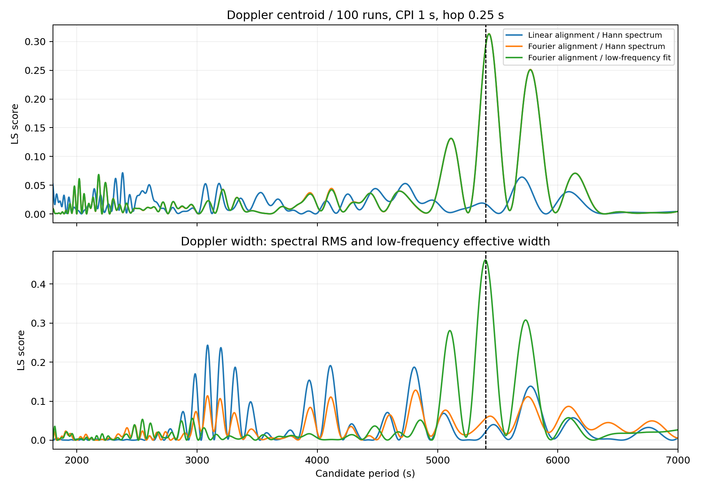
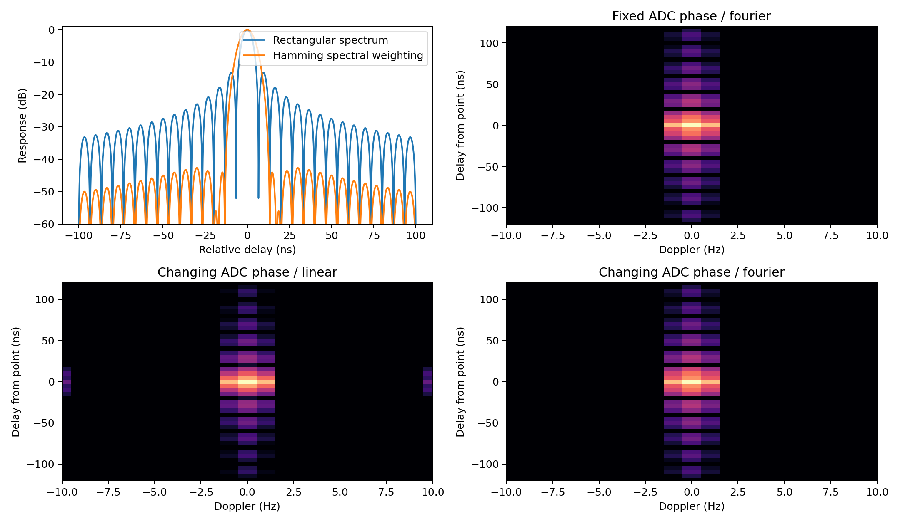
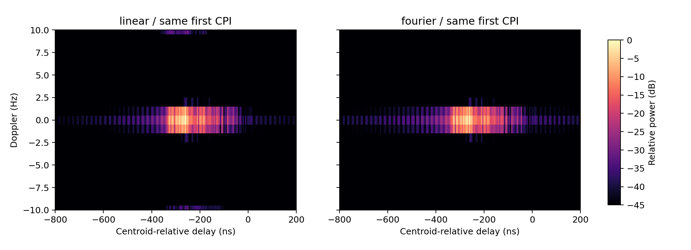
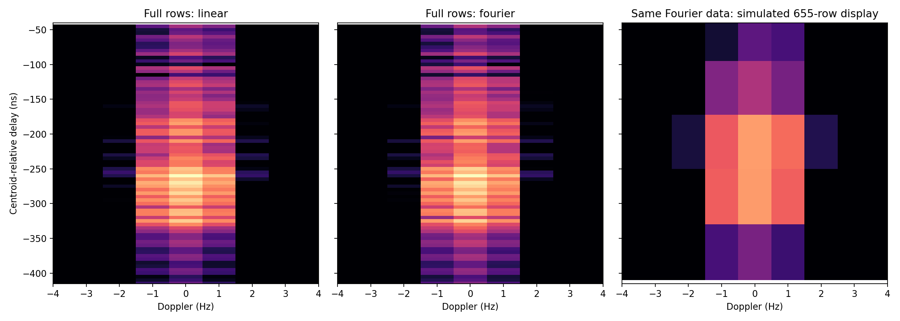
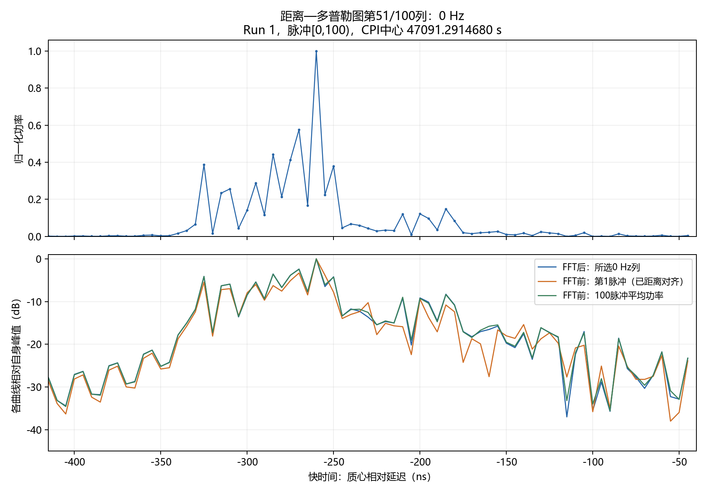
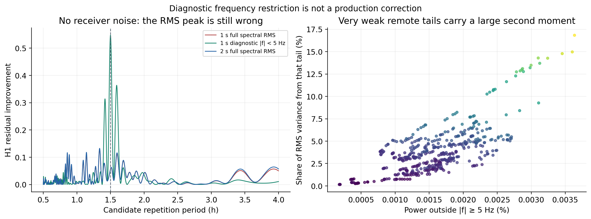

# 信号形成、CPI与积分成本

首个实验阶段：2026-10-09（Chirp教学控制）；后续诊断与性能实验按原日期保留。2026-10-18将教学验证并入本文；它只验证教学模型，不能替代mesh物理或完整周期验收。参见[教学控制](#teaching-control-20261009)与[实验导航](../README.md#reports)。

## 阅读范围（2026-10-18整理）

本文按阶段追加信号形成、CPI与性能证据。开头“只读诊断”“未修改生产代码”描述的是10月10日原阶段，后文有独立的生产修改及验收，不能作为全篇状态读取。当前能力见[项目现状总览](../../../PROJECT_OVERVIEW.md)，主要后续证据可直接读[CPI相干处理](#cpi-coherence-20261014)、[CUDA生产配对](#gpu-production-ab-20261015)、[周期搜索CUDA](#gpu-period-search-20261016)和[无噪声谱尾诊断](#doppler-tail-diagnosis-20261016)。以下原阶段输入、数值、失败与命令保持不变；本次未重跑实验。

## 2026-10-10原阶段说明

按用户要求将原信号形成检查和积分成本探针整合为本文，保留独立条件、数值表及复现命令。以下均为只读诊断，面元积分优化暂缓；当前逐脉冲完整原生特征的代码变更另见 [距离特征与绘图](../../changes/NATIVE_RANGE_FEATURES.md)。

本记录冻结本次只读检查的范围和证据；未修改生产回波生成器、反演代码或实验产物。周期搜索的逐 Run 截距及对称目标半周期问题不在本轮范围内。

## 输入与链路

输入为 `runs/paras_for_70m_3h/echo/echo.npz`、同目录的 `observation_info.npz`、`configs/observation.generated.json` 和 `configs/echo.generated.json`，不能用后来修改的根目录配置代替实际生成配置。产物包含 2000 个 Run，每 Run 一个脉冲；采样率 200 MHz、Chirp 带宽 150 MHz、脉宽约 50 μs、载频 1 GHz、采集路径窗 300 m。使用 `centroid_compensated`、`per_pulse_linear`、CUDA float32 计算，两类相位计算均为 float64，椭球网格有 1280 个面元。观测来源哈希为 `273dbfe57ec2377343f80797661e5f05927e637d5c4ab249a1e902183a54604b`。

已沿观测计划、全局 ADC、二维行映射、保存文件、反演消费者核对：生成器在唯一全局 ADC 索引上计算各脉冲贡献并求和，再映射为保存行；不是先生成独立行再插值到 ADC。原始基带补偿在当前质心补偿数据上不启用；各行偏移跨度为 0，共同距离轴没有实质分数位移；单脉冲 Run 不形成 CPI，也不触发慢时间均匀化。

## 数值对照

常规回放取零基脉冲索引 0、300、835、1200、1999。按原配置回放的 float32 清洁波形与保存的 `clean_iq` 相对 L2 差为 0，确认对照源自实际生成链路。下表中的最大值仅为这些检查点的最大值，不是全输入空间的误差上界。

| 检查项 | 本次结果 | 判断 |
| --- | --- | --- |
| ADC 覆盖与重叠 | 20806000 个保存样点均有效；有效回波重叠和保存行重叠均为 0；采用全数据最大路径差所得保守前后余量均至少约 559.94 ns | 当前没有发现采集截掉有效回波或重复样点计权的证据 |
| 匹配模板浮点取整 | 由时延轴中位步长得到模板 10001 点，按元数据采样率得到 10000 点；分别按自身相关滞后轴比较 | 确有一格差异，但抽查裁后总功率最大偏差约 0.006188%，质心约 0.003781 ns，90% 能量宽度未跨分位样点 |
| 原始网格和累加 float32 对照 float64 | 从原 OBJ 分别载入两种精度并生成；波形相对 L2 差约 0.0072%～0.01164% | 总功率最大偏差约 0.001948%，质心约 0.002699 ns，不能解释大幅尖峰 |
| 大绝对时刻相减对照局部整数 ADC 时刻 | 在回放中使用行偏移加整数索引除以采样率替代绝对时刻相减；差异最大约 7.28 ps | 波形相对 L2 差约 0.0525%～0.1671%，总功率最大偏差约 0.002948%，质心约 0.028501 ns；影响已测但很小 |
| 脉内冻结近似 | 当前已启用一阶脉内运动；诊断中的冻结遗漏公共路径约 0.6287 m、相位约 13.18 rad | 这些是“若采用冻结近似”的误差，不是当前配置的实际误差 |

模板对照改变了模板计数和由元数据确定的时步，属于这两项共同差异的检查，不能把其结果表述为只改一个端点的严格单因素实验。精度对照也同时涉及几何与求和精度，不是只替换相位计算；相位原本已为 float64。

## 面元中心积分对网格高度敏感

对原三角形做共面细分，保持同一分片平面表面及总面积不变，仅改变面元中心积分点和面积权重；使用 float64 对照 1280、5120、20480 面元。回波按面积及视向权重在面元中心评价后相干求和。下表总功率及能量宽度均取完整相关输出，质心也采用完整相关范围，不能混同 GUI 旧的裁后质心。

| 零基脉冲索引 | 面元数 | 完整相关功率和 | 完整相关质心（ns） | 90% 能量宽度（ns） |
| --- | ---: | ---: | ---: | ---: |
| 0 | 1280 | 16509.8494 | −265.5679 | 145 |
| 0 | 5120 | 2968.9537 | −261.0869 | 175 |
| 0 | 20480 | 641.0714 | −260.8804 | 190 |
| 835 | 1280 | 3608.8753 | −356.7067 | 280 |
| 835 | 5120 | 1295.1198 | −374.7292 | 235 |
| 835 | 20480 | 311.7955 | −358.7705 | 250 |
| 1999 | 1280 | 6507.1489 | −280.0790 | 235 |
| 1999 | 5120 | 2124.2869 | −293.0209 | 205 |
| 1999 | 20480 | 677.2690 | −315.2538 | 190 |

如果面元是连续散射表面积分的数值单元，这说明当前中心点求积尚无收敛证据；载频 1 GHz 对应波长约 0.30 m，面元内传播路径变化可能产生显著相位变化，一个中心点未必代表整个面元。如果面元被定义为实际离散点散射体，细分会改变物理散射体集合，这时不能把上述变化直接称为数值错误。下一步应先明确散射模型语义，再验证相位积分或自适应求积的收敛，而不是把 20480 面元直接当作真值。

另做固定观测几何、固定 ADC 事件的半转对照：索引 835 仅将旋转初相位增加 π，波形相对 L2 差约 `1.3718e-7`，原始功率相对差约 `1.1017e-7`。因此网格敏感本身尚不能证明模型丢失半周期；当前固定几何模型仍能很好复现半转。全程几何变化、离散采样及相干干涉对整条周期曲线的共同作用需要后续控制实验。

## 未解决项与修复优先级

优先澄清并验证连续表面相干积分的网格收敛，评估面元内相位变化并考虑解析积分或自适应求积。保留有变化亚样点偏移的数据验证分数延迟重建；逐行标量可在各自原生时延轴计算，CPI 共同轴则需要经过误差验证的重建器。这组零偏移数据无法检验插值替换的收益。

轨迹提供器的星历位置采用表格线性插值，当前配置步长 60 s；本轮没有更密的独立星历表，未量化它的物理误差。当前一阶脉内运动相对逐 ADC 精确几何的二阶残差也未独立量化。两者需要分别做更密时间表和精确运动对照，不能因现有单元测试通过就宣布实际轨迹完全准确。

## 可复现检查与验证

一次性数值脚本保存在仓库忽略的 `tmp/audit_signal_formation_20261010.py`，用于本机复查，不作为发布接口；其核心对照条件、选取索引和结果冻结于本文。临时文件使用仓库 tmp，因为本次可写范围不含推荐的 E 盘缓存。

```powershell
conda activate pytorch
python tmp/audit_signal_formation_20261010.py
# 仓库根目录
python -m unittest inversion.tests.test_chirp_contracts inversion.tests.test_range_energy_width
# echo 目录
python -m unittest tests.test_chirp_batching tests.test_simple_chirp_plan
# observation 目录
python -m unittest tests.test_planning tests.test_planning_regressions tests.test_light_time tests.test_ephemeris
python -m pytest tests/test_planning_regressions.py -q
```

实际执行结果为反演 13 项 unittest、回波 13 项 unittest、观测 19 项 unittest，以及观测回归 32 项 pytest 全部通过。pytest 另有 6 条 Astropy 未来日期 IERS 警告。上述测试用于既有链路回归，不替代网格收敛、独立星历精度或整个周期的物理正确性验证。

## 面元积分成本探针

下述计时仅测既有中心点生成器的细分成本，不是解析积分或 A100 实测，也不表示任何一级网格已收敛。

使用 `runs/paras_for_70m_3h/configs/echo.generated.json` 与 `observation_info.npz`；从 2000 脉冲中选择零基索引 0、100、200、300、400、500、600、700、800、900、1000、1100、1200、1300、1500、1999，共 16 个单脉冲 Run，每行 10403 样点。计算设备为 NVIDIA GeForce RTX 2060 with Max-Q Design，使用原 float32 配置，Chirp 与传播相位沿用生产代码的 float64 计算。网格依次共面四分，面元数 1280、5120、20480。每一级先预热一次，再同步 GPU 测量三次生成器调用；不含配置读取、网格载入和结果文件保存。

| 面元数 | 三次生成时间（s） | 中位数（s） | 按脉冲数线性外推 2000 脉冲（s） |
| ---: | --- | ---: | ---: |
| 1280 | 0.976110、0.982976、1.015856 | 0.982976 | 122.872 |
| 5120 | 3.253759、3.313657、3.470423 | 3.313657 | 414.207 |
| 20480 | 12.679592、13.211528、13.508080 | 13.211528 | 1651.441 |

原完整作业 summary 记录 runtime_s 为 126.6599584，跨运行只作参考；不能用它作同会话速度收益基线。以上外推假设单脉冲 Run 处理成本可按脉冲数近似线性放大，不是实际重新生成 2000 脉冲的计时。当前计时显示直接细分的成本增长显著；5120 和 20480 面元的特征尚不收敛，不能把表中时间称为满足目标精度的积分时间。

A100 耗时应由同一内核实测的相对吞吐比 r 推算：同一任务的估计生成时间为此处外推时间除以 r。若仅作规划情景，20480 点取 r=5、10、20 时分别约为 330、165、83 秒。这些 r 是假设，不是本次测量、置信区间或硬件规格保证。尚未实现的解析三角面元算法还需另行计时，其耗时不能由此表直接推出。

复现脚本为忽略目录中的 `tmp/time_surface_quadrature_20261010.py`；在仓库根目录执行 `conda activate pytorch` 后运行 `python tmp/time_surface_quadrature_20261010.py`。脚本支持无 CUDA 时回退 CPU；CPU 结果与本文 GPU 计时不能混用。

ISAR 的分数距离单元平移并非只存在于 Keystone：Muñoz-Ferreras 与 Pérez-Martínez 的[亚整数距离单元对齐论文](https://link.springer.com/article/10.1155/2010/438615)在第 2 节公式 (5) 使用 Fourier 平移性质实现非整数距离平移。频域线性相位平移与二点线性插值不同；前者的离散实现仍需处理周期延拓和边界。

<a id="fractional-doppler-20261013"></a>

## 2026-10-13：亚样点偏移污染相干多普勒的受控诊断

状态为已复现、未修复；本阶段不改变对齐插值、脉压或共识选择的数值策略，不把展示修复当作精度修复。真实输入为 `runs/seperate_observation_2/echo/echo.npz` 的首100个 `row_fast_time_offset_s`、`scatter_elapsed_s` 与 `fast_time_s`，仅读小型轴数组，不读取真实 IQ。对照组使用相同时间轴、恒定第0行偏移；处理组只改成真实100行偏移，跨度4.9331 ns。

两组都是无自转、无公共运动、无噪声的单位点目标，质心相对延迟−300 ns；在实际 ADC 网格上评价 centered Chirp，200 MHz采样率、50 μs脉宽、150 MHz带宽。调用当前 `prepare_chirp_pulse_profiles` 和 `range_doppler_cube`，100脉冲一个 CPI，Hann窗，无零填充。结果如下。

| 行偏移 | 多普勒质心（Hz） | RMS 带宽（Hz） | 超出±5 Hz的功率比例 |
| --- | ---: | ---: | ---: |
| 全部固定 | 约0 | 0.57736227 | 约 $2.47\times10^{-32}$ |
| 真实亚样点变化 | 0.00003391 | 1.46029223 | 0.01301478 |

固定组的0.577 Hz来自窗函数与有限 CPI，不是点目标有真实速度。改变偏移后出现的额外展宽能否消除，是修复必须满足的控制条件；此实验定位到离散脉压与共同轴线性插值组合，不能只凭它说已经单独证明某一个函数有错。未做带宽、脉宽、偏移和姿态全空间扫描，尚不能声称插值替换可安全成为默认。直接频域移位也有周期延拓和边界问题，必须独立验证。

### 怎么读这组诊断，而不是只看一串数

用户提出的是“真实旋转目标的多普勒质心和带宽没有给出与半周期一致的峰”。上面的测试不是对这个完整结论的直接验收，而是检查其前置条件：如果连已知没有多普勒的点目标都被处理出额外高频尾部，就没有理由先信任真实目标的多普勒宽度。它不能单独证明全部偏差来自插值，也不能证明修完插值就必然出现5400 s峰。

第一组固定行偏移时，各脉冲的复距离像相同。周期Hann窗使零频率点在FFT中落到中心格及相邻两格，振幅比例为 $P/2,-P/4,-P/4$，功率比例为4:1:1。设频率格间隔为 $\Delta f$，功率质心仍为0，但RMS为：

$$
\sigma_f^2=\frac{1\cdot(\Delta f)^2+1\cdot(-\Delta f)^2}{4+1+1}=\frac{(\Delta f)^2}{3},\qquad \sigma_f=\frac{\Delta f}{\sqrt3}.
$$

本例实际频率格约1.0000208 Hz，因此窗本身给约0.5773623 Hz。这是“测量结果中包含仪器／处理响应”，不代表静止点目标真有0.577 Hz物理带宽。不能直接把当前RMS统计量当成目标的纯旋转带宽。

第二组保留同一没有多普勒的连续波形，只让ADC起点相对波形改变一个亚样点。正确相干处理应该把它恢复到同一距离坐标，保留相同跨脉冲相位；当前链路却得到1.460 Hz和1.30%的±5 Hz外功率，这才是额外污染的证据。其具体根因需要分别隔离离散模板、分数对齐、边界和采样相位，不能靠调小显示范围消除。

即使得到准确频谱，多普勒质心和RMS也不是自转周期。正负速度的功率可能相互抵消，某些对称目标质心近似恒定；RMS随自转的调制还取决于形状、散射和视线。接下来必须用已知多普勒点目标验测量，再用固定视线旋转模型建立独立参考，最后判断当前变化几何场景是否应出现半周期峰。现有证据只支持“这两项当前不能被视为已经有效验证的周期约束”，不支持“CPI原理无用”或“已有程序已准确测出它们”。

可按下列代码重建两组（仓库根、Conda `pytorch` 环境）；输入只读取上述数组，真实 IQ 不参与。以下代码与当次临时探针执行内容一致，输出小数末位依赖库版本。

```python
import numpy as np
from types import SimpleNamespace
from inversion.src.inversion import prepare_chirp_pulse_profiles
from inversion.src.radar_signal import range_doppler_cube, range_doppler_features
with np.load('runs/seperate_observation_2/echo/echo.npz') as d:
    offsets = d['row_fast_time_offset_s'][:100]
    fast, times = d['fast_time_s'], d['scatter_elapsed_s'][:100]
for changing in (False, True):
    row = offsets if changing else np.full(100, offsets[0])
    u = fast[None, :] + row[:, None] + 3e-7
    iq = np.where((u >= 0) & (u < 50e-6),
                  np.exp(1j*np.pi*(150e6/50e-6)*(u-25e-6)**2), 0)
    echo = SimpleNamespace(iq=iq, valid=np.ones(iq.shape, bool),
        fast_time_s=fast, row_fast_time_offset_s=row,
        elapsed_s=times, scatter_elapsed_s=times,
        run_id=np.zeros(100, int), coherence_id=np.zeros(100, int),
        metadata=dict(pulse_width_s=50e-6, pulse_bandwidth_hz=150e6,
                      echo_output_reference='centroid_compensated', prf_hz=100))
    p = prepare_chirp_pulse_profiles(echo, {})
    # 冻结2026-10-13的旧线性处理；当前生产默认已改为Fourier。
    from inversion.src.radar_signal import align_profiles_to_common_delay
    lag = p['full_compressed'].shape[1] - len(fast)
    _, p['aligned'] = align_profiles_to_common_delay(
        p['full_compressed'][:, lag:lag+len(fast)],
        p['full_delay_axes'][:, lag:lag+len(fast)],
        common_grid=(p['common_delay'], 1/200e6), method='linear')
    cube = range_doppler_cube(p['aligned'], times, echo.coherence_id,
        p['common_delay'], cpi_pulses=100, cpi_hop_pulses=100)
    f = range_doppler_features(cube)
    power = cube.power.sum(axis=1)[0]
    print(changing, f.doppler_centroid_hz, f.rms_bandwidth_hz,
          power[np.abs(cube.frequencies_hz) > 5].sum()/power.sum())
```

同次读取实际500点候选确认旧共识选择缺陷：总能量、距离质心、能量宽度主峰分别5400.7937、5399.3889、5398.9402 s，分数0.533022、0.866356、0.598716。5739.2144 s簇的支持为上述三个特征的副峰加5702.0530 s多普勒质心候选，后者分数仅0.064068；旧规则四票优先于主峰三票。多普勒带宽最强候选3087.5926 s、分数0.243329，不支持当前明显的三项主峰。此证据证明等票规则会压过明显主峰，不证明换一个启发式规则就能对任意数据恢复真值。

<a id="cpi-coherence-20261014"></a>

## 2026-10-14：CPI、相干误差与距离旁瓣的配对实验

本阶段回答三个独立问题：距离对齐是否破坏相干性、准确的多普勒特征是否应在5400秒出现最强周期峰、增加CPI是否改善周期精度。所有本节数字为2026-10-14重新执行所得；没有改变副峰选择、共同截距、H1周期模型或源回波。生产修正和验收见[原生特征专题](../../changes/NATIVE_RANGE_FEATURES.md#coherent-alignment-20261014)。本阶段并未证明CPI一定优于逐脉冲距离特征，也未完成实测雷达数据验证。

### 实验输入、配对协议与判据

原始输入为`runs/seperate_observation_2/echo/echo.npz`：100个Run，每Run200脉冲，共20000×10403个复样点；PRF=100 Hz、采样率200 MHz、带宽150 MHz、脉宽50 µs、载频1 GHz、Run调度时长2秒、旋转周期10800秒、无噪声、质心已补偿。输入文件3540199624字节，修改时标`1791790698064721400`；身份检查沿用路径、大小和修改时标，不添加SHA256。每个Run内处理，不跨Run FFT。

第一级使用独立连续Chirp点目标，已知多普勒−2.3、0、0.2 Hz；控制ADC小数偏移固定或随真实前100行变化，扫描带宽/采样率0.1、0.5、0.75、0.95，配对比较线性和Fourier对齐。独立参考为连续矩形Chirp自相关。第二级冻结真实同一脉压输入，对CPI=0.25、0.5、1、2秒及步长=CPI/4、CPI/2、CPI执行12种组合，两种对齐共72项特征周期搜索；保存每项完整特征和全范围主峰，禁止只在真值附近搜索。第三级从独立连续LFM响应和面片几何构造固定/变化视线参考；第四级使用理想双距离通道、已知正弦调制的功率/质心/宽度，配对加入同一噪声实现，SNR=20、40 dB各30种子，另含无噪声控制。这最后一级不包含原始Chirp前端、椭球面片干涉、实际接收机或未知噪声模型，不能冒充实际目标的重复仿真。

周期搜索固定1800—14400秒、共同常数截距、H1、全范围最高峰和局部细化。真实数据使用4000频率网格；Monte Carlo使用800网格后细化。记录误差、RMSE、中位绝对误差、95%分位绝对误差、5秒内命中率，以及估计器拒绝比例；重叠CPI不是独立重复实验。种子为20261014加0—29，同一SNR/种子用于全部CPI设置。收益应在配对误差上比较，而不是比较不同噪声样本，也不能由单份无噪声回波的近真值结果推出精度普遍改善。

PRF为100 Hz时，CPI/4步长取整后的窗口数如下。表中CPI是配置名义孔径；首末脉冲时刻跨度为$(N-1)/100$秒，不能写成$N/100$秒。

| CPI名义秒数 | 脉冲数N | 步长脉冲数 | 每Run窗口数 | 全部Run特征点数 | DFT频率间隔Hz |
| --- | --- | --- | --- | --- | --- |
| 0.25 | 25 | 7 | 26 | 2600 | 4 |
| 0.5 | 50 | 13 | 12 | 1200 | 2 |
| 1 | 100 | 25 | 5 | 500 | 1 |
| 2 | 200 | 50 | 1 | 100 | 0.5 |

频率格间隔、窗口主瓣分辨率和高信噪比参数估计误差是三个不同量；补零不会创造额外观测孔径。参考[多普勒估计](https://www.mathworks.com/help/radar/ug/doppler-estimation.html)和[测量精度、偏差与分辨率](https://www.mathworks.com/help/radar/ug/measurement-accuracy-bias-and-resolution.html)。本阶段没有为了获得更小格间隔跨Run拼接FFT。

### 线性分数对齐确实产生假多普勒

对于归一化离散频率$\nu$，小数移位$\alpha$的线性插值频响为$H_\alpha(\nu)=(1-\alpha)+\alpha e^{j2\pi\nu}$，而理想移位为$e^{j2\pi\nu\alpha}$。前者的幅度和相位误差随$\alpha$变化。这里每行ADC相位都变化，因此误差沿慢时间变化，即使目标完全静止也会产生假多普勒。改变采样相位的波形是同一个连续信号；不应该把这种数值波动当成目标运动。

修正使用带零保护区的Fourier小数移位，保留复相位，统一反演及GUI距离—多普勒重算入口。Fourier重建依赖近似带限、均匀采样；采用128样点加实际移位量的零保护区，避免直接把两端当成周期接续。截断边界和接近奈奎斯特时仍有残差，不能宣称任意合法波形都达到机器精度。[SciPy Fourier重采样说明](https://docs.scipy.org/doc/scipy/reference/generated/scipy.signal.resample.html)明确要求注意周期假设。

| 静止点目标，真实前100行ADC相位 | 谱质心Hz | Hann谱RMS Hz | ±5 Hz以外功率占比 |
| --- | --- | --- | --- |
| 固定ADC相位，Fourier | 约0 | 0.577362 | 约0 |
| 变化ADC相位，旧线性 | 0.0000339 | 1.460292 | 1.30148% |
| 变化ADC相位，Fourier | 0.0000841 | 0.580450 | 0.0011885% |

静止点目标的0.577 Hz并非运动带宽：1秒周期Hann窗在整格单频点上形成中心及左右各一格，功率比例4:1:1，故RMS为$\Delta f/\sqrt{3}$。目标实际低频宽度约0.05—0.15 Hz，明显小于这项窗展宽。修好插值不等于消除了窗展宽。

真实ADC偏移下Fourier谱RMS相对独立连续参考的误差，在带宽/采样率0.1、0.5、0.75、0.95时分别约0.000337、0.001779、0.003087、0.008032 Hz。更强的覆盖全采样相位控制（100行黄金比例序列）误差分别0.000861、0.005401、0.012722、0.062492 Hz；对应旧线性RMS分别0.581726、1.821401、4.375435、7.549555 Hz。0.95边界残差比当前0.75作业大，测试明确采用不同上界，没有把当前作业的误差承诺推广到所有带宽。

### 相干污染：应区分真实干涉与数值伪差

距离单元内多个面片的复振幅相加后再取模平方，其功率为

$$
z(t,\tau)=\sum_i a_i h(\tau-\tau_i)e^{j(\phi_i+2\pi f_i t)},
$$

$$
|z|^2=\sum_i |a_i h_i|^2+\sum_{i\ne j}a_i a_j^*h_i h_j^*e^{j[\phi_i-\phi_j+2\pi(f_i-f_j)t]}.
$$

其中$a_i$是面片散射复振幅，$h_i=h(\tau-\tau_i)$是脉压响应，$\phi_i$是传播相位，$f_i$是面片多普勒。第二项是相干交叉项，产生增强、相消和散斑；它是真实相干模型的一部分，不能一概称为算法错误。“相干污染”在此前诊断中的准确含义是：当本来想测几何速度分布时，相干交叉项及额外数值误差使该统计量偏离了简单的非相干面片功率模型。线性对齐造成的慢时间调制属于数值伪差，性质不同。把交叉项强行删除，会改变本项目的散射模型。

独立几何参考按实际网格面片、散射权重和固定/变化视线计算连续LFM响应；每个2秒Run内冻结权重与速度，保留面片传播相位和相干求和，距离ROI为±1.2 µs。它不包括完整高阶运动、离散ADC及全部窗外尾部，因此仅用于隔离机制。固定视线四组半转复信号配对的最大相对L2差为$4.57\times10^{-12}$，说明这个控制确有半周期对称性。非相干面片速度矩参考的主峰约5399.9秒，但它不是相干回波的真值。

固定视线相干质心的H1主峰为5430.96秒（1秒CPI），变化视线参考为5425.35秒；变化视线相干宽度参考为5399.96秒。Fourier修正后真实质心与变化视线连续参考的相关系数为0.998857。因而质心剩余约28秒周期偏差不能简单归咎于提取错误；当前稀疏观测、变化几何和非正弦相干特征与H1拟合之间确有模型偏差。半转对称性只保证重复，不保证基波是最强分量，更不保证稀疏采样的单正弦最小二乘峰恰好落在重复周期。对于质心恒零的对称目标甚至根本没有质心周期可估计。

### 真实输入的主峰与低频有效估计

下面比较各特征自身的全范围最高峰，不改共识选峰规则；“5400秒得分/最高得分”用于判断真值附近是否有主峰，不能当作频率估计误差。

| 1秒CPI、0.25秒步长 | 特征 | 全范围主峰秒 | 相对5400秒误差秒 | 5400秒得分/最高得分 |
| --- | --- | --- | --- | --- |
| 旧线性、Hann谱矩 | 质心 | 2380.807 | −3019.193 | 0.2401 |
| Fourier、Hann谱矩 | 质心 | 5427.837 | +27.837 | 0.9312 |
| Fourier、低频有效估计 | 质心 | 5427.718 | +27.718 | 0.9317 |
| 旧线性、Hann谱矩 | RMS带宽 | 3087.593 | −2312.407 | 0.0898 |
| Fourier、Hann谱矩 | RMS带宽 | 4817.284 | −582.716 | 0.4372 |
| Fourier、低频有效估计 | 有效宽度 | 5398.021 | −1.979 | 0.9996 |



修正对齐后的12种CPI/步长组合中，质心主峰约5427.5—5427.8秒，谱RMS主峰约4816.5—4817.4秒；单纯延长到2秒没有解决谱RMS问题。真实低频有效估计本阶段只验证了1秒/0.25秒组合，不能将其结果推广到其余11种设置。

低频有效估计采用未加Hann窗的归一化滞后相关。将相位随滞后的一次项和对数幅度随滞后平方的项分别拟合：

$$
\rho(\ell)=\frac{\sum_{m,k}z_{m+\ell,k}z_{m,k}^*}{\sqrt{\sum_{m,k}|z_{m+\ell,k}|^2\sum_{m,k}|z_{m,k}|^2}},
$$

$$
\arg\rho(\ell)\approx b_0+2\pi\mu\ell\Delta t,\qquad \log|\rho(\ell)|\approx c_0-2\pi^2\sigma_{\mathrm{eff}}^2(\ell\Delta t)^2.
$$

这里$m$遍历有配对样点的慢时间脉冲，$k$遍历距离列，$\Delta t$为慢时间间隔。二次近似要求短滞后内的频谱主要为低频窄分布；常数$c_0$允许噪声导致的常量失相干。该方法估计低频有效宽度，不能宣称恢复任意谱RMS。生产质量检查要求至少12脉冲、最小相干系数≥0.9、对数幅度拟合RMS≤0.0005、相位拟合RMS≤0.005 rad、方差不低于−0.000001，以及$2\pi\sigma_{\mathrm{eff}}\ell_{\max}\Delta t\le0.45$；未通过窗口输出NaN，不暗中换回谱矩。

真实500窗口全部通过：最小相干系数不低于0.982895、最大对数拟合残差0.00002694、最大相位残差0.00006687 rad、有效宽度0.0461—0.1476 Hz。这说明本作业符合已测局部相关模型，不构成任意频谱准确性证明。对抗审查的反例为99.99%功率在0 Hz、0.01%在20 Hz：真实谱RMS约0.19999 Hz，低频有效估计约0.002625 Hz，全部质量阈值仍能通过。弱高频尾部正是不能由质量阈值排除的风险。默认继续使用谱矩，新方法为显式可选策略；禁止把图中名称继续叫成无条件的内禀RMS带宽。

### CPI是否改善精度：已测负结果与后续门槛

FFT沿全部频率求和的总功率由Parseval恒等式等于加窗前时间域功率的对应加权和（非归一化DFT多一个N因子）。它没有额外的频率信息，也不自动等同于先相干求和再平方。理想两通道实验逐窗口核对相对误差≤$10^{-12}$，因此CPI总能量的收益只能来自聚合/权重及噪声处理，不能解释为凭FFT创造了新的周期信息。

| 理想两通道，30种子，1秒CPI/0.25秒步长 | SNR dB | 周期误差RMSE秒 | 绝对误差95%分位秒 | 5秒内比例 |
| --- | --- | --- | --- | --- |
| 逐脉冲功率 | 20 | 0.4708 | 0.9534 | 100% |
| CPI功率 | 20 | 0.4817 | 0.9193 | 100% |
| Hann谱质心 | 20 | 2.1271 | 3.4079 | 96.7% |
| Hann谱RMS | 20 | 4.4493 | 9.8661 | 80% |
| 逐脉冲功率 | 40 | 0.04765 | 0.09683 | 100% |
| CPI功率 | 40 | 0.04868 | 0.09579 | 100% |
| Hann谱质心 | 40 | 0.02388 | 0.04271 | 100% |
| Hann谱RMS | 40 | 5.2333 | 11.2221 | 60% |

这些结果不支持“CPI总能量改善周期精度”的通用结论；质心在高SNR的这个理想模型中有用，谱RMS存在强窗/噪声偏差。不同特征并非相同信息的等价估计器，不能把跨特征更小误差当作CPI本身的普遍收益。30种子仍是诊断规模，不是论文级精度证明。新增低频策略的配对噪声结果见本节后续表；若拒绝了全部窗口必须报告不可估计，不能从有效子集中挑最好结果。

| 同一双通道噪声，1秒CPI/0.25秒步长 | SNR dB | 周期误差RMSE秒 | 绝对误差95%分位秒 | 平均窗口接受率 |
| --- | --- | --- | --- | --- |
| 低频有效质心 | 20 | 0.1893 | 0.3491 | 49.91% |
| 低频有效宽度 | 20 | 1.6862 | 2.7934 | 49.91% |
| 低频有效质心 | 40 | 0.01387 | 0.02115 | 100% |
| 低频有效宽度 | 40 | 0.05218 | 0.08829 | 100% |

每格30个周期拟合全部可执行，5秒内命中率全部100%；20 dB约一半窗口被拒绝，因此质量门限改变了实际采样时刻分布，该优势包含筛选作用，不能只说是“测量更准”。这个窄双频、正弦调制、白噪声控制支持新增估计器在该模型内的收益，不支持未知散射或高频尾部情形。真实椭球实验是无噪声，不把两者合成一个精度承诺。

后续列装门槛为：对实际Chirp前端、至少多个形状/散射模型/视线/信噪比，在相同观测计划和噪声下比较逐脉冲距离特征、CPI谱矩、低频有效估计；每格报告全范围误选率、偏差/RMSE、拒绝率、配对差的置信区间，并检验弱高频尾部和Run内运动非平稳边界。若没有一致收益，应允许直接采用逐脉冲路线，不把CPI视为必经步骤。当前不据这一个无噪声目标改变默认CPI长度或估计器。

### 横条纹的隔离实验

不凭条纹的外观断定正常。先只保留一个静止点、固定ADC相位，若仍有条纹就是脉压点扩散函数的候选；然后只改变ADC小数相位，比较线性/Fourier；最后仅改变距离频谱加权，判断条纹是否随距离旁瓣而变。绘制全频率轴、完整距离列，保持同一色标，避免抽列和压缩显示制造/掩盖纹理。真实首个CPI旧/新对齐的图也保留在下方。

矩形Chirp的高时间带宽积连续脉压响应近似$sinc(B\Delta\tau)$，第一个距离旁瓣约−13.26 dB；单点也会有许多重复旁瓣，旁瓣与目标共享多普勒。在“距离纵轴、多普勒横轴”的旧显示中形成横条，在现在“快时间横轴、多普勒纵轴”的显示中方向转为距离侧瓣纹理。这与数值对齐造成的额外离中心多普勒能量是两件事。有限脉宽精确响应还包含$T-|\Delta\tau|$包络，边界影响没有在近似Hamming图中全部建模。

| 理想连续脉压响应，B=150 MHz | 最大旁瓣dB | 功率半高全宽ns |
| --- | --- | --- |
| 矩形频谱 | −13.2617 | 5.9 |
| Hamming距离频谱加权 | −42.6753 | 8.6 |





点目标控制确认一部分条纹为距离旁瓣，另一部分假多普勒随插值修正显著下降；不能由此把真实图中的所有条纹都判为正常。Hamming旁瓣改善伴随主瓣约46%变宽，会改变距离统计量，故本阶段只作实验，不改生产匹配滤波默认权重。剩余面片离散、真实相干干涉和高阶运动应逐项控制，不能靠裁图或任意加窗让图“好看”就宣称物理正确。

### 重建命令与产物

以下脚本不覆盖源回波或已有反演产物。真实实验可复用已有原生脉压缓存；没有缓存会重新逐Run计算。控制和几何程序中的固定物理量仅对应上述配置，不是任意配置的通用实验生成器。

```powershell
conda activate pytorch
python scripts/experiment_cpi_coherence.py --mode controls
python scripts/experiment_cpi_coherence.py --mode real
python scripts/experiment_cpi_coherence.py --mode real-scan --output tmp/cpi_scan_20261014
python scripts/experiment_cpi_coherence.py --mode geometry
python scripts/experiment_cpi_coherence.py --mode lag
python scripts/experiment_cpi_coherence.py --mode stripes
python scripts/experiment_cpi_coherence.py --mode noise --seeds 30 --output tmp/cpi_noise_30_20261014
python scripts/experiment_cpi_coherence.py --mode noise-lag --seeds 30 --output tmp/cpi_noise_lag_30_20261014
python scripts/summarize_cpi_coherence.py
```

历史本次普通噪声原始文件名为`noise_pilot.json`；可重建脚本现在明确输出`noise_spectral_moments.json`，汇总器兼容两个名称。其余小型JSON保存测量值、全部主峰及质量；原始特征、谱和原始噪声统计放`tmp/`，图示保留在当前文档图片目录。本阶段没有新增SHA256或后台反复读取回波。

完整小型冻结表为[72项真实CPI/步长扫描](../data/2026-10-14_CPI_COHERENCE_REAL_SCAN.csv)和[两种估计器全部噪声统计](../data/2026-10-14_CPI_COHERENCE_NOISE.csv)，包含负结果和拒绝率；同主题表格附件不另建报告正文。汇总器从原始记录重建这些表，不能在缺少原始记录时伪造重新测量。本次耗时仅作执行记录，不是性能收益：真实单设置配对91.22秒、12设置扫描386.85秒、独立连续几何15.73秒、真实lag53.56秒、谱矩30种子201.67秒、lag30种子279.19秒；它们做的工作不同，不能相除宣称加速。

<a id="selected-rd-stripes-20261015"></a>

### 2026-10-15 用户指定首CPI横条纹的复查

本次针对用户明确提供的 `.gui_state/previews/seperate_observation_2/rd_run_-1_cpi_0.html`，标题Run 1、脉冲[0,100)、散射中心时刻47091.2915s；HTML中的实际功率矩阵为10403个距离格×100个多普勒格，默认延迟显示约−415至−40ns。源回波仍为3540199624字节、mtime_ns=1791790698064721400。只加载Run 0的200行，计算前100行，不重跑整场反演，不修改源回波、科学缓存或HTML。输入校验包含Run、脉冲范围、时刻、可见帧和频率格数。

比较三件彼此不同的事：一是已提交基线 `inversion` 子仓HEAD `079291a38b8496b593f68685bba4a136decb2ce5` 与当前匹配滤波的同输入输出；二是当前对齐实现的linear与Fourier两种方法；三是对同一Fourier矩阵模拟655个距离显示点。第二项不是10月13日前完整历史链复现，第三项不是直接拿到修改前HTML作截图差分。10月13日的历史诊断确曾限制距离显示列，但不能据此假装已找回其全部旧产物。

| 检查 | 本次结果 | 能支持的结论 |
| --- | --- | --- |
| 100行旧／新匹配滤波最大绝对差 | 0 | 本次输入的条纹不能归因于匹配滤波函数被改出不同输出 |
| 当前Fourier重算归一功率与指定HTML最大绝对差 | 5.55×10⁻¹⁷ | 已复现用户指定图的数据，不是拿其他Run代替 |
| 所示延迟范围的距离能量局部峰数，prominence=全场峰值0.005 | linear为16，Fourier为17 | 两种当前对齐方法都保留密集距离起伏，不能只怪新增Fourier方法 |
| FFT前加窗功率和乘100与频率方向求和的最大相对误差 | linear为2.38×10⁻¹⁶，Fourier为3.78×10⁻¹⁶ | 距离总能量包络的起伏在慢时间FFT前已经存在；不证明每个多普勒格或每条纹都物理正确 |
| 相同Fourier矩阵模拟655点距离抽样 | 细横纹明显被掩盖 | 显示采样变化足以改变条纹的可见性，不能把粗显示当物理修复 |



横轴均为多普勒频率、纵轴均为质心相对延迟，三幅使用同一−45至0dB色标。左为当前linear方法，中为当前Fourier方法，右为中图仅保留655个距离点后的模拟显示；为看清细节，频率只显示−4至4Hz。不能据此回复“修改前一直如此”：本次确证的是显示分辨率会掩盖纹理、距离功率已有起伏，以及本次匹配滤波输出未变；没有证明10月13日前的完整RD产物已有相同横纹。前述点目标实验能证明距离旁瓣是一项来源，但真实目标的逐条纹贡献仍需把脉压旁瓣、面片复振幅干涉、空间离散和其他数值误差分开，不能一律判正常。本轮未平滑图像、未降低科学分辨率、未修改生产FFT或周期算法。

复现：`conda activate pytorch` 后执行 `python scripts/experiment_cpi_coherence.py --mode saved-rd --echo runs/seperate_observation_2/echo/echo.npz --html .gui_state/previews/seperate_observation_2/rd_run_-1_cpi_0.html --output tmp/current_rd_repro`。这是既有实验脚本的新诊断模式，仅适用上述首CPI协议，非通用RD修复工具；JSON同时记录已加载／实际计算行数、匹配滤波Git基线和图标题。新上下文审查独立运行一次，重现数值并确认有界读取及不写生产缓存。原始JSON和临时脚本在tmp，图和本节保留审查后证据。

本日进一步提取上述矩阵的第51／100列，即0Hz频率格，绘制沿距离的一维功率。RD横轴是多普勒频率，所以这一列不是一条脉冲，而是100脉冲经过Hann加权、按0Hz相干积累后的功率。独立逐距离核对直接复数加权和的模平方与FFT的0Hz列，最大相对差5.01×10⁻¹⁶；从HTML还原的一列与重算归一列差5.55×10⁻¹⁷。中心三个频率格合计占全帧功率99.9675%，主要是短CPI下集中在零频附近的能量及窗主瓣，不能解释成三个已分辨散射中心。



上图线性功率，每个点为实际距离采样；下图dB功率，各曲线分别按自身峰值归一化。蓝线为所选0Hz列，橙线为FFT前第1条已距离对齐的脉压功率，绿线为FFT前100条已对齐脉压的非相干平均功率。原始／脉压矩阵仍是“脉冲×快时间”，RD图则是“距离×多普勒频格”；不能把后者的列当成原脉冲。三条曲线中的距离起伏对应热图的横向明暗变化，说明当前纹理不能仅归因于横向分辨率不足或浏览器画线；图本身没有证明各起伏物理正确。相关法只替换两个标量，不改变此FFT矩阵。相同复现命令同时输出 `selected_rd_column.png`、可编辑向量SVG及保存各一维数组的NPZ；本轮不改变生产计算。

<a id="gpu-kernel-probe-20261015"></a>

### 2026-10-15 FFT功率谱法的耗时与GPU可行性探针

本次仅测同一真实输入的第1个Run，200×10403、PRF100Hz、全有效、已质心补偿、centered Chirp；不读取全场IQ。运行现有科学预处理形成5个100脉冲CPI，关闭科学缓存写出，另做100×10403小核CPU／CUDA同会话各5次配对。设备为RTX2060 Max-Q、PyTorch2.3.1；CUDA计时前后同步，先预热。测量时间北京时间2026-10-15 11:57，原始记录 `tmp/fft_gpu_repro_20261015/result.json`，源码为 `scripts/benchmark_inversion_kernels.py`。身份仍只记录路径、大小、mtime，不新增SHA256。

单Run的cProfile探针2.979秒中，匹配滤波5次累计0.342秒，距离Fourier对齐10次累计1.834秒，range_doppler_cube的5次累计0.428秒。该总时间含剖析开销，不包括磁盘读取计时、科学产物写盘、逐脉冲检查导出、周期搜索或HTML；函数累计项可能嵌套，不能当互斥耗时相加。此处没有修改前同条件整流程基线，不能据此证明整体比以前慢了多少。代码确实按重叠CPI重复匹配滤波与两套距离轴对齐；每Run500行窗口输入复用200条物理脉冲，另有新增检查数据导出与完整频谱写盘成本。后两项没有包含在这次科学核剖析中。

| 100脉冲小核 | CPU中位数(ms) | CUDA中位数(ms) | 计时范围 |
| --- | --- | --- | --- |
| 匹配滤波完整相关 | 68.623 | 18.284 | GPU含输入／模板上传及结果返回CPU |
| Fourier距离对齐 | 141.721 | 16.960 | GPU含传输并按相同补零条件批处理；CPU仍逐行并检查坐标 |
| 慢时间FFT | 31.882 | 1.491 | GPU输入已驻留，不含传输；CPU输入在主存 |

这三项证明核级GPU实现有潜力，不表示真实20000脉冲整流程已加速。对齐收益同时来自分组批处理与GPU，CPU批处理收益未拆分；5次固定顺序的时间有下降趋势，只报告本次样本中位数，不给稳定性能区间。生产输入FFT为complex64、模板及输出complex128，GPU匹配滤波对生产CPU最大差3.196×10⁻⁶，按CPU峰值归一约5.36×10⁻⁸；Fourier对齐complex128最大差2.86×10⁻¹⁴。GPU与CPU不能声称逐位一致，该近似差尚未验证对最终周期及所有合法波形的影响。

正式流水线仍使用CPU，本轮没有偷偷开启GPU或降低精度。后续列装需要有界显存、无CUDA时CPU回退、复杂数精度合同、多参考系／掩码／采样边界验证及完整20K规模同会话A/B；并与减少重叠CPI重复脉压／对齐的CPU基线比较。单核加速不能消除磁盘与检查导出成本。复现：`conda activate pytorch`，执行 `python scripts/benchmark_inversion_kernels.py --output tmp/fft_gpu_new_probe`；输出目录必须不存在，该研究探针需要CUDA并显式拒绝其他未验证输入，生产CPU路径不受影响。新上下文审查核对计时同步、数据类型、误差及作用域，没有把该原型当成已完成生产加速。

<a id="gpu-production-ab-20261015"></a>

### 2026-10-15 生产CUDA核：真实20000脉冲配对验证

本阶段把前述原型接入生产，但默认仍为CPU。对同一份`runs/seperate_observation_2/echo/echo.npz`的20000×10403输入，用同一解释器、同一已映射IQ、同一会话先CPU后CUDA各1次，显式关闭科学缓存读写及额外方法比较，固定FFT功率谱法、CPI1秒、隐式步长0.25秒、H1、1800至14400秒4000格并细化。时间是从科学预处理到五特征和周期搜索，不含IQ加载、检查数据导出、HTML或磁盘缓存写出；不是完整GUI按钮耗时。原始记录`tmp/backend_full_fft_ab_20261015/result.json`，UTC测量时间2026-10-15T04:18:09.895196+00:00，设备NVIDIA GeForce RTX 2060 with Max-Q Design。配对脚本`python scripts/benchmark_inversion_backend.py --echo runs/seperate_observation_2/echo/echo.npz --config runs/seperate_observation_2/configs/inversion.generated.json --output tmp/backend_full_fft_new`在`conda activate pytorch`后执行，输出目录须不存在；脚本明确覆盖估计器为FFT且关闭误差重采样。

CPU耗时227.098787秒，CUDA耗时121.120074秒，本次比值1.875倍。只有一次固定顺序配对，不给稳定性能区间；GPU收益不能推广到小规模、其他GPU、相关法总耗时或IO导出。GPU含各核的上传和回传，并未让整个流水线持续驻留显存；Fourier对齐同时采用分组批处理，没有拆分CPU批处理的独立收益。

| 特征 | CPU周期(s) | CUDA周期(s) | 绝对差(s) |
| --- | --- | --- | --- |
| total_power | 5398.349376983 | 5398.349376969 | 1.4e-08 |
| doppler_centroid | 5427.837155233 | 5427.837155562 | 3.28e-07 |
| doppler_bandwidth | 4817.283998360 | 4817.283995029 | 3.33e-06 |
| range_centroid | 5400.633727941 | 5400.633728099 | 1.58e-07 |
| range_energy_width | 5398.484748101 | 5398.484748101 | 0 |

全部特征有限掩码一致。观测时刻、Run标识、有效样本数及90%能量宽度逐元素相同；总能量最大绝对差1.28830（本作业能量约10⁷量级），多普勒质心1.06467×10⁻⁹Hz、RMS带宽1.27311×10⁻⁸Hz、距离质心1.28587×10⁻¹⁵秒。周期最大差3.33113×10⁻⁶秒。此差值是当前输入的实测，不是所有合法输入误差上界；近常量特征、并列峰和分位边界可放大浮点差异。没有改动特征或共识规则，也不以接近真值选择设备。

<a id="gpu-period-search-20261016"></a>

### 2026-10-16 周期网格CUDA及重复实验加速

本阶段只将Chirp多谐波网格搜索接入GPU，不改五项已提取特征、搜索范围或共识。用户希望优先加速重复实验，故同时接入方法比较和完整Run重采样；CW原Lomb路径保持CPU。采用float64分块小矩阵正规方程，病态设计、过大相位／参数及预算边界回到原CPU SVD；相邻近并列点、所有待选局部峰及最终细化也由CPU核验。原型逐批QR在目标小矩阵上反而较慢，已舍弃；前期并行探针不作为以下速度证据。

最终独占同会话A/B读取原保存`period_observables.npz`，500观测×5特征，原1800至14400秒4000格、H1、原权重和细化；预热后按CPU/GPU、GPU/CPU、CPU/GPU交替3对，含上传／回传，不含IQ前端、文件载入或导出。然后同固定种子20261015，各执行30次完整Run重采样一对。设备仍为RTX2060 Max-Q、PyTorch2.3.1，源码与输入身份、时间及每次计时冻结在[JSON](../data/2026-10-16_PERIOD_SEARCH_CUDA.json)。脚本在开始／结束校验源码哈希和输入身份，避免混版本性能记录。

| 测量范围 | CPU(s) | CUDA(s) | 本次比值 |
| --- | --- | --- | --- |
| 五项全网格＋候选核验／细化，3次中位数 | 1.485057 | 0.576775 | 2.575倍 |
| 30次完整Run重采样，仅1对 | 39.951674 | 12.459085 | 3.207倍 |

五项全网格分数最大差4.44×10⁻¹⁶，全部候选周期逐项相同；共识均5748.465058秒，重采样共识和逐特征全部周期样本相同。这只证明该输入上的数值与速度，不证明真实科学结果正确，也不是整个GUI按钮速度。低规模、其他GPU、CUDA冷启动和病态回退可能没有加速；不将单次bootstrap比值当稳定性能保证。

独立审查另外实际执行81组合：N=32／137／500，H=1／2／4，时间跨度93／3／0.03秒，权重比1／10⁶／10²⁰，含非零相位补偿。72组合有效，候选周期逐项相同且NaN位置相同，曲线最大差5.33×10⁻¹⁵；9组合两后端一致拒绝，原控制台未保留具体原因，因此不补写拒绝类别。跨度／H越退化，CPU保护格越多；0.03秒H1／H2全部81格回CPU。扫描发生于随后仅抑制非有限差分警告的修正前，未捕获当时源码哈希，此限制在冻结证据中明确记录。完整复现脚本为`scripts/verify_period_search_cuda.py`；测试另有独立正交Fourier解析golden、Nyquist秩亏、边界峰、近并列采样别名、极端尺度、大相位、p>64和重采样设备传递，不能只以现行CPU互比证明历史物理正确。

复现（Conda pytorch环境、输出目录须不存在）：

```powershell
conda activate pytorch
python scripts/benchmark_period_search.py --output tmp/period_search_cuda_new
python scripts/verify_period_search_cuda.py --output tmp/period_search_scan_new.json
python -m pytest inversion/tests/test_period_search_cuda.py -q
```

<a id="cpi-full-support-20261016"></a>

## 2026-10-16 CPI 完整距离支撑的配对诊断

本阶段把两个问题分开验证：总功率和距离质心是否漏用已有完整相关支撑，以及修正这种表示不一致后周期是否自然更准确。生产修改见[完整支撑专题](../../changes/NATIVE_RANGE_FEATURES.md#cpi-full-support-20261016)。本节保留实际负结果；没有按已知半周期挑选特征、阶数、搜索区间或输出候选。

### 输入、基线与同会话协议

输入仍为 `runs/seperate_observation_2/echo/echo.npz`，3540199624 字节，mtime 为 `1791790698064721400`，SHA256 为 `945e43db26c54cd9149ee5fc1b4ee7526a785945bde7eb5e612bbce847dd3197`。旧观测快照为 `runs/seperate_observation_2/inversion/period_observables.npz`，SHA256 为 `dc83894df4032d02f7086dc97e9bdef290e75844750ee8487b1d2b88d15750d0`。100 Run、每 Run 200 脉冲；PRF 100 Hz，CPI 配置 1 s、步长 0.25 s，对应 100 脉冲／25 脉冲及 500 窗；使用散射时标、质心补偿回波、CPU、Fourier 距离对齐、Hann 窗和 FFT 谱矩。当前源作业 JSON 的 CPI 曾保存为 16 s，因此复现必须读取旧观测快照中的 `inversion_config`，不能把当前作业 JSON 当作本次配置。

配对的 `old_value` 明确定义为冻结的裁剪谱矩基线：总功率和距离质心由裁剪 RD 谱积分，90% 宽度仍取完整相关功率，两个多普勒数也取原谱。`value` 使用修改后的生产完整距离统计。两分支共享同一份 IQ、匹配滤波、对齐、CPI、时刻和权重；没有另加噪声，也没有重生成椭球回波。逐窗旧分支与原保存的 500×5 特征、时刻及 Run 排序完全相同，五列最大绝对差均为 0。全部周期采用共同截距 H1、1800—14400 s、4000 频率格及局部细化；5400 s 只用于报告误差，未用于求解或选峰。

原始产物为 `tmp/period_upgrade_20261016/feature_pairing.npz` 和 `feature_pairing.json`，于北京时间 2026-10-16 14:16 归档；该轮数值由临时 `probe_feature_pairing.py` 产生，原产物保留且未覆盖。之后整理为[可复用实验脚本](../../../../../scripts/experiment_cpi_feature_support.py)：原探针每 Run 一次压缩后分窗，新入口逐 CPI 有界处理，保留相同公式与全局距离轴，并校验旧快照、输入身份和源码哈希。这里的 146.6165 s 是原探针的一次提取耗时，不能当作新脚本耗时或性能收益；新入口已执行 `--help`、17 窗小型 CLI、配置自动读取、完整作业 JSON 读取及拒绝覆盖检查，未以这组小夹具代替真实 500 窗验收。

原完整运行时 `radar_signal.py` 哈希始终为 `30cae0d961ab61bc6ae2c6fb01a1794f016be0048866dab393e12c8f43bbe50c`，计算后端哈希始终为 `f46a54084c71d2bfab91baf979c9ba5e3dd613b6a2bc40fe5c75c4a25640e943`。同时进行的集成工作使 `inversion.py` 文件哈希由 `36a5450a398453167e3338088384ef5f786067c29f1bab36eaec59fcdebe19ae` 变为 `cfd4c0004d35bd1e52d454e0749e022f36d61d2f31ea598c4fc50ec68d1f7c87`；JSON 如实保留首尾两值，不声称这是最终源码冻结后的独占性能实验。实际旧数值逐点复现由上述独立快照比较保证。新脚本若发现运行期间源码或输入改变，会保留诊断产物并以非零状态退出。

### 完整距离统计没有自动消除周期偏差

| 特征 | 冻结裁剪基线 H1 周期(s) | 完整支撑 H1 周期(s) | 相对 5400 s 的误差，旧→新(s) |
| --- | --- | --- | --- |
| 总功率 | 5398.349377 | 5398.337741 | −1.650623→−1.662259 |
| 距离质心 | 5400.633728 | 5400.794505 | +0.633728→+0.794505 |
| 中央 90% 能量宽度 | 5398.484748 | 5398.484748 | −1.515252→−1.515252 |
| 多普勒质心 | 5427.837155 | 5427.837155 | +27.837155→+27.837155 |
| 多普勒 RMS 带宽 | 4817.283998 | 4817.283998 | −582.716002→−582.716002 |

恢复完整支撑的最大总功率相对变化为 0.001184636762，即 0.1184636762%；距离质心最大变化为 $3.586707804\times10^{-9}$ s。两个多普勒数和原90%宽度不变，符合本次修改范围。总功率和距离质心的 H1 误差略增，所以“完整支撑更符合统一统计定义”与“在这份数据上更准确测出周期”不能互换。本控制不支持靠这一处修复解决剩余几十至几百秒的多普勒周期偏差。

新增完整距离 RMS 探针使用同一功率权重的二阶中心矩平方根，避免了离散分位宽度的整格跳变；其本次 H1 最高峰却为 **2489.903123 s**，相对 5400 s 偏差 −2910.096877 s。二阶矩更重视远距离弱尾部，数值连续并不等于周期模型更合适。该特征未加入默认生产五特征，也未用真值附近次峰替换最高峰；单份无噪声结果不能推出 RMS 在其他目标必然无效。

### 窗展宽与频率边界的实测范围

| 诊断 | 500 窗最小值 | 500 窗最大值 | 解释边界 |
| --- | --- | --- | --- |
| Hann 窗自身谱 RMS(Hz) | 0.5773609985 | 0.5773622730 | 窗和实际时标的响应，不是真实目标内禀带宽 |
| Nyquist 接缝两格内功率占比 | 3.8943564×10⁻⁹ | 2.7234778×10⁻⁵ | 只衡量本次实测谱在接缝附近的能量，不能排除带外混叠 |

100 Hz、100 点、49.6 Hz 单频的独立控制中，原线性谱矩得到约 −7.95348 Hz 质心及 48.89011 Hz RMS，说明接缝跨越可严重污染线性矩；该控制的接缝功率比例超过 99%。真实输入的相应比例很小，不能把这个一般性风险当成当前 4817 s 带宽峰的已证根因。当前算法只新增数值诊断，未假定所有谱都能安全解折叠，也未从实测 RMS 中扣除窗方差；短 CPI、相干交叉项和弱尾部的既有限制仍然成立。

### 复建与验收

先激活 `pytorch` 环境，再执行下列命令。输出目录必须不存在；脚本不会覆盖既有结果。未提供 `--config`／`--job` 时使用旧观测快照内冻结配置；显式 JSON 可以是完整作业或 `inversion` 配置，但必须与快照形成相同窗口。该入口限定 CPU、FFT 谱矩及无视线相位补偿，始终输出 H1 诊断，不调用新融合器，也不读取形状自转真值来选择结果。

```powershell
conda activate pytorch
python scripts/experiment_cpi_feature_support.py --echo runs/seperate_observation_2/echo/echo.npz --observables runs/seperate_observation_2/inversion/period_observables.npz --output tmp/cpi_feature_support_rebuild
python -m unittest inversion.tests.test_cpi_feature_integrity inversion.tests.test_range_energy_width inversion.tests.test_coherent_doppler inversion.tests.test_native_pulse_features inversion.tests.test_chirp_contracts
```

新输出 `feature_pairing.npz` 保存旧／新五列、真实时刻、Run／相干组、有效权重、距离 RMS 候选及谱诊断；`feature_pairing.json` 保存配置、SHA256、旧快照差、逐特征 H1 结果、无法搜索原因及身份校验状态。快照不匹配或身份改变时返回失败；缺少周期调制的特征写为空并记录原因，不能把这种状态算作周期估计成功。独立 DFT、窗口与接缝回归在本阶段共 43 项通过；新 CLI 小夹具只检查参数、IO、拒绝覆盖及诊断输出，不作为物理正确性或真实精度的新证据。


### 2026-10-16 接手收尾：真实500窗复用入口验收

此前新入口的小夹具验收不能代替真实500窗，收尾使用上节命令与原IQ／旧快照完整执行到新目录 `tmp/cpi_support_final_20261016/`，退出0。五列旧分支与原快照最大绝对差全部为0，时刻／Run／相干组／有效权重完全相同；输入身份未变，脚本、生产前端与计算核的首尾源码哈希一致，`validation_passed=true`。提取记录耗时298.928604秒，仅作此次运行记录，不与旧探针146.6165秒作性能结论；新入口逐CPI处理且本机负载不同。

完整支撑功率、质心变化及所有H1周期与本节历史表一致；90%宽度及两个多普勒数没有因本次重新验收而改变。原完整探针运行期间源码改变的历史事实保持，新增稳定源码运行独立保存，不覆盖旧材料。开始时曾在多项大内存测试并行期间发生内存分配失败，失败不算通过；释放其他重型作业后完整运行成功，未据此降低算法精度或缩短CPI。源哈希、完整数值及独立阶段状态同时纳入[最终真实输入证据](../data/2026-10-16_PREDICTIVE_REAL_INPUT.json)，融合四格比较与30次重采样见[对应实验](2026-10-14_PERIOD_UNCERTAINTY_AND_FUSION.md#predictive-real-input-20261016)。

<a id="doppler-tail-diagnosis-20261016"></a>

### 2026-10-16 无接收噪声的多普勒谱尾对照

针对用户反馈“多普勒带宽周期图近似噪声”，本阶段直接复用同一份无噪声接收IQ，比较原全频率谱矩、仅用于诊断的频率限制、Hann／矩形窗及0.5／1／2秒CPI。原输入为100Run、每Run200脉冲、PRF100Hz；周期范围仍1800—14400秒4000频率格，H1与共同截距不变。所有对照保留实际CPI时刻；2秒只有100帧，1秒500帧，0.5秒1200帧，不能把不同孔径和样本数量混成同一统计重复。

| CPI与窗 | 可观测量 | 最强H1周期(s) | 最高拟合改善 | 5400秒拟合改善 |
| --- | --- | ---: | ---: | ---: |
| 0.5秒Hann | 全频率RMS | 4816.842997 | 0.1254 | 0.0558 |
| 1秒Hann | 全频率RMS | 4817.283998 | 0.1281 | 0.0560 |
| 2秒Hann | 全频率RMS | 4817.423607 | 0.1326 | 0.0571 |
| 1秒Hann | 仅诊断：保留绝对频率小于5Hz的谱功率再算RMS | 5399.845440 | 0.5473 | 0.5473 |
| 2秒Hann | 同一频率限制诊断 | 5399.730439 | 0.5641 | 0.5641 |
| 1秒矩形窗 | 全频率RMS | 5396.847630 | 0.4415 | 0.4411 |

1秒Hann的绝对频率不小于5Hz谱尾功率最多仅0.00363575%，却最多贡献全频率二阶中心矩的16.8334%。RMS对频率偏离作平方加权，弱远端谱尾因此可能主导小幅带宽调制的起伏。无接收随机噪声时已经出现4817秒峰；单纯延长至当前Run可提供的2秒相干孔径没有消除它。由此可以确认全频率RMS的周期判读对弱远端尾部敏感，不能再把杂峰简单解释为接收噪声，也不能把旧融合规则调整说成已修复这个特征。

频率限制诊断恢复了较强的5400秒邻近峰，但5Hz不是已验证的通用物理截止；高频功率可能来自真实非平稳散射、离散面元或采样／对齐／有限窗响应，这轮没有将其逐项排除。因此该对照没有接入生产，也没有从实测RMS中减去Hann方差。矩形窗虽改变了本场景主峰，却把远端谱尾最大功率比例增到0.90865%，二阶矩占比最高94.41%；不能按更接近真值就更换默认窗。当前质心的1秒Hann主峰5427.837155秒、2秒5427.809315秒仍有H1偏差，和带宽尾部问题分开处理。

窗改变主瓣与旁瓣、补零只细化频率采样的依据见[SciPy官方频谱分析教程](https://docs.scipy.org/doc/scipy/tutorial/signal.html#spectral-analysis)。本轮对照数字来自当前输入，不由教程推导为通用精度结论；原窗解析控制与物理带宽数量级见[雷达研究正文](../../../research/RADAR_PERIOD_ESTIMATION.md#predictive-features-20261016)。下一步真正的前端替换需要独立物理谱参照、谱尾来源控制及跨形状／CPI／噪声验收，不能靠预知5400秒裁剪频段或人为降低特征权重。



复建：激活pytorch环境，执行 `python scripts/diagnose_doppler_spectrum.py --output tmp/doppler_tail_rebuild_new`，再执行 `python scripts/plot_receiver_snr.py --kind diagnosis --input tmp/doppler_tail_rebuild_new/result.json --output tmp/doppler_tail_rebuild_figures`。原始完整记录与周期网格为 `tmp/doppler_spectrum_diagnosis_20261016/result.json`，归档摘要与身份见[证据JSON](../data/2026-10-16_DOPPLER_TAIL_DIAGNOSTIC.json)。研究脚本只读原IQ，不覆盖原反演结果或生产参数。接收IQ加噪的2600次完整搜索另见[抗噪实验](2026-10-16_RECEIVER_SNR_AND_EV5.md#receiver-snr-20261016)，不能用其成功率撤销本节的无噪声谱尾问题。

<a id="teaching-control-20261009"></a>

## 4.3 Chirp 教学仿真与文档交付证据（2026-10-09）

本记录仅覆盖 `scripts/explain_chirp_inversion.py`、`docs/4.3/CHIRP_INVERSION_WALKTHROUGH.md` 及其图和数据，不涉及生产回波算法或默认值变更。当前工作区其他已有改动不属于本次交付。

### 验证范围与结论边界

教学信号采用 CPU、float64/complex128、无脉冲支持重叠，调用项目传播函数、质心补偿、匹配滤波、CPI、特征和周期搜索。四个参考系/脉内模型组合共享一个确实运动的散射点，六个两两复波形相对 L2 差全部大于 1e-5；此断言验证夹具可区分分支，不证明恒定公共相位会改变功率谱。

点目标原始回波峰偏移 1.00 μs，与独立 LFM 近似 `-f_D/(B/T)=1.0006922856 μs` 相差小于一个 50 ns 采样间隔；补偿后离散峰在零格点，峰幅度为理想的约 0.999961。全波形相对 L2 差仍约 2.19%，不能扩大为逐样点精确逆变换或任意参数精度结论。

教学 ADC 例子证明相同前置格数并不使所有行偏移相同；事件同格点相位是相同偏移的退化条件。主文档单独说明被截零的行保持列数不变，行偏移须取实际保存值。

矩计算使用完整有限行/完整 FFT 格点。已知振幅调制序列搜索得到约 2.00000002 s；这是一个组、H=2的合成信号，不是 mesh 自转或跨 Run 共识验收。0 dB 整行复噪声使用固定种子，噪声前后距离和多普勒 RMS 宽度中位数分别为约 2.314/8.409 μs、1.809/10.543 Hz；这些仅是本文参数下的偏置演示，不给通用误差上界或检测阈值。

### 可复现命令

```powershell
conda activate pytorch
python scripts/explain_chirp_inversion.py --output tmp/chirp_walkthrough_reproduction
python scripts/check_doc_math.py
```

数值结果：`docs/4.3/vs_4.2/experiments/data/2026-10-09_CHIRP_WALKTHROUGH.json`。图片归档于[教学配图目录](../figures/2026-10-09_CHIRP_WALKTHROUGH)；重新执行脚本输出到命令指定的临时目录，不覆盖归档。脚本的断言覆盖模型分离、解析峰偏移、ADC余数公式、噪声宽度变化和已知调制周期。全仓库公式检查报告当前版本零违规；4.1/4.2 冻结快照的历史违规依规则只汇总。

### 独立对抗审查

已派出无上下文继承的独立审查者核对生产源码、教学脚本与文档。审查指出单站行起点截零时列数不缩短、四模型矩阵有一对差异只来自恒定相位、0 dB 定义是全序列合并平均而非每行相同；主文档均已修正，并补充参考路径和事件映射参数。审查独立内存复算了教学数值，并读取当前产物事实；文末历史镜像候选的独立复算来自主代理上一轮分析，不属于本次审查覆盖。审查不将教学波形当作完整 mesh 入口或物理模型验证。三个 PNG 已人工查看，轴标、归一化、图例及文字未重叠。
