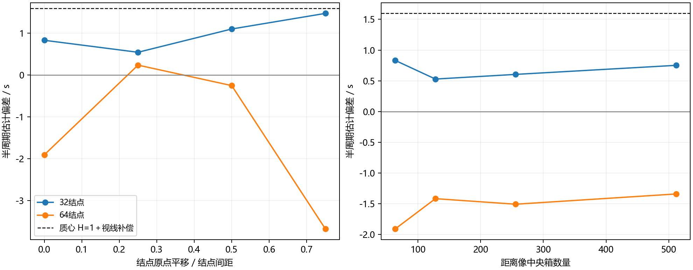
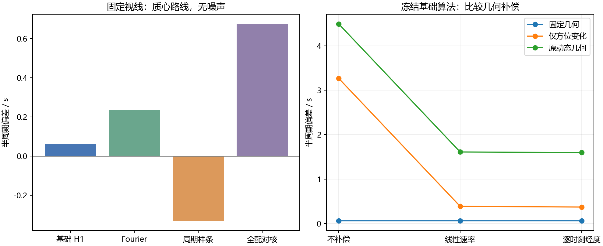

# 周期方法与几何补偿研究

实验日期：2026-10-11；原汇总日期：2026-10-12；本次整理日期：2026-10-18。本文保留原六个研究阶段及各自事前协议，集中说明冻结椭球输入上的方法、先验和几何对照。正文中的“当前”“未实施”“已列装”均指对应历史阶段；后来100Run/500CPI的误差与融合、接收噪声和EV5实验使用独立输入，不属于下述共同基准。当前项目状态见[项目现状总览](../../../PROJECT_OVERVIEW.md)，当前实现见[算法正文](../../../INVERSION_ALGORITHM.md)，开放问题与后续路线见[改进计划](../../plans/PERIOD_INVERSION_IMPROVEMENT_PLAN.md)。本次仅整理文档，未重跑实验或改写冻结数值。

<a id="reading-guide"></a>

## 阶段导航

| 要核实的问题 | 结果与独立协议 |
| --- | --- |
| 增加谐波是否提高精度，倍周期为何出现 | [多谐波实验](#harmonic)；[事前协议](#protocol-6) |
| 秒级偏差是否来自搜索、视线或浮点精度 | [半周期偏差诊断](#geometry-bias)；[事前协议](#protocol-7) |
| 已知完整形状与初相位能达到什么，联合拟合为何失败 | [物理模板控制](#physical-template)；[事前协议](#protocol-8) |
| 补偿、谐波、细化、网格和极轴的配对影响 | [可选开关完整评估](#optional-options)；[事前协议](#protocol-1) |
| 未知形状的样条、核方法与表示稳定性 | [未知波形首轮及扩展](#unknown-waveform)；[事前协议](#protocol-2) |
| 固定几何选参能否迁移到方位变化与原动态输入 | [分层控制](#layered-controls)；[事前协议](#protocol-3) |

<a id="common-input-and-metrics"></a>

## 共同输入、先验与统计口径

主要物理基准为 `runs/paras_for_70m_3h/echo/echo.npz`，SHA256为 `add62990c10ab7c4d74f5e2e5d50611cd9201d967399b3b2ed26ee195ee6ba3a`。完整周期10800s、椭球重复半周期5400s，2000个单脉冲Run、散射时刻跨度33735.378s，约6.25个半周期；带宽150MHz、脉宽50μs、采样率200MHz。该冻结基准的原始IQ与clean IQ相同，无接收噪声，全部ADC有效且无共享保存行。

形状只用于模拟器生成数据，不传入未知形状估计器；完整物理模板阶段则明确提供形状、自转轴、散射与相位先验，不能与未知形状路线合并排名。经度补偿显式使用已知极轴RA=105°、Dec=−66°，不是同时估计未知极轴。这里的基础算法是修正后的共同截距H=1搜索，通常开启局部细化；它不是旧逐Run独立常数，也不是所有GUI选项关闭后的纯网格结果。各特征独立估计且不按真值自动择优，单特征结果不能直接当作最终联合主周期。

记第i次估计为 $P_i$，评价参考为 $P_{\mathrm{ref}}=5400\,\mathrm{s}$，重复次数为 $M$，有符号偏差为 $e_i=P_i-P_{\mathrm{ref}}$。参考值来自生成配置 `target.rotation_period_s` 的一半，只用于本椭球的事后评价；脚本结果字段为 `period_s`／`error_s`。平均偏差、样本标准差和RMSE分别定义为：

$$
\overline e=\frac{1}{M}\sum_{i=1}^{M}e_i,\qquad s=\sqrt{\frac{1}{M-1}\sum_{i=1}^{M}(e_i-\overline e)^2},\qquad \mathrm{RMSE}=\sqrt{\frac{1}{M}\sum_{i=1}^{M}e_i^2}.
$$

标准差描述重复波动，RMSE同时包含偏差和波动；搜索网格、谱分辨率、预测分数与置信区间都不是同一量。多位小数用于复核，不代表系统测量不确定度。20／40dB原始IQ噪声按完整ADC窗平均功率定义，不是目标有效支撑区间或脉压后SNR。分层固定组的三个20dB种子与首轮原动态组的五个种子使用不同选参，不能当成同一A/B实验拼表；相关重复数只作探索，不提供可靠置信区间或通用排名。

## 跨阶段比较边界

[分层控制](#layered-controls)的stationary同时固定视线、距离、光行时、距离速度与名义ADC偏移；azimuth_only仅让收发方向共同绕极轴改变经度、保持倾角与其他控制因素；original_dynamic保留原实际变化。前两组重新生成完整IQ，是合成控制，不是新天文观测计划，也不能与早期[只固定视线、保留其他原条件](#geometry-bias)的诊断组混为同一输入。固定组基础质心不补偿、线性经度速率补偿和逐时刻经度补偿的偏差均为+0.063279s；这条退化对照不代表三种补偿在变化几何下等价。

[可选开关的网格表](#optional-options)中，开启补偿和细化的H1质心在4000／8000／16000网格上的误差分别为+1.596767／+1.596744／+1.596704s，极差约0.000063s；未细化网格点偶然更接近真值不能作为精度收益。其他结果不再复制摘要表，直接按导航查看完整配置、正负结果与统计口径。更多谐波、通道、更低预测误差或更小重复波动均不保证更小的周期偏差；现有结果也没有建立“小时周期必然有几秒误差”的物理下限。

这些阶段尚未证明无形状且未知轴的跨场景可靠亚秒精度、一般形状与真实系统总误差、哪条文献路线普遍最好、已测路线的最高可达精度，或仅用严格半转对称特征辨明完整自转周期。动态几何的Fourier单次收益仍缺独立噪声重复；模型错配、有限样本与误差抵消是待检验解释。信号形成抽查和面元求积的收敛问题见[信号形成专题](2026-10-09_SIGNAL_FORMATION_AND_INTEGRATION_COST.md)；教学模型及10月10日特征历史不作为新的半周期精度验收。共同截距恢复可搜索性的生产对照见[基线变更](../../changes/PERIOD_INVERSION_BASELINE.md)。

## 历史实现状态与证据来源

截至2026-10-12的原汇总，共同截距单谐波是生产基础功能，多谐波、连续局部细化及已知轴逐时刻经度补偿已列装；当时GUI主结果使用旧跨特征共识。线性经度速率补偿、多通道Fourier／正则化、周期样条和CKP思想迁移核相似性仍为研究脚本，后者不是完整原论文复现；完整物理模板与非相干近似仅为已知形状研究对照。这里记录历史交付边界，**不能据此描述当前GUI或当前共同预测融合规则**；各路线测试内容及端点限制以对应阶段为准。

截至上述阶段，独立PDM、自相关完整流水线、条件熵、GP、非均匀Optimized DMD、Hankel／ResDMD、矩阵铅笔、原子范数和深度表征尚未完成本项目实验；微多普勒、APT／ISAR和多站散斑尚未完成适配当前条件的精度验证。文献检索不能当作实验，已有Fourier不能直接称为DMD。实际原文阅读范围见[雷达研究](../../../research/RADAR_PERIOD_ESTIMATION.md)与[跨领域研究](../../../research/CROSS_DOMAIN_PERIOD_ESTIMATION.md)；后续状态回到[计划路线表](../../plans/PERIOD_INVERSION_IMPROVEMENT_PLAN.md)。

原汇总记录225次谐波搜索、168条可选开关评估、175条样条／核主实验、148条稳定性扩展和160条分层记录；模板评估及回波诊断另有计数。它们不是相互独立的样本集，不相加为总准确度或统一测试通过数。下面六个阶段及其独立协议保留输入／源码哈希、失败、时点限制与复现命令；原始产物仍在忽略的runs／tmp中，重建时使用新目录。此前两份周期专题于10月12日合并的来源事实保留，本次仅删除与阶段全文重复的摘要。

<a id="harmonic"></a>

## 多谐波周期反演精度实验（2026-10-11）

本报告记录第一批共同截距修改之后的固定输入实验。实验表明：当前单谐波结果不是所有特征的精度上限；能量宽度特征明显受非正弦波形影响，二阶谐波能够改善其周期估计和留出预测。但是增加谐波不保证每个特征的周期更接近真值，也不能自行消除完整自转周期与调制周期的歧义。本次没有修改生产算法、默认谐波阶数或共识规则。

### 输入与实验协议

使用项目既有仿真作业 `runs/paras_for_70m_3h`，冻结第一批最终结果中的 `period_observables.npz`，不重新生成回波。输入包含 2000 个有效逐脉冲观测、2000 个单脉冲 Run，散射时刻跨度为 33735.378073 秒，使用共同截距、原生散射时刻和均匀权重；原始 ADC 全有效，权重与该作业的有效样点比例一致。该作业走 `pulse_fallback` 路径，无 Run 聚合。结论仅针对这一固定作业及下述注入模板，不覆盖 CPI、多脉冲 Run、缺样或其他形体和观测几何。

搜索范围沿用配置的 1800–14400 秒。同一会话比较谐波阶数 H=1、2、3，每个阶数使用 4000 和 8000 个频率网格点，并沿用现有局部优化。单谐波基线来自本次重新执行的同一实现，而不是跨会话耗时或不同版本的结果。真值只用于事后评价，未用于选峰、拟合或留出预测；当前仿真的完整自转周期为 10800 秒，对称调制参考周期为 5400 秒。

五折验证按时间顺序划分连续 Run 块，每折训练 1600 个观测、留出 400 个观测；同一 Run 不跨训练和测试。每折重新搜索周期，归一化参数和谐波系数仅由训练集决定。汇总留出分数为 $1-\sum\mathrm{SSE}_{\mathrm{model}}/\sum\mathrm{SSE}_{\mathrm{baseline}}$，其中基线预测为各折训练集均值；分数越高表示留出预测越好。额外分别拟合前半段和后半段，以观察截取时段对估计的影响。

注入实验使用上述真实采样时刻，已知周期为 5400 秒。模板包括单位振幅正弦，以及基频加振幅 0.35 的二次余弦、振幅 0.15 的三次正弦；后者二次相位为 0.3 弧度、三次相位为 −0.2 弧度。添加标准差为 0.2 的白噪声或按观测索引定义、相关系数为 0.9 的平稳 AR(1) 残差。每种组合重复 12 次，随机种子为 `20261011 + rep`，不同 H 共享同一噪声实现。这里是特征级受控实验，不是原始 IQ 噪声的重新仿真，也未标定接收机噪声。共完成 225 次周期搜索：18 次全量、45 次留出、18 次半段、144 次注入。

### 原始仿真特征的结果

以下周期均来自 4000 格搜索。三项特征在各 H 下的全量最优模型均由一次谐波主导，因此表中基周期也等于主导分量周期。误差列以 5400 秒调制参考评价，不代表已经无歧义地恢复 10800 秒完整自转周期。

| 特征 | H | 周期（秒） | 调制参考绝对误差（秒） | 训练分数 | 五折汇总留出分数 |
|---|---:|---:|---:|---:|---:|
| 总功率 | 1 | 5406.235776 | 6.235776 | 0.527276 | 0.529015 |
| 总功率 | 2 | 5405.396898 | 5.396898 | 0.527993 | 0.528952 |
| 总功率 | 3 | 5405.463005 | 5.463005 | 0.530396 | 0.531535 |
| 质心时延 | 1 | 5404.493480 | 4.493480 | 0.911967 | 0.913303 |
| 质心时延 | 2 | 5406.295617 | 6.295617 | 0.915191 | 0.916353 |
| 质心时延 | 3 | 5406.434623 | 6.434623 | 0.915744 | 0.916986 |
| 90% 能量宽度 | 1 | 5420.226405 | 20.226405 | 0.590867 | 0.593105 |
| 90% 能量宽度 | 2 | 5407.015707 | 7.015707 | 0.732205 | 0.734014 |
| 90% 能量宽度 | 3 | 5406.410888 | 6.410888 | 0.732565 | 0.734078 |

能量宽度从 H=1 到 H=2，调制周期绝对误差减少约 65.3%，留出分数提高约 0.141；各折按训练标准差归一化的留出 RMSE 均值从 0.642278 降为 0.519454。H=3 的对应值为 0.519389，新增收益很小。折叠曲线显示其波形有较平的顶部和更陡的边缘，单正弦不足以表示这一结构。

质心特征的留出预测随 H 增加略有改善，但周期误差从约 4.49 秒增加到约 6.43 秒。这是本次实验中“拟合更好”不等于“周期更准确”的直接例子。总功率的变化也很小，H=2 的留出分数略低于 H=1。三个特征的留出收益不能被解释为统一的周期精度收益。

| 特征 | H | 前半段主导分量周期（秒） | 后半段主导分量周期（秒） |
|---|---:|---:|---:|
| 总功率 | 1 | 5396.270494 | 5407.350792 |
| 总功率 | 2 | 5384.511719 | 5405.648017 |
| 总功率 | 3 | 5398.147805 | 5406.322606 |
| 质心时延 | 1 | 5396.555218 | 5400.758859 |
| 质心时延 | 2 | 5406.580798 | 5407.565314 |
| 质心时延 | 3 | 5405.994762 | 5408.831097 |
| 90% 能量宽度 | 1 | 5497.646503 | 5451.885063 |
| 90% 能量宽度 | 2 | 5423.334660 | 5406.399101 |
| 90% 能量宽度 | 3 | 5420.116808 | 5405.378008 |

半段估计仍存在数秒至数十秒的变化，能量宽度加谐波后尤其仍有前后段差异。当前全量结果的小数位不能当作不确定度。上述分块留出没有额外设置相关噪声隔离间隙，不能据此声称获得独立残差或严格置信区间。

18 组全量周期图的网格最大值均在搜索区间内部。4000 格加密到 8000 格时，各 H、各特征的最优周期变化均不超过 0.000053 秒，远小于它们距调制参考的偏差；因此这批输入的主要误差不是现有网格密度不足。这不是任意输入的网格误差上界。

### 已知周期注入的结果

“主导分量周期”定义为拟合基周期除以最大振幅谐波的阶数，仅作为描述模型频率内容的诊断量。下表误差均为这一诊断量相对注入周期的绝对误差；命中条件为相对误差小于 1%。同时展示基周期命中数，防止倍周期峰被分量折算掩盖。

| 模板 | 残差 | H | 分量误差中位数（秒） | 分量误差 P90（秒） | 基周期命中 | 分量命中 |
|---|---|---:|---:|---:|---:|---:|
| 正弦 | 白噪声 | 1 | 1.844 | 4.660 | 12/12 | 12/12 |
| 正弦 | 白噪声 | 2 | 1.753 | 4.839 | 8/12 | 12/12 |
| 正弦 | 白噪声 | 3 | 1.815 | 4.993 | 6/12 | 12/12 |
| 正弦 | AR(1) | 1 | 5.636 | 18.219 | 12/12 | 12/12 |
| 正弦 | AR(1) | 2 | 5.663 | 17.554 | 6/12 | 12/12 |
| 正弦 | AR(1) | 3 | 5.577 | 20.083 | 4/12 | 12/12 |
| 非正弦 | 白噪声 | 1 | 3.193 | 6.434 | 12/12 | 12/12 |
| 非正弦 | 白噪声 | 2 | 1.494 | 3.922 | 12/12 | 12/12 |
| 非正弦 | 白噪声 | 3 | 1.364 | 2.993 | 12/12 | 12/12 |
| 非正弦 | AR(1) | 1 | 7.299 | 19.445 | 12/12 | 12/12 |
| 非正弦 | AR(1) | 2 | 5.579 | 14.175 | 12/12 | 12/12 |
| 非正弦 | AR(1) | 3 | 4.014 | 11.538 | 12/12 | 12/12 |

指定非正弦模板上，增加谐波降低了本批重复实验的周期误差；纯正弦上没有一致的改善，而且 H=2、3 多次选择约 10800 秒的基周期，由二次谐波表示 5400 秒信号。纯正弦本身没有提供识别该基周期所需的独立信息，不能把这种峰解释成完整自转周期恢复。12 次重复的经验中位数、P90 和命中数仅描述这些种子，不是可靠的尾部概率、显著性或覆盖率估计。

### 后续修改方向

下一批可以引入按特征选择谐波阶数的候选机制，优先验证能量宽度 H=2，并保留 H=1 候选。应同时展示基周期、谐波分量、留出误差和倍周期竞争关系，不应仅以训练分数或把周期乘二作为完整自转周期证据。当前作业中 H=3 对能量宽度的额外收益很小，缺乏把所有特征默认设为 H=3 的依据。

进一步提高精度需要检查特征误差、观测几何引起的缓变和相关残差，并在多个形体、观测跨度、信噪水平及重复仿真上验证。现有半段漂移提示这些因素值得实验，但本报告没有把某一个因素诊断为确定原因。若要按留出表现自动选择 H 后报告泛化精度，还需独立验证集或嵌套验证，不能重复使用本批五折结果作为独立验收。

独立审查发现现有底层搜索在存在内部局部峰时可能不选搜索边界峰。本批全量周期图最大值均为内部点；因此上述全量结果未触发该限制。边界候选处理仍是后续搜索可靠性修改项，不能把本实验推广为任意合法范围均无漏峰。

### 复现、产物和验收

运行环境为 Conda `pytorch`，Python 3.9.23、NumPy 1.24.3、SciPy 1.13.1；实验创建时间为北京时间 2026-10-11 10:00:48。搜索及序列化耗时 269.553 秒，总耗时含绘图约 275.01 秒，仅供本次运行参考，未分 H 计时，不能用于速度比较。结果目录为 `runs/paras_for_70m_3h/harmonic_experiment_20261011`，包含协议、冻结特征和配置、完整 JSON、周期图 NPZ，以及四类 PNG/SVG 图。原始材料位于忽略的 `runs/`；仓库保留可复用实验脚本、测试和本报告。临时审查材料使用仓库 `tmp/`，因为执行沙箱不允许写入首选的 `E:/Claude-code/cache`。

```powershell
conda activate pytorch
python -m pytest -q tests/test_period_harmonic_experiment.py --import-mode=importlib -p no:cacheprovider
python scripts/experiment_period_harmonics.py --output runs/paras_for_70m_3h/harmonic_experiment_reproduce --repetitions 12
python scripts/check_doc_math.py
```

输出目录必须尚不存在，脚本拒绝覆盖。脚本在运行前检查原始回波哈希、4000 格配置、全有效 ADC、原生逐脉冲路径及三个指定特征；输入哈希在实验结束时再次检查，结果为未改变。完整协议保存在 `protocol.json`，以下为关键 SHA-256：

| 文件 | SHA-256 |
|---|---|
| 原始 `echo.npz` | `add62990c10ab7c4d74f5e2e5d50611cd9201d967399b3b2ed26ee195ee6ba3a` |
| 第一批最终 `period_observables.npz` | `6b43e8a2e3907da717ad6b6ae915fe3b2158ef39f7f3a7c834d90cbc751d78b3` |
| `inversion.generated.json` | `40128460853bf02107bd691a4971c6157e1db7264e42480809089c852a38f970` |
| `scripts/experiment_period_harmonics.py` | `a645f56a990b3c5391a24e7b28417d1df6b91dac8f6807dba864882f59ed726c` |
| `inversion/src/inversion.py` | `c67bc4a4075b9f745a3e97f2c8dce486d03732fb77761bd2160b63ff56f33c9e` |

实验测试 4 项通过，分别核对独立原始最小二乘预测、Run 不跨折且测试点仅使用一次、留出值改变不能影响训练搜索与系数、以及夹具确实能区分 H=1/2/3。全新上下文的对抗审查另行用独立最小二乘检查实际三特征和三个 H 的训练分数，最大差为 $4.44\times10^{-16}$，并检查输入作用域、倍周期误读和汇总结果；审查未发现阻断本次固定输入实验的缺陷。文档公式检查当前版本零违规；冻结的 4.1/4.2 历史违规按既有规则不计入退出码。

<a id="geometry-bias"></a>

## 椭球半周期偏差诊断（2026-10-11）

本实验只评价椭球的 5400 秒半周期，不讨论完整自转周期的识别。结论是：几秒偏差不是当前搜索器不可突破的数值下限，也不是小时量级周期必然具有的误差。在固定视线的无噪声椭球对照中，当前默认单谐波方法从质心特征得到 5400.063279 秒；在原观测数据上，实验性的视线经度相位修正把该特征的偏差从 4.493480 秒降至 1.596767 秒。后一个结果仍有偏差，生产算法尚未获得前一个对照的精度，不能将两者混为同一成果。

### 本次究竟检验了什么

输入仍为 `runs/paras_for_70m_3h` 的冻结椭球作业：完整自转周期 10800 秒、半周期参考 5400 秒、2000 个单脉冲 Run，散射时刻跨度 33735.378073 秒，1280 个面元，载频 1 GHz、Chirp 带宽 150 MHz、快时间采样率 200 MHz。搜索配置仍为 1800–14400 秒、4000 个频率网格点、共同截距和原生散射时刻，不按 Run 聚合。当前反演走逐脉冲特征 fallback（`pulse_fallback`），所有 ADC 样点有效；回波生成仍使用当前全局 ADC 批量计算路径。

先检查实际保存的回波是否有噪声，再用相同采样时刻上的理想信号检验搜索器，随后比较当前特征、视线相位修正、双精度回波和固定视线回波。各特征固定检验 H=1/2/3/6，没有根据真值选择搜索区间或某个局部峰；真值仅用于生成理想检验信号和事后评价误差。所有实际回波及相位修正结果都由一次谐波主导，以下表中的候选基周期直接作为半周期估计，不依靠候选周期除以二来获得接近真值的数字。

使用现有回波生成器的 Run 级唯一全局 ADC 索引计算，先累加物理脉冲贡献，再映射到二维保存行。特征提取仍使用完整原生匹配相关、逐行质心时延轴及完整相关能量宽度，不新增逐保存行独立回波生成，也不通过切分真实回波来获得对照。

### 噪声与搜索器检验

原配置 `snr_db=null`；冻结回波中的 `iq` 与 `clean_iq` 逐点相同，最大差为零。这组作业原本就是无接收噪声输入，不能把原有几秒偏差归因于加噪声。重新提取的三个原生特征与第一批冻结特征逐项相同，排除了这次诊断使用另一套特征处理流程的可能。

在真实采样时刻上构造已知周期为 3600、5400、7200 秒的无噪声信号。H=1 使用常数加单位余弦；H=2 再加振幅 0.35、相位 0.3 弧度的二次余弦；H=3 再加振幅 0.15、相位 −0.2 弧度的三次正弦。搜索使用与生成信号匹配的阶数。

| 输入周期（秒） | H=1 绝对误差（秒） | H=2 绝对误差（秒） | H=3 绝对误差（秒） |
|---:|---:|---:|---:|
| 3600 | 0.000007773 | 0.000001129 | 0.000011793 |
| 5400 | 0.000000028 | 0.000036468 | 0.000041382 |
| 7200 | 0.000052280 | 0.000018708 | 0.000046671 |

这九个指定信号的最大误差约为 0.000053 秒，说明当前采样时刻、网格和局部优化能够提供远小于一秒的周期估计。它们不是全回波链路精度保证，也不是任意输入的误差上界。

将包含三个谐波的同一个 5400 秒无噪声信号只用 H=1 拟合时，估计为 5401.845635 秒，偏差达到 1.845635 秒。这直接证明：即使信号严格周期且没有噪声，拟合波形不足也可能使不规则采样下的周期估计产生秒级偏差。这个检验不能单独证明实际椭球残余偏差都来自同一种因素。

### 视线相位诊断

原观测期间收发视线方向变化约 0.55°。以生成配置给定的自转轴建立固定基底，将收发视线和投影到自转轴的赤道平面，得到展开经度 $\lambda(t)$；其变化范围为 0.559260°。该自转轴是已知生成参数，没有由当前反演估计得到，也没有给出轴误差的敏感性结论。

设 $P$ 为候选半周期，$t$ 为 `scatter_elapsed_s`，$t_0$ 为首个散射时刻，则实验拟合相位为：

$$
\psi(t;P)=\frac{2\pi(t-t_0)}{P}-2\left[\lambda(t)-\lambda(t_0)\right].
$$

共同截距的谐波模型为：

$$
y(t)=c+\sum_{h=1}^{H}\left[a_h\cos\left(h\psi(t;P)\right)+b_h\sin\left(h\psi(t;P)\right)\right].
$$

经度修正由视线和已知自转轴计算，不使用参考周期 5400 秒。其符号另用前向模型的 `Spin.rotate_inverse` 独立核对。这里仅修正绕自转轴的视线经度；视线纬度、双站角度、散射权重和完整距离像随几何变化的效应没有被这一相位公式完全建模。

如果用经度的线性拟合角速度近似其变化，仅此因素对应的表观半周期约为 5402.881372 秒，提供了秒级偏差的量级解释，不是对实际全部特征周期的精确预测。实际相位修正结果如下。

| 特征 | H | 原始半周期偏差（秒） | 相位修正后偏差（秒） | 固定视线回波偏差（秒） |
|---|---:|---:|---:|---:|
| 总功率 | 1 | +6.235776 | +3.332870 | −3.180069 |
| 总功率 | 2 | +5.396898 | +2.495093 | −4.637720 |
| 总功率 | 3 | +5.463005 | +2.567421 | −4.828171 |
| 总功率 | 6 | +6.338572 | +3.431681 | −6.545547 |
| 质心时延 | 1 | +4.493480 | +1.596767 | +0.063279 |
| 质心时延 | 2 | +6.295617 | +3.398213 | +1.287780 |
| 质心时延 | 3 | +6.434623 | +3.536912 | +1.446452 |
| 质心时延 | 6 | +5.130547 | +2.232384 | +1.197328 |
| 90% 能量宽度 | 1 | +20.226405 | +17.330057 | +11.010261 |
| 90% 能量宽度 | 2 | +7.015707 | +4.122682 | −3.625724 |
| 90% 能量宽度 | 3 | +6.410888 | +3.517775 | −3.771531 |
| 90% 能量宽度 | 6 | +6.331698 | +3.437721 | −2.506238 |

相位修正使本次各项偏差减少约 2.9 秒。独立以零相位修正桥接实验搜索器和生产搜索器时，质心 H=1 的周期差约为 $2.46\times10^{-8}$ 秒，分数差约为 $1.11\times10^{-16}$；相位收益不是替换归一化或局部优化产生的假象。本次各实际搜索的网格最优点均在内部，未触发已知的生产搜索边界候选限制。

该相位模型要求候选基周期表示半周期。若用完整周期基频及二次谐波表示半周期，统一使用上述两倍经度修正会改变其物理含义，不能简单折算后解释。本次实际结果均由一次谐波主导，因此表中相位修正项处于适用分支。

### 完整回波对照与作用域

固定视线组只将 `tx_los_icrs` 和 `rx_los_icrs` 固定为首个观测的方向；原事件时刻、距离、ADC 计划和其他参数保留。它是用于诊断的合成几何干预，没有重新求解自洽的天文光行时观测计划，不是建议在实际观测中固定测站视线。它改变了三个特征的实际波形，因此不能将固定视线与事后经度相位修正视为等价操作。

质心 H=1 在固定视线时获得约 0.063 秒误差，是这一个椭球、采样计划和特征的结果，足以否定“小时量级周期必然有几秒误差”的笼统判断。但总功率和能量宽度仍有明显偏差，增加 H 也不总使误差变小；不能据此宣称固定视线后全部特征无偏，不能把 0.063 秒当成任意目标的精度保证或理论下限。

双精度组保留原观测和配置，只将回波计算改为 float64。本轮再以相同当前生成器和形体生成原配置的 float32 回波，得到与冻结基线逐点完全相同的 IQ、时间轴、特征和周期结果，补齐了跨会话基线的同源验证。在三特征、四阶数的 12 项比较中，float64 与 float32 的最大周期差仅 0.000832 秒；质心 H=1 从 5404.493480 秒变为 5404.493329 秒。当前输入下，浮点精度不是秒级偏差的主要来源；该结论不外推到其他载频、时间带宽积、形体和配置。

原计划中 `row_fast_time_offset_s` 的 2000 项全部等于约 −1.004999 微秒，`centroid_fractional_offset_s` 全部为零，`row_start_sample` 全部为零。因此原拟定的“固定视线后再固定 ADC 偏移”操作没有新增变化，第三组与固定视线组的观测数组、特征和估计逐项相同。它只证明本次确定性重复，不能作为一个独立 ADC 干预，不能据此排除采样率、快时间离散化或匹配滤波误差。

### 下一步修改的明确方向

目前已经排除“当前搜索网格或浮点精度必然造成几秒误差”的解释，并确认观测视线变化对本作业的估计有实际影响。下一步应把已知观测几何引入反演模型，先以当前椭球和已知自转轴验证相位修正，再检验视线纬度和波形变化的建模；同时保留单谐波基线，避免把提高训练分数当成提高周期精度。未知自转轴的联合估计需要另一组实验，不能沿用本次已知轴的精度数字。

相位修正后剩余约 1.60 秒偏差尚未完全定位；本次没有给出各物理因素的严格贡献比例，也没有实现对原观测无偏的物理模板反演。对实际生产结果的有效精度，还需要多个半周期、形体、几何和观测跨度的重复验证及不确定度评价。生产源文件、默认值和共识策略本轮均未修改，实验修正仅存在于独立诊断脚本中。

### 复现与验收证据

主实验约 625.584 秒，原 float32 同源重复约 173.177 秒，仅为本次运行参考，不用于性能收益比较。环境为 Conda `pytorch`、Python 3.9.23、NumPy 1.24.3、SciPy 1.13.1、PyTorch 2.3.1，回波设备 `cuda:0`；脚本保留无 CUDA 时的 CPU 回退。主实验创建时间为北京时间 2026-10-11 10:23:48。结果目录为 `runs/paras_for_70m_3h/half_period_diagnosis_20261011`，含协议、控制观测／配置、原生特征、逐阶段结果、同源重复结果、补充哈希清单及 PNG/SVG 图；完整生成 IQ 可按脚本重新计算。

主协议记录了输入与主要生成／反演源码的起止哈希。形体及额外模块清单在主实验进行中补录，随后在主实验结束和同源重复前后复核；其原 `scope` 对时点的表述过强，已用独立 `auxiliary_manifest_timing_note.json` 更正，不能声称该补充清单在首组生成前冻结。新复现应先冻结补充输入，命令如下，所列输出路径都必须尚不存在。

```powershell
conda activate pytorch
python -m pytest -q tests/test_half_period_diagnosis.py tests/test_period_harmonic_experiment.py --import-mode=importlib -p no:cacheprovider
python scripts/freeze_half_period_inputs.py --output tmp/half_period_reproduce_manifest.json
python scripts/experiment_half_period_diagnosis.py --output runs/paras_for_70m_3h/half_period_reproduce
Copy-Item -LiteralPath tmp/half_period_reproduce_manifest.json -Destination runs/paras_for_70m_3h/half_period_reproduce/auxiliary_manifest.json
python scripts/experiment_half_period_precision_repeat.py --diagnosis-dir runs/paras_for_70m_3h/half_period_reproduce
python scripts/freeze_half_period_inputs.py --output runs/paras_for_70m_3h/half_period_reproduce/auxiliary_manifest.json --verify
python scripts/plot_half_period_diagnosis.py --input runs/paras_for_70m_3h/half_period_reproduce
python scripts/check_doc_math.py
```

输入与源码 SHA-256 详见运行目录的 `protocol.json` 和 `auxiliary_manifest.json`；主实验和同源重复的相关起止核对均通过。关键 SHA-256 如下。

| 文件 | SHA-256 |
|---|---|
| 冻结回波 `echo.npz` | `add62990c10ab7c4d74f5e2e5d50611cd9201d967399b3b2ed26ee195ee6ba3a` |
| 原观测计划 `observation_info.npz` | `273dbfe57ec2377343f80797661e5f05927e637d5c4ab249a1e902183a54604b` |
| 原回波配置 `echo.generated.json` | `6c41c0591e0ffc0d5b89be21233eea626eb1b48a2753e7a63e0f8dd63d2f192c` |
| 形体 `ellipsoid.obj` | `1bc9d4493238f34c6bdfabb30ee9475372dc01c86242b309e2d654dea701257c` |
| 主诊断脚本 | `04fb964f1b9698f8ddf0a5b965f3dba7665b4ad132c156edebec1e65bc812c1e` |

新增诊断测试 5 项，与上一轮实验测试合计 9 项通过。检查了几何相位符号与前向旋转的一致性、移动视线夹具对周期的非零影响、独立三角设计矩阵、控制干预不修改原对象及指定字段外的不变量，以及 ADC 本已固定时干预确实退化。独立全新上下文审查核对了实际分支、输出数值、相位作用域、同源 IQ 和哈希，并指出 ADC 矩阵退化及补充清单时点问题；本报告保留这些限制。临时审查材料放在仓库忽略的 `tmp/`，因为沙箱不允许写入首选的 `E:/Claude-code/cache`。

<a id="physical-template"></a>

## 完整几何模板的半周期精度检验（2026-10-11）

本次检验证明：在这组原始无噪声椭球观测中，已知形状、自转轴、散射参数和初始相位时，使用项目现有完整回波与特征链路作为模板，可以得到 5400.000015484 秒的半周期估计，相对 5400 秒参考值的误差约为 15.48 微秒。因此原来的秒级偏差不是该数据和当前数值链路不可突破的精度下限。

这一正结果使用了已知初始相位，也改变了波形建模和求解协议。它不能证明仅进一步优化视线经度相位公式，就能达到同样精度。周期与初始相位同时拟合的三个局部起点，本次均未收敛，没有优于简单相位修正；更完整模型的数值恢复能力与当前求解方法的可靠性必须分别评价。此次仅新增实验、测试和文档，未切换生产算法。

### 数据和成立条件

输入为冻结作业 `runs/paras_for_70m_3h` 的原始 `echo/echo.npz`、`observation_info.npz` 及两个生成配置。原回波 `snr_db=null`，`iq` 与 `clean_iq` 相同；2000 个 Run 各有一个脉冲，全部 ADC 样点有效。散射时刻跨度为 33735.378073 秒，绝对 `scatter_elapsed_s` 约为 47090.796–80826.175 秒，仍相对于观测的 `start_utc`，没有在子采样时重置为零。

模板沿用 1280 面元椭球、已知自转轴（赤经 105°、赤纬 −66°）、原均匀散射参数、收发几何、事件时刻、连续 ADC 窗及脉冲保存行。生成仍走每个 Run 的唯一全局 ADC 索引累加，再映射二维行的现有 Chirp 路径；保持 `centroid_compensated`、`per_pulse_linear` 和 float32。生成后用原生完整匹配相关计算三个特征，拟合目标为质心时延。这里的“完整模板”指项目当前实现的回波和特征链路，不表示新增了逐面元精确光行时等物理机制。

数据与模板使用同一生成器及同一模型，这是一项同模型、无噪声的数值恢复检验。15.48 微秒是此作业的参考误差，不是不确定度、理论精度下限，也不是未知形状、自转轴、初相位或真实噪声观测的精度保证。

### 比较结果

周期真值不参与初始化、优化目标或候选选择，仅用于误差评价与结果确定后的 golden 重建。各方法的先验与求解协议不同，表中收益不能全部归因于某一个几何项。

| 方法 | 半周期估计（秒） | 有符号误差（秒） | 解释 |
|---|---:|---:|---|
| 当前单谐波质心拟合 | 5404.493480 | +4.493480 | 本会话重新计算的基线 |
| 视线经度相位修正 | 5401.596767 | +1.596767 | 已知自转轴，只修正经度相位 |
| 平滑非相干几何质心近似 | 5395.068863 | −4.931137 | 初相位触及 −2° 边界，省略相干干涉与脉压响应 |
| 完整模板，周期与初相位联合局部拟合 | 5401.747281 | +1.747281 | 按训练残差选组；未收敛 |
| 完整模板，初始相位已知 | 5400.000015484 | +0.000015484 | 32 Run 网格扫描及局部细化，2000 Run 全量验证 |

### 完整模板如何拟合

令 $P$ 为候选半周期，$\alpha$ 为观测 `start_utc` 对应的初始自转相位，$y_i$ 为第 $i$ 个脉冲的原始质心时延特征。令 $F_i(P,\alpha)$ 表示将 `target.rotation_period_s` 设为 $2P$、`target.initial_phase_deg` 设为 $\alpha$ 后，沿原观测计划生成回波并提取的质心特征。其他模型和观测参数保持已知值。用一个全局尺度 $g$ 和一个全局截距 $c$ 校准模板；$s_y$ 为训练特征的标准差，目标为：

$$
L(P,\alpha)=\min_{c,g}\sum_{i\in\mathcal T}\left[\frac{y_i-c-gF_i(P,\alpha)}{s_y}\right]^2.
$$

$\mathcal T$ 是参与模板参数拟合的 Run 索引集合。尺度和截距在全部训练 Run 间共享，没有每 Run 独立常数。优化配置先移除真实周期；联合拟合还移除真实初相位。初估周期由原观测的 H=1 经度相位修正得到 5401.596767 秒，范围和候选选择不读取周期参考值。

联合拟合均匀选取覆盖全时间跨度的 200 个完整 Run。设 $P=5401.596767+10x_0$ 秒、$\alpha=x_1$ 度，范围为 $P\in[5371.596767,5431.596767]$ 秒、$\alpha\in[-2,2]$ 度。三个起点的 $(x_0,x_1)$ 为 $(0,0.35)$、$(-0.8,-0.35)$、$(0.8,0.7)$；这是一项近零初相位先验下的局部实验，不是任意未知初相位的全局搜索。差分 Jacobian 的物理步长为 0.05 秒和 0.005°。单起点 `max_nfev=12` 指优化器计数，额外差分模板评估另计。

| 起点半周期（秒） | 起点初相位（度） | 返回半周期（秒） | 返回初相位（度） | 优化器 cost（$L/2$） | 状态 |
|---:|---:|---:|---:|---:|---|
| 5401.596767 | +0.350 | 5401.747281 | +0.417758 | 13.368094 | 评估次数上限，未收敛 |
| 5393.596767 | −0.350 | 5393.739003 | −0.293827 | 16.034210 | 评估次数上限，未收敛 |
| 5409.596767 | +0.700 | 5409.596770 | +0.700000 | 17.142088 | 评估次数上限，未收敛 |

第一组训练残差最小，故选择第一组，而不是根据周期参考误差选组。三个差分 Jacobian 的两项奇异值分别约为 246.844/28.070、224.993/27.057、243.858/27.376，说明当前参数化及步长下两列没有线性退化；它们不证明真实微分的步长稳定性或优化收敛。三组 `optimality` 仍约为 59.9、226.7、146.5，不能把这些返回点称为已确认的局部极小。本实验没有隔离初值、差分步长、评估预算和相干波形结构对失败的分别影响。

### 已知初相位对照

此对照明确读取配置初相位 0°作为已知先验，仅拟合半周期。均匀选取 32 个完整 Run，在经度相位修正初估周期的 ±5 秒，即 5396.596767–5406.596767 秒，扫描 65 个候选。最小网格损失位于索引 22，周期 5400.034267 秒；随后仅细化其相邻网格点构成的区间，得到 5400.000015484 秒。真实周期既不在这个网格点上，也没有用于初始化、选择最优点或细化。

65 个网格损失全部不同，最小值约为 0.122029，最大值约为 5.711304；最终训练 SSE 为 $2.40314\times10^{-8}$。因此该对照确实对周期扰动敏感，没有退化成相同预测。只细化最低网格点的邻域不能认证连续区间的全局最优，成功结论仅对应最终得到并验证的这个估计。

已知相位对照与联合拟合同时改变了相位自由度、训练数量、搜索范围及求解器，不能用它的成功单因素证明联合局部优化器失败的原因。非相干质心近似则以面元场振幅的平方作为功率权重，保留姿态和照明变化，但省略面元干涉和脉冲／ADC／匹配相关响应；它触及相位边界的负结果，也不能解释为完整物理模板的精度下限。

### 全量验证与独立审计

粗初始化使用了全部 2000 个 Run。因此下面的其他 Run 仅未参与物理模板参数拟合，不能称为严格独立测试集。下表两个完整模板对照先在训练集确定唯一尺度和截距，再将它们不变地应用到其他 Run；归一化 RMSE 用对应其他 Run 的原始特征标准差计量。

| 对照 | 模板参数拟合／其他 Run | 其他 Run 原始质心 RMSE（秒） | 训练校准应用其他 Run 后的归一化 RMSE |
|---|---:|---:|---:|
| 联合局部拟合 | 200／1800 | $1.34727\times10^{-8}$ | 0.367089 |
| 已知初相位 | 32／1968 | $1.43602\times10^{-12}$ | $3.97132\times10^{-5}$ |

子集生成与全量生成的对应训练残差一致，审计以训练校准表达式重算时的 SSE 差仅为浮点舍入量：联合拟合约 $3.55\times10^{-15}$，已知相位约 $8.84\times10^{-20}$。源回波重新提取的三个特征与父实验 `input_features.npz` 精确一致；使用参考参数重生成的 golden 回波提取三个特征后，与原始三个特征也逐项精确一致。golden 只在拟合结果选定后生成，没有参与搜索。

输入、mesh 和生成／特征源码的已记录哈希在实验前后相同。辅助对照对父产物的哈希记录有时点限制：本次 `parent_artifact_timing_note.json` 在 fixed 对照运行中、proxy 结束后补记父协议与特征哈希，不能声称这两项在所有辅助对照开始前都已冻结；最终审计复核其未变，并从原始回波重新提取特征证明父特征一致。新复现流程用 `freeze_geometry_parent.py` 在辅助实验之前记录这两项，不改写本次的时点记录。

新增几何实验测试 10 项，加上前两轮相关实验测试共 19 项通过。覆盖唯一共同校准、留出数据不参与校准、周期／初相位差分列与独立解析计算、三个已知周期的合成移动几何信号、完整 singleton Run 子采样不重置事件时刻、不修改源数组，以及独立面元计算对姿态和相对照明权重的非零敏感性。原始冻结产物提供新拟合流程之外的参照，但不能据同模型对照证明生成器对真实物理过程的正确性。

### 复现命令与产物

环境为 Conda `pytorch`、Python 3.9.23、NumPy 1.24.3、SciPy 1.13.1、PyTorch 2.3.1，回波计算使用 `cuda:0` 并保留 CPU 回退。主实验在北京时间 2026-10-11 10:52:06 创建协议，耗时约 1809.589 秒；已知相位对照约 743.233 秒；非相干近似约 1.012 秒。部分计算同会话并行运行，这些时间仅记录本次成本，不能用于速度收益比较。

实际产物为 `runs/paras_for_70m_3h/geometry_template_20261011`，包含协议、逐次评估与三个起点结果、原生特征、控制观测、fixed 对照、golden 特征、独立审计以及 PNG／SVG 图。完整生成 IQ 未另存，可按脚本重建；原始数据未被覆盖。复现使用尚不存在的新目录，依次执行：

```powershell
conda activate pytorch
python -m pytest -q tests/test_geometry_template_experiment.py tests/test_half_period_diagnosis.py tests/test_period_harmonic_experiment.py --import-mode=importlib -p no:cacheprovider
python scripts/experiment_geometry_template.py --output runs/paras_for_70m_3h/geometry_template_reproduce
python scripts/freeze_geometry_parent.py --experiment runs/paras_for_70m_3h/geometry_template_reproduce
python scripts/experiment_geometry_centroid_proxy.py --experiment runs/paras_for_70m_3h/geometry_template_reproduce
python scripts/experiment_geometry_fixed_phase.py --experiment runs/paras_for_70m_3h/geometry_template_reproduce
python scripts/audit_geometry_template.py --experiment runs/paras_for_70m_3h/geometry_template_reproduce
python scripts/plot_geometry_template.py --experiment runs/paras_for_70m_3h/geometry_template_reproduce
python scripts/check_doc_math.py
```

原始回波 SHA256 为 `add62990c10ab7c4d74f5e2e5d50611cd9201d967399b3b2ed26ee195ee6ba3a`，观测计划为 `273dbfe57ec2377343f80797661e5f05927e637d5c4ab249a1e902183a54604b`，椭球模型为 `1bc9d4493238f34c6bdfabb30ee9475372dc01c86242b309e2d654dea701257c`。其他输入和源码摘要见主协议、fixed 结果及 `audit.json`。该报告交付后冻结，后续改进另写新证据，不回改本轮负结果或先验条件。

<a id="optional-options"></a>

## 可选周期算法精度评估：2026-10-11

本阶段结果保持冻结；后续结论追加到本专题的独立阶段。生产算法和默认值均未修改。完整研究解释见 `docs/4.3/research/RADAR_PERIOD_ESTIMATION.md#radar-overview`。

### 条件与可复现命令

参考半周期 5400 s，全自转周期 10800 s；冻结的无噪声椭球、2000 个 singleton Run、全部 ADC 有效，观测跨度约 9.37 h。输入形状/初始相位不进入反演；视线补偿显式使用已知极轴 RA=105°、Dec=−66°。因此以下不是未知极轴或实测系统的精度保证。搜索范围 1800–14400 s，真值只参与搜索后的误差评价，未按真值挑选候选峰。

测量时间：2026-10-11T12:30:22.732522+00:00；本次总耗时 292.633 s，搜索记录 168 条。输入 SHA256：`add62990c10ab7c4d74f5e2e5d50611cd9201d967399b3b2ed26ee195ee6ba3a`。

```powershell
conda activate pytorch
python scripts/experiment_optional_period_precision.py --output tmp/optional_precision_20261011
python scripts/summarize_optional_period_precision.py tmp/optional_precision_20261011
python -m pytest tests/test_optional_period_precision.py tests/test_optional_period_methods.py -q
python scripts/check_doc_math.py
```

原始 JSON/图放忽略的 `tmp/optional_precision_20261011/`；目录必须尚不存在，重建时换新的输出目录。这里的误差表完整列出参与比较的配置，不依据真值筛选最优结果。一次性数据未放入发布档案，固定脚本和输入哈希允许复核。

### 4000 网格无噪声误差

所有数字为估计半周期减 5400 s，有符号；末位小数仅方便复核。表中功率/质心/宽度分别独立估计，未做自动择优或联合融合。

| 补偿 | H | 细化 | 功率误差/s | 质心误差/s | 宽度误差/s |
| --- | --- | --- | --- | --- | --- |
| 0 | 1 | 0 | +7.606348 | +4.054054 | +21.862348 |
| 0 | 1 | 1 | +6.235776 | +4.493480 | +20.226405 |
| 0 | 2 | 0 | +4.054054 | +7.606348 | +7.606348 |
| 0 | 2 | 1 | +5.396898 | +6.295617 | +7.015707 |
| 1 | 1 | 0 | +4.054054 | +0.506424 | +18.291306 |
| 1 | 1 | 1 | +3.332870 | +1.596767 | +17.330057 |
| 1 | 2 | 0 | +4.054054 | +4.054054 | +4.054054 |
| 1 | 2 | 1 | +2.495093 | +3.398213 | +4.122682 |

### 网格稳定性：距离质心

| 补偿 | H | 细化 | G4000误差/s | G8000误差/s | G16000误差/s |
| --- | --- | --- | --- | --- | --- |
| 0 | 1 | 0 | +4.054054 | +4.476141 | +4.687170 |
| 0 | 1 | 1 | +4.493480 | +4.493439 | +4.493503 |
| 0 | 2 | 0 | +7.606348 | +6.251760 | +6.462817 |
| 0 | 2 | 1 | +6.295617 | +6.295578 | +6.295636 |
| 1 | 1 | 0 | +0.506424 | +0.928401 | +2.025886 |
| 1 | 1 | 1 | +1.596767 | +1.596744 | +1.596704 |
| 1 | 2 | 0 | +4.054054 | +2.701689 | +3.799784 |
| 1 | 2 | 1 | +3.398213 | +3.398258 | +3.398242 |

细化减少离散网格对同一模型最优值的限制，不保证更接近物理真值。粗网格偶然更接近真值只能说明该网格的离散误差与连续拟合偏差抵消，不能据此独立确认偏差的物理来源。多谐波改变模型；拟合分数变高也不保证周期准确度提高。

### 配对原始 IQ 接收噪声

ADC 窗平均信号/噪声功率比 40/20 dB，复高斯白噪声，每档 3 种固定随机种子。同一含噪 IQ 用于补偿×H 的四组合；固定细化开启、G4000。不是特征 SNR 或脉压峰值 SNR。各 Run 只有一行且无样点重复计权，因此可独立逐行加噪。该阶段没有比较关闭细化。

RMSE 包含相对真值的偏差与随机波动；标准差使用 ddof=1，三次重复不足以形成可靠置信区间或尾部风险结论。

| 特征 | SNR/dB | 补偿 | H | 平均误差/s | 标准差/s | RMSE/s |
| --- | --- | --- | --- | --- | --- | --- |
| total_power | 40 | 0 | 1 | +6.239424 | 0.005766 | 6.239426 |
| total_power | 40 | 0 | 2 | +5.400523 | 0.005608 | 5.400525 |
| total_power | 40 | 1 | 1 | +3.336565 | 0.005807 | 3.336569 |
| total_power | 40 | 1 | 2 | +2.498719 | 0.005613 | 2.498723 |
| total_power | 20 | 0 | 1 | +6.270202 | 0.060258 | 6.270395 |
| total_power | 20 | 0 | 2 | +5.430564 | 0.058162 | 5.430772 |
| total_power | 20 | 1 | 1 | +3.367334 | 0.060279 | 3.367694 |
| total_power | 20 | 1 | 2 | +2.528767 | 0.058208 | 2.529213 |
| centroid_delay_s | 40 | 0 | 1 | +4.489756 | 0.017646 | 4.489780 |
| centroid_delay_s | 40 | 0 | 2 | +6.290161 | 0.018190 | 6.290178 |
| centroid_delay_s | 40 | 1 | 1 | +1.593019 | 0.017592 | 1.593084 |
| centroid_delay_s | 40 | 1 | 2 | +3.392791 | 0.018188 | 3.392824 |
| centroid_delay_s | 20 | 0 | 1 | +4.324135 | 0.381952 | 4.335367 |
| centroid_delay_s | 20 | 0 | 2 | +5.935545 | 0.350883 | 5.942455 |
| centroid_delay_s | 20 | 1 | 1 | +1.427381 | 0.381078 | 1.460900 |
| centroid_delay_s | 20 | 1 | 2 | +3.038236 | 0.349827 | 3.051633 |
| energy_width_90_s | 40 | 0 | 1 | +20.222140 | 0.040058 | 20.222167 |
| energy_width_90_s | 40 | 0 | 2 | +6.948629 | 0.094456 | 6.949057 |
| energy_width_90_s | 40 | 1 | 1 | +17.325686 | 0.040090 | 17.325716 |
| energy_width_90_s | 40 | 1 | 2 | +4.055524 | 0.094308 | 4.056255 |
| energy_width_90_s | 20 | 0 | 1 | +17.977095 | 0.429622 | 17.980517 |
| energy_width_90_s | 20 | 0 | 2 | +7.937386 | 0.245718 | 7.939922 |
| energy_width_90_s | 20 | 1 | 1 | +15.081265 | 0.429046 | 15.085333 |
| energy_width_90_s | 20 | 1 | 2 | +5.041674 | 0.245228 | 5.045649 |

### 极轴敏感性

分别扰动 RA 或 Dec，另一坐标不变；H=1、细化开启、G4000、无噪声。这里只评价补偿使用了错误极轴时的结果，不是极轴联合反演或统计不确定度。

| 极轴参数 | 偏差/deg | 功率误差/s | 质心误差/s | 宽度误差/s |
| --- | --- | --- | --- | --- |
| spin_axis_ra_deg | -5 | +3.347783 | +1.611483 | +17.344851 |
| spin_axis_ra_deg | -1 | +3.336289 | +1.600164 | +17.333453 |
| spin_axis_ra_deg | +1 | +3.329217 | +1.593137 | +17.326428 |
| spin_axis_ra_deg | +5 | +3.312137 | +1.576151 | +17.309448 |
| spin_axis_dec_deg | -5 | +3.216031 | +1.479738 | +17.213093 |
| spin_axis_dec_deg | -1 | +3.308494 | +1.572358 | +17.305661 |
| spin_axis_dec_deg | +1 | +3.357687 | +1.621534 | +17.354893 |
| spin_axis_dec_deg | +5 | +3.460924 | +1.724801 | +17.458107 |

### 证据范围

新增三项测试检查加噪可复现性、功率约定、输入不变、非法重复行拒绝以及合成数据对补偿/谐波/细化的敏感性；既有可选算法测试保留八组合独立回归与冻结 golden。此轮只修改研究脚本和文档，未重复验收所有 GUI/CW 入口，也不声称其发生新变化。对抗性审查需独立读取结果表后再确认交付。

未评估：一般不对称形状、多脉冲重叠 ADC 加噪、实际标定误差、相关/非高斯噪声、未知极轴联合求解、文献 APT/GP/PDM 的实际复现。本轮不以单场景结果改变默认值或宣布精度上限。

算法及实验源码 SHA256：

- `scripts\experiment_optional_period_precision.py`：`a0773727964c5d5f48434547a82d7f9c47ecff0f7232b6f236d342d6dfee6e56`
- `inversion\src\inversion.py`：`6ca1e00c4f208682a550b8ed7c759aab47742ea1da15c8b880723614f83e0f53`
- `inversion\src\period_enhancements.py`：`ff85ece83bf06d066cf8899dd0688dba4abacd2f7a6d3ec79aca44050446063d`

<a id="protocol-1"></a>

## 事前协议：2026-10-11：可选算法与未知形状研究

此段由原实验协议归入相应专题，记录当时设计及追加验证条件；不表示本次重新执行。

输入为 `runs/paras_for_70m_3h/echo/echo.npz`，全自转周期 10800 s，椭球半周期参考值 5400 s。先使用 1800–14400 s 的完整搜索范围盲搜，参考值仅在搜索结束后用于评价；不得根据真值挑选候选峰。数据包含 2000 个单脉冲 Run，不假定跨 Run 载波相干。

视线补偿实验显式提供极轴 RA=105°、Dec=−66°，因而结果属于已知极轴条件，不代表同时反演未知极轴。反演不读取目标形状或初始相位。比较总功率、距离质心和 90% 能量宽度；扫描相位补偿开关、H=1/2、局部细化开关，以及 4000/8000/16000 的频率网格。

在原始无噪声 IQ 上加入配对的复高斯白噪声，ADC 窗平均信号功率与噪声功率之比设为 40/20 dB，每档 3 个固定种子。同一含噪数据用于视线补偿开关×H=1/2 的四种组合，固定局部细化开启、网格 4000，重新提取特征；八种开关组合的全扫描只在无噪声阶段进行。由于同一 Run 中二维行可能共享 ADC 样点，本实验必须断言每 Run 恰好一行、全部样点有效；未满足时拒绝该加噪方案。这里只检验接收白噪声敏感性，不模拟标定误差、散射模型误差或未知极轴。

另扫描极轴单独 RA/Dec 偏差 ±1°、±5°，使用 H=1、局部细化、4000 网格。保存所有搜索结果、输入哈希、时间戳、耗时和算法文件哈希，报告有符号误差及重复试验 RMSE；3 次重复只作探索，不提供可靠置信区间。网格收益和拟合分数不能替代周期准确度。

执行环境为 Conda `pytorch`。命令：`python scripts/experiment_optional_period_precision.py --output tmp/optional_precision_20261011`。输出目录必须尚不存在，以避免覆盖证据。当前验收范围为单一冻结的 3 小时椭球场景，不对其他形状、波形、观测安排或真实系统精度作通用结论。

<a id="protocol-6"></a>

## 事前协议：4.3 谐波精度实验（2026-10-11）

此段由原实验协议归入相应专题，记录当时设计及追加验证条件；不表示本次重新执行。

对第一批冻结的 2000 个单脉冲 Run 原生特征比较 H=1、2、3；固定共同截距和原始散射时刻，生产默认不变。实际回波须与第一批 SHA-256 一致且 ADC 全有效，三个特征及实际配置复制到独立目录；计算前后核对输入校验和。全数据比较 4000／8000 频率网格，五个连续 Run 块逐块留出，每折只在其余训练数据上盲搜和拟合，再预测留出块；前／后半场分别盲搜作为观测跨度稳定性检查。已知半周期仅用于最后误差评估，不用于训练或选参。

另在相同真实时间戳上注入单位基频余弦，以及含 0.35 二次、0.15 三次谐波的非正弦模板；叠加标准差 0.2 的独立白残差或 rho=0.9 的索引 AR(1) 残差。每种条件使用 12 个固定种子实现，H=1、2、3 共享相同噪声输入。分别报告拟合基周期和幅度最强谐波的分量周期；后者不自动等于完整物理自转周期。重复试验只代表指定合成模板与残差模型，不是接收 IQ 噪声注入，不提供实测置信区间或 FAP。留出集只用于诊断模型泛化，不将单份数据上选出的阶数宣称通用最佳。

```powershell
conda activate pytorch
python -m unittest tests.test_period_harmonic_experiment
python scripts/experiment_period_harmonics.py --output runs/paras_for_70m_3h/harmonic_experiment_20261011 --repetitions 12
```

输出目录必须不存在，避免覆盖；实验输出含协议、完整数值、频率网格和 PNG／SVG 图，复现须另指定新目录。最终解释与证据写入 `docs/4.3/vs_4.2/changes/`。测试须验证训练／留出无泄漏、Run 不跨折拆分、独立最小二乘预测，以及夹具能区分三种阶数。

<a id="protocol-7"></a>

## 事前协议：4.3 无噪声椭球半周期偏差诊断（2026-10-11）

此段由原实验协议归入相应专题，记录当时设计及追加验证条件；不表示本次重新执行。

以第一批冻结回波与观测计划为输入，目标仅为椭球半周期，不讨论完整周期歧义。先检查 `iq` 与 `clean_iq` 是否相同，重新提取原生特征并与第一批冻结特征核对；在相同 2000 个散射时刻上用已知 3600、5400、7200 秒信号检验匹配的 H=1/2/3 搜索，并单独检查无噪声非正弦信号被 H=1 拟合的偏差。实际特征分别搜索 H=1/2/3/6，范围和网格保持 1800–14400 秒与 4000 格。

几何诊断使用已知配置自转轴，在该轴基底中求收发视线和的展开经度；半周期模型相位减去两倍经度变化，相位补偿不使用真值周期。再做完整回波对照：原观测改为 float64；原 float32 配置只固定收发视线；在固定视线后只固定 ADC 相对脉冲接收时刻的偏移。控制观测文件保留原事件时刻及距离，是用于因果排查的合成干预，未重新求解自洽的天文光行时计划。各实验仍使用现有全局 ADC 唯一样点生成器和完整原生脉压特征，不改为逐保存行独立回波生成。

测试需证明移动视线夹具确实产生非零周期偏移、相位修正能去除该夹具偏移、设计矩阵与独立三角函数计算相同，以及控制操作只改变指定字段且不改变输入对象。验收记录必须区分理想信号精度、当前算法对实际无噪回波的误差，以及实验几何补偿的误差；不能把更多谐波或几何补偿的单作业结果直接写成通用生产默认。报告需说明固定视线不固定 ADC、已知自转轴不是由反演估计得到的参数，并核查输入与源码哈希不变。

```powershell
conda activate pytorch
python -m pytest -q tests/test_half_period_diagnosis.py --import-mode=importlib -p no:cacheprovider
python scripts/experiment_half_period_diagnosis.py --output runs/paras_for_70m_3h/half_period_diagnosis_20261011
```

以上输出目录必须不存在；协议、逐阶段检查点、控制配置／观测及原生特征保存到新目录，完整回波可按脚本重建。原始数据和生产代码不得被覆盖。临时诊断脚本使用仓库 `tmp/`，因为执行沙箱不允许写入首选的 `E:/Claude-code/cache`。这不是论文级精度下限或置信区间实验。

最终诊断结果与包含补充输入预冻结、同源 float32 重生成和绘图的完整复现命令见 `docs/4.3/vs_4.2/experiments/reports/2026-10-11_PERIOD_METHOD_RESEARCH.md#geometry-bias`。单独执行上述主脚本可重建核心对照；精度归因的完整验收还需执行报告中的同源重复与哈希核对。

实际作业核对后发现 ADC 相对偏移本已固定，因此“再固定 ADC”组退化为固定视线组的重复对照，不能作为采样误差归因的证据。另需在同一会话以当前生成器重新生成原观测的 float32 回波，并与冻结回波及本轮 float64 结果对照，保证精度比较不混入生成器或 mesh 版本差异。相位修正证据只解释基周期约为半周期且一次谐波主导的分支；倍周期基频配合更高谐波时需要另一套几何相位语义，不得直接折算后宣称修正正确。

<a id="protocol-8"></a>

## 事前协议：4.3 完整几何模板半周期精度检验（2026-10-11）

此段由原实验协议归入相应专题，记录当时设计及追加验证条件；不表示本次重新执行。

保持原无噪声椭球回波和观测计划不变，先在同一次会话重算单谐波与经度相位修正基线。物理模板使用现有 Chirp 全局 ADC 生成器，保留原收发方向、事件时刻、采样窗、1280 面元和散射配置，生成候选半周期对应的完整回波，再经过同一脉压特征提取器比较质心特征。模板的形状、自转轴及散射参数已知，不能把该结果外推为未知形状或未知自转轴的精度保证。

主对照使用 200 个完整单脉冲 Run 联合拟合半周期和近零初始相位，在经度修正初估周期的 ±30 秒范围及初始相位 ±2° 范围内运行三个局部起点，单起点设置 `max_nfev=12`（优化器计数；差分 Jacobian 的额外模板评估另计）。1800 个其他 Run 不参与物理模板参数拟合，但参与粗初始化，不能称为严格独立测试集。报告须保留不收敛、触及边界和不同起点结果，不能根据真值选择结果。验证时另外用训练集拟合的唯一尺度与截距预测其他 Run，避免在验证集重新校准造成误解。

辅助对照包括平滑非相干面元功率质心，以及已知初始相位的周期网格搜索。后者固定配置初始相位，使用 32 个完整 Run、经度修正初估周期 ±5 秒的 65 点扫描和最优网格点邻域细化，再重生成全部 2000 个 Run 验证；这同时改变了先验、训练规模、范围和求解器，不能将它与联合拟合的差异归为某一个因素。周期真值仅在选定拟合结果后用于评价，初始相位在此辅助对照中则明确作为已知先验使用。当前同一生成器和相同 mesh 的无噪声匹配实验只证明模型一致时的数值恢复能力。

```powershell
conda activate pytorch
python -m pytest -q tests/test_geometry_template_experiment.py tests/test_half_period_diagnosis.py tests/test_period_harmonic_experiment.py --import-mode=importlib -p no:cacheprovider
python scripts/experiment_geometry_template.py --output runs/paras_for_70m_3h/geometry_template_reproduce
python scripts/freeze_geometry_parent.py --experiment runs/paras_for_70m_3h/geometry_template_reproduce
python scripts/experiment_geometry_centroid_proxy.py --experiment runs/paras_for_70m_3h/geometry_template_reproduce
python scripts/experiment_geometry_fixed_phase.py --experiment runs/paras_for_70m_3h/geometry_template_reproduce
python scripts/audit_geometry_template.py --experiment runs/paras_for_70m_3h/geometry_template_reproduce
python scripts/plot_geometry_template.py --experiment runs/paras_for_70m_3h/geometry_template_reproduce
```

新输出目录必须不存在。最终结果、审计与绘图命令及父产物补充哈希的记录时点限制见 `docs/4.3/vs_4.2/experiments/reports/2026-10-11_PERIOD_METHOD_RESEARCH.md#physical-template`。所有生产默认值、源回波及原观测计划保持不变。

<a id="unknown-waveform"></a>

## 无形状真值周期估计第一轮实验（2026-10-11）

在这一冻结场景中，从数据学习距离像周期关系观察到了小于 1 秒的单次偏差，但稳定性检查没有支持“已获得可靠亚秒精度”的结论。初轮五块留出选择的归一化距离像样条偏差为 +0.831299 s；扩展结点扫描后，留出误差降低，周期偏差却变为 −1.908605 s，移动结点原点还会改变结果。核相似性方法也对配对抽样敏感。应继续研究模型偏差，暂不接入生产默认算法或 GUI 精度选项。

### 1. 输入、先验与比较范围

输入为 `runs/paras_for_70m_3h/echo/echo.npz`，SHA256 为 `add62990c10ab7c4d74f5e2e5d50611cd9201d967399b3b2ed26ee195ee6ba3a`。目标真实自转周期 10800 s，评价参考为椭球重复半周期 5400 s；参考值仅用于生成独立数学夹具和事后评价，不传入搜索或超参数选择。2000 个单脉冲 Run、约 9.37 小时时间跨度约覆盖 6.25 个半周期，Chirp 带宽 150 MHz、脉宽 50 μs、ADC 200 MHz。本轮保持所有 2000 行，不裁剪规模。

没有向新反演方法提供形状模型、面元、散射参数或初始自转相位。视线补偿明确使用已知极轴 RA=105°、Dec=−66°，因此结论限于已知极轴场景。观测时间、视线几何和采集路径窗属于可用观测元数据，不等同于未知形状真值。当前输入是一个无噪声椭球仿真场景；不能据此保证未知极轴、一般形状或真实系统的精度。

基础算法用距离质心 H=1 在 1800–14400 s 盲搜，随后新方法在该数据候选的 ±2% 区间局部细化。五块留出每折重新拟合周期和系数，归一尺度只由训练集计算，但候选范围来自全数据基础算法；这是候选条件下的预测检验，不是全流程独立外推验证。补偿关闭/开启的基础半周期分别为 5404.493480 / 5401.596767 s，偏差分别为 +4.493480 / +1.596767 s。

### 2. 实际比较的两条路线

周期样条把距离质心或距离像视为未知的光滑周期函数，搜索周期并拟合其系数，不改变发射 Chirp。这里学习的是回波特征随自转相位的变化，不是发射信号波形。距离像来自完整原生脉压相关功率，经样点单元积分映射到固定延迟箱；定义 D 为元数据 planned_target_extent_path_m 给出的 300 m 采集路径窗，c 为光速；±D/c 内有 64 个中央箱，两侧各保留一个尾箱，逐行总功率守恒。归一化距离像再除以该行总功率；未使用形状确定的门限，也未使用跨 Run 载波相位。

样条初轮扫描 8/16/32 结点和循环二阶差分惩罚 0.001/0.1/10；按五块留出均方误差选择，各表示均选中 32 结点、惩罚 0.1。因选择命中扫描上边界，按预声明协议扩展到 64 结点，同样按留出误差选择，均选中 64 结点、惩罚 0.1。扩展后仍命中边界，因此不能宣称结点选择已收敛。没有按最接近 5400 s 的配置挑结果。

核方法借鉴 [CKP 原始论文](https://arxiv.org/abs/1212.2398)，比较真实时间差与距离像相似性所形成的周期重复关系。本轮是 CKP 思想迁移，不是原论文完整复现。研究预设相位核宽度 0.5，另保留 0.2/1 扫描；观测对不是独立样本，不能把近 200 万对解释成近 200 万次观测。

### 3. 无噪声结果：预测误差不等于周期准确度

下表为有符号半周期误差，单位秒。留出误差使用各表示自身的训练尺度，不能跨表示直接比较数值大小；它只用于同一表示内部选择结点和惩罚。

| 表示 | 视线补偿 | 初轮 K32 偏差/s | 扩展 K64 偏差/s | 初轮留出 MSE | 扩展留出 MSE |
| --- | --- | --- | --- | --- | --- |
| 距离质心 | 关 | +6.265885 | +4.540017 | 0.083469 | 0.082324 |
| 距离质心 | 开 | +3.346653 | +1.742062 | 0.083470 | 0.082317 |
| 距离功率像 | 关 | +4.903024 | +1.645608 | 0.392691 | 0.390857 |
| 距离功率像 | 开 | +1.919197 | -1.105290 | 0.392671 | 0.390772 |
| 归一化距离像 | 关 | +3.748093 | +0.819461 | 0.309958 | 0.308023 |
| 归一化距离像 | 开 | +0.831299 | -1.908605 | 0.309965 | 0.307948 |

归一化距离像初轮达到 +0.831299 s，而只对质心提高模型自由度，相对基础 H=1 未改善无噪声准确度。扩展 K64 后，各表示留出误差都降低，但补偿后的归一化距离像真值误差反而增大。数据中的慢变几何、散射和表示变化并不一定服从单一平稳周期函数，预测拟合能改善而周期仍偏离。

### 4. 结点原点与距离像分辨率

保持归一化距离像、开启视线补偿，平移周期样条结点原点，不改变数据、几何或真实周期：

| 模型 | 0 间距 | 0.25 间距 | 0.5 间距 | 0.75 间距 |
| --- | --- | --- | --- | --- |
| initial | +0.831299 | +0.544610 | +1.101464 | +1.474960 |
| extended | -1.908605 | +0.237101 | -0.252315 | -3.681205 |

这不是要求已知初始自转相位。自由系数已经学习周期曲线的位置；有限结点及正则化会使数值模型依赖结点网格原点，这是算法表示造成的敏感性。不得选中最接近真值的原点作为精度成果。

保持结点原点和同一组留出选定参数，改变中央箱数，两侧尾箱始终保留：

| 模型 | 64 箱 | 128 箱 | 256 箱 | 512 箱 |
| --- | --- | --- | --- | --- |
| initial | +0.831299 | +0.528645 | +0.604559 | +0.751868 |
| extended | -1.908605 | -1.417105 | -1.507328 | -1.340475 |

分辨率会改变距离像特征的计权与近似，结果未单调趋向真值。不能把 128 箱的较小误差当作已经找到最佳分辨率，也不能把 32 结点优于 64 结点当作通用默认值依据。



### 5. 核方法：控制带宽和搜索网格后的配对敏感性

初轮抽样与全配对比较同时改变了配对距离中位数和搜索网格，故追加控制实验：全部使用 81 点初始网格加连续细化，绝对幅度核宽度固定为全配对距离中位数，相位核宽度固定 0.5，视线补偿开启。抽样种子为 20261011/20261111/20261211，全配对仅运行一次。

| 表示 | 观测对数量 | 三个抽样种子或全配对的偏差/s |
| --- | --- | --- |
| 距离质心 | 40000 | -0.062522, +2.071507, +0.795939 |
| 距离质心 | 160000 | -1.664577, +3.202534, -0.036370 |
| 距离质心 | 1999000 | +2.330173 |
| 归一化距离像 | 40000 | +0.932831, -0.455325, +2.574819 |
| 归一化距离像 | 160000 | -0.591259, +3.470854, +1.462908 |
| 归一化距离像 | 1999000 | +2.580187 |

抽样恰好接近真值不能代替全配对参考。当前核目标没有证明稳定优于基础 H=1；需要先解决目标函数的偏差和抽样误差，不能直接包装成精度提升开关。

### 6. 相同原始 IQ 噪声的重复比较

20 dB 表示对完整 clean IQ 全体样点平均功率定义的白噪声 SNR，不是目标支撑区间 SNR 或脉压后 SNR。种子为 20261021–20261025，每个种子的相同复白噪声 IQ 用于所有算法，重新脉压、提取特征和盲搜基础候选；样条参数冻结为无噪声留出选择，不根据含噪真值调参。数据全部为无共享 ADC 行的单脉冲 Run，独立行噪声仅在该条件下合法。

| 算法 | 表示（视线补偿开） | 平均偏差/s | 样本标准差/s | RMSE/s |
| --- | --- | --- | --- | --- |
| 基础 | 距离质心 | +1.741560 | 0.621840 | 1.828218 |
| 初轮样条 | 距离质心 | +3.276380 | 0.744890 | 3.343434 |
| 初轮样条 | 距离功率像 | +1.922638 | 0.018844 | 1.922712 |
| 初轮样条 | 归一化距离像 | +0.836655 | 0.010918 | 0.836712 |
| 扩展样条 | 距离质心 | +1.536039 | 0.278674 | 1.556130 |
| 扩展样条 | 距离功率像 | -1.105692 | 0.003950 | 1.105697 |
| 扩展样条 | 归一化距离像 | -1.906291 | 0.004457 | 1.906295 |
| 抽样核 | 距离质心 | -1.840218 | 0.860258 | 1.994602 |
| 抽样核 | 距离功率像 | +7.079797 | 0.016799 | 7.079813 |
| 抽样核 | 归一化距离像 | -0.537102 | 0.014329 | 0.537254 |

归一化距离像对本轮白噪声的波动较小，但重复性与准确度不同：64 结点模型可以稳定地偏离真值。五个种子只作探索，不能据此给出可靠置信区间，也没有覆盖有色噪声、时钟误差或轨道误差。

表中抽样核来自主实验：固定 160000 个配对、种子 20261011、相位核宽度 0.5、网格 81，幅度宽度按每组含噪数据的配对距离中位数重新计算。它与第 5 节固定绝对幅度宽度的无噪声控制实验不同。归一化距离像抽样核的含噪亚秒偏差不能推翻全配对 +2.580187 s 及换抽样种子后变化的结果；本轮未进行全配对含噪重复实验。

### 7. 独立数学夹具：数值精度与模型错配

在实际观测时刻上构造未知非正弦函数 exp(1.2 cos φ)+0.3 sin(3φ+0.4)，周期分别为 3600/5400/7200 s。反演仅收到时刻、函数值和对应已知相位扰动，基础算法提供候选，样条固定 32 结点、惩罚 0.001；无真值搜索窗口。慢变幅度条件额外乘以从 1 到 1.08 的线性因子。该夹具验证数学恢复，不是重新生成自洽天体回波。

| 参考周期/s | 条件 | 偏差/s |
| --- | --- | --- |
| 3600.0 | stationary | +0.000001558 |
| 3600.0 | known_phase | +0.000002809 |
| 3600.0 | amplitude_drift | +0.707684956 |
| 5400.0 | stationary | +0.000033503 |
| 5400.0 | known_phase | +0.000038869 |
| 5400.0 | amplitude_drift | +2.315356403 |
| 7200.0 | stationary | +0.000215621 |
| 7200.0 | known_phase | +0.000208683 |
| 7200.0 | amplitude_drift | +5.426170720 |

平稳和已知相位扰动夹具可以远小于 1 秒；加入仅 8% 的幅度漂移后出现秒级偏差。这说明当前秒级结果不能称为普遍物理极限，也不能仅靠缩小周期网格解决。几何变化下的非平稳特征模型仍是重要研究方向。

### 8. 验证、证据与复现

主实验完成 175 条结果，记录时间 `2026-10-11T13:42:14.454467+00:00`，耗时 192.920 s；扩展完成 148 条结果，记录时间 `2026-10-11T13:51:07.062482+00:00`，耗时 172.089 s。二者共享依赖哈希完全相同；脚本启动冻结源码哈希，保存时拒绝源码或基线变化。原始 JSON 在忽略的 tmp 中，本文件保留结果、协议与可重建命令。首次主实验输出仍保留；修正哈希记录后进行了全量重跑，未更换算法或挑选噪声结果。

测试覆盖独立增广最小二乘参照、样条周期性、已知相位扰动、分别改变结点/惩罚、训练尺度不读取留出值、独立样点积分 golden、功率守恒、核抽样可重复及常数相位抵消。研究估计器与既有可选方法测试合计 32 项通过。正惩罚、非退化训练集和局部候选是本轮合法输入范围；不声明零惩罚稀疏相位覆盖、所有形状或所有采样都适用。

在仓库根目录执行，三个输出目录均须不存在：

```powershell
conda activate pytorch
python scripts/experiment_cross_domain_period.py --output tmp/cross_domain_period_20261011_reviewed
python -m scripts.experiment_cross_domain_stability --base tmp/cross_domain_period_20261011_reviewed/results.json --output tmp/cross_domain_period_20261011_stability_reviewed
python scripts/summarize_cross_domain_period.py --base tmp/cross_domain_period_20261011_reviewed/results.json --extension tmp/cross_domain_period_20261011_stability_reviewed/results.json --report tmp/cross_domain_period_reproduction.md
python -m pytest tests/test_research_period_estimators.py tests/test_optional_period_methods.py -q
python scripts/check_doc_math.py
```

复现会生成新的研究证据；已冻结报告不得覆盖，应给 --report 指定新文件名。扩展采用模块入口 `python -m scripts.experiment_cross_domain_stability`。

源码 SHA256：

| 文件 | SHA256 |
| --- | --- |
| scripts\experiment_cross_domain_period.py | 0c0df14706d81321902f440520653d3741c79c081b877fc84834e1f2188c24cb |
| scripts\research_period_estimators.py | 35a7b779ce23e9f24a1cbc26191a317c04e65a7632d4d506339b470a66ac5803 |
| scripts\experiment_optional_period_precision.py | a0773727964c5d5f48434547a82d7f9c47ecff0f7232b6f236d342d6dfee6e56 |
| inversion\src\inversion.py | 6ca1e00c4f208682a550b8ed7c759aab47742ea1da15c8b880723614f83e0f53 |
| inversion\src\period_enhancements.py | ff85ece83bf06d066cf8899dd0688dba4abacd2f7a6d3ec79aca44050446063d |
| inversion\src\dataset.py | 40b5817753379a7702ec48f3ced33664a8748ab02886e7eada78c5aa28b20c67 |
| inversion\src\radar_signal.py | 983fc0dae821dba77b499880631099c6537f291b7152b26e257c30d37f5c445e |
| scripts\experiment_cross_domain_stability.py | 60bb5aa33c3bc8e116a7f729091d3d0ab8fb3acb407c277980513e72ac6c6495 |

### 9. 下一步研究判据

优先检查相位原点不敏感的多通道周期基函数，与当前样条进行同数据对照；再研究随观测几何缓慢变化的幅度/距离像模型，并通过分块预测与独立几何场景约束，防止漂移项吸收周期。算法必须同时通过真值偏差、结点/表示稳定性和噪声重复性，才适合增加独立精度开关。极轴未知及一般形状需要单独实验，不能从本轮单椭球结果外推。

<a id="layered-controls"></a>

## 固定视线与变化视线的分层周期实验（2026-10-11）

按“先固定视线比较估计器，再加入视线变化比较补偿”的顺序完成了第一组分层实验。固定几何中，基础质心 H=1 的半周期偏差为 +0.063279 s；仅引入视线方位变化后，不补偿偏差为 +3.267710 s，逐时刻补偿后为 +0.370586 s。原动态观测则为 +4.493480 / +1.596767 s。这些结果说明，当前秒级偏差不能解释成普遍的周期测量物理极限；本次已验证路线中，更复杂的模型也没有一致优于基础算法。

### 1. 哪些路线已经验证

| 路线 | 实际验证状态 | 范围 |
| --- | --- | --- |
| 现有质心 H=1 与多谐波 | 已验证 | 原动态数据及本轮固定/方位单因素数据 |
| 多通道共频 Fourier、惩罚变量投影 | 本轮已实现和验证 | 从数据学习系数，无形状/初始相位输入；不是换名字后的标量 H=1 |
| 周期三次样条 | 已验证 | 上一轮及本轮分层、留出、噪声比较 |
| 距离像核相似性（CKP 思想迁移） | 已验证 | 本轮全部配对；不是原论文完整复现 |
| 独立 PDM、条件熵、GP | 尚未实验 | 周期样条不等于完整 PDM，CKP 不等于条件熵 |
| 非均匀 Optimized DMD、矩阵铅笔、原子范数 | 尚未实验 | 仍需核查采样、谱稀疏与模态选择条件 |
| SimPer/CycleCL 等深度表征 | 尚未训练验证 | 需要多个独立形状、周期及几何场景，当前单场景不能作泛化训练集 |
| 微多普勒轨迹、APT/ISAR、多站散斑 | 尚未完成项目精度验证 | 当前冻结数据每 Run 只有一个脉冲，不能拼接相位重置的 Run 假装形成长期相干 CPI |

因此不能把文献中的全部技术路线说成已经验证，以下排名只在本轮明确实现的估计器、表示和扫描范围内成立。

### 2. 三层数据与受控变量

共同使用 2000 个原始散射时刻，跨度约 33735.378 s，椭球真实自转周期 10800 s，评价重复半周期 5400 s；Chirp 带宽 150 MHz、脉宽 50 μs、采样率 200 MHz，1280 个面元、float32 回波生成。固定组和方位组都重新计算完整 IQ，视线用于面元照射、接收及差分传播路径，未对原 IQ 仅修改视线标签。真值形状只在模拟器生成数据时使用，不传入估计器；真值周期只用于模拟与事后评价。

| 数据组 | 固定的因素 | 改变的因素 |
| --- | --- | --- |
| stationary | 收发视线、距离、距离速度、收发光行时、名义 ADC 相对偏移 | 目标自转、原始不规则散射时刻 |
| azimuth_only | 视线倾角、收发夹角、距离、速度及名义 ADC 相对偏移 | 收发视线共同绕极轴改变方位，经度跨度 0.559260° |
| original_dynamic | 原冻结观测安排、信号和形体配置 | 原视线、倾角、距离、速度与采样变化全部保留 |

前两组是合成受控几何，不是新的真实天文观测计划。固定距离时，以散射时刻减去发射光行时得到发射时刻、加接收光行时得到接收时刻；生产者仍用每 Run 唯一全局 ADC 索引求和，保存二维脉冲行，再由反演读取完整脉压相关。本输入的单脉冲 Run 相互分离，不存在共享 ADC 行的重复计权。

静态 ADC 的名义相对偏移固定，但绝对时刻相减仍受 float64 epoch 量化影响；测试要求其变动不超过两倍 epoch 浮点间距，而不声称对任意时刻字节恒定。实际冻结控制组的偏移跨度为零。所有 20,806,000 个保存样点均有效。

方位单因素组才能隔离经度相位变化。原动态组与固定组还存在其他差异，不能把两组之间的全部误差差异归因于视线；倾角、收发夹角或采样影响需要进一步单因素实验。

### 3. 参数选择及算法约定

基础质心 H=1 全范围盲搜 1800–14400 s，各新方法在它给出的 ±2% 范围连续细化，参考值不用于设定搜索范围或选参。新方法尚未完成全局消歧，比较属于候选条件下的局部精度。

固定组用五个连续时间块留出，每折重拟合周期及系数，归一尺度仅来自训练集。Fourier 扫描 H=1/2/4/8/16、惩罚 0/0.001/0.1，成对正弦/余弦使用相同缩减权重，因此常数相位平移不影响 Fourier 目标；样条扫描 K=8/16/32/64、惩罚 0.001/0.1/10。留出误差用于同一表示内部选复杂度，不按真值挑配置，也不跨表示按 MSE 大小挑表示。候选中心来自全数据基础算法，因此留出不是全流程独立外推验证。

| 模型与表示 | 固定组选定参数 | 留出 MSE |
| --- | --- | --- |
| fourier:centroid | {"harmonics": 16, "penalty": 0.001} | 0.078738 |
| spline:centroid | {"knots": 64, "penalty": 0.001} | 0.073120 |
| fourier:profile_shape | {"harmonics": 16, "penalty": 0.1} | 0.297199 |
| spline:profile_shape | {"knots": 64, "penalty": 0.001} | 0.270943 |

四个选择都命中 H16/K64 的复杂度上边界。应扩大扫描或研究其他表示后再讨论模型收敛；不能声称本轮已经找到这些技术路线的最高可达精度。变化组和噪声组复用上述参数，不重新按其真值或留出调参。

全配对核使用 1,999,000 个观测对。固定的是相位核宽度 0.5 和幅度宽度倍率 1；绝对幅度核宽度由每组数据的全配对距离中位数计算，会随几何或噪声重标定。配对不是独立观测，不能将观测对数量当作有效样本数。

归一化距离像使用完整原生相关功率、64 个中央箱和两侧尾箱，再除以整行总功率，功率积分守恒。采集路径窗元数据用于分箱，不使用形状给定的门限或相位模板。

### 4. 固定视线：先比较估计器

所有方法不做视线补偿，单位为秒。共同相位 H=1 的质心结果与生产基础算法一致，另列距离像 H=1 作为同阶多通道对照。

| 算法 / 表示 | 估计半周期/s | 有符号偏差/s |
| --- | --- | --- |
| 基础 H=1 / 质心 | 5400.063279 | +0.063279 |
| 共频 H=1 / 归一化距离像 | 5401.556917 | +1.556917 |
| 留出选参 Fourier / 质心 | 5400.234783 | +0.234783 |
| 留出选参 Fourier / 归一化距离像 | 5401.486978 | +1.486978 |
| 留出选参样条 / 质心 | 5399.671110 | -0.328890 |
| 留出选参样条 / 归一化距离像 | 5401.682905 | +1.682905 |
| 全配对核 / 质心 | 5400.674583 | +0.674583 |
| 全配对核 / 归一化距离像 | 5401.019487 | +1.019487 |

本次无噪声、固定几何、所列选参范围内，基础质心 H=1 的绝对偏差最小，约 63 ms。增加周期函数复杂度或距离像维度没有自动改善周期准确度；更低的留出预测误差也不等于更小的周期真值误差。63 ms 是该场景的一次实验偏差，不是任何目标都能达到的系统精度，不是当前算法的物理或数值下限。

### 5. 仅方位变化：冻结算法后比较补偿

线性补偿以观测几何经度拟合恒定角速度；逐时刻补偿使用每个散射时刻的有效收发视线经度，半周期相位偏移为经度变化的负两倍。两种方案都显式使用已知极轴 RA=105°、Dec=−66°；没有输入初始自转相位或形状。

| 算法 / 表示 | 不补偿偏差/s | 线性速率补偿偏差/s | 逐时刻补偿偏差/s |
| --- | --- | --- | --- |
| 基础 H=1 / 质心 | +3.267710 | +0.385937 | +0.370586 |
| 共频 H=1 / 归一化距离像 | +8.132585 | +5.245610 | +5.232028 |
| 留出选参 Fourier / 质心 | +4.531947 | +1.648894 | +1.637826 |
| 留出选参 Fourier / 归一化距离像 | +4.309623 | +1.426728 | +1.407592 |
| 留出选参样条 / 质心 | +2.259047 | -0.621663 | -0.303152 |
| 留出选参样条 / 归一化距离像 | +1.053343 | -1.826080 | -1.600802 |
| 全配对核 / 质心 | +3.864919 | +0.982498 | +0.963203 |
| 全配对核 / 归一化距离像 | +5.238622 | +2.354736 | +2.338556 |

对基础质心 H=1，逐时刻补偿将偏差从 +3.267710 s 降至 +0.370586 s，比线性速率的 +0.385937 s 略好。它没有回到固定组 +0.063279 s，因此不能把补偿后的剩余偏差都解释成经度算法出错：方位变化改变有效相位采样位置，有限周期函数近似的偏差也可能变化。不同估计器的反应说明应联合检查波形模型与补偿，而不是按真值给每组独立调参。

### 6. 原动态几何：复杂场景中的迁移

| 算法 / 表示 | 不补偿偏差/s | 线性速率补偿偏差/s | 逐时刻补偿偏差/s |
| --- | --- | --- | --- |
| 基础 H=1 / 质心 | +4.493480 | +1.610347 | +1.596767 |
| 共频 H=1 / 归一化距离像 | +8.078980 | +5.192063 | +5.178199 |
| 留出选参 Fourier / 质心 | +5.480865 | +2.596720 | +2.583671 |
| 留出选参 Fourier / 归一化距离像 | +3.072620 | +0.191044 | +0.178340 |
| 留出选参样条 / 质心 | +5.173927 | +2.290110 | +2.397427 |
| 留出选参样条 / 归一化距离像 | -0.794572 | -3.672028 | -3.423118 |
| 全配对核 / 质心 | +5.231545 | +2.347667 | +2.330173 |
| 全配对核 / 归一化距离像 | +5.478530 | +2.594388 | +2.580187 |

基础质心 H=1 的逐时刻方案为 +1.596767 s，比线性速率 +1.610347 s 略小，主要改善仍来自加入经度补偿本身。Fourier 距离像配置出现约 +0.178340 s 的单次偏差，但它在固定组及方位组分别为约 +1.49/+1.41 s；不能凭这个动态组结果认定它稳定达到亚秒精度，也没有对动态组做本轮噪声重复。不同误差来源的相互抵消是一种可能解释，需要独立几何场景检验。



### 7. 固定组配对噪声重复

在完整原始 IQ 全体样点平均功率定义下加入 20 dB 复白噪声，种子 20261031/20261032/20261033。每种算法使用同一份噪声 IQ，重新脉压、提取特征及盲搜候选，参数保持固定组无噪声留出选择。三个种子只作探索，不给出可靠置信区间。

| 算法 / 表示 | 平均偏差/s | 样本标准差/s | RMSE/s |
| --- | --- | --- | --- |
| 基础 H=1 / 质心 | +0.389096 | 0.382192 | 0.498775 |
| 留出选参 Fourier / 质心 | +0.596894 | 0.478804 | 0.713525 |
| 留出选参 Fourier / 归一化距离像 | +1.492463 | 0.004429 | 1.492467 |
| 留出选参样条 / 质心 | +0.010805 | 0.443087 | 0.361940 |
| 留出选参样条 / 归一化距离像 | +1.675080 | 0.008827 | 1.675095 |
| 全配对核 / 质心 | +0.681865 | 0.519445 | 0.803008 |
| 全配对核 / 归一化距离像 | +1.065722 | 0.018154 | 1.065825 |

无噪声偏差、含噪 RMSE 和重复波动必须分别看；不能将最小的单次偏差直接作为加噪后的算法排名，也不能用稳定性代替准确度。本轮噪声只检验固定组，没有覆盖动态几何的噪声、时钟、轨道或极轴误差。

### 8. 验证与元数据修正

两组回波生成耗时 247.148 s，设备 cuda:0；拟合完成 160 条结果，耗时 273.025 s，记录时间 `2026-10-11T14:12:39.227597+00:00`。耗时只作为本次会话参考，不作性能优劣比较。新增 7 项测试与相关研究/可选方法测试共 39 项通过，覆盖独立旋转几何、三事件关系、ADC 浮点上界、H 阶扰动、Fourier 增广最小二乘成本、常数相位不变性、训练尺度与非线性经度补偿分支。

生成器原样保留了部分顶层真实观测来源标签，审查后另存修正版，把 frame/time_scale/solver_version 明确改为合成控制来源。首次修正版曾保留旧 observation 路径，已再另存最终修正版，保留 original 路径并使当前路径与 SHA256 对应。未覆盖原始产物或改变 IQ、任何数值数组及估计器使用的信号元数据。实际拟合使用的是首次元数据修正版；本报告逐字段验证其与最终版本除路径历史字段外完全一致，没有声称在最终版本重新运行估计。

| 控制组 | 实际拟合 Echo SHA256 | 最终元数据修正版 Echo SHA256 |
| --- | --- | --- |
| stationary | 8b0e49f097e4e6892fee4b0785b71afb4f1d15262398da201ae01586d3f8f19a | cdede074464c609394d93fdd810b5ddd4b91d51e40bfefe5909d28b1f23e7369 |
| azimuth_only | 6eeeed4843af65c9108f17c83cbccb2215bf79fb1859d15d1bd1b411d51f0a57 | a7576a34536cb343b6d35616607bf7e0a73f1d7134230c6300253edce5465466 |

实际拟合输入哈希及全部源码哈希存于 JSON。生成器和估计器在启动时冻结依赖，在保存时拒绝输入或源码变化。元数据修正版另记录生成来源、原产物哈希、修正器源码哈希及数值不变校验；原输出完整保留。以上前提由冻结 singleton-run 数据和脚本断言保证，不外推到共享 ADC、多脉冲 Run 或任意观测计划。

### 9. 重建命令与下一步

在仓库根目录运行，各输出目录及报告路径必须不存在：

```powershell
conda activate pytorch
python scripts/generate_layered_period_controls.py --output tmp/layered_period_controls_new
python scripts/repair_layered_control_metadata.py --controls tmp/layered_period_controls_new --output tmp/layered_period_controls_new_metadata_reviewed
python scripts/experiment_layered_period.py --controls tmp/layered_period_controls_new_metadata_reviewed --output tmp/layered_period_fit_new
python -m pytest tests/test_layered_period_experiment.py tests/test_research_period_estimators.py tests/test_optional_period_methods.py -q
python scripts/check_doc_math.py
```

本次报告及图由 `scripts/summarize_layered_period.py --results tmp/layered_period_fit_20261011/results.json --repaired-controls tmp/layered_period_controls_20261011_provenance_final --report <新文件名>` 生成；该历史证据汇总入口显式核验本次元数据版本映射。新实验应按自身输入路径整理新报告，不覆盖已冻结证据。

后续沿这套分层基准扩大复杂度扫描，再补 PDM/条件熵与非均匀 DMD 等适用路线；用独立周期、初始相位、采样安排和视角检验“谁更准”是否能稳定成立。补偿研究还需将倾角、双站夹角、距离运动及采样变化分别加入，之后再讨论未知极轴。继续保持基础功能与附加算法独立，不将单次接近真值的配置直接加入 GUI 精度选项。

源码 SHA256：

| 源码文件 | SHA256 |
| --- | --- |
| scripts\experiment_layered_period.py | 7cd309230a0fd3b123b8b2b2e5f8f571891a9ab899222021bc7c9c27ccde216e |
| scripts\layered_period_estimators.py | 52404c1d6b6595a58ed22676d19ee0ac2802d0b78fd2d83e463dad17e0d07e81 |
| scripts\research_period_estimators.py | 35a7b779ce23e9f24a1cbc26191a317c04e65a7632d4d506339b470a66ac5803 |
| scripts\experiment_cross_domain_period.py | 0c0df14706d81321902f440520653d3741c79c081b877fc84834e1f2188c24cb |
| scripts\experiment_optional_period_precision.py | a0773727964c5d5f48434547a82d7f9c47ecff0f7232b6f236d342d6dfee6e56 |
| inversion\src\dataset.py | 40b5817753379a7702ec48f3ced33664a8748ab02886e7eada78c5aa28b20c67 |
| inversion\src\ellipsoid.py | 6f09c73d981827dfb2d32284b297938bace99bc18227973d1379a9c249c5c397 |
| inversion\src\ephemeris.py | 47ac12abad4d82b8aebaeeddefe89c6ed9300c4096961a248cd2b7e89a7c301f |
| inversion\src\inversion.py | 6ca1e00c4f208682a550b8ed7c759aab47742ea1da15c8b880723614f83e0f53 |
| inversion\src\method_report.py | 98b991384df839f8f170724b6c0fc7454b32bf64a5eff6e6452f06aa13e4eef5 |
| inversion\src\period_enhancements.py | ff85ece83bf06d066cf8899dd0688dba4abacd2f7a6d3ec79aca44050446063d |
| inversion\src\pointing.py | cb4244ce1c49e140ecb55d921d8d0df2e7f33cc1964d7fc9ab3f24acff49eb21 |
| inversion\src\radar_signal.py | 983fc0dae821dba77b499880631099c6537f291b7152b26e257c30d37f5c445e |
| inversion\src\__init__.py | 13e039e8a9d1075b12e0d085a0f040185708987dac756ee2089a41d0f3442a56 |

<a id="protocol-2"></a>

## 事前协议：2026-10-11：跨领域周期估计第一轮

此段由原实验协议归入相应专题，记录当时设计及追加验证条件；不表示本次重新执行。

冻结输入同上。先在 1800–14400 s 全范围用现有距离质心 H=1 盲搜候选，再在其 ±2% 范围比较周期三次样条与核相似性目标；这属于数据给定候选后的局部细化，不声称新方法完成全局消歧。参考半周期不进入搜索或超参数选择。

周期样条扫描结点 8/16/32 和二阶循环差分惩罚 0.001/0.1/10。分别比较质心、保留幅度的脉压距离功率像和按总功率归一的距离像，视线补偿开/关。用五个连续时间块留出误差选结点/惩罚；每折重新拟合周期及系数，归一尺度仅来自训练数据。候选范围由全数据基础算法决定，留出仅评价该候选条件下的泛化，不是全流程独立外推验证。

距离像由完整原生脉压相关功率进行样点单元积分：采集路径窗 `planned_target_extent_path_m=300` m 对应 ±D/c 区间采用 64 个等距中央箱，区间外保留两个尾箱，逐行断言总功率守恒。另以 128 中央箱检查表示分辨率，不使用形状真值、初始相位或跨 Run 载波相位。

核方法借鉴 CKP，以观测相似核与真实散射时刻/可选补偿的相位差周期核相乘。固定随机种子抽取 40000 个不重复观测对，扫描时间核宽度 0.2/0.5/1，幅度核宽度为配对距离中位数；默认研究配置为 0.5，不按真值选宽度。用 160000 对与全部观测对检查其局部最优值稳定性；配对统计量不是独立观测量。该版本属于 CKP 思想迁移，不是原论文完整流水线复现。

以相同原始 IQ 白噪声（20 dB、5 个固定种子）对已选样条和固定宽度核方法重复，重新提取全部特征；不根据含噪真值重新挑超参数。独立数学夹具包含 3600/5400/7200 s 未知非正弦波形、已知相位扰动与慢变幅度，用于区别数值恢复能力和模型错配。这里只模拟观测函数，不声称重新生成自洽天体几何。

所有 A/B 在同次会话、2000 行全规模数据上执行；小矩阵 CPU 使用单 BLAS 线程以免调度开销，数据规模不裁剪。不修改生产默认值或 GUI；输出到新的 `tmp/cross_domain_period_20261011/`，源码/输入哈希、所有扫描及耗时留存。实验范围仍为椭球半周期和已知极轴补偿，深度表征、DMD、一般形状及未知极轴不在本轮验收范围。

审查追加稳定性协议：初轮所有留出选择均命中最高扫描结点数 32，因此追加 K=64、同样三档惩罚及五块留出，不依据真值扩展或选择。对新选择的样条模型扫描结点原点平移 0/0.25/0.5/0.75 个结点间距，以及距离像中央箱 64/128/256/512；比较只看稳定性，不按最小真值误差选分辨率。核配对追加同一网格 81、固定绝对幅度核宽度（由全配对中位数定义）、多个抽样种子的比较，分离配对抽样与带宽重标定。初轮结果仍完整保留。

审查还要求源码哈希在运行开始时冻结，补齐直接依赖并在保存时检查是否发生变化。此记录机制修正后以 `tmp/cross_domain_period_20261011_reviewed/` 重跑主实验；不是换算法或挑选随机结果。后续稳定性扩展输出独立 `tmp/cross_domain_period_20261011_stability_reviewed/`，记录其源码哈希与命令，并核验复用主实验 CV 的共享依赖完全一致。对初轮和扩展选定模型都扫描结点原点与距离像分辨率；扩展模型另用同样五组 IQ 噪声重复，不根据噪声真值调参。

<a id="protocol-3"></a>

## 事前协议：2026-10-11：固定视线与变化视线的分层验证

此段由原实验协议归入相应专题，记录当时设计及追加验证条件；不表示本次重新执行。

先以同一椭球、Chirp、2000 个散射时刻重新生成固定收发视线、固定距离、零距离速度、固定 ADC 相对偏移的静态几何回波。再只将收发视线绕已知极轴共同旋转，方位变化取原始观测经度变化，保持倾角、双站夹角、距离和 ADC 约定不变，形成方位单因素组。第三组为原冻结动态观测回波。前两组为合成受控几何，不是重新解算真实天文观测计划；视线在生成器的面元照射、接收与路径投影中生效，不能仅改反演标签。光行时按固定距离重建三事件时刻，散射时刻与原数据相同，沿用 Run 级全局 ADC 生成机制。

静态组先比较基础 H=1、共频多通道 Fourier、周期样条及完整配对核相似性。以质心和归一化距离像分别比较，Fourier 扫描 H=1/2/4/8/16、惩罚 0/0.001/0.1，周期样条扫描 K=8/16/32/64、惩罚 0.001/0.1/10；仅以五块留出预测误差选复杂度。未知形状和初始相位不传入估计器；真实半周期仅用于评价。基础算法仍全域盲搜 1800–14400 s，新模型细化其 ±2% 候选，须报告条件局部搜索与扫描边界限制。

静态组选择的参数冻结后应用于方位单因素组及原动态组，比较不补偿、经度线性速率补偿和逐时刻经度补偿；两种补偿都显式使用已知极轴。不得将原动态组相对静态组的全部差异都归因于视线，因为原动态组另有距离、速度、倾角和采样变化。固定组的补偿应为零；傅里叶常数相位平移应不改变周期，使用独立数值参照及扰动守护测试验证。增加固定组 20 dB 三个配对 IQ 噪声种子检验重复性，不根据噪声真值重新选参数。本轮不把未实现的 DMD、GP、原子范数或深度表征说成已验证。

生成后用 `scripts/repair_layered_control_metadata.py` 另存元数据修正版，明确合成 frame/time_scale/solver_version，保留原观测路径历史并使当前路径与哈希对应；逐字段断言数值数组与 IQ 不变。本次实际拟合使用首次元数据修正版，路径字段随后另存最终修正版，汇总器显式验证两个版本仅有路径历史差异，不冒充一次新的拟合。后续重建应先使用当前修正器，再运行估计器。固定组与方位组的同一时刻采样不意味着同一有效旋转相位采样；补偿残差还要结合有限观测模型分析。


