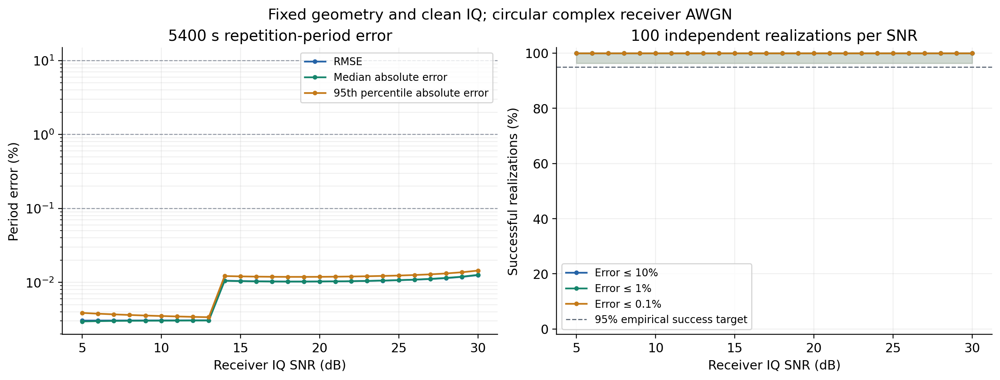
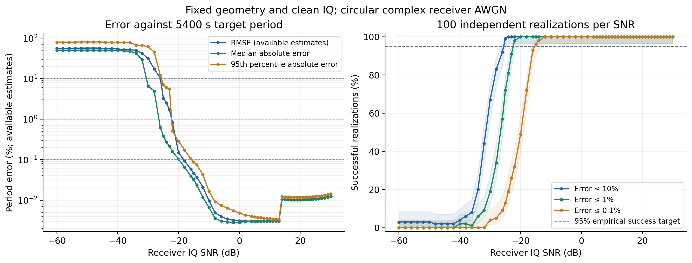
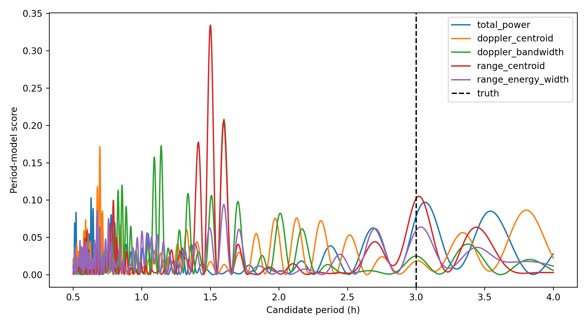
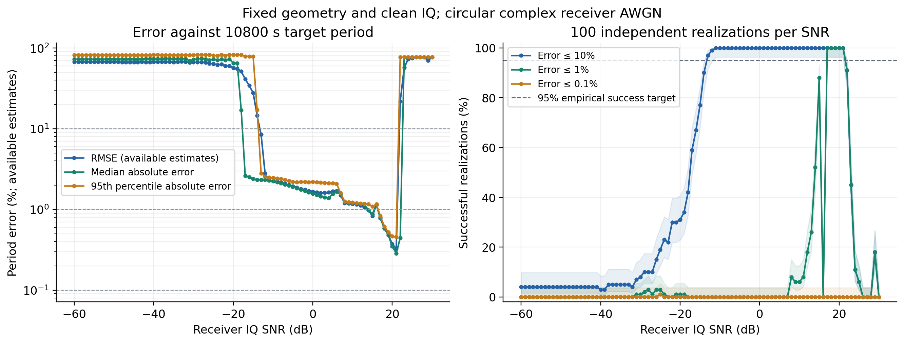
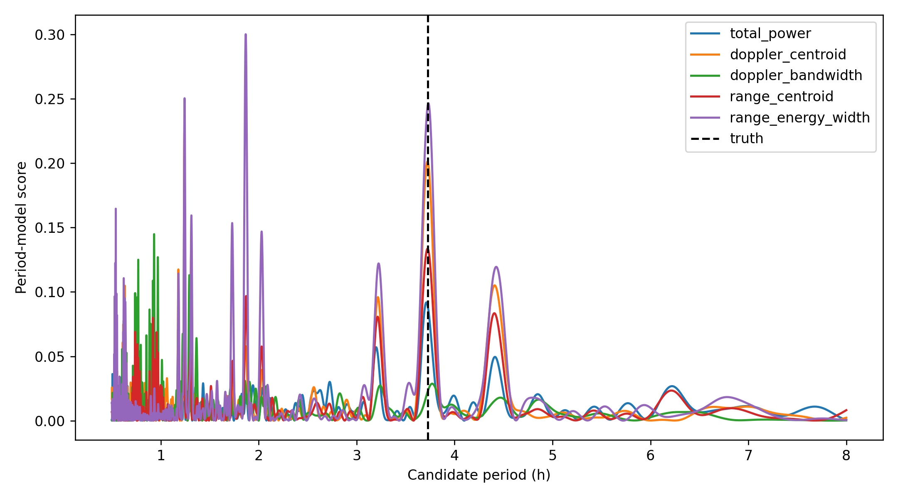
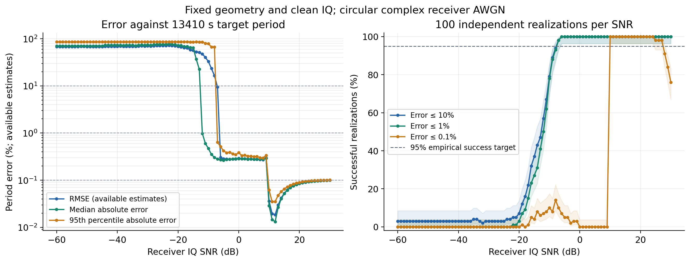
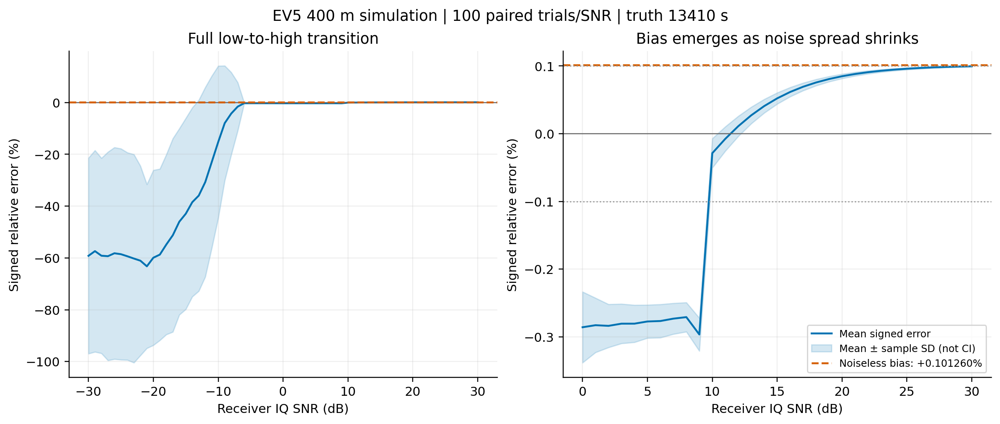

# 接收噪声门限与 EV5 验证

首个实验阶段：2026-10-16；整理日期：2026-10-18。椭球接收IQ加噪、70m EV5网格控制与400m EV5名义参数实验；三者的几何、先验和评价周期不同。正文数值、输入身份、失败结果和复现依据来自原周期实验汇编，未重新运行。阶段中的“当前”“本次”仅指该阶段。

返回[实验导航](../README.md#reports)；当前项目结论见[现状总览](../../../PROJECT_OVERVIEW.md)，算法定义见[算法正文](../../../INVERSION_ALGORITHM.md)。

| 阶段 | 直接阅读 |
| --- | --- |
| 2026-10-16 接收IQ噪声下的完整周期蒙特卡洛 | [阶段正文](#receiver-snr-20261016) |
| 2026-10-16 低SNR扩扫与EV5实验 | [阶段正文](#receiver-snr-extension-20261016) |
| 70m EV5形状控制：无噪声与9100次噪声结果 | [阶段正文](#ev5-70m-snr-20261017) |
| 真实EV5名义参数与未来观测计划 | [阶段正文](#ev5-real-plan-20261017) |
| 2026-10-18 失败峰、高SNR偏差与改进方向 | [新增诊断](#ev5-bias-diagnosis-20261018) |

配置身份快照：[70m EV5](../configs/2026-10-16_EV5_70M.json)、[400m EV5长CPI](../configs/2026-10-16_EV5_400M_LONG_CPI.json)。二者已与各自启动哈希核对；历史运行路径保留，跨机器使用说明见[配置归档约定](../README.md#配置数据与复现)。

<a id="receiver-snr-20261016"></a>

## 2026-10-16 接收IQ噪声下的完整周期蒙特卡洛

### 固定协议与信噪比含义

本阶段回应5—30dB抗噪要求，使用[共同预测融合收尾阶段](2026-10-14_PERIOD_UNCERTAINTY_AND_FUSION.md#predictive-real-input-20261016)的同一仿真作业的完整100Run、20000脉冲、500CPI；每个整数SNR独立重复100次，共2600次周期反演。目标是5400秒特征重复周期，完整自转10800秒；若把估计和真值同时乘2，相对误差不变。固定H1、1秒CPI／0.25秒步长、散射时标、FFT全频率谱矩、完整相关支撑、无视线补偿、共同周期预测融合及1800—14400秒4000频率格，保留全部局部峰和端点细化，不用真值缩域或删通道。形状、几何、观测计划与无噪声散射均固定，本实验不覆盖这些量的系统误差。

噪声直接加入接收复IQ，再经过脉压、分数采样对齐、CPI、五特征提取和完整周期选择。SNR定义为所有唯一、有效、已保存ADC样点上的全局平均干净信号功率除以期望噪声功率；它不是脉压后SNR，也不是整个Run连续ADC窗含未保存空隙的平均SNR。实测信号功率为0.00006340258690514254；0dB基准噪声的实部和虚部各为独立零均值高斯、方差0.00003170129345257127，再乘振幅系数 `10**(-snr_db/20)`。不按每次随机实现重新归一化噪声。当前各Run保存行没有共享ADC索引且全部有效，程序逐Run断言此条件；共享索引输入直接拒绝，不能把该实验外推为重叠ADC实现已验收。

种子固定20261016，按trial和run建立独立SeedSequence；同一次trial的26个SNR复用同一份单位噪声，以配对降低曲线比较波动，因此不同SNR点之间不是独立样本。同一SNR的100次噪声实现独立。CPI彼此重叠，保留原Run内相关性，不把500窗当作500次独立Monte Carlo。CUDA可用时复用双精度线性前端，否则回退CPU；五通道谱矩及距离特征的非线性归约对每个噪声功率重新执行。

### 误差曲线与扫描门槛

相对误差为估计周期与5400秒差的绝对值除以5400。事前规则取某SNR及全部更高扫描点的经验成功率均至少95%，成功分别定义为相对误差不超过10%、1%、0.1%；不可用结果计失败。下表为代表点，完整26格统计、逐点Wilson区间及2600次结果分别保存在[汇总JSON](../data/2026-10-16_RECEIVER_SNR_SUMMARY.json)与[逐次CSV](../data/2026-10-16_RECEIVER_SNR_TRIALS.csv)。

| 接收IQ SNR(dB) | 相对误差RMSE(%) | 绝对相对误差95%分位(%) | 最大绝对相对误差(%) | 误差≤0.1%次数 |
| --- | ---: | ---: | ---: | ---: |
| 5 | 0.00304329 | 0.00385916 | 0.00419672 | 100/100 |
| 10 | 0.00305537 | 0.00350383 | 0.00367457 | 100/100 |
| 13 | 0.00306374 | 0.00337625 | 0.00349397 | 100/100 |
| 14 | 0.01054968 | 0.01216959 | 0.01287697 | 100/100 |
| 15 | 0.01042903 | 0.01204191 | 0.01275771 | 100/100 |
| 20 | 0.01026691 | 0.01187971 | 0.01260892 | 100/100 |
| 25 | 0.01068962 | 0.01236355 | 0.01306995 | 100/100 |
| 30 | 0.01252347 | 0.01442622 | 0.01502131 | 100/100 |



| 精度目标 | 5—30dB扫描内最小达标点 | 对实际最低SNR能给出的结论 |
| --- | ---: | --- |
| 相对误差≤10% | 5dB | 本固定协议的经验门槛≤5dB，实际交点未定位 |
| 相对误差≤1% | 5dB | 同上 |
| 相对误差≤0.1% | 5dB | 同上 |

全部26格均100/100成功且无不可用结果；最坏为trial78、30dB，周期5400.811150985068秒、偏差0.811150985068秒、相对误差0.0150213145383%。每格100/100的95% Wilson区间为[96.30065%,100%]，是单点成功概率区间，不是26点同时置信保证，更不是任意几何／形状都必然成功。5dB已达标只说明扫描下界左删失，不能声称精确最低SNR就是5dB；本轮按用户范围没有向更低SNR扩扫。大量快时间样点的脉压、相干处理及长时观测参与本结果，不可将接收IQ的5dB替换为特征域的5dB。

曲线没有随SNR单调下降，13—14dB有跳变。独立生产搜索复核trial0及trial99：13dB时最终周期附近五通道预测分数的中位通道为总功率，14dB变为多普勒带宽；trial0周期从5399.826284秒变为5400.497874秒。中位目标是分段、非光滑的，特征又会受噪声底和非线性宽度提取影响，因此总体误差可随噪声改变而出现偏差切换。该结果不能解读为“噪声越大算法越准确”，也不能通过平滑曲线掩盖。无噪声同一双精度前端为5399.833177秒，带宽本身仍存在[独立谱尾问题](2026-10-09_SIGNAL_FORMATION_AND_INTEGRATION_COST.md#doppler-tail-diagnosis-20261016)；抗噪通过不等于前端物理正确性已完成校准。

### 独立参照、失败记录与复建

为复用2600次大IQ计算，线性前端把干净信号与单位噪声分开变换，再用功率的精确二次展开计算各SNR。全部100Run干净双精度前端与独立CPU生产路径配对，五列最大尺度相对差分别为8.77e−16、2.95e−12、6.75e−15、9.85e−16、0；首／中／末Run、trial0／50／99与5／18／30dB的27格加噪输入也经过独立生产前端。原complex64 IQ的SciPy FFT首步为单精度，加入complex128噪声后为双精度：原快照与复用双精度基线约1e−7的相对差最初触发验收失败；随后将全部Run的原精度路径与旧快照核对为逐列最大绝对差0，并另行完成双精度参照，而不是直接放松误差门槛。原失败日志、来源副本和恢复过程保留在tmp，汇总明确区分提取源码与恢复验证源码身份。

搜索预计算固定设计的SVD投影，并对所有峰使用批处理SciPy bounded Brent状态机；最终赢家用原生产SVD／Brent重算，近分回退原选择器。曾尝试黄金分割提议，但独立审查发现粗网格多峰反例，故该批产物不作验收依据。修正后完整重算2600次；当前数据的两批周期恰好相同，不足以撤销那个反例。最终trial0的5／18／30dB在全部4000格逐通道对照标量SVD，另将13／14dB转换点、最大误差等八点与完整生产选择器复核，最大周期差2.98824e−8秒。条件数界及少量核对不构成任意输入逐位等价证明，脚本限制散射时标、H1、完整有限五列和固定Run验证设计。

线性提取实际耗时1489.215579秒，独立恢复验证282.576092秒，修正后2600次搜索358.307294秒，额外八点复核22.318415秒；这些只记录当前设备与负载，不宣称相对生产全链路的加速倍数。输入IQ与观测快照SHA256沿用[共同预测融合收尾阶段](2026-10-14_PERIOD_UNCERTAINTY_AND_FUSION.md#predictive-real-input-20261016)的冻结值；汇总还保存特征数组哈希、配置、噪声定义、源码、每格统计和独立验证。各次返回的候选、特征数组和固定设计留在 `tmp/receiver_snr_brent_20261016/`，未覆盖历史反演文件；不支持的CLI组合显式报错。

```powershell
conda activate pytorch
python scripts/experiment_receiver_snr.py --phase extract --trials 100 --seed 20261016 --device cuda:0 --output tmp/receiver_snr_rebuild_new
python scripts/search_receiver_snr.py --output tmp/receiver_snr_rebuild_new
python scripts/plot_receiver_snr.py --kind snr --input tmp/receiver_snr_rebuild_new/result.json --output tmp/receiver_snr_figures_new
python -m pytest tests/test_receiver_monte_carlo.py tests/test_result_popup_interaction.py -q -p no:cacheprovider
```

输出目录须使用新名称；无CUDA可指定 `--device cpu`，搜索也会回退CPU。专门验收18项通过，最终根tests完整执行322通过／1可选浏览器引擎跳过，不能与历史阶段158项反演测试相加。全新上下文对抗审查复现并推动修复Brent替代问题，最终独立重算全部2600条误差与门槛、核对噪声定义和八点生产参照后无交付阻断。本阶段结论严格限定为固定仿真输入的接收AWGN鲁棒性，未认证实测系统总误差或多普勒前端偏差。

<a id="receiver-snr-extension-20261016"></a>

## 2026-10-16 低SNR扩扫与EV5实验

### 椭球场景：门限定位完成

延续上一阶段同一IQ、500CPI、5400秒重复周期及全部数值协议，先以2dB步长扫描−60—4dB，再补算−25、−23、−15dB三个边界点，并与原5—30dB结果合并。最终共62个SNR点、每点100次、6200条完整记录；边界附近分辨率为1dB，远离边界仍为2dB，不能称为全域1dB连续扫描。三个批次使用同一种NumPy PCG64接收噪声、种子和trial／Run映射；同trial跨SNR配对，全部结果保留，没有不可用记录。

| 相对误差要求 | 最低达标扫描点 | 该点成功次数 | 前一档及成功次数 | 本次扫描括区间 |
| --- | ---: | ---: | --- | --- |
| ≤10% | −25dB | 99/100 | −26dB：92/100 | (−26,−25]dB |
| ≤1% | −22dB | 98/100 | −23dB：91/100 | (−23,−22]dB |
| ≤0.1% | −15dB | 96/100 | −16dB：93/100 | (−16,−15]dB |

这里的“门限”继续指该点及全部更高已扫描点的经验成功率至少95%。三个门限点的单点95% Wilson下限分别约94.55%、93.00%、90.16%，不能表述成“以95%置信保证总体成功概率至少95%”，也不能保证扫描点之间单调。固定作业、固定无噪声模型和接收AWGN的作用域保持不变；未知形状、极轴、标定及前端模型误差未进入这100次噪声重复。

误差曲线的RMSE与上表“至少95次各自达标”是不同统计量。如果仅以RMSE不超过10%、1%、0.1%且全部更高扫描点也满足为判据，对应最低已扫描点为−25、−22、−18dB；其中−18dB只有72/100次各自误差≤0.1%，不能用RMSE门槛替换95%成功门槛。所有后续形状和真实参数实验沿用上表的成功率判据，同时保留RMSE曲线。



完整62格统计、输入和三批源码身份见[冻结JSON](../data/2026-10-16_RECEIVER_SNR_ELLIPSOID_EXTENDED.json)，6200次周期、误差和搜索路线见[逐次CSV](../data/2026-10-16_RECEIVER_SNR_ELLIPSOID_EXTENDED.csv)。全新上下文审查独立重算全部误差、186个成功计数、连续高档条件及原始文件SHA，均一致。无噪声周期5399.833177秒及此前13—14dB中位通道切换仍成立，扩扫没有通过平滑或删除异常点更改它们。

深扫提取实际1679.061396秒、3300次搜索438.043104秒；边界补算提取1640.295280秒、300次搜索57.831561秒。耗时仅记录当前设备负载。第一次边界提取因新增列名检查错误地比较显示名与带单位的科学字段名而在读入时拒绝，未生成有效实验结果；修正契约检查并添加顺序颠倒会失败的测试后，使用全新输出目录重跑，失败目录和日志保留。此处数值核冻结后才扩展研究脚本的可选LOS与Torch噪声路径，旧结果不会被新随机流替换。

```powershell
conda activate pytorch
python scripts/experiment_receiver_snr.py --phase extract --trials 100 --seed 20261016 --noise-engine numpy --output tmp/ellipsoid_high_rebuild_new
python scripts/search_receiver_snr.py --output tmp/ellipsoid_high_rebuild_new
python scripts/experiment_receiver_snr.py --phase extract --snr-min -60 --snr-max 4 --snr-step 2 --trials 100 --seed 20261016 --noise-engine numpy --output tmp/ellipsoid_deep_rebuild_new
python scripts/search_receiver_snr.py --output tmp/ellipsoid_deep_rebuild_new
python scripts/experiment_receiver_snr.py --phase extract --snr-points -25 -23 -15 --trials 100 --seed 20261016 --noise-engine numpy --output tmp/ellipsoid_boundary_rebuild_new
python scripts/search_receiver_snr.py --output tmp/ellipsoid_boundary_rebuild_new
python scripts/summarize_snr_scan.py --input tmp/ellipsoid_high_rebuild_new/result.json tmp/ellipsoid_deep_rebuild_new/result.json tmp/ellipsoid_boundary_rebuild_new/result.json --output tmp/ellipsoid_combined_rebuild_new
```

完整原始批次分别为 `tmp/receiver_snr_brent_20261016/`、`tmp/receiver_snr_ellipsoid_deep_20261016/` 和 `tmp/receiver_snr_ellipsoid_boundary_verified_20261016/`；合并输出为 `tmp/receiver_snr_ellipsoid_final_20261016/`，其 `scientific_sources/` 保存扩展LOS前的数值源码副本。重建须在相同数值源码版本内完成各批；不能混合旧版提取与新版数值核再声称源码身份一致。

### EV5阶段的预先约定

后续几何实验以根[EXPERIMENTS.md](../../../../../EXPERIMENTS.md)为执行协议，物理参数、原始OBJ尺度、质心平移、体积等效直径及未来几何来源见[EV5输入核对](../../../research/RADAR_PERIOD_ESTIMATION.md#ev5-physical-inputs-20261016)。先完成用户70m模型的生产全链路与噪声实验，再执行真实400m／13410秒及未来观测计划；各实验使用独立名称和配置。完整自转与半周期候选分别报告，不用已知真值选择倍频；无噪声基线不达标的精度等级不得宣称存在有效SNR门限。

<a id="ev5-70m-snr-20261017"></a>

### 70m EV5形状控制：无噪声与9100次噪声结果

独立作业 `ev5_snr_20261016_70m` 复用原Apophis观测计划、100Run×2秒、20000脉冲、500CPI、10800秒自转及全部RF设置，只按协议替换网格并质心居中；[配置](../configs/2026-10-16_EV5_70M.json)和[模型来源／尺度](../../../../../assets/ev5_snr_20261016/provenance.json)另存，原配置和用户OBJ不覆盖。生产全链路实际耗时3469.554772秒，退出码0，生产源码、配置和模型首尾哈希一致。复用观测文件和原文件均为419434476字节、SHA256 `005df4046d496ae126104e041a2f83935d095e201a16064da2ab6202b35008d3`，身份在回波计算期间捕获，归档时再核对；它不是重新生成的EV5星历。

最终生产选择5754.032520秒，相对完整10800秒误差46.721921%，相对预声明5400秒半周候选也误差6.556158%。10851.487756秒候选虽存在且距整周真值约0.477%，预测评分0.033288低于最终候选0.068825，因此不能事后挑它作为成功结果。这是完整自转三个精度等级均未通过的无噪声负结果，已足以否定把原椭球门限推广到该网格。

| 通道 | 自身最佳H1周期(s) | 在最终5754.032520秒的整Run预测评分 |
| --- | ---: | ---: |
| 总功率 | 2272.039184 | −0.043975 |
| 多普勒质心 | 2502.358220 | −0.011377 |
| 多普勒带宽 | 5758.294729 | 0.171464 |
| 距离质心 | 5403.109160 | 0.154254 |
| 90%距离能量宽度 | 5754.875701 | 0.068825 |

该表只描述实际选择行为：中位预测评分在这个候选由距离能量宽度给出，三通道正预测增益不等于周期物理正确，也不能据此断言网格散射误差、形状谐波或几何变化中的哪一项是唯一成因。按事前协议仍执行−60—30dB每1dB／每档100次的接收IQ扫描，以保留性能曲线和噪声下的误选情况；完整结果如下。



图中是五项独立H1残差改善评分，虚线为10800秒完整自转；它不是共同留出预测目标。距离质心在5403秒附近有峰，但多个通道并未共同指向完整自转，不能将椭球的峰型直接搬到此网格。

该阶段使用以下命令执行接收噪声实验；重建时将输出改为未存在的新目录。CUDA噪声流与原椭球NumPy流同分布但不逐位相同，清单明确记录Torch／NumPy版本、设备和种子映射。用于搜索的特征先在接收IQ加噪再提取，不是在保存特征上直接叠加独立白噪声。

```powershell
conda activate pytorch
python scripts/experiment_receiver_snr.py --phase extract --echo runs/ev5_snr_20261016_70m/echo/echo.npz --snapshot runs/ev5_snr_20261016_70m/inversion/period_observables.npz --truth 10800 --noise-engine torch --trials 100 --seed 20261016 --snr-min -60 --snr-max 30 --snr-step 1 --device cuda:0 --output tmp/receiver_snr_ev5_70m_rebuild_new
python scripts/search_receiver_snr.py --output tmp/receiver_snr_ev5_70m_rebuild_new
python scripts/plot_receiver_snr.py --kind snr --input tmp/receiver_snr_ev5_70m_rebuild_new/result.json --output tmp/ev5_70m_figures_rebuild_new
```

#### 2026-10-17 完整噪声搜索与门限判定

接收IQ特征提取于10月16日完成，耗时2847.504063秒；9100次完整周期搜索于10月17日完成，耗时1212.944030秒。100Run的干净双精度及旧精度路径均分别核对独立生产前端；首／中／末Run的trial0、−60与30dB加噪输入另作独立CPU核对。trial0的−60／−15／30dB又在全部4000格逐通道对照标量SVD并核对完整生产候选，评分最大差1.11e−15、最终周期最大差5.80e−8秒。全部9100次有可用估计，失败次数0；“有输出”不等于达到精度要求。

信号功率为0.000026031615548887895，仍按唯一有效已保存ADC样点定义。输入IQ SHA256为 `1a9ec5e4cdd2b3ab045fd760267b598e67f4c82a2cf3cb4ccb29f8a0c68ae9f6`，特征快照为 `29629f4a0aa2c655ae923a7e2d39d7aa4a2601d19a619ec26f06dc9e4d47bafa`。提取首尾、搜索首尾及冻结时八份科研源码完全一致；加速入口另拒绝跨阶段源码身份不同的输入。完整配置、生产运行记录、无噪声候选、源代码身份、半周诊断及依赖版本见[冻结JSON](../data/2026-10-16_RECEIVER_SNR_EV5_70M.json)，9100次周期、误差、评分及搜索路线见[逐次CSV](../data/2026-10-16_RECEIVER_SNR_EV5_70M.csv)。全部噪声试验的原始候选与源码副本保存在 `tmp/receiver_snr_ev5_70m_20261016/`。

| SNR(dB) | 对完整10800秒的相对RMSE(%) | 误差≤10%次数 | ≤1%次数 | ≤0.1%次数 |
| --- | ---: | ---: | ---: | ---: |
| −60 | 67.536356 | 4/100 | 0/100 | 0/100 |
| −30 | 66.557192 | 8/100 | 1/100 | 0/100 |
| −20 | 56.636664 | 31/100 | 1/100 | 0/100 |
| −10 | 2.266968 | 100/100 | 0/100 | 0/100 |
| 0 | 1.665063 | 100/100 | 0/100 | 0/100 |
| 5 | 1.681035 | 100/100 | 0/100 | 0/100 |
| 10 | 1.172735 | 100/100 | 6/100 | 0/100 |
| 20 | 0.373911 | 100/100 | 100/100 | 0/100 |
| 30 | 77.002772 | 0/100 | 0/100 | 0/100 |



对完整自转，经验成功率≥95%的已扫描点仅在10%目标的整数−13至21dB、1%目标的整数17至21dB出现；0.1%没有达标点。22dB以后结果恶化，30dB三目标均0/100，无噪声本身也失败。因此三个等级均未获得有效的“达到该SNR后全部更高扫描点继续达标”门限，不能把−13或17dB称为最低所需SNR。这里的有限好区间也不能推广到未扫描的连续SNR，或解释为噪声能普遍提高物理精度。

预声明固定5400秒半周假设只作诊断，不改变任何估计或挑选倍频。该假设下91档的10%、1%、0.1%成功次数最大分别只有8、3、0次，各等级均没有经验95%达标点；半周10%在无噪声可通过，但其高于30dB的噪声门限没有在本扫描中定位，不能把“未取得门限”改写为任何SNR都不可能通过。半周1%／0.1%的无噪声偏差仍为6.56%。这一负结果说明现有五标量H1共同预测规则在本几何与网格上未获得稳定的完整周期或高精度半周期反演；本轮没有根据真值改通道、阶数或评分。

全新上下文审查逐条核对9100个唯一(trial,SNR)键、完整100×91矩阵、完整／固定半周的182行统计及546个成功计数与Wilson区间，全部一致；原始结果、8份科研源码、3份加速源码、生产全部源码档案、配置、网格、IQ、特征快照与两份观测文件的SHA也一致。CPU小测独立21项通过，另一次与MC竞争GPU的广测已终止，不计为通过。曲线已实际查看；这些检查支持本固定仿真结果的可追溯性，不证明散射模型或实测周期已校准。

<a id="ev5-real-plan-20261017"></a>

### 真实EV5名义参数与未来观测计划

70m结果冻结后，于10月17日启动独立作业 `ev5_snr_longcpi_20261016_400m`，正式[配置](../../../../../configs/ev5_snr_longcpi_20261016_400m.json)另存；文件名中的20261016是方案建立日，并非所有计算完成日期。此前短Run预览配置不作为本实验输入，也不覆盖原椭球或70m配置。本项使用真实目标编号和名义物理参数、JPL星历生成仿真回波，并非取得实测雷达IQ。

| 量与配置 | 预声明设置 |
| --- | --- |
| 目标 `observation.target.id` | 341843／2008 EV5 |
| 形状与等效直径 | 独立400m体积等效直径副本；最大笛卡尔尺寸约452.14m |
| 完整周期 `echo.target.rotation_period_s` | 13410秒，即3.725h |
| 赤道极轴 `echo.target.spin_pole_icrs_deg` | RA105°、Dec−66°；反演显式给定相同名义极轴 |
| 时段 `observation.schedule.start_utc/end_utc` | 2039-12-26 00:00至12-30 00:00 UTC，共4天 |
| 测站模型与可见性 | 纬度29.5°、经度107°、高程511m；仰角至少20°，不是实际设施能力声明 |
| Run `run_count/run_duration_s` | 100次，每次16秒发射调度，按可见时段等可见时间排布 |
| PRF与脉宽 `transmit` | 20Hz、10μs，每Run320脉冲，共32000脉冲 |
| 固定RF参数 | 快时间采样率200MHz、Chirp带宽150MHz、载频1GHz |
| CPI `inversion` | 配置时长8秒、步长2秒，每CPI160脉冲，预计500CPI |
| 搜索 | 1800—28800秒、8000频率格、H1、全峰细化、共同预测融合 |
| 视线相位补偿 | 已知极轴、`full_rotation`约定；仅使用几何，不读取周期真值 |

这里16秒是Run发射调度长度，不是连续射频开启时间；每Run320个10μs脉冲累计射频开启3.2ms。首末脉冲及其末端的列跨度15.95001秒，8秒CPI的160个样点首末时刻跨度7.95秒，不能把样点数除PRF当作首末跨度。预检中发射起点至最后接收结束的占用外包络最多约65.3055秒，包含光行时后的接收尾部，不等于ADC连续采样窗时长。正式观测阶段输出32000个脉冲样本，回波每行3337个快时间样点、共106784000个有效样点；最大实际双站差分路径451.874m，模型报告无物理回波重叠。

#### 2026-10-17 无噪声生产基线

完整生产流水线耗时1741.841131秒、退出码0，源码、配置和模型首尾身份一致；未复用其他作业的观测文件。估计完整周期13423.578975秒，对名义13410秒偏差+13.578975秒，相对误差0.1012600675%。10%与1%等级通过，0.1%未通过：0.1%对应13.41秒，不能把0.10126%四舍五入成0.1%再判成功。固定6705秒半周仅作诊断，其误差100.202520%，本结果没有通过事后倍频得到。

该基线在查看噪声结果前独立冻结为[基线JSON](../data/2026-10-16_EV5_400M_BASELINE.json)，保留所有生产候选、配置、输入IQ／观测／特征身份及完整生产源码档案。它验证当前名义参数仿真可以达到1%，不认证真实小行星的系统总误差；极轴和直径不确定度、未来地球定向误差、离散散射模型偏差均未被接收AWGN重复覆盖。

| 通道 | 自身最佳H1周期(s) | 在最终13423.578975秒的整Run预测评分 |
| --- | ---: | ---: |
| 总功率 | 13363.241882 | 0.074225 |
| 多普勒质心 | 4466.836895 | 0.162199 |
| 多普勒带宽 | 3353.061070 | −0.014089 |
| 距离质心 | 13406.632717 | 0.114997 |
| 90%距离能量宽度 | 6721.851857 | 0.223562 |



图为独立单通道H1残差改善评分，虚线是13410秒完整自转，不是融合预测评分。各通道有不同谐波或别名，不能按已知真值改选距离质心或半周通道。按事前协议继续执行接收IQ噪声扫描，主要定位10%与1%门限；0.1%保留全部曲线与基线失败标记，不把某个有限噪声区间偶然抵消偏差当成稳定高SNR保证。

本项完整生产命令为 `python scripts/run_ev5_case.py --case 400m --tag ev5_snr_longcpi_20261016`，严格拒绝覆盖已有Run。已有上述生产输入时，可在Conda环境中用新的临时目录重建噪声扫描与曲线；完整生产重建须在未占用的作业名／目录执行，不能删除原证据以迁就命令。

```powershell
conda activate pytorch
python scripts/experiment_receiver_snr.py --phase extract --echo runs/ev5_snr_longcpi_20261016_400m/echo/echo.npz --snapshot runs/ev5_snr_longcpi_20261016_400m/inversion/period_observables.npz --truth 13410 --noise-engine torch --trials 100 --seed 20261016 --snr-min -60 --snr-max 30 --snr-step 1 --device cuda:0 --output tmp/receiver_snr_ev5_400m_rebuild_new
python scripts/search_receiver_snr.py --output tmp/receiver_snr_ev5_400m_rebuild_new
python scripts/plot_receiver_snr.py --kind snr --input tmp/receiver_snr_ev5_400m_rebuild_new/result.json --output tmp/ev5_400m_figures_rebuild_new
```

#### 2026-10-17 完整接收噪声扫描

−60至30dB逐1dB、每档100次，共9100次完整8000格搜索全部完成。提取661.087734秒，搜索2502.781999秒；各次均有可用估计，不可用次数0，仍按全部100次计算每档精度成功率。信号平均功率0.000013634576738645215；输入IQ SHA256为 `a42430a141a72e1f60e4d38179023e258a354e32e0e173eb21057f0231ffc538`，特征快照为 `fefc4d57120099766adfb688fefc9b0daf9bbb1f45121c32a26e4304eaf2559b`。完整配置、运行记录、源码身份、逐点统计及固定半周诊断见[冻结JSON](../data/2026-10-16_RECEIVER_SNR_EV5_400M.json)，全部逐次周期、误差及评分见[CSV](../data/2026-10-16_RECEIVER_SNR_EV5_400M.csv)。

| 完整13410秒周期误差目标 | 持续达标的最低已扫描SNR | 前一档−8dB | −7dB | 扫描结论 |
| --- | ---: | ---: | ---: | --- |
| ≤10% | −7dB | 94/100 | 98/100 | 经验边界(−8,−7]dB；−7至30全部整数档均≥95/100 |
| ≤1% | −7dB | 93/100 | 98/100 | 经验边界(−8,−7]dB；−7至30全部整数档均≥95/100 |
| ≤0.1% | 未取得 | 14/100 | 10/100 | 仅整数10至27dB达经验95%，28／29／30dB降至91／84／76次；无噪声也未通过 |

−7dB的两目标成功率均98%，逐点Wilson95%区间约92.999%—99.450%；下界低于95%，不能说已用95%置信度证明总体成功率≥95%。两个等级门限相同，是因为本固定计划的主要低SNR失败会跳到远处别名；这并不表示两目标定义相同。−7dB仍有2次大误差，其相对RMSE为9.447561%，故该门限只表示每档至少95/100次达到误差目标，不能改写成“平均误差≤1%”或每次都成功。

| SNR(dB) | 相对RMSE(%) | 误差≤10%次数 | ≤1%次数 | ≤0.1%次数 |
| --- | ---: | ---: | ---: | ---: |
| −60 | 67.817475 | 3/100 | 0/100 | 0/100 |
| −30 | 70.114874 | 3/100 | 0/100 | 0/100 |
| −20 | 68.704439 | 7/100 | 3/100 | 0/100 |
| −10 | 32.933917 | 79/100 | 78/100 | 10/100 |
| −8 | 16.422414 | 94/100 | 93/100 | 14/100 |
| −7 | 9.447561 | 98/100 | 98/100 | 10/100 |
| 0 | 0.290604 | 100/100 | 100/100 | 0/100 |
| 5 | 0.278444 | 100/100 | 100/100 | 0/100 |
| 10 | 0.035941 | 100/100 | 100/100 | 100/100 |
| 20 | 0.084888 | 100/100 | 100/100 | 100/100 |
| 30 | 0.099567 | 100/100 | 100/100 | 76/100 |



0.1%目标出现有限好区间而高SNR成功率下降，说明噪声变化会改变当前固定处理链的估计偏差；本实验没有隔离是哪一项特征／融合机制造成，不能把曲线当成单一因果诊断。30dB的RMSE虽然低于0.1%，仍有24次超出0.1%，两种标准不可混用。无噪声误差略高于目标，故不能把10dB当成“至少达到即可”的0.1%需求，也不能通过事后选取更近的通道、倍频、SNR区间或修改计划真值来消除此负结果。固定6705秒半周诊断同样保留，三个等级均无门限。

全部100Run干净输入核对独立生产前端；首／中／末Run的trial0、−60／30dB共六格加噪参照最大差3.204e−14。独立审查从实际记录的视线与散射时刻重算相位，另用独立向量基底公式核对至1e−14；设计不含周期真值。trial0的−60／−15／30dB在完整8000格核对标量SVD，最大评分差1.11e−15，最终周期与生产选择差至多9.72e−8秒。MC双精度干净前端估计13423.578976491秒，与先冻结生产基线差约1.44e−6秒；两者误差均严格大于0.1%，没有把不同数值路线写成逐位等同。上述核对验证本次实现与统计，不是实际雷达物理精度认证。

全新上下文审查独立复算全部9100条CSV与原始记录、100×91唯一键、完整／固定半周的182行统计及546个成功计数与Wilson区间，均一致；固定半周三等级的最高成功次数仅11／3／0次。八份科研源码与三份加速源码的跨阶段身份、生产全部源码档案、模型、配置、IQ、观测、特征快照及先冻结基线全部SHA链核对通过，完整生产候选也一致。曲线已实际查看；未发现本实验统计与归档的交付阻断。

<a id="ev5-bias-diagnosis-20261018"></a>

## 2026-10-18：失败峰与高SNR偏差诊断

本阶段重新分析已有无噪声特征、候选记录和400m的9100条噪声结果，另在保存特征上重算评分与70m的H1/H2/H4全域搜索；没有重新生成IQ，没有新增9100次噪声实现，也没有修改生产算法。旧阶段数值保持冻结。结论是：70m存在全局候选误选；400m高SNR区间主要表现为同一候选分支内的确定性偏差，尚无证据把0.1%视为物理下限。文献依据和数学边界见[研究补充](../../../research/RADAR_PERIOD_ESTIMATION.md#ev5-bias-model-20261018)，后续实施见[改进方案](../../plans/PERIOD_INVERSION_IMPROVEMENT_PLAN.md#ev5-next-20261018)。

### 1. 70m：真周期附近的峰被找到，但没有赢得当前评分

下表为共同周期预测融合的候选，不是单通道周期图上的残差改善率。评分是五个通道的整Run留出预测改善率中位数，不是候选为真的概率；当前五折按Run序号交错划分，保留Run整体，但不等于连续日期留出或独立物理场景验证。

| 输入 | 第一候选：周期／分数 | 第二候选：周期／分数 | 第三候选：周期／分数 |
| --- | --- | --- | --- |
| 原椭球，评价5400秒重复半周 | 5399.833177 s／0.538288 | 5095.418156 s／0.306387 | 5743.268392 s／0.283312 |
| 70m EV5，评价10800秒完整自转 | 5754.032520 s／0.068825 | 10851.487756 s／0.033288 | 5394.907834 s／0.032784 |

70m EV5在固定真值10800秒的评分为0.031995，低于5754秒候选；5754秒相对完整周期误差46.72%，相对5400秒也偏6.56%，不能用简单倍频消除。生产融合会枚举原频率网格的所有局部峰及端点并逐峰细化，整周期附近并未被漏掉。单通道搜索的有限候选细化与最终共同搜索是不同层，不能把前者的top5规则套到后者。当前问题是观测表示、拟合模型及候选评价共同给错误周期更高分，继续把同一个目标函数求得更精确不能自动恢复物理真值。

用户观察到的“接近椭球次峰”有数据支持：椭球五通道在5736—5772秒均有局部峰，其中总功率和带宽为第3峰，另三项为第2峰；EV5对应的带宽、距离质心、距离宽峰约5758、5751、5755秒。两组共用采样时刻，5400与5754秒的差频对应约87765秒拍频，采样窗在该差频的归一化幅度约0.769，支持观测窗口旁峰参与的解释；这些现象尚不能唯一确定物理原因或证明原始IQ不可辨识。在70m赢家处，带宽、距离质心、距离宽提供正预测分数，距离宽决定中位数；三项来自同一IQ，不能按三个独立证据投票。

同域、同折分、无LOS、五通道的保存特征探索中，H=1、2、4分别选择5754.032520、5770.280991、2432.572463秒，全部未恢复10800秒。这是本次实际重算的负结果，不能承诺只增加谐波即可修复，也没有按真值选出“最好阶数”。

### 2. 400m的条件性成功与泛化范围

70m失败不使400m结果自动失效，但说明当前方法不具备已验证的跨场景可靠性。400m计划在查看噪声结果前已冻结，固定输入上重复加噪能检验抗噪性；100次噪声不等于100个不同形状、观测几何或初相位的成功案例。400m无噪声第一、第二候选约13423.579、15851.712秒，评分约0.114997、0.069996，当前规则稳定偏好前者不等于其偏差已校准。

两组也不是只改变尺寸：70m指最大笛卡尔尺寸，体积等效直径约61.927m；400m指体积等效直径，最大尺寸约452.142m。70m沿用原Apophis计划与10800秒周期、2秒Run、1秒CPI，400m使用EV5星历与13410秒周期、16秒Run、8秒CPI；日期、跨度、PRF、脉宽及搜索域等也改变。两组回波极轴均为赤经105°／赤纬−66°，没有改变；400m反演显式使用此已知极轴并开启LOS补偿，70m关闭。原椭球尺寸为140×100×80m，也不是等尺度“70m椭球”。因此不能把成功单独归因于变大、形状或LOS。

### 3. 高SNR回升：随机分散缩小，估计均值向无噪偏差移动

以下统计重新从冻结逐次CSV核算。平均偏差为100次估计均值减13410秒，标准差采用样本分母99，RMSE相对13410秒计算；无噪行没有随机重复，标准差不适用。历史生产无噪周期为13423.578975秒，双精度缓存为13423.578976491秒，两者差约1.44微秒，不影响0.1%失败结论。

| 接收IQ SNR | 平均偏差(s) | 样本标准差(s) | 相对RMSE | 误差≤0.1% |
| --- | ---: | ---: | ---: | ---: |
| −15 dB | −5756.851 | 4946.886 | 56.48163% | 4/100 |
| 0 dB | −38.339 | 7.021 | 0.29060% | 0/100 |
| 5 dB | −37.196 | 3.281 | 0.27844% | 0/100 |
| 10 dB | −3.860 | 2.900 | 0.03594% | 100/100 |
| 15 dB | +6.995 | 1.116 | 0.05282% | 100/100 |
| 20 dB | +11.375 | 0.439 | 0.08489% | 100/100 |
| 25 dB | +12.868 | 0.198 | 0.09597% | 98/100 |
| 30 dB | +13.352 | 0.101 | 0.09957% | 76/100 |
| 无噪声 | +13.579 | 不适用 | 0.10126% | 不通过 |

−15dB仍有大量远处误选，绝对相对误差中位数64.2166%，仅27/100次达到1%；不能读作此处已稳定达到0.1%—1%。此前定义的≤1%经验持续门限是−7dB，且该档仍有2次大误差。不同统计曲线、典型成功试次与整个试次群体不能互换。



蓝线为100次平均有符号相对误差，阴影为均值±样本标准差，不是均值置信区间或严格覆盖范围；橙虚线是无噪偏差，灰点线是±0.1%门槛。右图放大0—30dB，左图包含−30dB起的全局误选区。跨SNR复用配对单位噪声，不能把相邻点视为独立实验。

新增评分复核把两种变化分开：9dB时100次赢家的中位通道为97次距离宽、3次多普勒带宽；10、20、30dB各100次在赢家和真值处均为距离质心。trial0/50/99在10—30dB全部整数档也均为距离质心；这三次的10/20/30dB以及无噪输入在13360—13460秒、步长0.25秒的局部401点内，中位通道保持距离质心。故约9→10dB的跃迁涉及通道切换，10→30dB的回升却不能归因于同一种切换。

对上述三个trial的10/20/30dB及无噪特征，单独优化距离质心的整Run预测评分，局部最优与原融合赢家最大差不到0.000075秒。这里13200—13600秒括区是事后定位机制所选，不算新的盲搜验收。无噪真周期处的该评分为0.114734456，13423.578976秒处为0.114996982，实际目标函数确实偏好后者；这不是需要再加密几格才能消除的13.58秒误差。总功率、多普勒质心、距离宽在真周期处反而评分更高，但五项取中位数未使用其全部偏好。单独距离质心的全数据H1残差最优为13406.632717秒，与留出预测最优不同；不能因它事后更近真值便改选它。

噪声还改变了特征的平均形状。对每个CPI取100次距离质心均值，再拟合“干净质心×统一斜率＋统一截距”，未被这种整体平移缩放解释的残差RMS，在10/20/30dB分别为干净质心标准差的20.1754%／2.29844%／0.233067%。对应残差RMS为逐CPI非仿射残差试次均值的标准误RMS的37.60／32.04／14.99倍；这只是形变量与Monte Carlo均值误差的数量级比较，不是把500个相关CPI当独立样本的显著性检验。统一仿射变化本可被归一化消除，此项复核表明实际变化并非只有统一平移或缩放。

因此，“高SNR显露系统偏差”的解释方向正确，但“固定偏差加零均值随机抖动”不足以解释整条曲线。可把本固定场景的误差记为无噪偏差、随SNR变化的估计均值偏移及零均值随机项三部分；中等噪声下两种偏移部分抵消，高SNR下后者消退，均值逐渐接近无噪结果。距离质心是功率加权比值，噪声底和每CPI信号强度不同会改变这种非线性映射；本次还未用反事实控制量化各来源的贡献，更不能把全部13.58秒归因于这一项。400m已开LOS，相位补偿也不能消除方面角、双站角导致的波形变化。

### 4. 本阶段证据、复现与尚未证明的事项

本轮归档[全部91档派生统计](../data/2026-10-18_EV5_BIAS_STATISTICS.csv)和[诊断JSON](../data/2026-10-18_EV5_BIAS_DIAGNOSTICS.json)，包含候选／通道评分、H阶负结果、完整配置差异、局部复核、特征非仿射残差、输入和源码SHA256。一次性分析脚本及原始大数组留在被忽略的 `tmp/ev5_bias_analysis_20261018/` 与原缓存，正文数据不替换历史结果。峰值复核使用的当前两份评分源码SHA256与噪声阶段冻结源码相同；噪声审计直接从冻结源码导入。

```powershell
conda activate pytorch
python tmp/ev5_bias_analysis_20261018/peak_audit.py
python tmp/ev5_bias_analysis_20261018/peak_config_compare.py
python tmp/ev5_bias_analysis_20261018/noise_audit.py
python tmp/ev5_bias_analysis_20261018/noise_local_followup.py
```

这些命令依赖原 `runs/` 特征快照和 `tmp/receiver_snr_*` 缓存，不宣称仅下载文档即可复建全部诊断；缺失时须先按前文对应阶段命令重建输入，核对身份后另记新实验。尚未完成的是13.58秒无噪偏差的逐项因果分解、未知形状／极轴跨场景验收、30dB以上扫描及真实仪器校准。0.10126%只是该输入和估计规则的无噪误差；不能当作普适物理下限，也不能直接从所有输出减去13.58秒作为校准。

<a id="ev5-precision-20261020"></a>

## 2026-10-20—23：使用现有数据的精度改进试验

本阶段直接回答“现有数据不变，具体怎样提高周期精度”。10月20日完成无噪原型及部分带噪计算，10月23日继续带噪验证、独立复核和归档。没有生成新回波、ISAR图像或新的随机噪声，没有读取OBJ来拟合形状，也没有修改生产算法。输入仍为两份原EV5作业的100Run／500CPI及历史IQ加噪特征缓存；周期真值只在选择完成后计算误差。方法族曾在这两份数据上探索，因此本节是同场景回测，不是未见目标的独立精度认证。

### 1. 已验证的具体算法

**方案A：多谐波正预测增益融合。** 保留五个特征、原时标、Run划分及LOS设置，按整Run五折预测误差定义各通道增益，再最大化正增益平方之和；H从固定集合{1,2,4,8}按同一评分自动选择。70m保留LOS关闭，400m沿用已知极轴补偿。算法不依赖噪声底估计，不新增极轴或形状先验。数学定义见[解法A](../../../research/RADAR_PERIOD_ESTIMATION.md#ev5-precision-models-20261020)，工程移植直接读[修改方案第12节](../../plans/PERIOD_INVERSION_IMPROVEMENT_PLAN.md#precision-implementation-20261020)。

**方案B：有限球面响应。** 用原LOS和显式已知极轴构造体固观测方向，以有限球谐系数拟合五个特征随方向的变化，谱阶正则及整Run留出损失选择阶数和参数。这些是响应系数，不是三维形状。两组都给定RA105°／Dec−66°；70m因此比原生产多一个已知极轴先验，单独报告，不混入方案A的同先验比较。

### 2. 无噪声：原500CPI的全域搜索

| 场景 | 原H1中位数融合 | 仅改为平均CV损失并自动选H | 方案A：正增益平方并自动选H |
| --- | --- | --- | --- |
| 70m，评价10800s | 5754.032520s；误差46.721921% | H2，10827.218374s；0.252022% | **H2，10806.327522s；0.058588%** |
| 400m，评价13410s | 13423.578975s；误差0.101260% | H8，13406.052486s；0.029437% | **H8，13408.502601s；0.011166%** |

该比较保持各自原物理作业不变，不把70m与400m当成只改变尺寸的实验。基线为冻结生产输出，研究输入为历史双精度噪声前端的干净特征；400m原生产与此缓存重算的基线相差约1.44微秒，远小于表中改进。没有把“已测得真值后改选更近通道／倍频／阶数”当成算法。特别是400m某些H1或球面L4给出更小真值误差，但按规定预测评分并未获选，不能拿这些数代替最终结果。

70m完整搜索1800—14400s，400m为1800—28800s；无噪各H的所有网格局部极值及两端点均连续细化，保留原格点评分。搜索域、原始4000／8000频率格和所有尝试的阶数都在证据中。这能核对数值搜索结果，不构成连续全域无遗漏的形式证明。

方案B使用同500CPI并按训练折方差标准化，自动选择70m的L4、400m的L6，分别得到10801.701662s（0.015756%）和13405.246841s（0.035445%）。所选阶数的全域网格加倍后，周期变化均不足2微秒。频率导数投影到未惩罚系数切空间后的剩余范数比为70m的0.717—0.784、400m的0.153—0.352，没有完全“吞掉频率”；这是局部敏感度，不是Fisher精度或全域唯一性证明。整Run留出公式已与显式删除整个Run重拟合核对，最大差小于2.4×10⁻¹²。

### 3. 带噪比较的固定协议

对方案A及平均CV对照，复用每场景0、10、20、30dB各100次历史特征，共800份原噪声实现，按同一trial和SNR与历史生产周期配对。未生成新的800份噪声；重复次数也不增加系统误差的独立覆盖。保留完整500CPI、两场景原LOS状态及固定H集合，正增益的指数固定为2，不再根据噪声结果调参。

带噪计算采用原全频率域的4倍、8倍嵌套密网格，各H、各trial细化评分最高的3个不同局部候选及端点，并保留格点值；另比较两种分辨率的最终H与周期。此数值协议因计算成本与无噪的“细化全部局部极值”不同，不能冒称连续全域认证。矩阵条件检查与代表候选CPU独立最小二乘复核一并保存。下面统计按8倍网格结果计算，失败不删，预测评分不能当作成功概率。

下表RMSE按全部100次、相对各自完整自转真值计算，包含跳到远处别名的失败；命中计数只表示本批经验结果，不是总体成功率或误差保证。平均CV为同样多谐波和搜索规则下的对照。

| 场景 | SNR(dB) | 原生产RMSE(%) | 平均CV的RMSE(%) | 方案A的RMSE(%) | A误差≤0.1% | A误差≤1% |
| --- | ---: | ---: | ---: | ---: | ---: | ---: |
| 70m | 0 | 1.665063 | 39.791924 | 49.626920 | 0/100 | 0/100 |
| 70m | 10 | 1.172735 | 2.495199 | 15.500409 | 31/100 | 96/100 |
| 70m | 20 | 0.373911 | 0.165975 | 0.059679 | 100/100 | 100/100 |
| 70m | 30 | 77.002772 | 0.157849 | 0.060756 | 100/100 | 100/100 |
| 400m | 0 | 0.290604 | 0.153491 | 0.110714 | 40/100 | 100/100 |
| 400m | 10 | 0.035941 | 0.049949 | 0.005924 | 100/100 | 100/100 |
| 400m | 20 | 0.084888 | 0.010564 | 0.065946 | 100/100 | 100/100 |
| 400m | 30 | 0.099567 | 0.028899 | 0.007372 | 100/100 | 100/100 |

70m的0dB出现明确退化：100次绝对误差全部大于旧方法，RMSE从1.665063%升至49.626920%。10dB有96次比旧方法更准，但trial 9、20、55、63跳到约2430秒，四次约77.5%的错误使RMSE从1.172735%升至15.500409%；不能只报成功试次中位数或96%的≤1%命中率。20和30dB则各100次均达到0.1%以内。主方案改善本批无噪及高SNR结果，并不全面支配旧方法，因此只作为显式新选项，不替换所有输入的默认策略，也不按本批真值事后设置SNR切换门槛。

400m的有符号偏差与随机分散进一步区分如下；标准差采用样本分母99。它们描述这100份既有噪声实现，不是系统校准不确定度。

| SNR(dB) | 原生产平均偏差(s) | 原生产标准差(s) | 方案A平均偏差(s) | 方案A标准差(s) |
| --- | ---: | ---: | ---: | ---: |
| 0 | -38.338730 | 7.021271 | -14.155139 | 4.501256 |
| 10 | -3.860244 | 2.900290 | +0.731459 | 0.311616 |
| 20 | +11.375100 | 0.438911 | +8.842618 | 0.117796 |
| 30 | +13.351621 | 0.100797 | -0.985126 | 0.083557 |

400m四档的方案A总体RMSE均低于原生产，但不是每个trial都更好：10dB有91次改善、9次变差；0／20／30dB各100次改善。0／10／20dB均自动选H4，30dB均选H8。20dB平均偏差回升到+8.842618秒、30dB随所选阶数改变降为−0.985126秒，表明新规则仍有随SNR改变的偏差与模型选择影响；不能声称误差随SNR单调下降。平均CV对照在20dB还优于方案A，因此也不能称正增益平方在所有档位最优。

两场景、两种评分的全部800份输入，4倍和8倍网格选取的H及0.1%达标判断均一致；最终周期最大差为70m的0.0000319秒、400m的0.0000132秒。为使最终修改方案只有一套搜索规则，又在两份无噪输入上执行同一8倍网格／前三局部候选／端点协议：方案A分别为H2、10806.327574596秒和H8、13408.502629383秒，与前表全部极值细化对照差0.0000522秒和0.0000280秒。两种评分共四个最终无噪结果均保持原H，最大周期差0.0000817秒。生产移植采用这一统一协议；前面的全峰搜索留作独立数值对照，不把两者说成逐位相同。

方案B另完成400m历史trial0的10／20／30dB完整搜索，误差依次为0.014920%、0.023910%、0.036109%；无噪为0.035445%。这只有一个trial的三个诊断点，不是100次成功率验证。它说明原0.1%附近的平台能够降低，同时新模型仍存在约0.035%的残余偏差，不能宣称系统误差严格归零。

### 4. 已排除的快捷结论与保留的负结果

从原IQ重新提取完整距离功率轮廓确实可行，无需新仿真或ISAR。此次保留完整支撑并固定分为258个bin，两端尾部也计入；功率汇总相对误差小于7×10⁻¹⁶。归一化仅使用确定CPI窗权或一个全矩阵尺度，不按随机总能量逐帧归一化；输出侧满秩SVD没有丢弃任何分量。可行的数据处理不等于更准的周期估计：

| 100Run均值上的完整轮廓试验 | 70m自动结果 | 400m自动结果 | 本轮决定 |
| --- | --- | --- | --- |
| 共同Fourier，H={1,2,4,8,12}，整Run五折CV | H2，10820.268956s | H12，13419.911888s | 两组都不优于方案A，不作为主线 |
| 球面响应，全部bin共用α，整RunLOO | L2，5399.715549s，半周期失败 | L6，13406.587243s | 400m改善不能掩盖70m失败，不作为统一替换 |

纯Fourier配同一球面试验的正则／LOO机制，也能改善400m；因此不能把融合、复杂度、观测和几何同时变化的收益全归因于“几何补偿”。无噪声的改进没有使用噪声底或迹校正，说明后两项不是本次改善的必要前提。原先“模型不适用就转形状联合反演”的依赖已取消，没有要求下一位实现者补一套形状算法或占位接口。

### 5. 证据与复现

冻结[结果与原型源码快照](../data/2026-10-20_EV5_PRECISION_MODELS.json)保存各方法的关键对照、负结果、最终选择、数据身份、实际执行时间及源码哈希；[带噪逐次CSV](../data/2026-10-20_EV5_PRECISION_NOISE.csv)按场景、算法、SNR、trial列出2400行结果，包含同800份输入的历史生产、平均CV及方案A。附件日期沿用10月20日首阶段，10月23日续算时间另记元数据。数学公式和生产接入方案只维护上面链接的两个权威正文，不另建平行报告。

工作原型在`tmp/ev5_precision_solution_20261020/`，因推荐E盘缓存不在可写范围。原始IQ、特征与噪声缓存仍位于对应`runs/`和`tmp/receiver_snr_ev5_*`。复算应将证据JSON的`source_snapshots`解出到新的`tmp/ev5_precision_rebuild/`，保持相对目录结构，以`write_bytes(utf8_source.encode("utf-8"))`保留源码换行字节并核对SHA256；另外从`results["geometry/EVIDENCE.json"]["data"]`恢复输入清单到新目录的`geometry/EVIDENCE.json`。结果对象重新序列化不保证原JSON字节哈希，原始哈希仍只标识本批归档源文件。不要把已完成的噪声输出恢复到新目录再运行，也不要直接覆盖旧原型的数值证据。缺失缓存时，先按本报告原阶段命令从同一IQ重建并核对身份。

```powershell
conda activate pytorch
python tmp/ev5_precision_rebuild/features/verify_mean_cv.py 70m 400m
python tmp/ev5_precision_rebuild/features/verify_skill2.py 70m 400m
python tmp/ev5_precision_rebuild/features/clean_dense_protocol.py
python tmp/ev5_precision_rebuild/features/noise_dense.py 70m
python tmp/ev5_precision_rebuild/features/noise_dense.py 400m
python tmp/ev5_precision_rebuild/geometry/extract_metadata.py
python tmp/ev5_precision_rebuild/geometry/audit_models.py 70m full500_all_train
python tmp/ev5_precision_rebuild/geometry/audit_models.py 400m full500_all_train
```

以上是在仓库根运行的研究复算入口，不是已经接入GUI的生产功能。带噪入口拒绝覆盖已完成记录，断点续算校验原缓存哈希及既有结果身份。球面响应和完整轮廓是独立研究分支，不是运行方案A的前置步骤；无需只为复算主方案而执行它们。

本批加速命令使用`cuda:0`。带噪函数另接受`dense(case, device="cpu")`，评分器`BatchMeanCV`也接受CPU设备；无噪`verify_mean_cv.py`、`verify_skill2.py`及独立审查使用CPU。`clean_dense_protocol.py`是本机CUDA记录入口，CPU同协议复算需把其评分器设备显式设为`cpu`并另记源码身份，不声称这一临时脚本已有自动设备选择。生产实现必须自动检查CUDA可用性并保留同规则CPU回退。

全新上下文审查独立重建CPU原始尺度SVD评分，对800份噪声输入的两种评分、两种网格共3200个最终获选点评分逐一核对，最大差1.47×10⁻¹⁴；同时核对全部32行新方法统计、8行历史基线、trial配对与H选择。统一协议的16个无噪H／评分候选独立评分最大差3.55×10⁻¹⁵。原`period_observables.value`与干净缓存存在微小重提取差异，最大通道尺度归一差约9.3×10⁻⁸；在原`value`上局部复核的周期差小于0.000091秒，没有把两文件称作字节相同。

审查还覆盖无噪加倍全域网格与全部极值细化、方案B全部100Run在获选参数处显式删除重拟合、普通与QR求解分支、条件数边界及秩亏拒绝。研究加速器在约7.99×10⁵条件数的远端候选采用QR和SVD秩检查；这些候选的CV比极大、正增益总分为0，按相对误差核对，不能与正常赢家的绝对评分容差混用。独立脚本、结果和审查正文已包含在冻结JSON，未发现本批交付的数值／统计阻断。上述证据不涵盖未知轴、未见目标、所有SNR或总误差覆盖率；尤其70m低SNR的实际退化和400m的非单调性仍是方案的限制。
