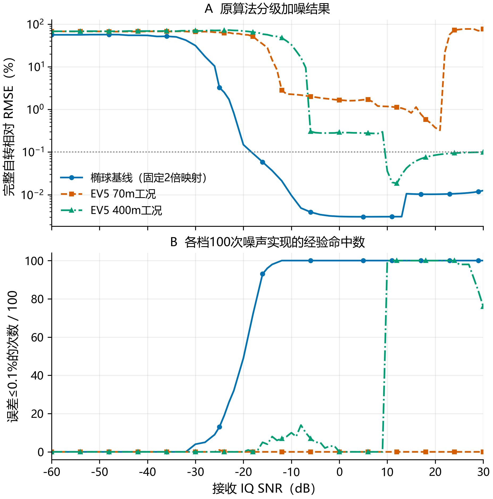
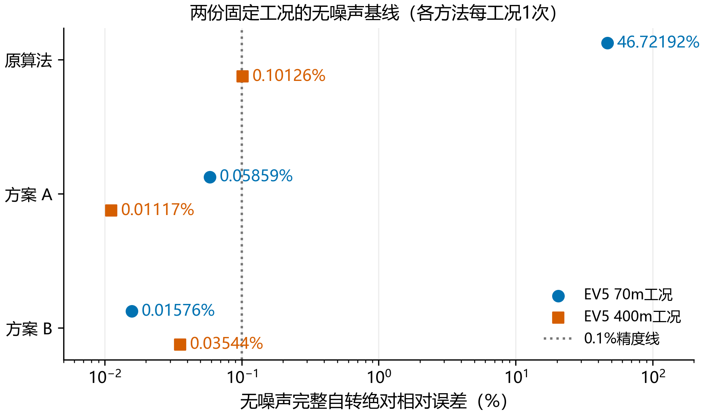
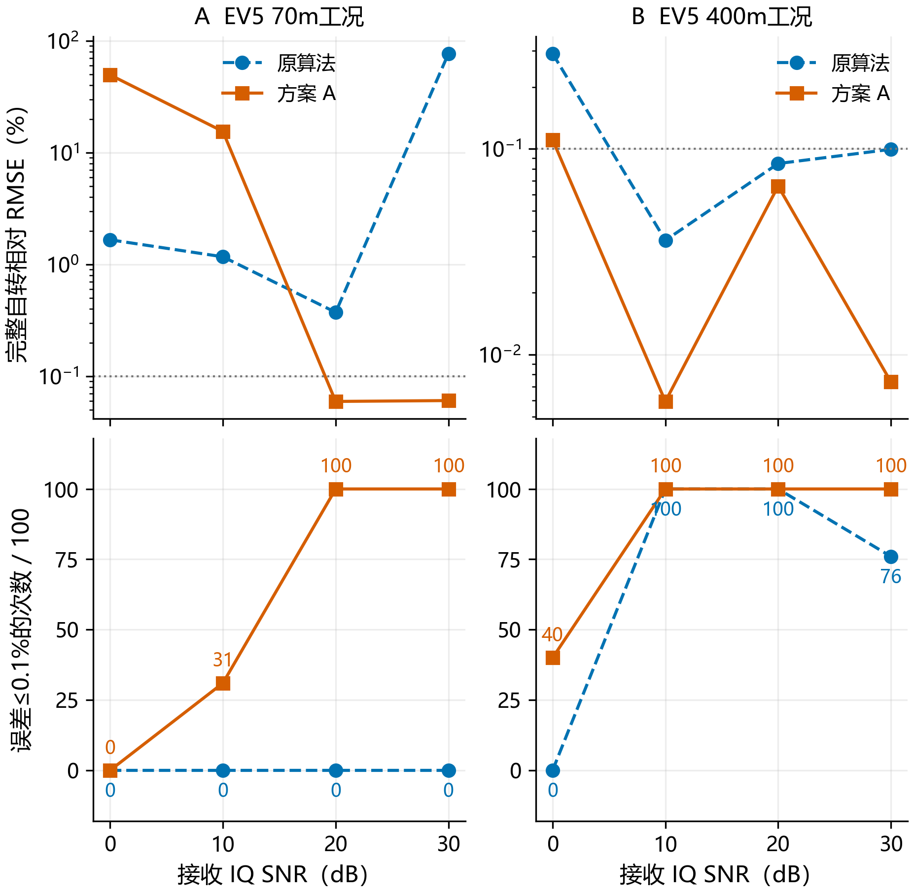
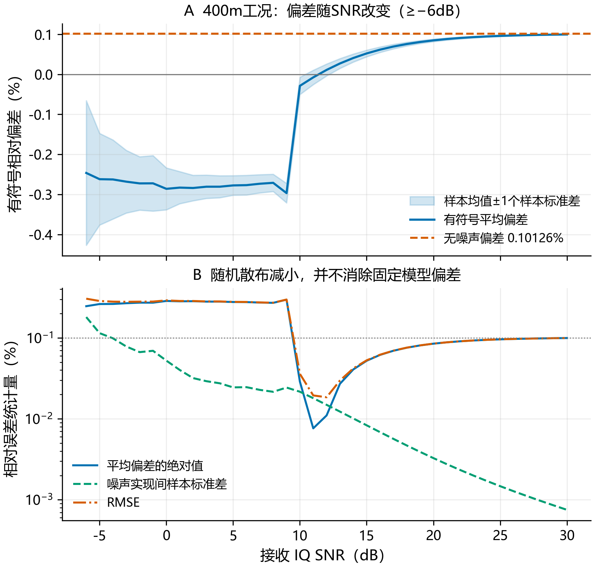

# 小行星雷达自转周期反演阶段实验报告

整理日期：2026年10月24日；2026年10月30日按工作线拆分范围。本文覆盖4.3完整仿真链路、基线噪声实验和4.4的A/B精度方法接入，汇总既有冻结结果及配图，不表示本次重新运行回波仿真或蒙特卡洛实验。完整历史报告及其Word版保存在研究分支，位置见[归档记录](../../logs/2026-10-30_LOG.md#short-arc-branch-split)。

## 摘要

项目已实现观测几何解算、Chirp回波仿真、脉冲压缩、相干处理区间内的特征提取和自转周期反演。原方法以五项特征的单谐波拟合及整Run留出预测评分选周期：在对称椭球上能够稳定恢复特征重复周期，但在70m EV5工况中出现无噪错峰，在400m EV5工况中存在约0.1%的高信噪比偏差。改进方案A采用多谐波正预测增益平方融合，方案B采用已知极轴下的有限球面响应，两者均复用现有信号数据，不要求ISAR图像或形状反演。

两份无噪EV5输入上，方案A将完整自转周期误差分别从46.72%和0.10126%降低至约0.05859%和0.01117%；方案B分别达到约0.01576%和0.03545%。方案A在70m低SNR仍有显著退化，400m误差仍不随SNR单调下降。跨目标鲁棒性、最终误差区间和实测校准尚未建立。

阶段结论是：原有约0.1%的平台并非已证明的物理极限，修改响应模型与评分能降低固定工况中的偏差；现有证据仍不足以宣称任意目标、任意SNR或未知几何条件下均能准确反演。后续优先比较充分观测条件下的精度、鲁棒性、先验与运行成本，再开展实测精度验收。

## 1 研究目标与评价对象

本研究关注在离散Run、非均匀长时观测和接收噪声条件下，能否从雷达回波中估计目标完整自转周期，以及如何判断结果是否可信。输入数据由仿真生成；采用真实形状模型、目标名义参数和JPL星历，不等同于取得真实雷达测量数据。

必须区分三个量：完整自转周期$P_{\mathrm{rot}}$、某项观测特征的重复周期$P_{\mathrm{feat}}$及算法返回的候选周期$\widehat P$。对具有半转对称性的目标，可能有$P_{\mathrm{feat}}=P_{\mathrm{rot}}/2$；几何变化还会使特征偏离严格平稳周期。除椭球试验预声明的半周期评价外，EV5均直接对完整自转真值计算误差，不根据真值事后乘2或挑选次峰。

本文所称“原算法”是产生本批分级加噪结果的4.3 `predictive_joint`共同预测融合方法，不是更早的`legacy_consensus`候选投票。4.4保留原默认，新增A/B为显式选项。工程移植一致、固定输入测量准确及实测覆盖率有效，是三个不同的验收目标。

## 2 信号与观测模型

### 2.1 旋转目标与双站传播

令$t$为物理时间，$\mathbf x_C(t)$为目标质心位置，$\boldsymbol\rho_j$为体固坐标中第$j$个面元质心，$R(t)$为由名义极轴、初相位和周期决定的旋转矩阵。面元位置写为

$$
\mathbf x_j(t)=\mathbf x_C(t)+R(t)\boldsymbol\rho_j,
\qquad \theta(t)=\theta_0+\frac{2\pi(t-t_0)}{P_{\mathrm{rot}}}.
$$

发射、散射和接收分别发生在$t_T,t_S,t_R$。以$\mathbf x_T,\mathbf x_R$表示收发站位置，$c$表示光速，传播时间满足

$$
t_S-t_T=\frac{\|\mathbf x_j(t_S)-\mathbf x_T(t_T)\|}{c},
\qquad
t_R-t_S=\frac{\|\mathbf x_R(t_R)-\mathbf x_j(t_S)\|}{c}.
$$

这些关系说明不能把发射时刻、接收时刻和目标散射时刻混为一谈。本批周期反演采用散射质心特征时标。生成器以质心光行时和记录的几何为基础，结合面元差分路径及所选脉内运动近似求回波；它不是每个采样点都独立求解任意电磁散射的精确Maxwell模型。

### 2.2 Chirp复包络与离散回波

设脉宽为$T_p$、Chirp带宽为$B_c$、载频为$f_c$，中心化基带约定下的单脉冲复包络可写为

$$
u(\xi)=A_0\,\mathbf 1_{[0,T_p)}(\xi)
\exp\!\left\{\mathrm i\pi\frac{B_c}{T_p}\left(\xi-\frac{T_p}{2}\right)^2\right\}.
$$

记$t_p$为第$p$个脉冲的发射参考时刻，$\tau_{pj}(t)$为它经面元$j$到达接收端的传播延迟，$a_{pj}(t)$为面元复振幅。未补偿的回波结构为

$$
s(t)=\sum_p\sum_j a_{pj}(t)\,
u\!\left(t-t_p-\tau_{pj}(t)\right)
\exp\!\left[-\mathrm i2\pi f_c\tau_{pj}(t)\right],
\qquad y(t)=s(t)+n(t).
$$

实际实现以质心三事件几何为基础，采用远场一阶面元差分路径。令$\mathbf u_T,\mathbf u_R$为从测站指向目标的单位视线，$L_0$为质心总路径，则$\Delta L_j=(\mathbf u_T+\mathbf u_R)^\mathsf T R(t_S)\boldsymbol\rho_j$，$L_j\simeq L_0+\Delta L_j$。配置`centroid_compensated`去除公共质心路径相位和公共包络运动项，保留$\Delta L_j$对应的残余相位与时延；不能把这种理想参考转换解释为实测补偿已校准。两份EV5使用`per_pulse_linear`，在每个脉冲内线性推进质心散射时刻和公共路径。

设$S_j,\rho_j,\mathbf n_j$分别为面元面积、散射系数及体固法线，$p_T,p_R$为角度指数，当前归一化面元振幅为

$$
a_j=\frac{S_j\rho_j}{\sum_k S_k}
\left[\max(0,-\mathbf u_T^\mathsf T R\mathbf n_j)\right]^{p_T}
\left[\max(0,-\mathbf u_R^\mathsf T R\mathbf n_j)\right]^{p_R}.
$$

本批$p_T=p_R=1$，散射斑点关闭。面积权重已经归一化，代码未建立绝对雷达方程，因此目标变大不意味着本仿真中的绝对接收能量必然按面积增大；相对路径、相位干涉和谱形仍会变化。当前面元质心离散散射尚无连续表面积分收敛保证，自遮挡、多次散射、材料极化与真实仪器响应也未被本批实验完整建模和标定。

每个Run以唯一全局ADC整数索引建立物理采样时刻，在同一时刻求和所有可能到达的脉冲贡献，然后映射成保存的二维`[pulse, fast_time]`行。二维行是数据视图，不能据其形状假定接收机逐行开关。保存行共享样点与真实脉冲回波叠加是不同问题；本批精度与加噪合同要求保存样点无共享索引，不将这些结果推广到重叠输入。

### 2.3 接收噪声及SNR定义

令$\mathcal Q$为所有唯一、有效、已保存ADC样点的集合，干净信号平均功率为$P_s$。设复噪声$\mathbb E|n_q|^2=\sigma_n^2$，其定义为

$$
P_s=\frac{1}{|\mathcal Q|}\sum_{q\in\mathcal Q}|s_q|^2,
\qquad \mathrm{SNR}_{\mathrm{dB}}=10\log_{10}\frac{P_s}{\sigma_n^2}.
$$

实部和虚部分别服从独立的$\mathcal N(0,\sigma_n^2/2)$。噪声加入接收IQ，再经过完整前端与非线性特征提取；不是直接向五项特征叠加独立白噪声。SNR是上述样点集合上的接收端定义，不是脉压后SNR、特征域SNR，亦不是包括未保存空档的整个Run连续ADC窗平均SNR。每次随机噪声不重新归一化；同trial跨SNR复用单位噪声，以形成配对比较。

### 2.4 从IQ到五项观测特征

前端完成匹配滤波、距离／相位参考对齐，并在每个相干处理区间CPI中处理多脉冲慢时间序列。各Run之间不拼成一条跨夜相干IQ；周期搜索使用各CPI的真实时标。令$G_i(\tau)$为CPI $i$的时延功率轮廓，$S_i(f)$为采用全频率谱矩得到的多普勒功率谱。五项观测量的含义如下；距离特征原始单位为秒，单站情况下可乘$c/2$转换成距离。

| 特征 | 数学含义 | 主要敏感因素 |
| --- | --- | --- |
| 总功率 | $E_i=\sum_\tau G_i(\tau)$，保留前端约定的DFT倍率 | 相干叠加、可见面权重、噪声底；不是标定焦耳能量 |
| 距离质心 | $\bar\tau_i=\sum_\tau\tau G_i(\tau)/\sum_\tau G_i(\tau)$ | 亮度分布与距离参考，不是刚体质量质心 |
| 距离90%能量宽度 | $W_{90}=\tau_{95}-\tau_5$，累计功率首次达到95%和5%的离散时延差 | 投影形状、脉压响应、噪声及边界；不是最短90%区间 |
| 多普勒质心 | $\bar f_i=\sum_f fS_i(f)/\sum_f S_i(f)$ | 残余平动与散射速度分布 |
| 多普勒RMS带宽 | $B_{\mathrm{rms},i}=\sqrt{\sum_f(f-\bar f_i)^2S_i(f)/\sum_fS_i(f)}$ | 旋转速度、窗谱、谱尾及噪声 |

这五项量来自同一IQ，通常相关；500个重叠CPI也不等于500个独立样本。距离宽度和RMS带宽均不是单纯几何尺度。以直径$d$的理想球形目标、单站观测和赤道外视角$\delta$为例，旋转支撑带宽近似满足$B_{\mathrm{rot}}=4\pi d\cos\delta/(\lambda P_{\mathrm{rot}})$，其中$\lambda=c/f_c$；它不能直接代替上述RMS谱矩，也不能在未知$d$与$\delta$时唯一解出周期。

## 3 实验配置与统计协议

### 3.1 三组工况不能视作纯直径扫描

下表保留历史工况名称，但纠正尺寸口径。原“70m椭球”的70m是长半轴；70m EV5的70m是最大笛卡尔尺寸；400m EV5的400m是体积等效直径。EV5网格经均匀密度质心平移，400m副本由同一输入网格缩放得到，均保留3996个三角面元。[网格来源与尺度记录](../../../../../assets/ev5_snr_20261016/provenance.json)

| 项目 | 椭球基线 | 70m EV5工况 | 400m EV5工况 |
| --- | --- | --- | --- |
| 尺度口径 | 全尺寸140×100×80m | 最大尺寸70m；等效直径61.927m | 等效直径400m；最大尺寸452.142m |
| 完整自转周期 | 10800s | 10800s，控制实验指定值 | 13410s，即3.725h名义值 |
| 主要评价周期 | 5400s特征重复周期 | 10800s完整自转 | 13410s完整自转 |
| 轨道／时段 | Apophis几何，2029年4月 | 复用同一Apophis观测计划 | EV5几何，2039年12月26—30日 |
| Run数量与调度时长 | 100×2s | 100×2s | 100×16s |
| PRF／脉宽 | 100Hz／50μs | 100Hz／50μs | 20Hz／10μs |
| 脉冲总数 | 20000 | 20000 | 32000 |
| CPI名义时长／步长 | 1s／0.25s | 1s／0.25s | 8s／2s |
| CPI数量 | 500 | 500 | 500 |
| 原算法LOS补偿 | 关闭 | 关闭 | 开启，显式给定名义极轴 |
| 周期搜索域／基础频率格数 | 1800—14400s／4000 | 同左 | 1800—28800s／8000 |

三组共用载频1GHz、采样率200MHz、Chirp带宽150MHz。70m与400m EV5还改变了周期、观测几何、跨度、PRF、CPI和LOS先验，因此结果差异不能唯一归因于尺寸。两份EV5特征时刻总跨度分别约119712.785s和345542.543s，即11.0845与25.7675个自转周期；这是首末特征时刻之差，不是累计发射时长。

Run调度时长也不等于射频连续开启时间。例如400m每Run发射320个10μs脉冲，累计射频开启时间为3.2ms；160个慢时间采样点的首末跨度为$(160-1)/20=7.95$s，虽配置CPI名义时长为8s，二者不应混用。

400m工况使用EV5的文献名义参数，极轴为赤经105°、赤纬−66°。Busch等给出400±50m、3.725±0.001h及相应极轴，但其周期约束主要来自光变，不能将该文献误差当成本项目雷达反演的误差条。本文也未把形状、极轴或真实周期的不确定度随机注入AWGN重复。[Busch等，2011，第652页§2.3及第655页表2](https://echo.jpl.nasa.gov/asteroids/2008EV5/busch.etal.2011.2008ev5.pdf)

### 3.2 噪声重复与指标

椭球扩扫共62个SNR点、每点100次，共6200条；范围−60至30dB，低SNR主要按2dB取点并补边界，高SNR为1dB。两份EV5均在−60至30dB逐1dB扫描，每点100次，各9100条。方案A后续比较复用两场景0、10、20、30dB各100份特征，共800份输入，不是新增800份独立物理场景。B的带噪验证仅有400m trial0的三个SNR诊断点。

设第$k$次估计为$\widehat P_k$、评价真值为$P_0$、每档重复数为$K=100$，相对误差及RMSE为

$$
e_k=\frac{\widehat P_k-P_0}{P_0},
\qquad \mathrm{RMSE}_{\mathrm{rel}}=\sqrt{\frac1K\sum_{k=1}^K e_k^2},
\qquad \widehat p_\eta=\frac1K\sum_{k=1}^K\mathbf1(|e_k|\le\eta).
$$

所有远处错峰均计入RMSE，不能只统计正确峰附近的试次。经验门槛定义为某个已扫描SNR点及全部更高已扫描点均至少95/100次满足指定精度；它不是对连续SNR或未知工况的保证，也不是总体成功概率的置信下限。各试验固定形状、几何与前端模型；接收噪声重复不覆盖这些系统项。

## 4 原共同预测融合算法

### 4.1 单特征拟合与共同评分

记$y_{ic}$为时刻$t_i$的第$c$项特征，$o_i$为可选几何相位修正。对候选频率$f=1/P$，原批次采用$H=1$，拟合

$$
m_c(t_i;f)=\beta_{c0}+\beta_{c1}\cos\psi_i+\beta_{c2}\sin\psi_i,
\qquad \psi_i=2\pi ft_i+o_i.
$$

独立通道周期图采用带浮动均值的加权正弦最小二乘思想。GLS是其统计基础；后续跨特征留出评分属于本项目的组合方法，不能把GLS文献的显著性公式直接当作本项目融合结果的可信概率。[Zechmeister与Kürster，2009，§2—3](https://arxiv.org/html/0901.2573)

在本批100Run条件下，按Run时间顺序交错分为五折，同一Run内的CPI始终同时进入训练或留出集。训练时拟合系数，并以训练数据的带权均值作常数预测基线。设留出平方误差累计为$E_c(P)$，训练均值基线误差累计为$D_c$，通道分数和融合目标为

$$
s_c(P)=1-\frac{E_c(P)}{D_c},
\qquad J_{\mathrm{old}}(P)=\operatorname{median}_{c=1,\ldots,5}s_c(P),
\qquad \widehat P=\operatorname*{argmax}_P J_{\mathrm{old}}(P).
$$

正分表示对留出数据优于训练均值，负分表示更差。算法在完整配置频率网格上评价共同目标，并细化全部网格局部峰及端点；不只搜索某个单特征的最高峰。输出`candidate`、`ambiguous`等是内部诊断状态，不能当成正确性认证。交错Run留出控制了局部过拟合，但不等于独立日期、独立形状或独立几何验证。

### 4.2 原方法的主要局限

首先，H1不能充分表达不规则目标的多谐波响应；不同特征可由不同谐波主导。其次，中位数融合随SNR可能切换决定目标的通道，使最优点不连续移动。再次，LOS经度相位补偿不能消除方面角变化和一般双站散射变化。最后，有限观测窗口会产生旁峰：将数值优化做得更精细，并不能保证错误目标函数的最优点接近物理真值。

## 5 原算法的分级加噪结果

### 5.1 总体曲线与无噪基线

图1 原算法的分级接收IQ加噪结果。各点均为同档100次，曲线保留非单调变化及错峰尾部。椭球使用预声明的5400s重复周期；若按该对称性先验同时将估计和真值乘2，相对误差不变，这不是算法自动识别完整周期。两份EV5直接按完整自转评价。三组工况参数不同，不能把曲线差异视为纯尺寸效应。

| 工况 | 无噪估计周期(s) | 评价真值(s) | 绝对相对误差 |
| --- | ---: | ---: | ---: |
| 椭球重复周期 | 5399.833177 | 5400 | 约0.00309% |
| 70m EV5完整自转 | 5754.032520 | 10800 | 46.72192% |
| 400m EV5完整自转 | 13423.578975 | 13410 | 0.101260% |

椭球扫描中，≤10%、≤1%、≤0.1%的经验持续达标最低扫描点分别为−25、−22、−15dB。70m EV5三个等级均没有持续高SNR达标门槛；400m EV5的≤10%和≤1%门槛均为−7dB，但≤0.1%没有取得门槛。400m在−7dB仍有两次大误差，RMSE约9.45%，不能把98/100次≤1%误写成“平均误差≤1%”。

### 5.2 EV5代表档位

| SNR(dB) | 70m RMSE(%) | 70m ≤0.1%次数 | 400m RMSE(%) | 400m ≤0.1%次数 |
| ---: | ---: | ---: | ---: | ---: |
| −30 | 66.557192 | 0/100 | 70.114874 | 0/100 |
| −20 | 56.636664 | 0/100 | 68.704439 | 0/100 |
| −10 | 2.266968 | 0/100 | 32.933917 | 10/100 |
| 0 | 1.665063 | 0/100 | 0.290604 | 0/100 |
| 10 | 1.172735 | 0/100 | 0.035941 | 100/100 |
| 20 | 0.373911 | 0/100 | 0.084888 | 100/100 |
| 30 | 77.002772 | 0/100 | 0.099567 | 76/100 |

70m在部分中等SNR档能靠近完整周期，但30dB及无噪均失败，不能把一个有限好区间称为最低SNR要求。400m在整数10—27dB达到至少95/100次≤0.1%，28—30dB又下降；30dB的RMSE虽略低于0.1%，仍有24次超过0.1%。RMSE、单次误差、分位数和成功率是不同指标。

### 5.3 70m错峰与400m高SNR偏差

70m无噪候选中，10851.487756s附近的峰已经找到，但评分0.033288低于5754.032520s的0.068825；因此主要问题不是“没有搜索到真周期附近”，而是当前表示与评分偏好错误候选。原椭球也有5743.268392s旁峰，两组共用的采样窗口在相应差频附近存在较强响应，支持窗口旁峰参与的解释；尚不能据此唯一确定全部误差来源或证明原IQ不可辨识。

400m在高SNR主要表现为同一候选分支内偏差。以原算法为例，10dB平均偏差约−3.860s、样本标准差2.900s；30dB平均偏差约+13.352s、标准差0.101s。随机分散缩小而偏差仍在，符合模型／特征／评分偏差主导的现象。噪声也会改变非线性特征的期望，偶然抵消无噪偏差，所以有限SNR可能比无噪更接近真值；这不是噪声提高信息量的证明。

0.1%不是已证明的物理渐近线。已有改进在同一输入上突破了该误差水平，足以否定“当前约0.1%平台不可改善”的说法；它并未证明可将总误差无限压低。

## 6 改进算法及其适用条件

### 6.1 方案A 多谐波正预测增益融合

方案A继续使用原500CPI、100Run和五项特征，不先按Run平均，不重生成IQ。设$g_i$为Run编号，$w_i$为CPI有效样本权重；将每个Run内权重归一化，避免采样量多的Run自动占据更大总权重：

$$
\widetilde w_i=\frac{w_i}{\sum_{j:g_j=g_i}w_j}.
$$

将单谐波扩展为$H\in\{1,2,4,8\}$，所有特征共享周期，但各自拥有截距和谐波系数：

$$
X_H(f)_{i,:}=[1,\cos\psi_i,\sin\psi_i,\ldots,\cos(H\psi_i),\sin(H\psi_i)],
\qquad y_{ic}\simeq X_H(f)_{i,:}\beta_c.
$$

按Run平均特征时刻排序、编号模5分折。设$V_k$为第$k$个留出折，$\widehat\beta_c^{(-k)}$与$\overline y_c^{(-k)}$分别为训练折拟合系数和带权均值，累计误差为

$$
E_c(f,H)=\sum_k\sum_{i\in V_k}\widetilde w_i
\left[y_{ic}-X_H(f)_{i,:}\widehat\beta_c^{(-k)}\right]^2,
$$

$$
D_c=\sum_k\sum_{i\in V_k}\widetilde w_i
\left[y_{ic}-\overline y_c^{(-k)}\right]^2.
$$

用正预测增益的平方和取代中位数，并用同一目标同时选择周期与阶数：

$$
s_c(f,H)=1-\frac{E_c(f,H)}{D_c},
\qquad J_A(f,H)=\sum_{c=1}^5[\max(s_c(f,H),0)]^2,
$$

$$
(\widehat f,\widehat H)=\operatorname*{argmax}_{f,H}J_A(f,H),
\qquad \widehat P=\frac1{\widehat f}.
$$

这允许少数预测能力较强的通道提供有效贡献，避免中位目标必须由居中通道决定；同时通过留出预测抑制单纯增加阶数造成的训练拟合收益。它仍是经验选择规则，不是概率、似然或无偏定理。多通道共频和有限Fourier模型有成熟统计基础，但本项目的正增益平方融合是针对当前数据研究确定的规则，不是文献已证明的雷达最优估计。[VanderPlas与Ivezić，2015，§IV—V](https://arxiv.org/html/1502.01344)

正式搜索采用完整频率范围、原网格间隔8等分，即$8(N_f-1)+1$点；每个H细化前三个局部峰及两个端点，保留格点与细化中的较优值。70m关闭LOS补偿，400m沿用原显式已知轴补偿。当前A至少需要10个有效Run，要求五特征完整有限、正权重及训练折可估；任一候选训练折数值秩不足会整体拒绝。这一拒绝规则在短窗实验中暴露了适用限制，尚未改变。

### 6.2 方案B 已知极轴下的有限球面响应

方案B让特征随体固观测方向变化，以表达单纯经度相位修正没有描述的方面角效应。它拟合响应函数，不输出三维形状，不需要ISAR图像。代价是需要反演端显式已知极轴，并且当前首版仅验证100Run×5CPI、近单站几何，最大收发夹角小于0.000155°。

令$\mathbf a$为已知单位极轴，$B=[\mathbf e_1,\mathbf e_2,\mathbf a]$为正交基，$\mathbf v_i=\operatorname{unit}(\boldsymbol\ell_{T,i}+\boldsymbol\ell_{R,i})$为有效方向。定义$z_i=(B^\mathsf T\mathbf v_i)_3$、方位角$\lambda_i=\operatorname{atan2}((B^\mathsf T\mathbf v_i)_2,(B^\mathsf T\mathbf v_i)_1)$及$\psi_i=2\pi f(t_i-\bar t)-\lambda_i$。除截距外，设计列采用

$$
\frac{N_{lm}P_l^m(z_i)}{l(l+1)}\cos(m\psi_i),
\qquad
\frac{N_{lm}P_l^m(z_i)}{l(l+1)}\sin(m\psi_i),
$$

$$
N_{lm}=\sqrt{(2l+1)\frac{(l-m)!}{(l+m)!}},
\quad l=1,\ldots,L,\quad m=0,\ldots,l.
$$

$P_l^m$为含Condon–Shortley相位的连带勒让德函数，$m=0$不设正弦列；本实现不额外加入$m>0$的$\sqrt2$因子。固定$L\in\{1,2,3,4,6\}$，每通道分别从$\alpha\in\{10^{-8},10^{-5},10^{-3},0.1,10\}$选择岭参数。内层目标是单位CPI权重的残差平方和加$\alpha\|\beta\|^2$，截距不惩罚。

设$S_\alpha$为含截距的线性拟合平滑矩阵。对Run组$g$，整组留出残差由组PRESS关系得到

$$
e_g^{(-g)}=(I-S_{\alpha,gg})^{-1}(y_g-\widehat y_g).
$$

各组残差除以该组之外训练数据的通道标准差，再累计平方损失；五通道损失均值决定周期和L。搜索采用原基础频率格，细化全部局部极小及端点，与A的8倍／前三峰协议不同。70m的B新增了已知轴先验，不能把B与无该先验的A称为完全同条件比较；400m二者均使用同一名义极轴。

## 7 改进效果与保留的失败

### 7.1 无噪周期误差

下表与图2采用4.4生产接入记录的A原`value`完整搜索与B最终完整搜索值；原法采用已冻结基线。A干净缓存完整搜索另行通过金值核对，但缓存与原`value`有微小重提取差异，不能把两者说成逐字节同一输入。小数位用于复现，不代表具有相同位数的物理精度。

| 工况 | 原算法周期(s) | A周期(s)／阶数 | B周期(s)／阶数 |
| --- | ---: | --- | --- |
| 70m EV5，真值10800s | 5754.032520 | 10806.327577／H2 | 10801.701662／L4 |
| 400m EV5，真值13410s | 13423.578975 | 13408.502626／H8 | 13405.246841／L6 |

| 工况 | 原算法误差(%) | A误差(%) | B误差(%) |
| --- | ---: | ---: | ---: |
| 70m EV5 | 46.72192 | 0.058589 | 0.015756 |
| 400m EV5 | 0.101260 | 0.011166 | 0.035445 |

图2 无噪完整周期误差。两种改进均降低原工况的误差，但方案B并非在两个工况都优于A；70m B还增加了已知轴先验。该图不能外推未知目标的总体精度，也不能表示系统误差已归零。

### 7.2 同一批800份输入的带噪配对比较

图3 方案A与原算法复用同一场景、SNR和trial的结果。每档100次，RMSE保留所有错峰；达标次数只描述本批经验结果。方案A没有覆盖原91档全SNR扫描，图中四档之间的连线仅帮助阅读。

| 工况／SNR | 原法RMSE(%) | A的RMSE(%) | A误差≤0.1% | A误差≤1% |
| --- | ---: | ---: | ---: | ---: |
| 70m／0dB | 1.665063 | 49.626920 | 0/100 | 0/100 |
| 70m／10dB | 1.172735 | 15.500409 | 31/100 | 96/100 |
| 70m／20dB | 0.373911 | 0.059679 | 100/100 | 100/100 |
| 70m／30dB | 77.002772 | 0.060756 | 100/100 | 100/100 |
| 400m／0dB | 0.290604 | 0.110714 | 40/100 | 100/100 |
| 400m／10dB | 0.035941 | 0.005924 | 100/100 | 100/100 |
| 400m／20dB | 0.084888 | 0.065946 | 100/100 | 100/100 |
| 400m／30dB | 0.099567 | 0.007372 | 100/100 | 100/100 |

70m的0dB全部100次绝对误差都比旧法大；10dB有96次改善，但trial 9、20、55、63跳到约2430s，四个约77.5%的错误主导RMSE。因此不能只报96/100次≤1%，也不能据已知真值事后制定SNR切换规则。20、30dB则明显改善。400m四档总体RMSE均降低，但10dB仍有9个trial比旧法差，不能称逐次全面占优。

方案B的400m trial0在10、20、30dB完整搜索误差分别约0.014920%、0.023910%、0.036109%；仅为三个诊断点，不构成每档100次成功率证据。不能将A的800份统计移交给B。

### 7.3 偏差和随机分散分别观察

图4 400m原算法在SNR≥−6dB区间的偏差细节，低SNR全范围保留在图1。阴影为100次估计的样本均值±1个样本标准差，不是置信区间；下图区分平均偏差绝对值、样本标准差与RMSE。图中无噪参考采用同一双精度噪声前端基线，与原生产值有微小数值差。方案A的四档配对统计列于下表，不在本图中。标准差描述接收噪声实现之间的分散，不是模型系统项的校准不确定度。

| SNR(dB) | 原法偏差(s) | 原法标准差(s) | A偏差(s) | A标准差(s) |
| ---: | ---: | ---: | ---: | ---: |
| 0 | −38.338730 | 7.021271 | −14.155139 | 4.501256 |
| 10 | −3.860244 | 2.900290 | +0.731459 | 0.311616 |
| 20 | +11.375100 | 0.438911 | +8.842618 | 0.117796 |
| 30 | +13.351621 | 0.100797 | −0.985126 | 0.083557 |

A在400m的0、10、20dB均选H4，30dB选H8。20dB仍有+8.84s偏差，而30dB转为约−0.99s，说明改进仍受非线性特征、模型选择与评分影响。平均CV融合对照在400m 20dB优于A，也进一步说明正增益平方并非所有噪声条件下的最优规则。

完整距离功率轮廓曾从原IQ提取并尝试替代五标量，但所试球面轮廓方法在70m仍选择约5399.72s半周；该路线没有作为统一替换。只扣噪声底不能修复无噪偏差，视线经度补偿也不足以表达全部几何变化。这些负结果应与成功结果一起保留。

### 7.4 生产实现核对

4.4已接入A/B数值组件、CLI、结果保存和GUI显式选项，旧默认保留。A的800份冻结输入完成同数学批量全搜索回归，并用生产CPU SVD逐胜点评分核对；这不是800次直接调用生产完整搜索，也不是800次全部达到测量精度。2026年10月24日独立审查的相关组合为65项通过、4项跳过，另外两份A生产完整金值搜索均通过。

审查仍发现误差页把“尚未实现重采样”显示为“观测不足或不可识别”，并将缺失统计显示为0。该缺陷不改变周期值，但会误导可信度判断；截至本报告整理时尚未修复。A/B当前不提供已校准的最终误差区间。工程细节见[独立审查专题](../../changes/EV5_PRECISION_IMPLEMENTATION.md#independent-review-20261024)。

## 8 适用范围与未完成项

当前结果只支持两份固定EV5输入上的改善。A在70m低SNR有错峰，B带噪验证有限；未知轴、独立目标、最终区间覆盖和实测校准仍未完成。默认算法继续保留，A/B作为显式选项，不按真值自动切换。后续实验须同时报告精度、失败率、先验与耗时。

## 附录 证据来源与复现索引

本报告的图表由冻结记录重算统计，不增加实验样本量。文献用于说明参数来源与统计结构，不提供本项目的外部精度认证；核心数值以仓库原始结果为依据。

| 证据 | 支持内容 | 入口 |
| --- | --- | --- |
| E1 接收IQ分级加噪 | 原算法三组工况、逐次周期和SNR门槛 | [原实验专题](../../../../4.3/vs_4.2/experiments/reports/2026-10-16_RECEIVER_SNR_AND_EV5.md) |
| E2 改进研究冻结结果 | A/B无噪、配对噪声、失败与对照 | [2400行配对CSV](../../../../4.3/vs_4.2/experiments/data/2026-10-20_EV5_PRECISION_NOISE.csv)；[研究结果与源码](../../../../4.3/vs_4.2/experiments/data/2026-10-20_EV5_PRECISION_MODELS.json) |
| E3 生产移植及独立审查 | 当前A/B实现、金值、工程回归和未修缺陷 | [接入与审查](../../changes/EV5_PRECISION_IMPLEMENTATION.md) |
| E5 配置与模型尺度 | 时序、RF、CPI、极轴、尺寸定义 | [70m配置](../../../../4.3/vs_4.2/experiments/configs/2026-10-16_EV5_70M.json)；[400m配置](../../../../4.3/vs_4.2/experiments/configs/2026-10-16_EV5_400M_LONG_CPI.json)；[网格尺度](../../../../../assets/ev5_snr_20261016/provenance.json) |
| E6 本报告图表 | 原始输入哈希、汇总统计、制图源码 | [报告制图与生成清单](../data/2026-10-24_STAGE_REPORT_MANIFEST.json) |

主要外部依据：Busch等，2011，Icarus 212，649–660，DOI 10.1016/j.icarus.2011.01.013，参数表及§2.3；Zechmeister与Kürster，2009，DOI 10.1051/0004-6361:200811296，GLS加权浮动均值模型；VanderPlas与Ivezić，2015，DOI 10.1088/0004-637X/812/1/18，多通道共频、有限Fourier与正则化；NIST线性最小二乘模型与残差自由度说明。正文链接指向已核对的一手来源。
