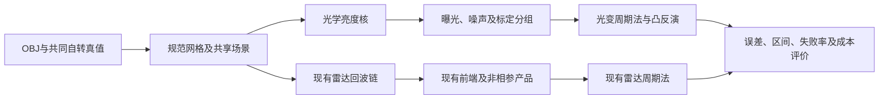

# 同目标光学／雷达周期测量对照与项目改造计划书

制定日期：2026-10-29；更新日期：2026-10-30，北京时间。状态：核心源码、手册与三篇原始方法论文已检查；适配器、配对数据集和精度对照待实施。本计划是同目标、同时间跨度对照的唯一方案正文；误差定义及既有实验见[精度研究](../../research/PERIOD_PRECISION_BENCHMARKS.md#uncertainty-status)，原文依据见[三篇方法论文核对](../../research/PERIOD_PRECISION_BENCHMARKS.md#original-paper-uncertainty)，实验通用要求见[实验设计与验收](../../../../EXPERIMENTS.md)。尚未生成配对科学仿真数据或运行光学反演，已停止的大规模作业不自动恢复。

接手入口为[第十节实施合同](#implementation-handoff)：冻结首版算法、数据文件、起始配置、区间计算和完成条件。该节中的新增模块、配置与命令均为待实现接口，不是已经可运行的软件；接手者需同时访问本仓库与第二节两个外部核心目录，按阶段实现并验证，无需恢复此前聊天。科学对照允许得到雷达不占优、多解或覆盖不足的结果。

## 一、结论与研究目标

**已有代码足以提供光变合成的数值核心，值得接入本项目；目前还不是把任意 OBJ 文件直接交给一个可执行程序就能完成公平对照。** 对凸形状可复用 `convexinv/lcgenerator`；对非凸三角网格可复用 ADAM 的直接亮度核，但需要适配入口、核对遮挡近似并验证网格收敛。合成已知形状的亮度只做正演，不需要运行 ADAM 的形状优化，更不需要先实现 NeuS。雷达侧继续使用本项目的回波及非相参处理链。

本计划首先回答：相同目标、相同观测窗口与可比先验下，现有雷达周期估计器相对成熟光学方法的真值误差和不确定度分别如何。以窗口长度为自变量，在均超过一转的若干窗口中横向比较两类方法，纵向检验各自表现随窗口的变化；不预设误差单调下降。只有较短窗口的雷达优势及两类方法随窗口延长而改善的趋势均获得支持，才追加达到共同精度目标所需窗口的比较。该追加比较可以没有共同可达目标，不能预先假定两种方法存在相同误差的窗口。

OBJ 只给出几何，不能唯一决定光变或雷达回波。用户层可实现“选择一个 OBJ，再使用项目中的共同自转与观测配置”，由两条分支自动生成数据；物理层还必须给出尺寸、完整初始姿态、周期、历元、太阳／观测者／雷达站方向、散射与仪器参数。共同真值只给生成器及评价器，反演端获得预先声明的先验。

<a id="source-readiness"></a>

## 二、核心代码的可用性与接入边界

检查对象为 `D:/Documents/Projects/convexinv` 和 `D:/Documents/Projects/ADAM` 的核心源码及随附手册。下表为源码能力审查，不是本机端到端运行验收。

| 模块 | 可以复用的能力 | 接入前必须处理的事项 |
| --- | --- | --- |
| convexinv 的 `lcgenerator` | 给定三角网格、自转、太阳／观测者方向，计算 LS＋Lambert 混合散射及相位函数的盘积分亮度 | 原生形状文件不是 OBJ；不计算面间遮挡，只适用于凸体；外层补曝光与噪声 |
| ADAM 的 `calculate_lcurve` | 直接计算三角网格亮度，含散射、相位函数、反照率选项及太阳／观察遮挡判断 | 写薄封装，分配其要求的导数缓冲；核对单位、全局选项、内存及遮挡近似 |
| ADAM 的 `lcgen.c` | 展示独立生成器的调用意图 | 不作为可直接运行的入口：参数遍历越界、曲线清零表达式及当前函数签名存在问题，Makefile 也无此构建目标 |
| convexinv 的 `period_scan`＋`convexinv` | 成熟凸形状、自转轴及周期联合拟合，可作主要物理反演基线 | 原扫描是多个初始周期的联合优化，周期会继续变化；需充分多初值搜索，不能解释成固定周期的似然剖面 |
| ADAM 的形状／自转优化 | 可作为非凸联合反演的补充基线 | 是否启用、模型复杂度及计算预算由前向验证和凸反演先导结果决定；不要求先完成高分辨率形状重建 |
| ADAM 的 `Calculate_Range_Doppler` | 生成延迟—多普勒强度图像的 Fourier 系数 | 不是发射 Chirp 后的接收载波 IQ；其复数相位不能作为本项目相干传播相位，当前阶段不替换雷达回波生成器 |

### 2.1 convexinv 光变生成器

命令格式为 `lcgenerator [-v] input_parameters shape output_lcs`，通过标准输入提供时间及几何表。形状文件依次写顶点数／三角面数、顶点坐标、1 基三角面索引。参数包括黄道极点经纬度、小时周期、零相位 JD、初相位、相位函数和 Lambert 系数。每个观测点包含 JD、亮度占位值、目标指向太阳的向量和目标指向观测者的向量；方向被单位化，核心不计算距离衰减，也不执行光行时修正。[源码](D:/Documents/Projects/convexinv/lcgenerator/lcgenerator.c)、[光变生成手册](D:/Documents/Projects/convexinv/lcgenerator_doc.pdf)第1—2页、[反演手册](D:/Documents/Projects/convexinv/convexinv_doc.pdf)第1—2页。

`bright_direct.c` 第62—68行只判断面法向与两方向的夹角，没有面间遮挡。因而可以让双方使用同一非对称凸模型做首阶段控制；不能给光学使用 EV5 的凸包、给雷达使用原始非凸 EV5，却把结果称为同目标比较。非凸输入即使能运行，也不能据此认为正演已经正确。[散射核心](D:/Documents/Projects/convexinv/lcgenerator/bright_direct.c)。

当前实现上限包括每块1000点、总计10000点、100个曲线块和10000个三角面；这是数组上限，不是反演所需的最低数据量。超过上限应拒绝输入或在单独验证的适配版本中处理，不能用任意拆分相对光变规避限制。亮度输出 `%f` 只有小数点后六位；周期扫描输出 `%f` 小时的格式步长为3.6毫秒，`convexinv -p` 参数文件八位小数小时的步长为36微秒。这些是输出量化，不是算法不确定度。精密实验需保留足够有效数字并测定 I/O 误差。[常量定义](D:/Documents/Projects/convexinv/lcgenerator/constants.h)、[周期扫描](D:/Documents/Projects/convexinv/convexinv/period_scan.c)、[参数输出](D:/Documents/Projects/convexinv/convexinv/convexinv.c)。

### 2.2 ADAM 的直接亮度核

优先封装 `calculate_lcurve.c` 的 `calculate_lcurve`，只导出 `bright`。`calculate_lcs.c` 第109行输出的是带权 `data−model` 残差，且依赖全局权重，不能直接当亮度生成器。直接亮度核也会访问导数数组，因此封装仍须按接口分配并初始化有效缓冲；若另设纯前向实现，必须证明与该核在合法输入上相符。[亮度核](D:/Documents/Projects/ADAM/calculate_lcurve.c)、[残差接口](D:/Documents/Projects/ADAM/calculate_lcs.c)。

ADAM 默认光散射为 Lambert 系数0.1的 LS＋Lambert 混合，可选 Hapke；相位和反照率参数须显式冻结。`FindActualBlockers.c` 从面片质心判断整片是否被遮挡，并非精确积分部分遮挡面积，且分配面数平方级缓存。因此非凸高面数 OBJ 需要分辨率／资源控制和遮挡收敛验证。这里的“可复用”不表示任意网格均可直接高精度运行。[遮挡实现](D:/Documents/Projects/ADAM/FindActualBlockers.c)。

生产光变读入在 `utils.c` 第304行的 `read_lcurve`，支持区分 calibrated 与 relative；`INI_LC_ARE_RELATIVE` 可覆盖文件标志。目录中的 `read_lcurve.c` 是另一条测试路径，不能据它推断主程序只支持相对光度。`utils.c` 第1646行的 OBJ 读取只覆盖简单连续 `v`／整数三角 `f`，并有固定缓冲，不适合作为通用 OBJ 前端。应统一解析 OBJ 后直接传规范数组或输出其数字网格格式。[生产工具函数](D:/Documents/Projects/ADAM/utils.c)。

`lcgen.c` 第66行使用 `argcount<=argc`；第111—113行有错误的 `LC-nobs[j]`、曲线循环及旧接口调用，不能作为成品入口。本次唯一语法编译探测先停在 `utils.h` 缺少 `cblas.h`，没有生成可执行文件；上述逻辑问题来自源码检查，不能写成已经运行复现。后续可在工作区建立隔离封装及构建，记录依赖和来源，不修改用户提供的外部核心。[入口源码](D:/Documents/Projects/ADAM/lcgen.c)、[构建文件](D:/Documents/Projects/ADAM/Makefile)。

### 2.3 雷达分支及物理作用域

ADAM 的雷达路径先把面片映射到延迟—多普勒坐标，再计算二维 Fourier 系数；`Calculate_Range_Doppler.c` 第568行的复相位表示图像平移，`process_rd_images.c` 第121行对输入强度图像做 FFT。它不包含本项目的 Chirp、连续 ADC 时间轴、脉冲列及积累链，不能替代原始回波仿真。[图像正演](D:/Documents/Projects/ADAM/Calculate_Range_Doppler.c)、[图像预处理](D:/Documents/Projects/ADAM/process_rd_images.c)。

本项目 Chirp 核以面片面积、散射系数及收发朝向权重叠加回波；该路径未实现 ADAM 式面间射线遮挡。因此同一个非凸网格仅保证几何真值相同，不代表两种模拟器都具备同等完备的物理模型。第一阶段采用凸体，非凸阶段需单列遮挡／散射近似并量化对周期的影响，之后才决定是否扩展雷达可见性。不得把光学的细致遮挡与雷达的简化响应混成“物理准确度已匹配”的证据。[当前 Chirp 核](../../../../echo/src/echo.py)。

<a id="matched-optical-radar-benchmark"></a>

## 三、项目架构与数据契约



### 3.1 共享场景

复用 [SurfaceMesh](../../../../echo/src/mesh.py)、[Spin](../../../../echo/src/motion.py) 和 [ObservationInfo](../../../../echo/src/geometry.py)，新增独立的场景导出与光学适配模块，先提供 CLI。三个现有 GUI 阶段继续承担观测、回波与反演职责，光学对照入口在 CLI 稳定后再评估；本计划不要求切换到 ROAIS 图像或 NeuS。

受控时间对应采用“一个短雷达 Run 对应一次光学曝光／一个测光点”，其物理含义是相近时间段内的两类测量，而不是信息量相等。光学曝光在该段积分得到一个通量值；雷达 Run 可含脉冲列、距离和多普勒结构，具体保留什么由前端决定。多个光学曝光共同组成有真实标定关系的亮度序列。部分自转的片段仍可称光变片段，但不能据这一名称把一个 Run 当成独立幅度归一化单位。

短 Run 内外观变化小，不意味着没有径向速度信息；多普勒谱可对速度分布形成约束，但其周期价值还受形状、尺寸、极轴、散射及频谱分辨率影响。当前[反演 CPI 路径](../../../../inversion/src/inversion.py)已经使用多普勒质心与 RMS 带宽等摘要，不能说完全未用多普勒；是否因压缩摘要或经验响应损失关键约束，仍由同数据的后续诊断回答。

| 契约 | 必须记录及检查的内容 |
| --- | --- |
| 网格 | 原 OBJ 哈希、规范顶点／三角面哈希、米制尺度、闭合性、外法向、退化面、质心与体轴；任何三角化／简化／居中变换显式保存，两分支使用同一规范真值 |
| 自转 | 恒星周期秒值、惯性极轴、共同参考历元、完整初始姿态矩阵及初相位规范；不把同一组角度数字直接当作不同库中的相同姿态 |
| 坐标 | 本项目 ICRS 与光学核黄道约定之间的固定变换及参考系版本；用体上基向量在多个时刻的惯性方向核对完整姿态 |
| 时标 | 内部使用靠近观测时段的参考历元加双精度相对秒；文件 JD、小时、天的转换显式记录，规定 UTC／连续时间尺度与光行时处理，避免大 JD 相减或文本截断主导精度 |
| 几何 | 目标到太阳、目标到光学观测者，以及现有雷达收发站几何分别保存；检查向量符号，不能拿雷达发射站方向当太阳方向 |
| 资源 | 首末跨度、基础曝光／脉冲／积累窗、采样间隔、累计曝光、射频开启时间、接收 ADC 覆盖与独立观测组数分别报告 |
| 复现 | 代码／依赖／编译选项、完整配置、随机种子、后端及处理版本、原始输出、退出状态和耗时；临时文件放工作区 `tmp/` |

光学本体到黄道姿态采用手册的 `Rz(lambda) Ry(90−beta) Rz(phi)`；ADAM 内部使用余纬、弧度及 rad/day。本项目的体轴基底有自己的构造规则，适配验收必须比较完整旋转矩阵，不能只比极点。物理时刻以目标反射／散射事件为共同参考；传感器各自保存接收时刻，光学分支另补同一星历体系的太阳方向。

### 3.2 保留物理亮度后再形成观测

令 $A_j$ 为面片面积，$V_j(t)$ 为同时可见且被照明的面积比例，$\mu_j(t)$ 为观察方向与外法向夹角余弦的非负部分，$\mu_{0j}(t)$ 为太阳方向余弦的非负部分，$r_j$ 为指定散射辐亮度响应，$\alpha(t)$ 为相角，$K(t)$ 为距离和定标因子。盘积分亮度的物理形式为

$$
F(t)=K(t)\sum_j A_j V_j(t)\mu_j(t)r_j\!\left(\mu_{0j}(t),\mu_j(t),\alpha(t)\right).
$$

这里定义的是物理目标；各后端对 $V_j$ 的近似按第二节单列，不能由公式反推代码已实现精确部分遮挡。光学核的未归一化输出只是散射模型亮度，距离、望远镜光子转换及未知反照率尺度需外层声明；`calibrated` 也不自动意味着已知物理绝对通量或尺寸。

曝光以接收时刻 $u$ 定义，端点为 $u_i^-$、$u_i^+$，宽度 $\Delta t_i=u_i^+-u_i^-$；$t_s(u)$ 表示对应的目标反射时刻，$\epsilon_i$ 为声明模型的噪声，则

$$
y_i=\frac{1}{\Delta t_i}\int_{u_i^-}^{u_i^+}F\!\left(t_s(u)\right)\,\mathrm du+\epsilon_i.
$$

首轮允许固定几何和已知常量光行时作控制，曝光积分用足够子采样验证收敛。两种散射律可不同，但各自必须符合对应观测量；光学噪声采用下节明确定义的通量域方案。

**生成顺序固定为：未归一化亮度 → 曝光积分与仪器噪声 → 真实标定分组 → 反演输入。** `lcgenerator.c` 第245—248行及 ADAM `calculate_lcurve.c` 第410行都会将 relative 曲线逐块除以自身均值。分组由光度标定关系定义，不能按雷达 Run 拆成独立归一化块；单点块归一化后恒为1，无法保留该点相对其他历元的调制。需要分别测试共用未知整体尺度、真实跨段校准、每夜／每组独立未知零点。归一化后的噪声和相关性亦须随变换处理。

光学噪声先在不重叠的基础曝光上生成；若再构造重叠积累，必须从同一份基础数据聚合或使用等价联合噪声，不能给重叠窗各自独立加噪。雷达继续保留非相参积累、重叠 CPI 和共享 ADC 样点的相关性合同，重叠样点不重复计入资源。相关背景、散斑及标定误差是否包含须明示。

<a id="photometric-noise"></a>

### 3.3 光变单位与两级加噪方案

测光常以星等或差分星等展示，两个反演核使用线性亮度；Part II期刊43页明确其图中为 intensity 而非 magnitude。统一接口保存曝光平均通量、标准差／协方差、曝光端点和标定组，星等仅作为可选展示列。令 $F>0$ 为指定通带的通量，$F_{\mathrm{ref}}>0$ 为固定参考通量，$m_{\mathrm{ref}}$ 为其星等，则通常的 Pogson 星等为

$$
m-m_{\mathrm{ref}}=-2.5\log_{10}\!\left(\frac{F}{F_{\mathrm{ref}}}\right).
$$

在小相对误差、固定零点的条件下，对该变换作一阶传播得到

$$
\sigma_m\approx\left|\frac{\partial m}{\partial F}\right|\sigma_F
=\frac{2.5}{\ln 10}\frac{\sigma_F}{F}
\approx1.0857\frac{\sigma_F}{F}.
$$

例如单点1%通量标准差对应约0.01086等，0.01等对应约0.921%相对通量标准差；它们都是单点光度精度，不是周期精度。[SDSS测光标定说明](https://www.sdss2.org/dr4/algorithms/fluxcal.php)给出通量／星等转换与误差传播；[Newberry 1991](https://adsabs.harvard.edu/pdf/1991PASP..103..122N)期刊125页式(13)给出同一高信噪比关系。通量高斯噪声变换到星等后一般不再严格高斯；星等高斯噪声对应乘性、近似对数正态的通量噪声，两者不能无条件互换。

**首轮采用固定参考尺度的高斯通量控制。** 定义 $f_i=\overline F_i/F_{\mathrm{ref}}$ 为第 $i$ 次曝光平均通量的无量纲值，$r$ 为相对于该固定参考通量的噪声标准差比例，$z_i$ 为独立标准正态变量，生成

$$
y_i=f_i+r z_i,\qquad z_i\sim\mathcal N(0,1).
$$

建议先测 $r=0,0.003,0.01,0.03$ 的少量档位；这是受控实验设定，不宣称对应某一实际望远镜。$F_{\mathrm{ref}}$ 对同一目标／几何控制的各窗口固定，不能逐窗口、逐 Run 重选，否则噪声水平会随所截取的亮度段改变。上式为同方差加性通量模型，瞬时相对噪声为 $r/f_i$，并不等于处处固定相对噪声；第一阶段固定曝光参数。零噪声档检验偏差，不赋予它95%统计覆盖解释。较低信噪比或曝光改变时，转入计数模型，不能仅保持 $r$ 不变便声称模拟了实际仪器。

首轮参考值的选取规则为：在共同参考几何下，对无噪模型亮度按完整 $0$ 至 $2\pi$ 转角求均值，以独立角度求积检查收敛并冻结为 $F_{\mathrm{ref}}$；该值必须为正。参考几何的太阳／观察方向和距离随场景配置保存，对同一场景的窗口、起始相位及噪声重复不变。此操作只是生成器设置通量单位，不作为额外观测提供给反演器，也不向它提供真周期或真形状。最暗测点不满足高信噪比时，保留线性噪声合同，但撤销对数星等的一阶近似解释。

**仪器层在光电子数上生成噪声。** 将曝光后的目标信号换算成期望电子数 $S_i$，目标、天空背景和暗电流按 Poisson 统计生成，读出项按仪器标定的高斯模型加入，然后估计并扣除背景，最后换回通量。不能直接对 ADU 数值应用 Poisson，必须经电子／ADU增益转换。[Newberry 1991](https://adsabs.harvard.edu/pdf/1991PASP..103..122N)§2、期刊123—125页讨论了电子计数与背景扣除后的方差。

作为本项目的简化生成合同，设 $n_{\mathrm{ap}}$ 为测光孔径像素数，$q_i$ 为一次曝光每像素期望天空加暗电子数，$\sigma_R$ 为每像素每次读出的电子数标准差，$\widehat q_i$ 为独立背景区域估计的均值且方差为 $v_{q,i}$。先生成总电子读数 $X_i$，再得到净目标读数 $\widehat S_i$：

$$
X_i=N_i+R_i,\qquad N_i\sim\operatorname{Poisson}(S_i+n_{\mathrm{ap}}q_i),
\qquad R_i\sim\mathcal N(0,n_{\mathrm{ap}}\sigma_R^2),
\qquad \widehat S_i=X_i-n_{\mathrm{ap}}\widehat q_i.
$$

在各项独立且背景估计无偏的条件下，按方差相加有

$$
\operatorname{Var}(\widehat S_i)
=S_i+n_{\mathrm{ap}}q_i+n_{\mathrm{ap}}\sigma_R^2+n_{\mathrm{ap}}^2v_{q,i}.
$$

若背景由同曝光、独立且均匀的 $n_{\mathrm{sky}}$ 个背景像素求平均，则该简化模型给 $v_{q,i}=(q_i+\sigma_R^2)/n_{\mathrm{sky}}$。这是本文依据独立计数与读出噪声给出的生成模型，未包含平场、参考星、大气闪烁及校准帧误差；这些按应用另加，不能冒称完整观测误差预算。共同参考星或逐组零点误差应按组共享，不能逐点独立抽样替代；若每组星等零点偏移为 $\delta m_g$，则相应通量因子为 $10^{-0.4\delta m_g}$。真实通光率变化作用于期望电子数并改变计数方差；探测后的残余零点误差作用于提取通量及其误差，两者分别建模。

净通量可能为零或负数，此时通常的对数星等无定义，保留线性数据及其噪声，不能截为小正数或删除后仍宣称无选择偏差。若反演实现不支持该输入，显式记录适用范围或失败，不伪造星等。光学通量 SNR 与雷达接收 IQ 的功率 SNR 定义不同，分别扫描并报告物理资源，不用同一 dB 数字定义公平性；雷达高斯噪声仍加在接收 IQ，非相参功率的分布由前端自然传播，不能在积累功率上照搬同方差高斯假设。

## 四、比较哪些算法

| 基线 | 用途 | 公平性要求 |
| --- | --- | --- |
| 当前雷达默认及已实现 A/B | 衡量现有方法实际表现 | 固定代码、前端、模型选择和搜索规则；不能逐数据按真值挑选默认、A或B |
| 成熟加权多谐波光变周期法 | 必需的周期专用光学对手 | 选定可复现实现及版本，以公开示例或独立参考核对；不能将本项目的谐波函数改名即称“已复现成熟光学算法” |
| convex inversion | 共同形状、极轴、周期约束的物理光学基线 | 宽范围周期与极点多初值搜索，保存多解；周期正确与形状／极点唯一分别评价 |
| ADAM 光变联合反演 | 可选非凸模型与失配参照 | 先验证构建、参数自由度、全域搜索与运行成本；仅局部初始化成功不能充当未知周期测量能力 |
| 已知真形状的光学／雷达周期拟合 | 强先验诊断 | 单列，不进入未知形状主成绩；区分数据区分能力、模型偏差与优化失败 |

先验分为“已知极轴”和“未知极轴”两组，并记录初相位、散射、尺度、标定参数是否已知。当前雷达基线若使用真实极轴下的 LOS 补偿，不能只与未知极轴、未知形状的光学联合反演比较后宣称传感器更优。算法不能利用某先验时如实注明；不能处理未知极轴的雷达路径标记为能力未实现，不暗中提供真轴。两方使用同一事前周期搜索范围，不通过真值设窄窗口、选谐波阶数、排除半周期或选择解。

雷达逐 Run 增益、距离配准、频率配准分别记录为已知、从数据估计或待拟合，并注明是否使用真值；光学逐组零点与雷达这些附带未知量一起列入先验表。不能让雷达依赖真实配准而只让光学承担未知组间标定，再将差距归因于传感器本身。

首轮严格固定惯性太阳和观察方向，按目标时标比较恒星周期，以避免把会合／视会周期差当作误差。真实变化几何另开一组：物理反演使用共同几何模型，经验周期法需明确其所估周期以及可用的几何修正；无法修正时单列其适用边界，不能因几何“看起来变化缓慢”直接忽略差值。零点幅度可自由，逐段转动相位不能无约束独立调整。

## 五、观测窗口与研究假说

几十条光变曲线不等于几十个完整自转周期，也不必然对应数年。作者综述 §2.1 给出“少于十条优质光变、至少几种几何也可能足够”的经验描述；§2.2.1 指出近地目标可能在一次接近中得到足够几何，主带目标则常需跨回归。它们不是固定最低条数或短窗口精度保证。研究背景与原文定位见[光变数据要求](../../research/PERIOD_PRECISION_BENCHMARKS.md#convex-data-requirements)。三维形状求解失败也不意味着周期专用方法失败。

主问题是：在指定目标族、相同窗口、几何、噪声、先验和资源规则下，雷达与光学各自返回多大的真值误差和不确定度。应用优势须来自该横向结果，纵向随窗口变化的规律由数据检验；主结果不是某个预设误差的逆问题。若要声称“光学理论上不可能”，还需限定模型族与噪声的不可辨识性／信息界证明；有限算法失败不构成这一结论。

### 5.1 两层对照

第一层采用同目标散射时刻计划、共同观察方向及声明的积分窗，控制观测量与算法差异。第二层只固定同一首末时间范围，允许光学按合理曝光连续采样、雷达按其调度积累，并报告资源和成本；不能机械把光学限制到雷达100个16秒 Run 后宣称应用优势。实际应用层若加入光学夜间、站点高度角、日距角及雷达可见条件，应显式记录可用性影响。无可见窗口限制的理想控制仍可保留。

两层分表，分别记录时间跨度 $B$、真实周期 $P_0$、覆盖转数 $B/P_0$、观测点数、独立标定组数、独立积分量及几何范围。当前400米工况约四天跨度、100个16秒 Run，500个重叠 CPI 不是500次独立观测；Run 调度时长、脉冲列跨度、接收 ADC 覆盖和累计射频开启时间分别统计。

### 5.2 最小分阶段矩阵

| 阶段 | 场景与变化 | 必须排除的混淆 |
| --- | --- | --- |
| 生成器控制 | 球／椭球等简单体、非对称凸体、一个非凸遮挡示例 | 方向、法向、尺度、散射、相位、曝光、网格和输出精度错误 |
| 多转主对照 | 非对称凸体，固定几何；继而使用可验证的 EV5 非凸模型 | 先证明光学适配和充分观测的基线能正常工作；EV5近似单列 |
| 同窗口主矩阵 | 建议先测 $B/P_0=1.25,1.5,2,4,8$，每个窗口都横向比较光学与雷达；既有约25.77转场景可作补充参照 | 每个跨度单独报告偏差、RMSE、错峰、区间可用率／覆盖率／长度；不预设随跨度单调改善 |
| 固定资源诊断 | 固定观测数／累计积分量与几何，改变采样分布跨度 | 与合理固定采样节奏的应用主矩阵分开，区分基线增长与新增测量资源 |
| 等精度窗口追加 | 仅在主矩阵支持较短窗口的雷达优势及两类方法纵向改善后实施 | 只在已测范围及共同可达的精度／可靠性目标上比较；无共同目标或趋势证据不足时不强行求逆 |
| 采样／积分扫描 | 固定跨度、几何及先验，增加独立数据或积分 | 过采样和重叠不算新增独立信息 |
| 几何与校准扫描 | 固定观测数、跨度和噪声，改变方面角范围及标定分组 | 人为几何控制与真实星历另列，校准变化不伪装成条数变化 |
| 稳健性控制 | 独立形状、近轴对称／近极视退化、散射／离散失配 | 不把单一 EV5 或同生成同拟合的成功泛化到全部目标 |

以上是顺序实验菜单，不是立即执行的笛卡尔积。本轮“较短窗口”仍严格超过一个自转周期；$B/P_0\leq1$不纳入当前实验，既有结果的这一要求不推广成所有雷达算法的理论下限。开始每一批前冻结场景、窗口、搜索范围、噪声网格、资源上限和停止条件，并给出单场景耗时及总预算估算。

应用主矩阵固定各传感器自己的合理曝光／采样规则，较长窗口可保留较短窗口的全部观测并追加数据；因此它评价的是增加可用观测时间的综合收益，不能把结果解释成固定信息量下的纯跨度作用。可在同一传感器内复用基础噪声序列的前缀作配对趋势分析，但不同窗口并非独立试次，两传感器噪声仍独立。固定资源诊断采用独立分表。

较短窗口还必须控制观测起始自转相位：窗口覆盖不同相位段可能产生不同结果。P4 前冻结覆盖一整转的少量起始相位，或声明独立随机相位分布；同一场景的两传感器共享真相位，但反演是否知道它仍由先验组决定。报告分相位成功率及总体表现；若只测试一个起始相位，应用结论明确限定该相位，不能推广到任意到达时刻。

纵向检查使用多次重复下的偏差、RMSE及其估计精度，结合错峰率和区间覆盖，不要求每一次带噪误差逐点单调，也不以一条偶然下降曲线宣布规律。若某方法出现平台、反弹或失败，保留结果并诊断原因；不通过删点、挑种子或事后换指标满足追加条件。未达到等精度窗口比较的条件不影响同窗口主实验的交付。

## 六、误差、不确定度与失败的评价

第 $k$ 次估计记为 $\widehat P_k$，真值为 $P_0$，有效点估计数为 $K$，定义误差 $e_k=\widehat P_k-P_0$、偏差 $\overline e$、重复标准差 $s_P$ 与 RMSE：

$$
\overline e=\frac{1}{K}\sum_{k=1}^{K}e_k,\qquad
s_P=\sqrt{\frac{1}{K-1}\sum_{k=1}^{K}(e_k-\overline e)^2},\qquad
\operatorname{RMSE}=\sqrt{\frac{1}{K}\sum_{k=1}^{K}e_k^2}.
$$

有限样本满足 $\operatorname{RMSE}^2=\overline e^{\,2}+(K-1)s_P^2/K$。必须同时给出总试次数、有效点估计数、无结果率、错误峰／半周期率；返回的错误峰全部计入误差，不能择近真值筛掉。若有无结果，偏差和 RMSE 标明“返回点估计条件下”，不能冒充全试次表现；另用预声明精度阈值的总体成功率计入失败。算法内部候选数、输出峰宽和搜索网格步长均不等于不确定度。

上述样本标准差与恒等式要求 $K\geq2$；$K=1$ 时仅给该次误差及其绝对值，分散不可估，$K=0$ 时偏差与 RMSE 均标为不可用，不能填零。无可用区间时，条件覆盖率与条件区间长度不可用，但总体有效覆盖比例为零；这些状态保留在主表中。

每次算法自身报告的标准不确定度或标称95%区间 $C_k$ 单独保存。若外层共有 $M$ 次试验，区间不存在时记为未有效覆盖，则总体有效覆盖比例定义为

$$
\widehat c_{\mathrm{all}}=\frac{1}{M}\sum_{k=1}^{M}\mathbf 1\{C_k\text{ 可用且 }P_0\in C_k\}.
$$

同时报告区间可用率、在可用区间上的条件覆盖率、长度与多峰分支数。局部单峰区间须配套全局错峰率。比较窄区间之前先检查覆盖率，不把 CRLB、格式位数、残差谷宽或一次真值误差当作95%区间。

现有 A/B 最终区间未接入，这是正式同窗口比较的实施缺口。雷达可以通过重采样与完整重拟合给出条件统计标准不确定度，并显示为“周期±一个标准差”；不必等所有系统误差都得到严格界定才允许计算或报告。点估计和独立 Monte Carlo 分散可用于小先导，但正式 P4 报告必须同步比较真值误差与单次不确定度。convexinv 将权重中的 `sig` 设为块均值而非实测噪声标准差；原扫描还会释放周期，因此不能把其原生目标值直接套统计卡方阈值形成区间。首版方法及输出语义按[10.4节](#uncertainty-implementation)实施；独立外层批次评价其覆盖，校准集和最终评价集分开。

原始论文提供的是模型敏感性评估思路，不能直接套用其中的±值或谷宽比例作统计区间。按[原文核对](../../research/PERIOD_PRECISION_BENCHMARKS.md#original-paper-uncertainty)分别报告条件统计区间、不同合理模型下的周期变化，以及全局别名；未概率化的模型敏感性范围不称为1σ或95%区间。正确分支下的局部协方差可作为数值诊断，不能替代全流程重拟合及覆盖检验。

每个已通过无噪控制的场景先用不超过20次重复作小先导，只检查稳定性与成本；正式样本量依目标误差与覆盖率置信精度决定，不用小先导认证尾部概率。比例指标给二项区间。各光学算法共享同一光学数据，各雷达算法共享同一雷达数据；传感器之间噪声独立，共享的是场景，不人为制造同噪声配对。记录全部候选、多起点、失败重启和前处理总耗时，形状网格数量与峰值内存另报。

## 七、实施步骤与验收门槛

| 步骤 | 本项目修改范围 | 完成条件与停止条件 |
| --- | --- | --- |
| P0 冻结接口与来源 | 场景清单、源文件哈希、依赖及构建清单；选定成熟光变周期基线 | 完整声明各方法输入及先验；外部源码保持只读，隔离适配版本记录差异 |
| P1 光学正演适配 | OBJ规范化、单位／姿态转换、convex生成调用、ADAM亮度薄封装 | 共同凸体用两核在相同散射参数下交叉核对；结合独立简单体积分，验证相位、尺度平方律、每转重复、曝光与离散收敛；输出量化低于预算 |
| P2 配对数据与评价器 | 共同时间／几何导出、光学曝光／噪声／标定模块、统一结果格式 | 每条观测能追溯到同一真值与其接收窗；两传感器噪声定义及资源可核对；非凸遮挡近似有明确作用域 |
| P3 成熟基线与区间接入 | 普通光变周期法、convex搜索及各估计器区间封装；ADAM逆解按需要追加 | 公开示例或独立参考通过，无噪控制、多初值及区间小先导完成；接口失败不能计作光学物理失败 |
| P4 同窗口误差与不确定度对照 | 均大于一转的窗口矩阵；误差、区间、别名／失败和成本表；独立形状／失配控制 | 同时比较准确度及不确定度；横向优势与纵向趋势按实际结果判断，高 SNR 偏差不靠盲目增样解决 |
| P5 有条件的等精度窗口比较 | 仅在横向优势及纵向改善得到支持后，比较共同可达目标 | 只给已测范围中的结果和分辨能力，不假设单调、不强求相同误差；条件不满足则报告不适用 |
| P6 证据驱动改造 | 根据下节选择单一主瓶颈，另立实现与验证任务 | 数值修改遵守变更验证纪律，保留强基线，同输入先验 A/B 验证；没有证据不引入复杂形状网络 |

光学薄封装优先 CPU 与批处理。ADAM 有面数平方遮挡缓存及采样数乘顶点数的导数缓存，先测小模型，按校准组语义保持分块等价，不能只为节省内存改变归一化。运行使用项目 Conda `pytorch` 环境；既有 PyTorch 雷达计算在实际收益明确时使用 `cuda:0`，保留 CPU 回退。临时构建、原始日志和试验输出放工作区 `tmp/`，审查后将正式配置／数据／图表按当前版本实验目录归档。

P1 必须覆盖合法但退化的数值边界：零相角下恰好切向的面片、零照明、全暗曲线块、极小正亮度、方向点积的浮点舍入，以及重复／极短曝光时刻。ADAM 的可见性判断与 LS 分母在切向处可能遇到零除，应按物理极限令无照明面贡献为零并验证有限值及邻域收敛；不得靠抖动方向避开问题。全暗块不能作单位均值归一化，应记录无可用光度约束；任何精度修补均需保留独立参照与误差预算。默认反照率和相位函数参数也必须保证生成亮度的物理范围。

## 八、结果如何决定算法改造

| 观察到的结果 | 后续行动 |
| --- | --- |
| 雷达重复标准差小，但无噪／高 SNR 偏差大 | 检查前端、几何补偿、经验响应和评分失配；增加样本数不能替代偏差修正 |
| 已知形状物理拟合准确，现有摘要法明显差 | 比较完整功率结构与五摘要的周期约束，优先保留有判别力的观测量及正确物理响应 |
| 同几何增样收益小，改变几何收益明显 | 将几何与共享刚体模型纳入研究，避免把条数当作唯一设计变量 |
| 光学短窗也准确且成本合理 | 放弃该条件下的“短窗必胜”主张，查找明确的失配、低调制、资源或其他应用边界 |
| 雷达在限定短窗稳定达标，所有已验证光学基线未达标 | 用独立形状、先验匹配、噪声／校准变化及实际采样复核，形成有作用域的应用贡献 |
| 只有真形状／真极轴参照成功 | 说明未知参数退化仍是问题，先测试低维物理限制；不得把强先验成绩作为现有方法精度 |
| 低维形状确实限制周期，受限非凸表示有可重复收益 | 再评估显式非凸或神经表示的必要性，计入全部搜索成本；不以形状外观取代周期指标 |

改造依据可以是主要精度、可靠性或成本指标上的稳定差距，不需要先证明所有指标均落后。最终交付应同时包括正结果和负结果、适用条件及未处理项。仅有“光学软件没搜到”或“某次雷达更接近真值”不足以确立研究优势。

## 九、证据与交付清单

本次交付为源码可用性判断及本计划，未宣称两个光学核心已经在本机完成构建、合成和反演闭环。外部源码定位见第二节，光变条数与观测几何的一手文献见[研究第3.1节](../../research/PERIOD_PRECISION_BENCHMARKS.md#convex-data-requirements)。本次源码笔记与编译探测保存在工作区临时审查目录，后续真正实施时按 P0 重新冻结输入、源码和构建身份。

后续实施交付包括：共享场景契约与光学 CLI、两个后端的前向验收证据、独立成熟光学基线、同窗口配对数据及完整配置、准确度／区间／失败／成本报告，以及由结果选定的算法改造任务。计划书本身不充当任何一项数值验收的证据。

<a id="implementation-handoff"></a>

## 十、首版实施合同

### 10.1 实施边界与入口

首个闭环交付“同一凸体的光学正演＋普通光学周期估计＋convexinv＋现有雷达估计＋各自不确定度”。ADAM亮度后端随后用于交叉核验和非凸阶段；ADAM逆解、NeuS、GUI扩展及不足一转的研究均不作为首个闭环的前置条件。生产默认参数保持兼容，新研究配置显式选择方法。新增或修改数值代码前执行仓库 `AGENTS.md` 的变更验证纪律；代码通过和科研优势分别验收。

建议技能：数值实现使用 `change-verification-discipline`；论文追溯使用 `research` 与 `pdf`；确需坐标／时标转换时使用 `astropy`。这些技能帮助执行本合同，不改变用户已确定的同窗口主比较、误差与不确定度同时报告，以及停止作业不自动恢复的要求。

| 位置 | 明确职责与入口 |
| --- | --- |
| 拟新增 `benchmark/optical_radar/contracts.py` | 场景／观测／结果schema、单位与先验白名单校验 |
| 拟新增 `benchmark/optical_radar/scene.py` | 规范网格、完整姿态转换、受控静态多Run计划、真实星历场景导出 |
| 拟新增 `benchmark/optical_radar/optical.py` | 隔离构建与调用光学核、曝光积分、加噪及标定；生成器与估计器的访问权限分开 |
| 拟新增 `benchmark/optical_radar/estimators.py` | 普通光学和convexinv适配器，统一全范围搜索与拟合预测接口 |
| 拟新增 `benchmark/optical_radar/runner.py`、`scripts/experiment_optical_radar.py` | 阶段CLI、预算、进度、取消、断点、汇总；不把一次运行的输出直接覆盖正式报告 |
| [观测生成](../../../../observation/src/observation_info.py) | `build_observation_info(config, ...)`，对象通过 `.save_npz(path)` 写生产NPZ |
| [雷达回波](../../../../echo/src/echo.py)、[保存](../../../../echo/src/dataset.py) | `generate_echo(config, progress_callback=None)`、`save_echo(path, echo)`；配置正规化和路径解析沿现有CLI处理 |
| [雷达反演](../../../../inversion/src/inversion.py) | `estimate_rotation(echo, config, progress_callback=None)`，继续使用原前端与显式策略 |
| [选择器](../../../../inversion/src/precision_selection.py)、[区间](../../../../inversion/src/period_uncertainty.py) | 增加选择上下文、已选模型预测与新重采样分支，不用旧选择器的区间替代A/B结果 |
| [反演保存入口](../../../../inversion/scripts/estimate_period.py) | 保存重放所需几何、准确分组及来源；在摘要中增加标准不确定度和95%经验区间 |

观测产出的 `observation.src.observation_info.ObservationInfo` 与回波消费的 `echo.src.geometry.ObservationInfo` 是不同类，不能按名称直接互换。以现有 `observation_info.npz` 文件合同作为边界，走生产保存和加载。固定几何控制可参考[短Run计划工具](../../../../echo/scripts/make_simple_chirp_plan.py)，但它目前只生成一个Run；新增多Run适配必须保持每Run唯一全局ADC整数索引、共享样点与来源映射，不能将多小时窗口变成连续全采样的一个Run。

外部源码只读。将所需源码复制到 `tmp/optical_radar/build/` 后构建，记录源文件SHA256、GPL许可证、编译器版本和适配补丁；不把外部目录中的GUI复制进来。convex的构建目标来自 `lcgenerator/Makefile` 与 `convexinv/Makefile`；先用本机 `E:/mingw64/bin/gcc.exe`，不可用时返回依赖缺失，保留日志。C核心的输出改用足够精度并验证往返误差，参数文件也使用17位有效数字。ADAM只封装亮度核的实际依赖闭包，缺少BLAS头文件等属于依赖问题，不记为光学算法反演失败。

### 10.2 文件与适配协议

每批次目录为 `tmp/optical_radar/<batch_id>/`。全部JSON采用UTF-8、禁止NaN／Infinity，缺失值用null并给原因；NPZ数组禁止object dtype，浮点数据默认float64，索引int64，掩码bool。NPZ中不混放pickle对象。数值单位写入schema，不依赖文件名猜测。

| 文件 | 必填内容与数组合同 |
| --- | --- |
| `manifest.json`、`resolved_config.json` | schema_version、输入／源码／科学配置／依赖身份、实际后端、种子规则、阶段状态、全部显式配置及预算；科学身份与执行预算分别哈希，基于科学身份拒绝误用旧缓存 |
| `truth/scene.json`、`truth/mesh.npz` | 生成器／评价器专用：真实周期s、初相位、姿态、尺度和原OBJ哈希；vertices_m `[V,3]`、faces `[F,3]`（0基）、变换记录及规范网格哈希 |
| `observed/geometry.npz` | 曝光中点的scatter_s／receive_s `[N]`、曝光接收端点 `[N,2]`、目标指向太阳／观察者的ICRS单位向量 `[N,3]`、calibration_group_id及independent_group_id `[N]`；参考历元与时标在manifest中 |
| `observed/optical.npz` | flux `[N]`、sigma_flux `[N]`、有效掩码和几何引用；通量无量纲单位与3.3一致。无噪控制sigma为0，拟合时单位权重，不将0送入除法；不含clean_flux |
| `observed/observation_info.npz`、`observed/echo.npz` | 复用现有生产合同；送估计器的视图只含观测、已声明几何及先验，屏蔽clean_iq、真实周期和真形状元数据 |
| `observed/radar_features.npz` | time_s `[M]`、features `[M,5]`及固定通道名／单位、run_id `[M]`、effective_sample_count `[M]`、有效掩码、CPI脉冲／ADC来源、phase_offset_rad；B另存插值后的LOS／z／phase或带哈希的可重建几何上下文 |
| `results.jsonl` | 每个trial×方法一行：scenario_id、trial_id、method、prior_group、status、period_s、候选附件、uncertainty、耗时、峰值内存、输入／配置哈希；真值误差由评价器另写evaluation.jsonl |
| `bootstrap/<method>/<trial>.npz`及JSON | 每次尝试的周期、选阶、成功／失败原因、候选分支和种子；固定尝试次数，失败不得补抽成成功 |

`EstimatorAdapter.select(data, context, search_config)` 返回 `SelectionResult`；`fit_selected(data, context, result)` 返回观测原单位的拟合均值、残差和附带参数；`simulate_from_fit(fit, noise_model, rng)` 仅用于需要拟合正演的参数bootstrap。`context` 只允许时间、几何、组号和声明先验，不能读 `truth/`。选择器可以将与观测值无关的设计矩阵缓存，但每次重采样都重新拟合系数、重选周期和允许变化的模型阶数。用修改隐藏真值而固定观测的测试确认输出不变。

状态至少区分 `ok`、`ambiguous`、`no_result`、`unsupported_prior`、`dependency_unavailable`、`numerical_failure`、`timeout`、`budget_exhausted` 和 `not_run`。预算耗尽及依赖缺失不计为算法统计失败。记录已完成／未完成试次，禁止以已完成子集冒充完整矩阵。

### 10.3 默认估计器与搜索规则

普通光学基线固定为 Astropy `LombScargle(t, flux, dy, fit_mean=True, center_data=True, nterms=H)`，用 `method='chi2'` 进行加权多谐波搜索。`H=2` 是主基线，`H=4,8` 为必须单独报告的复杂度对照，不按各trial真值挑一个最好结果。初始频率网格覆盖完整 `[1/Pmax,1/Pmin]`，间距不超过 `1/(20 H T)`，其中 `T` 为该输入实际首末测量中点跨度；所有局部最佳网格点及两端均作邻格内有界细化，以加权残差选择最优并保存候选。首版采用float64、细化频率绝对容差 `1e-12 Hz`；此容差和网格密度是数值控制，不是周期精度保证。检验半步网格与更严细化容差的稳定性。浮点等价的候选保留并标记歧义；确定性点估计按较小周期优先，不能根据真值翻倍或折半。库支持的模型及求解路径见[Astropy官方文档](https://docs.astropy.org/en/stable/timeseries/lombscargle.html)。

上述直接Astropy接口首先用于固定几何、共用一个通量尺度的场景。固定几何下重复亮度的周期与刚体恒星周期直接对应；几何变化场景须区分会合周期与恒星周期，不能把未建模的几何漂移算成普通周期法的软件错误。多标定块的扩展使用同一Fourier设计加声明的标定参数并独立验收，不能把多个相对块随意拼接后声称仍是已验证基线。常量光变返回无周期约束，不能由任意网格最大值生成一个周期。

convexinv默认使用6阶／6阶形状展开、每象限8行、凸性权重0.1；初始散射参数 `a=0,d=0.1,k=0,c=0.1`，首个已知散射控制组固定它们。已知极轴组通过 `convexinv` 的经纬固定标志搜索周期；未知极轴组用 `period_scan` 的六个原生极轴初值并保留所有扫描结果。两组分别报告，不能以未知极轴的光学结果对比已知极轴雷达。频率初始间距取 `0.1/T`（等价原扫描系数0.2），在整个声明范围多初值优化，周期仍为自由参数；记录实际收敛周期，越界解单列而非裁剪。起始相位使用0°，允许形状经度自由吸收相位，不向估计器输入真相位；在充分数据控制上另试90°／180°／270°初始化检查收敛。

首个convex实现用100次迭代、再用200次复核候选稳定性；形状与极轴自由参数、正则项和数据项分开记录。每个初始频率均保留结果，按统一原生目标选winner，随后重新拟合该解并导出预测通量；不把扫描输出当固定周期似然。用官方 `test_lcs_rel`／`test_lcs_abs` 与随附输入检查适配器，再用半步频率网格、增加迭代和极轴初值检查搜索是否充分。若这些检查持续改变结论，记为搜索未稳定，不能据此宣布短窗光学物理失败。原核未处理曝光积分；首版16秒曝光须验证中点近似相对曝光积分的偏差低于10.6数值预算，否则必须给残差模型补曝光积分后再比较。

雷达主表显式列 `predictive_joint`、`predictive_skill_energy`（A）、`spherical_response`（B），保持各自生产选择规则。B只支持100个完整Run×每Run5个CPI、五通道、已知极轴及近单站几何；不为扩展窗口或bootstrap静默放宽。固定100Run的窗口扫描属于固定资源控制，不能同时称为固定节奏增样实验。应用层延长窗口增加Run后，B不支持的单元标为 `unsupported_prior` 或明确的输入不支持，A及其他适用方法继续完成；将B推广到其他规模属于独立算法改动。

<a id="uncertainty-implementation"></a>

### 10.4 单次测量的±：明确采用什么算法

后续凸反演研究已采用“外层重复反演，取周期分散”的做法，见[直接实例与原文定位](../../research/PERIOD_PRECISION_BENCHMARKS.md#later-convex-uncertainty)。本项目首版光学使用参数bootstrap，雷达A/B使用完整Run残差的wild bootstrap。两者采用同一输出语义，不强行使用不符合各自数据相关性的同一种抽样单位。这里所有方案均待实现和覆盖检验。

**光学：** 用当前数据拟合的Fourier曲线或凸形状／自转模型生成曝光平均预测通量，再加入数据声明的通量噪声。首个独立高斯控制采用 `y*=fitted_flux+sigma_flux*z`，`z` 独立标准正态；每次保留真实时间和几何，重做完整搜索及全部允许变化的附带参数。convex预测应恢复到观测的原通量尺度；若使用relative归一化，伪数据从归一化前生成，再经过相同分组与归一化。真实标定扰动存在时也须按声明模型抽样，不能把共享零点当逐点独立噪声。生成中心来自本次拟合，不能用真形状或clean光变。

**雷达A/B：** 新增显式 `whole_run_wild_residual` 方法。令 `Y_g` 是第g个Run的全部CPI与五通道观测，`M_g` 为已选周期／阶数下用全部数据重拟合的均值，`R_g=Y_g-M_g`；每次每Run独立抽一个等概率±1乘子，构造

$$
Y_g^*=M_g+\xi_gR_g,\qquad \Pr(\xi_g=1)=\Pr(\xi_g=-1)=\frac12.
$$

同一Run的全部CPI与通道共用乘子，保留时间、几何、权重、真实Run身份及折分。A的均值拟合沿原Run内权重归一、相位补偿及所选Fourier阶数；B沿原球谐设计、截距和各通道ridge系数，预测后恢复原单位。每个伪样本重新调用完整生产选择器：A重新选择H、候选及所有通道评分；B重新选择L、每通道alpha及全范围候选。不能固定原胜出周期附近的一小段，不能冻结选阶。旧 `predictive_joint` 若使用此法，也必须重做其逐特征候选生成和最终融合，不能套用A/B的候选捷径。

不能把Run乘子直接乘进当前 `weights`：A的Run内归一化会将它消去，B目前回归没有使用该权重。也不能复制Run后改组号导致训练／留出泄漏。旧pairs bootstrap会减少不同Run数，不适合原封不动套在B的100×5合同上。选择残差wild方法是为保持原估计器和采样设计；借鉴[同组共享乘子的原始方法说明](https://cameron.econ.ucdavis.edu/research/Cameron_Miller_JHR_2015.pdf)§VI.C，但该文并未证明本项目经过全域选峰及选阶后的区间覆盖。

首版残差修正为 `none`，记录残差量级、设计秩及杠杆诊断；不在Run内额外去均值，不截断变负的伪特征，不悄悄取对数。这是保存特征层的加性工作模型，依赖跨Run误差近似独立，不能自动包含系统偏差、未知形状失配或跨Run标定漂移。小样本／过拟合可能低估分散，外层完整IQ加噪试验会直接检验这一点。覆盖不足可以成为实验结论，不是禁止输出±的理由。

两传感器的已声明零观测噪声控制只报告真值误差及数值／模型残差诊断，统计不确定度设为null，原因 `no_observation_noise_control`，不纳入95%噪声区间覆盖表。不能把无噪雷达的确定性拟合残差经wild抽样后称为仪器统计±；确需这种扰动诊断时另标模型敏感性。该规则不妨碍带噪数据按上述工作模型报告条件统计不确定度。

将 `selection_report` 和只读 `selection_context` 从 `inversion.py` 传给不确定度入口，后者需包含B的LOS／z／phase与先验。离线文件补齐这组上下文或可验证的回波引用；现有保存的启发式MAD `uncertainty` 列不等于噪声协方差。进度以固定总重复数报告，支持在每次重复后取消和续算。生产配置缺省 `none` 维持兼容，基准新配置显式开启。

若成功重估的周期为 `P_b`、成功数为 `J`，计算样本标准差

$$
u_{P,\mathrm{stat}}=\sqrt{\frac{1}{J-1}\sum_{b=1}^{J}(P_b-\overline P_*)^2},\qquad \overline P_*=\frac{1}{J}\sum_{b=1}^{J}P_b.
$$

默认中心仍取原数据点估计，输出 `period_s ± standard_uncertainty_s（条件统计，1 SD）`；另存bootstrap均值与中心之差，不自动作偏差校正。95%经验区间取成功样本的2.5%／97.5%线性插值分位数，标明 `coverage_calibrated=false` 及所属噪声、先验和拟合模型。±1 SD不自动意味着68.27%覆盖，95%分位区间也不是误差确定上界。少于两个成功样本时标准差为null；有失败时分散和分位数注明“成功重估条件下”，始终附失败比例。

完整样本分散始终保存；明显多峰时主摘要同时显示分支／歧义，不能只留最接近真值的一簇获得很小±。展示判据按原数据全频率目标包络的相邻峰间鞍点划分basin，至少5%的成功样本落入另一basin时标多峰；这是展示规则，不是统计显著性检验。无法稳定划分时标 `ambiguous` 并保留频率直方图、边界质量和全部样本。分支内标准差必须另标条件范围；总分位区间可能跨越低支持空隙。

不确定度JSON至少含 `method/scope/standard_uncertainty_s/interval_95_s/interval_type/coverage_calibrated/attempted_replicates/successful_replicates/failure_reason_counts/bootstrap_shift_s/alias_branches/boundary_fraction/seed/conditioning/samples_path`。旧 `final_3sigma_interval_s` 不能代替这些字段。用于正式覆盖表的 `interval_95_s` 包括已标记的多峰包络和有失败时的条件分位区间，其作用域列必须保留；评价器不因覆盖差或区间宽事后删行。

### 10.5 确定的首个配置与扩展次序

以下是新基准CLI应支持的完整组合配置，不是现有GUI的配置文件。`radar_template` 指向只读完整基线，再按本节规则覆盖几何、形状、周期、相位、噪声、选择器和设备；预检将全部继承值展开到 `resolved_config.json`。实现者将此块保存为 `configs/optical_radar_smoke.json`，不得直接传给现有生产CLI。

```json
{
  "schema_version": "optical_radar_benchmark/1",
  "batch_id": "convex_fixed_geometry_smoke",
  "radar_template": "docs/4.3/vs_4.2/experiments/configs/2026-10-16_EV5_400M_LONG_CPI.json",
  "sources": {"convexinv": "D:/Documents/Projects/convexinv", "adam": "D:/Documents/Projects/ADAM"},
  "scene": {
    "obj": "assets/ev5_snr_20261016/ev5_centered_400m.obj",
    "mesh_transform": "shared_convex_hull_volume_centroid_radius200m",
    "period_s": 13410.0,
    "phase_deg": [17.0],
    "spin_axis_icrs_deg": [105.0, -66.0],
    "epoch_utc": "2026-01-01T00:00:00Z",
    "geometry": "static_monostatic",
    "target_range_m": 2997924580.0,
    "station_to_target_icrs": [1.0, 0.0, 0.0],
    "target_to_sun_icrs": [-0.8660254037844386, 0.5, 0.0]
  },
  "schedule": {"window_in_periods": [2.0], "resource_mode": "fixed_run_count", "run_count": 100, "run_duration_s": 16.0, "optical_exposure_s": 16.0, "optical_sampling": "one_per_run"},
  "optical": {"forward": "convex_lcgenerator", "phase_a_d_k": [0.0, 0.1, 0.0], "lambert_c": 0.1, "calibration": "one_shared_scale", "noise": "fixed_reference_flux_gaussian", "noise_r": [0.01], "exposure_quadrature_nodes": 32},
  "radar": {"snr_db": [20.0], "device": "auto", "dtype": "float32", "selectors": ["predictive_joint", "predictive_skill_energy", "spherical_response"], "period_grid_size": 8000},
  "search": {"period_min_s": 1800.0, "period_max_s": 28800.0, "prior_group": "known_axis_unknown_shape", "optical_harmonics": [2, 4, 8]},
  "uncertainty": {"optical_method": "parametric_flux", "radar_method": "whole_run_wild_residual", "replicates": 19},
  "execution": {"outer_trials": 2, "seed": 20261030, "max_wall_time_s": 7200, "max_solver_call_s": 600, "max_memory_gib": 16, "max_disk_gib": 20, "max_workers": 1, "resume": true, "output_root": "tmp/optical_radar"}
}
```

模板SHA256为 `8ABFB534E4DF7A93E4FAA53C776D2FA2FDC19AAD4C34DD02EF9355A995E372C0`，原OBJ为 `E36BA06BB296854DD9E79A3DED2B4231DB86070DA62EA01715FB3F5B2FD197D0`（2026-10-30读取）。首场景先对全部规范顶点计算确定性凸包，按封闭体积质心居中，再统一缩放到最大顶点半径200m；两传感器使用同一结果并冻结新哈希。该工况是EV5凸包控制，不代表原始非凸EV5的科学结果。基线模板中的历史星历／可见性不用于这个静态场景，回波的 `observation_info` 指向新建静态计划；禁止联网取旧模板星历后仍称固定几何。

自转采用 `echo.src.motion.Spin` 的完整体轴基底，在目标散射参考时刻0设置17°相位，再转换给光学核。首个已知极轴组只向两类估计器提供极轴，不给真周期、真相位、真尺寸或真形状。模板中的Chirp载频1 GHz、带宽150 MHz、采样率200 MHz、PRF 20 Hz、脉宽10 μs、采集路径窗1000 m及8秒CPI／2秒步长保留；Run内保留所有能完整放入16秒的脉冲，预检确认得到B所需5个CPI。硬件参数属于受控仿真，不暗示当前实际雷达达到该性能。

这里窗口 `B` 定义为共同目标散射事件域的首个曝光起点至最后曝光终点。第g个Run／曝光起点为 `g(B-16)/99`，`g=0,...,99`；光学用相同16秒积分段。固定几何的单程光行时为10秒，传播转换得到各自发射／接收时刻，允许发射早于共同散射参考历元；雷达ADC实际边缘仍按生产规则计算，单独报告。20秒往返延迟为16秒发射Run及模板的换接／安全余量留下间隔，预检仍须执行生产收发约束，不能只复制helper中的mode字符串。光学测量中点跨度是 `B-16`，不得把它写成B，搜索网格使用实际中点跨度。坐标符号检查应得到目标指向观测者 `(-1,0,0)`。随机流由 `SeedSequence` 结合稳定场景ID、trial、传感器和重复序号派生，不能用进程随机hash或任务完成顺序决定种子。

首个配置只做有限闭环检查，不认证精度或覆盖。之后先做无噪控制，再将pilot设为最多10次外层、99次内层；初始正式候选为200次外层、399次内层，并用先导实测成本决定分批执行范围。次数增大改善分布估计精度，不自动解决偏差或覆盖。窗口扩展 `[1.25,1.5,2,4,8]`、相位 `[17,107,197,287]`、光学 `r=[0.003,0.01,0.03]`、雷达 `SNR=[0,10,20] dB` 分轴推进，两个噪声轴不声称等价，不自动启动全笛卡尔积。正式矩阵在运行前冻结，调试批次不混入评价批次。

固定资源组按上面的100Run规则扩展窗口。应用组固定在2转场景的Run起点间隔 `(2×13410−16)/99`，较长窗口追加完整Run；光学以16秒曝光、20秒节奏连续取样，两者占空比分别记录。原生光学核数据量超上限时暂停该后端或先实现并验证动态分配，不按单点重新归一化规避。更短窗口按同一节奏截取，B的输入限制按10.3标注。该资源选择是明确的模拟假设，后续真实站点／曝光规则单列。

### 10.6 命令、验收与完成状态

实现后的CLI合同如下，当前不得将这些命令描述为已运行成功。`preflight` 检查依赖、哈希、完整配置、合法输入、预计数据量和预算；`verify` 只做轻量工程控制；`smoke` 执行有限配对闭环；`pilot` 输出单场景成本与统计诊断；`benchmark` 必须读取已经冻结的批次清单与预算，不能自行扩大；`summarize` 只读实际记录生成临时报告。

```powershell
conda run --no-capture-output -n pytorch python scripts/experiment_optical_radar.py --config configs/optical_radar_smoke.json --stage preflight
conda run --no-capture-output -n pytorch python scripts/experiment_optical_radar.py --config configs/optical_radar_smoke.json --stage verify
conda run --no-capture-output -n pytorch python scripts/experiment_optical_radar.py --config configs/optical_radar_smoke.json --stage smoke
conda run --no-capture-output -n pytorch python scripts/experiment_optical_radar.py --config configs/optical_radar_smoke.json --stage summarize
```

全部阶段在进程结束或取消时写明完成度。每完成一个trial或bootstrap重复便写检查点；断点恢复核验数据、源码、科学配置和随机流身份，重用已完成结果，耗时预算累计而非重置。允许通过显式修改执行预算继续同一科学批次，记录预算扩展及其身份，不因预算字段变化废弃有效检查点，也不由执行器自行放宽。外部求解器独立超时，预算到达正常保存状态；超时不是“光学短窗测不准”的证据。资源估算必须包含外层×内层×全域搜索成本；首次没有成本先验时，允许在已有单调用上限内执行一次限时计时探测并计入总预算。预检预测超过预算就只报告待执行量，不先启动再留后台。A/B内层可以跳过不影响最终选择的绘图与逐特征诊断，但不能删选阶或搜索。无自动后台监控，不恢复已停止旧作业。

| 验收项 | 可执行判断与交付 |
| --- | --- |
| 姿态／几何／单位 | float64同一时刻完整姿态矩阵最大差≤1e-12，单位向量范数误差≤1e-12；秒／天／小时转换与目标指向符号有独立参考 |
| 前向控制 | 同网格同散射凸体两核归一亮度最大差≤1e-8；尺度放大2倍亮度变4倍相对误差≤1e-10；文本往返相对误差≤1e-12；零亮度用绝对误差判断 |
| 曝光与数值预算 | 16／32／64节点积分差及中点近似误差均以Fref归一；目标≤1e-6且≤最小正噪声标准差的1%。不满足时增加积分或修正模型，保留失败，不静默放宽 |
| 独立物理参照 | 球／椭球逐级三角化与独立积分核收敛；球的亮度恒定只测正演，不要求从无调制球恢复周期；包含非对称凸体、切向、全暗、重复时刻及近退化几何 |
| 普通光学基线 | 在独立合成的H阶Fourier数据上核对Astropy与独立加权线性解；明确非零基频并选可辨识采样的无噪夹具，周期相对误差≤1e-6；半周期／别名夹具保留歧义路径 |
| convex适配 | 官方示例与源码直接运行结果一致；输出足够精度；凸体无噪、充分几何及多起点控制；网格与迭代稳定性失败必须可见 |
| 雷达重放与± | 新adapter全1／未扰动输入复现原A/B金值；同Run同乘子、组／折不变；夹具证明周期、H／L／alpha确会在扰动下重选；全域错峰、边界、失败固定分母与真值盲性均覆盖 |
| 断点及状态 | 中断后恢复与一次完成逐样本相同；依赖缺失／不支持／数值失败／预算停止区分；CPU可运行，GPU路径有现有合同及对照 |
| 科学评价 | 每个已冻结单元交付真值误差、标准差、错峰／失败、单次区间、覆盖／长度和总成本；区间覆盖不足、偏差平台、光学优于雷达均是有效结果 |

这些容差是首版拟验收门槛，不是本轮已通过的数值证据。数值代码修改需独立金值、敏感夹具及全新上下文对抗性审查。以 `implementation_complete` 表示接口与工程控制通过，以 `pilot_complete` 表示小先导和成本已获得，以 `benchmark_complete` 表示冻结矩阵得到完整评价；三者分别记录，不以雷达获胜作为完成条件。

正式结果复用唯一专题 `docs/4.4/vs_4.3/experiments/reports/2026-10-30_OPTICAL_RADAR_BENCHMARK.md`（待首次实验创建），结果／配置／配图分别进入对应 `data/`、`configs/`、`figures/`，同批次前缀一致，实际执行日期另记。接手者首先完成P0—P3及有限smoke，再据成本安排P4；完成代码不等于完成正式精度比较，完成本计划修订也不等于代码已实现。
